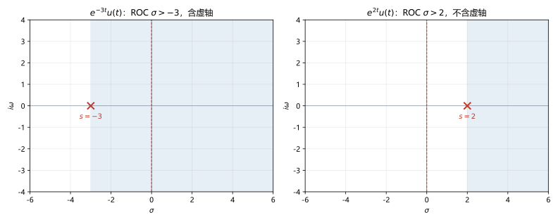

# 第 21 讲 拉普拉斯变换：定义与收敛域

> **前置**：第 18 讲（傅里叶变换的存在条件、绝对可积、频谱密度）、第 19 讲（性质表、对偶）、第 20 讲（$\delta$ 函数、冲激、抽样）。
> **预计时间**：约 4 小时（含作业；第 2 节的收敛域推导建议自己写一遍）。
>
> **一句话定位**：第 18、20 讲解决了“不衰减但不增长”的信号；这一讲用衰减因子 $e^{-\sigma t}$ 把增长信号也压成可积，得到拉普拉斯变换。代价是单边和收敛域。
>
> **本讲回答什么**：
> 1. $e^{2t}$、$t^2$ 这类增长信号没有傅里叶变换，$\delta$ 也救不了，怎么办？
> 2. 乘一个衰减因子为什么能救？$\sigma$ 的下界怎么定？
> 3. $s=\sigma+i\omega$ 里的 $\sigma$ 与 $\omega$ 各管什么？
> 4. 为什么用单边？为什么下限写 $0^-$？
> 5. 收敛域为什么是变换的一部分？拉普拉斯与傅里叶到底什么关系？
>
> **本讲目标（学完你能）**：
> 1. 说清“乘 $e^{-\sigma t}$”为什么能让增长信号可积，$\sigma$ 的下界怎么定；
> 2. 写出单边拉普拉斯的定义，解释 $0^-$ 与单边的理由；
> 3. 求常见信号的变换与收敛域，并说清 $(F,\mathrm{ROC})$ 为什么必须成对；
> 4. 判断什么时候能令 $s=i\omega$ 回到傅里叶变换，并举出不能的反例；
> 5. 对 $\delta$、阶跃、指数、$t^n$、正弦余弦，按定义算出变换并核对表值。
>
> **目标达成 = 末尾“掌握度自测”全部打勾。**
>
> **怎么学这一讲**：先抓住“乘 $e^{-\sigma t}$ 把增长压成可积”这一件事。$\sigma$ 是收敛横坐标，$\omega$ 是频率；$0^-$ 是为了把 $t=0$ 的冲激和初值收进来；ROC 必须和 $F(s)$ 成对，不能只看 $F(s)$。
>
> **这一讲有真实验证**：脚本 `scripts/lec21-01_verify_laplace.py`（增长信号的可积性、典型变换、ROC、$s=i\omega$ 边界），可复跑。

## 本讲怎么走（脉络图）

```text
增长信号：傅里叶积分发散
        │
        ▼
乘 e^{-σt} ──→ 可积（σ > σ0）
        │
        ▼
s = σ + iω ──→ 单边拉普拉斯
        │
        ▼
0^- 约定：把 t=0 的冲激/初值收进来
        │
        ▼
ROC：右半平面 σ > σ0
        │
        ▼
典型信号表 + (F, ROC) 必须成对
        │
        ▼
s = iω 回傅里叶的条件与反例
```

---
## 本讲要解决什么

第 18 讲给傅里叶变换定了存在条件：$\int\lvert f\rvert dt<\infty$。第 20 讲用 $\delta$ 把常数、余弦、周期信号这些"不衰减但不增长"的对象接进了频域。但还有一类信号两头都不占：$e^{2t}$、$t^2$、$e^{at}\cos\omega t$——它们在 $t\to\infty$ 时无界增长，绝对积分发散，普通傅里叶变换不存在；$\delta$ 是单位面积的集中对象，也压不住无界的增长。

这一讲换一个核：不只用 $e^{-i\omega t}$，而是用 $e^{-(\sigma+i\omega)t}$。指数里多出的实部 $e^{-\sigma t}$ 是一个可调的衰减因子；只要 $\sigma$ 足够大，增长也能被压成可积。把 $\sigma+i\omega$ 记作 $s$，得到的变换就是拉普拉斯变换。

代价有两个，必须当场记住：**它是单边的**（只积 $t\ge0$，下限写 $0^-$），**收敛域是变换的一部分**（同一个 $F(s)$ 配不同收敛域，可能对应不同信号）。好处在第 22、25 讲兑现：微分变成乘 $s$，初值自动进入，微分方程整体变成代数方程。

学完之后，你应该能做到：

- 说清"乘 $e^{-\sigma t}$"为什么能让增长信号可积，$\sigma$ 的下界怎么定；
- 写出单边拉普拉斯的定义，解释 $0^-$ 与单边的理由；
- 求常见信号的变换与收敛域，并说清 $(F,\mathrm{ROC})$ 为什么必须成对；
- 判断什么时候能令 $s=i\omega$ 回到傅里叶变换，并举出不能的反例；
- 对 $\delta$、阶跃、指数、$t^n$、正弦余弦，按定义算出变换并核对表值。

---

## 1. 增长信号与衰减因子

### 1.1 第 18 讲留下的缺口

第 18 讲 3.2 的存在条件要求 $\int_{-\infty}^{\infty}\lvert f(t)\rvert dt<\infty$。对 $f(t)=e^{2t}u(t)$：

$$\int_0^\infty e^{2t}dt=\infty,$$

对 $t^2u(t)$ 也一样。它们的傅里叶积分在无穷远处发散，没有普通意义下的变换。第 20 讲的 $\delta$ 也帮不上：$\delta$ 描述的是"面积为 $1$ 的集中"，而这里的问题是**幅度无界增长**，不是"没有面积"。

### 1.2 乘一个衰减因子

把被积函数乘上 $e^{-\sigma t}$（$\sigma$ 为实常数），再看积分：

$$\int_0^\infty e^{2t}\cdot e^{-\sigma t}dt=\int_0^\infty e^{(2-\sigma)t}dt.$$

这个积分在 $2-\sigma<0$，即 $\sigma>2$ 时收敛，值为 $\dfrac{1}{\sigma-2}$；$\sigma\le2$ 时发散。**同一个信号，换一个 $\sigma$，可积性就变了。**

一般地，若存在常数 $M$ 与 $\sigma_0$，使

$$\lvert f(t)\rvert\le Me^{\sigma_0 t}\qquad(t\ge0), \tag{21.1}$$

则对 $\sigma>\sigma_0$，

$$\left\lvert\int_0^\infty f(t)e^{-\sigma t}dt\right\rvert
\le M\int_0^\infty e^{-(\sigma-\sigma_0)t}dt=\frac{M}{\sigma-\sigma_0}<\infty.$$

积分绝对收敛。于是可以对这样的 $s=\sigma+i\omega$ 定义

$$F(\sigma+i\omega)=\int_0^\infty f(t)e^{-(\sigma+i\omega)t}dt.$$

把 $\sigma+i\omega$ 记作 $s$，写成

$$F(s)=\int_0^\infty f(t)e^{-st}dt. \tag{21.2}$$

这就是拉普拉斯变换的雏形：**傅里叶的核 $e^{-i\omega t}$ 乘上衰减因子 $e^{-\sigma t}$，合起来是 $e^{-st}$。**

**例 21.1** 求 $f(t)=e^{2t}u(t)$ 的拉普拉斯变换与收敛条件。

**解**：按 (21.2)，积分只在 $\sigma>2$ 时收敛：

$$F(s)=\int_0^\infty e^{2t}e^{-st}dt
=\int_0^\infty e^{-(s-2)t}dt
=\frac{1}{s-2},\qquad \operatorname{Re}s>2. \tag{21.3}$$

**数值核对**（EXP1）：$\sigma=3$ 时 $\int_0^{10}e^{(2-3)t}dt=0.999955$，与 $1/(3-2)=1$ 一致；$\sigma=2.5$ 时 $T=10$ 给 $1.986524$，仍在向 $2$ 收敛（时间常数 $1/(\sigma-2)=2$，$T=10$ 不够长）；$\sigma=1$ 时积分随 $T$ 爆炸：$T=5$ 给 $147.4$，$T=10$ 给 $22025.5$。

同一信号在第 18 讲没有傅里叶变换（$e^{2t}u$ 不绝对可积），在这里有了拉普拉斯变换，代价是必须声明 $\sigma>2$。

### 1.3 不是万能药

$\sigma$ 再大也救不了增长快于任何指数的信号。以 $e^{t^2}$ 为例：

$$\frac{e^{t^2}}{e^{\sigma t}}=e^{t(t-\sigma)}\longrightarrow\infty\qquad(t\to\infty),$$

无论取多大的 $\sigma$，被积函数最终都会爆炸，积分发散。所以 $e^{t^2}$ 没有拉普拉斯变换。

**深度**：$F(s)$ 的定义与常见表值要会算；收敛域的严格理论（绝对收敛与条件收敛的区分）、双边拉普拉斯、反演积分属于认识层，第 23 讲只用到部分。

**易错**：以为"有拉普拉斯变换"是普遍性质；把 $\sigma$ 当成一个固定常数，而不是"只要足够大"的一段区间。

---

**下一站**：衰减因子让增长信号可积；下一步把它写成单边定义，并说清 $0^-$ 与收敛域。

## 2. 单边定义、下限 $0^-$ 与收敛域

### 2.1 定义与两个约定

**定义 21.1（单边拉普拉斯变换）**

$$F(s)=\int_{0^-}^{\infty}f(t)e^{-st}dt,\qquad s=\sigma+i\omega. \tag{21.4}$$

两个约定各有理由：

- **单边**：电路换路、初值问题都从某个时刻（取 $0$）开始往后看，$t<0$ 的信息由初始条件单独给出，不需要再积一遍。单边变换只保留 $t\ge0$ 的部分。
- **下限 $0^-$**：$\delta(t)$ 集中在 $t=0$。若从 $0^+$ 积，$\delta$ 被整个漏掉；从 $0^-$ 积，它被完整收进：

$$\int_{0^-}^\infty\delta(t)e^{-st}dt=e^{-s\cdot0}=1. \tag{21.5}$$

**数值核对**（EXP3）：用宽 $\tau=10^{-3}$ 的单位面积矩形逼近 $\delta$，从 $0^+$ 积得 $0.487381-0.000237i$（只剩右半），从 $0^-$ 积得 $1.000112+0.000025i$。差的那一半正是 $0^-$ 与 $0^+$ 的区别。

### 2.2 收敛域：右半平面

由 (21.1) 的增长界，对 $\sigma>\sigma_0$ 积分绝对收敛。所有这样的 $s$ 组成**收敛域**（region of convergence，ROC）：

$$\mathrm{ROC}=\{s:\operatorname{Re}s>\sigma_0\}. \tag{21.6}$$

它是 $s$ 平面上的一个右半平面，边界 $\sigma=\sigma_0$ 通常不包括在内。

**边界为什么不算**：在 $\sigma=\sigma_0$ 上，$\lvert f(t)e^{-st}\rvert$ 不再衰减。以 $e^{-3t}u$ 为例，$\sigma=-3$ 时被积函数的模是 $1$，积分 $\int_0^T1\,dt=T$ 随 $T$ 线性增长（EXP5：$T=10$ 给 $10$，$T=100$ 给 $100$）。所以边界要单独讨论，通常发散。

### 2.3 三个基本例子

**例 21.2** 求下列信号的变换与收敛域：

（1）$f(t)=u(t)$；（2）$f(t)=e^{-3t}u(t)$；（3）$f(t)=\delta(t)$。

**解**：

（1）$\sigma>0$ 时

$$F(s)=\int_0^\infty e^{-st}dt
=\left[\frac{e^{-st}}{-s}\right]_0^\infty=\frac1s,
\qquad \operatorname{Re}s>0. \tag{21.7}$$

（2）$\sigma>-3$ 时

$$F(s)=\int_0^\infty e^{-(s+3)t}dt=\frac{1}{s+3},
\qquad \operatorname{Re}s>-3. \tag{21.8}$$

（3）用 (21.5)：$F(s)=1$，对一切 $s$ 成立（$\delta$ 没有增长，$\sigma_0$ 可看作 $-\infty$）。

**数值核对**（EXP2）：$u(t)$ 在 $\sigma=0.5,1,2,5$ 给 $2,1,0.5,0.2$，与 $1/\sigma$ 一致；$e^{-3t}u$ 在 $\sigma=-2,0,1$ 给 $1,0.333333,0.25$，与 $1/(\sigma+3)$ 一致。

### 2.4 图：含虚轴与不含虚轴



图 1 左：$e^{-3t}u$ 的极点在 $s=-3$，ROC 是 $\sigma>-3$ 的右半平面，虚轴 $\sigma=0$ 落在其中。右：$e^{2t}u$ 的极点在 $s=2$，ROC 是 $\sigma>2$，虚轴在 ROC 之外。这一差别决定了第 4 节"能不能令 $s=i\omega$"。

### 2.5 易错

- 只写 $F(s)$，不写 ROC。同一个 $F(s)$ 在不同 ROC 下可能对应不同信号（双边情形），单边口径下 ROC 也必须随信号给出。
- 把下限写成 $0^+$，$\delta$ 及 $0$ 处的冲激会被漏掉。
- 把边界 $\sigma=\sigma_0$ 当成收敛（多数情形发散）。

---

**下一站**：定义和 ROC 说清了；下一步逐条算典型信号，验证 $(F,\mathrm{ROC})$ 必须成对。

## 3. 典型信号表与唯一性

### 3.1 逐条由定义算

**(1) 常数 $1$（即 $u(t)$）**：$\sigma>0$ 时由 (21.7) 得 $1/s$。

**(2) 指数 $e^{at}$**：$\sigma>a$ 时

$$\int_0^\infty e^{at}e^{-st}dt=\int_0^\infty e^{-(s-a)t}dt=\frac{1}{s-a}. \tag{21.9}$$

**(3) 幂 $t^n$（$n$ 为非负整数）**：$\sigma>0$ 时，分部积分递推

$$\int_0^\infty t^ne^{-st}dt
=\frac{n}{s}\int_0^\infty t^{n-1}e^{-st}dt,$$

从 $\int_0^\infty e^{-st}dt=1/s$ 出发迭代 $n$ 次：

$$\int_0^\infty t^ne^{-st}dt=\frac{n!}{s^{n+1}}. \tag{21.10}$$

**(4) 正弦与余弦**：用欧拉公式拆成指数。对 $\sigma>0$，

$$\sin\omega t=\frac{e^{i\omega t}-e^{-i\omega t}}{2i}
\ \Longrightarrow\
\mathcal L[\sin\omega t]=\frac{1}{2i}\left(\frac{1}{s-i\omega}-\frac{1}{s+i\omega}\right)
=\frac{\omega}{s^2+\omega^2}, \tag{21.11}$$

$$\cos\omega t=\frac{e^{i\omega t}+e^{-i\omega t}}{2}
\ \Longrightarrow\
\mathcal L[\cos\omega t]=\frac{1}{2}\left(\frac{1}{s-i\omega}+\frac{1}{s+i\omega}\right)
=\frac{s}{s^2+\omega^2}. \tag{21.12}$$

**(5) $\delta(t)$**：由 (21.5) 得 $1$，ROC 为全平面。

### 3.2 表与收敛域

| $f(t)$ | $F(s)$ | ROC |
|---|---|---|
| $\delta(t)$ | $1$ | 全 $s$ |
| $u(t)$ | $\dfrac1s$ | $\operatorname{Re}s>0$ |
| $e^{at}u(t)$ | $\dfrac1{s-a}$ | $\operatorname{Re}s>a$ |
| $t^nu(t)$ | $\dfrac{n!}{s^{n+1}}$ | $\operatorname{Re}s>0$ |
| $\sin\omega t\,u(t)$ | $\dfrac{\omega}{s^2+\omega^2}$ | $\operatorname{Re}s>0$ |
| $\cos\omega t\,u(t)$ | $\dfrac{s}{s^2+\omega^2}$ | $\operatorname{Re}s>0$ |

每行都带自己的 ROC。两个信号相加时，ROC 取交集（至少）：例如 $3e^{-2t}u+2\sin5t\,u$，第一项要求 $\sigma>-2$，第二项要求 $\sigma>0$，合起来 $\sigma>0$。

### 3.3 唯一性与 $(F,\mathrm{ROC})$ 配对

单边、因果的口径下，一个 $F(s)$ 与它的 ROC 一起，唯一确定 $t\ge0$ 上的信号（相差零测集）。所以逆变换必须配 ROC；只给 $F(s)$ 而不给 ROC，在单边口径下虽然默认因果，但换到双边情形就不够。

一个认识层的对照：$F(s)=1/(s+1)$。若 ROC 取 $\sigma>-1$，对应 $e^{-t}u(t)$；若允许双边并取 ROC $\sigma<-1$，对应 $-e^{-t}u(-t)$。同一个代数式，ROC 不同，时域信号不同。本课程只做单边，逆变换在第 23 讲，唯一性按因果信号处理。

**例 21.3** 求 $f(t)=3e^{-2t}u(t)+2\sin5t\,u(t)$ 的变换与收敛域。

**解**：用线性与表：

$$F(s)=\frac{3}{s+2}+\frac{2\cdot5}{s^2+25}
=\frac{3}{s+2}+\frac{10}{s^2+25},
\qquad \operatorname{Re}s>0. \tag{21.13}$$

（第一项要求 $\sigma>-2$，第二项要求 $\sigma>0$，取交集。）

**数值核对**（EXP6）：$s=1+i$ 时数值积分给 $1.297456-0.331796i$，与上式逐位一致（差 $2.6\times10^{-9}$）。

### 3.4 易错

- $\sin$ 与 $\cos$ 的分子写反（$\sin$ 的分子是 $\omega$，$\cos$ 的是 $s$）。
- $t^n$ 漏 $n!$。
- 把 $\delta$ 的 ROC 写成 $\sigma>0$；它对全平面成立。
- 两个信号相加时，ROC 误取并集；应取交集。

---

**下一站**：典型信号表有了；下一步看什么时候能令 $s=i\omega$ 回到傅里叶变换，边界在哪。

## 4. 与傅里叶变换的关系

### 4.1 取 $s=i\omega$ 的条件

$s=\sigma+i\omega$。若 ROC 包含虚轴（即 $\sigma_0<0$），就可以取 $\sigma=0$：

$$F(i\omega)=\int_0^\infty f(t)e^{-i\omega t}dt. \tag{21.14}$$

对因果信号（$t<0$ 为零），右边就是傅里叶变换。所以：**拉普拉斯变换在虚轴上的取值，就是（因果信号的）傅里叶变换**，前提是虚轴落在 ROC 内。

**例 21.4** 比较 $e^{-3t}u(t)$ 与 $e^{2t}u(t)$。

**解**：$e^{-3t}u$ 的 ROC 是 $\sigma>-3$，包含虚轴。取 $s=i\omega$：

$$F(i\omega)=\frac{1}{3+i\omega},$$

与第 18 讲例 18.3 的傅里叶变换一致。**数值核对**（EXP4）：$\omega=1$ 时数值 $0.300000-0.100000i$，与 $1/(3+i)$ 一致（差 $2.6\times10^{-9}$）。

$e^{2t}u$ 的 ROC 是 $\sigma>2$，不含虚轴，不能取 $\sigma=0$。强行取 $\sigma=0$ 的积分随 $T$ 爆炸：$T=5$ 给 $1.1\times10^4$，$T=10$ 给 $2.4\times10^8$（EXP4）。这与第 18 讲"$e^{2t}u$ 没有傅里叶变换"是同一件事。

### 4.2 边界

- 非因果信号：单边拉普拉斯只积 $t\ge0$，取 $s=i\omega$ 不自动等于全轴傅里叶；别把单边结果套到双边问题。
- 双边拉普拉斯：认识层，本课程不展开；它才需要"同一 $F$ 配不同 ROC"的完整讨论。
- ROC 含虚轴是充分条件；边界 $\sigma_0=0$ 的情形要单独判断（通常没有普通傅里叶变换）。

### 4.3 易错

- 无条件令 $s=i\omega$，不看 ROC。
- 把"单边拉普拉斯取 $i\omega$"当成"任何信号的傅里叶变换"。
- 把 $e^{2t}u$ 的 $1/(s-2)$ 在 $s=i\omega$ 处代入，得到 $1/(i\omega-2)$ 并当作傅里叶变换——这个值没有对应的傅里叶积分。

---

**下一站**：与傅里叶的关系收尾；下一讲把性质表搬到拉普拉斯，处理时移、频移、微分、积分。

## 5. 本讲小结

| 概念 | 一句话 | 关键式子 / 条件 |
|---|---|---|
| 拉普拉斯的来由 | 傅里叶核乘衰减因子 | $e^{-st}=e^{-\sigma t}e^{-i\omega t}$ |
| 单边定义 | 只积 $t\ge0$，下限 $0^-$ | $F(s)=\int_{0^-}^\infty f e^{-st}dt$ |
| 收敛域 | 右半平面 $\operatorname{Re}s>\sigma_0$ | 由 $\lvert f\rvert\le Me^{\sigma_0t}$ 定；边界通常不算 |
| $\delta$ | $1$ | 全平面；依赖 $0^-$ |
| 阶跃 | $1/s$ | $\operatorname{Re}s>0$ |
| 指数 | $1/(s-a)$ | $\operatorname{Re}s>a$ |
| $t^n$ | $n!/s^{n+1}$ | $\operatorname{Re}s>0$ |
| 正弦 / 余弦 | $\omega/(s^2+\omega^2)$，$s/(s^2+\omega^2)$ | $\operatorname{Re}s>0$ |
| 唯一性 | $(F,\mathrm{ROC})$ 成对 | 单边口径下默认因果 |
| 与傅里叶的关系 | ROC 含虚轴时取 $s=i\omega$ | 否则不能代入 |

**三句话带走**：

1. 拉普拉斯变换是"乘了衰减因子的傅里叶变换"：$s=\sigma+i\omega$，$\sigma$ 负责把增长压成可积，$\omega$ 仍是频率。
2. 收敛域是变换的一部分：右半平面 $\sigma>\sigma_0$，由增长阶定；写 $F(s)$ 必须同时写 ROC。
3. 只有当 ROC 包含虚轴时，才能令 $s=i\omega$ 回到傅里叶；$e^{2t}u$ 就是不能的反例。

---

## 6. 掌握度自测

- [ ] 我能解释乘 $e^{-\sigma t}$ 为什么能让 $e^{2t}$ 可积，并算出 $\sigma$ 的下界。
- [ ] 我能写出单边定义，并说清单边与 $0^-$ 各自的理由。
- [ ] 我能用 $\delta$ 的数值实验说明 $0^+$ 会漏掉一半冲激。
- [ ] 我能由增长界推出 ROC 是右半平面，并说明边界为什么通常不算。
- [ ] 我能算出 $\delta$、$u$、$e^{at}$、$t^n$、$\sin$、$\cos$ 的变换与 ROC。
- [ ] 我能说清 $(F,\mathrm{ROC})$ 为什么必须成对。
- [ ] 我能判断什么时候能令 $s=i\omega$，并举出不能的反例。
- [ ] 我能用数值积分核对表值，并解释有限区间的收敛快慢。

---

## 作业

### 基础

**1.** 求 $\mathcal L[e^{-4t}u(t)]$ 与 $\mathcal L[2u(t)]$，写出各自的 ROC。

**参考答案：**

由表：$\mathcal L[e^{-4t}u]=\dfrac{1}{s+4}$，ROC $\operatorname{Re}s>-4$；$\mathcal L[2u]=\dfrac{2}{s}$，ROC $\operatorname{Re}s>0$。

---

**2.** 求 $\mathcal L[t^3]$ 与 $\mathcal L[t e^{-2t}u(t)]$，写出 ROC。

**参考答案：**

$t^3$：由 (21.10)，$n=3$，$\dfrac{3!}{s^4}=\dfrac{6}{s^4}$，ROC $\operatorname{Re}s>0$。

$te^{-2t}u$：按定义

$$\int_0^\infty t e^{-2t}e^{-st}dt=\int_0^\infty t e^{-(s+2)t}dt=\frac{1}{(s+2)^2},$$

ROC $\operatorname{Re}s>-2$。（这是 $t^n$ 表值在 $a=-2$ 处的平移版本，第 22 讲的 $s$ 域平移会给出一般规则。）

---

**3.** 求 $\mathcal L[\sin3t\,u(t)]$ 与 $\mathcal L[\cos3t\,u(t)]$，写出 ROC。

**参考答案：**

由 (21.11)(21.12)，$\omega=3$：

$$\mathcal L[\sin3t]=\frac{3}{s^2+9},\qquad
\mathcal L[\cos3t]=\frac{s}{s^2+9},\qquad \operatorname{Re}s>0.$$

---

**4.** 求 $\mathcal L[\delta(t-2)]$，写出 ROC。

**参考答案：**

下限 $0^-$ 覆盖 $t=2$，用筛选：

$$\int_{0^-}^\infty\delta(t-2)e^{-st}dt=e^{-2s}.$$

$\delta(t-2)$ 不增长，ROC 为全平面。

---

### 提高

**5.** 求 $\mathcal L[e^{3t}u(t)]$ 与它的 ROC；说明它为什么没有傅里叶变换；再说明 $e^{t^2}$ 为什么连拉普拉斯变换也没有。

**参考答案：**

$$\mathcal L[e^{3t}u]=\frac{1}{s-3},\qquad \operatorname{Re}s>3.$$

ROC 不含虚轴（$\sigma_0=3>0$），不能取 $s=i\omega$；按第 18 讲，$e^{3t}u$ 不绝对可积，傅里叶变换不存在。

$e^{t^2}$：对任意 $\sigma$，$\dfrac{e^{t^2}}{e^{\sigma t}}=e^{t(t-\sigma)}\to\infty$，被积函数最终爆炸，积分发散，故无拉普拉斯变换。

---

**6.** 求 $\mathcal L[3e^{-2t}u(t)+2\sin5t\,u(t)]$ 与 ROC，并用 $s=1+i$ 核对。

**参考答案：**

$$F(s)=\frac{3}{s+2}+\frac{10}{s^2+25}.$$

第一项 ROC $\sigma>-2$，第二项 $\sigma>0$；交集为 $\sigma>0$。

$s=1+i$：$\dfrac{3}{3+i}+\dfrac{10}{(1+i)^2+25}=1.297456-0.331797i$；数值积分给 $1.297456-0.331796i$，一致。

---

**7.** 设 $F(s)=\dfrac{1}{s+2}$。单边口径下它对应哪个信号、哪个 ROC？若允许双边并取 ROC $\sigma<-2$，又对应哪个信号？

**参考答案：**

单边（因果）：$f(t)=e^{-2t}u(t)$，ROC $\sigma>-2$。

双边、ROC $\sigma<-2$：$f(t)=-e^{-2t}u(-t)$。验证：$\int_{-\infty}^0(-e^{-2t})e^{-st}dt=-\int_{-\infty}^0e^{-(s+2)t}dt$，在 $\sigma<-2$ 时收敛为 $-\dfrac{1}{s+2}\cdot(-1)=\dfrac{1}{s+2}$。同一代数式，ROC 不同，信号不同。

---

**8.** 用定义（分部积分两次）证明 $\mathcal L[t^2]=\dfrac{2}{s^3}$，并写出 ROC。

**参考答案：**

$$\int_0^\infty t^2e^{-st}dt
=\left[-\frac{t^2e^{-st}}{s}\right]_0^\infty+\frac{2}{s}\int_0^\infty te^{-st}dt
=\frac{2}{s}\cdot\frac{1}{s^2}=\frac{2}{s^3},$$

其中用了 $\int_0^\infty te^{-st}dt=1/s^2$（同样分部积分一次），边界项在 $\sigma>0$ 时为零。ROC：$\sigma>0$。

---

### 综合

**9.** 设 $F_1(s)=\dfrac{1}{s-3}$，$F_2(s)=\dfrac{1}{s+3}$。分别写出对应的因果信号与 ROC，判断哪一个能取 $s=i\omega$ 得到傅里叶变换。

**参考答案：**

$F_1$：$f_1=e^{3t}u(t)$，ROC $\sigma>3$，不含虚轴，不能取 $s=i\omega$，傅里叶变换不存在。

$F_2$：$f_2=e^{-3t}u(t)$，ROC $\sigma>-3$，含虚轴，可以取 $s=i\omega$，得 $F_2(i\omega)=1/(3+i\omega)$，即傅里叶变换。

---

**10.** 求 $\mathcal L[e^{-2t}\cos3t\,u(t)]$ 在 $s=1+i$ 处的值，并与定义积分对照。

**参考答案：**

由 $s$ 域平移（或直接由表把 $s$ 换成 $s+2$）：

$$F(s)=\frac{s+2}{(s+2)^2+9}.$$

$s=1+i$：$s+2=3+i$，$(3+i)^2=8+6i$，分母 $17+6i$：

$$F(1+i)=\frac{3+i}{17+6i}
=\frac{(3+i)(17-6i)}{17^2+6^2}
=\frac{57-i}{325}\approx0.175385-0.003077i.$$

定义积分 $\int_0^\infty e^{-2t}\cos3t\,e^{-(1+i)t}dt$ 数值上给同一值（可仿 EXP3 的写法核对）。

---

**11.** 为什么单边拉普拉斯丢弃 $t<0$ 仍够用于电路与初值问题？初始条件靠什么保留下来？

**参考答案：**

电路换路后只关心 $t\ge0$ 的响应；$t<0$ 的历史被压缩成 $0^-$ 时刻的初值（电容电压、电感电流）。单边变换从 $0^-$ 开始积，$\delta$ 与 $0$ 处冲激被完整计入；第 22 讲的微分性质会把 $f(0^-)$、$f'(0^-)$ 自动带进 $s$ 域，所以不需要在时域另定常数。丢弃的是"$t<0$ 的波形细节"，保留的是"它对 $t\ge0$ 的全部影响"，即初值。

---

## 下一讲预告

定义会了，但每求一个变换就积一次分，太慢。第 22 讲把第 19 讲的性质表搬到 $s$ 域：时移、$s$ 域平移、尺度、时域微分与积分、$s$ 域微分、初值/终值定理。最重要的一条是时域微分：

$$\mathcal L[f']=sF(s)-f(0^-),$$

微分变成乘 $s$，初值自动出现。这是第 25 讲能把微分方程整体变成代数方程的原因。
