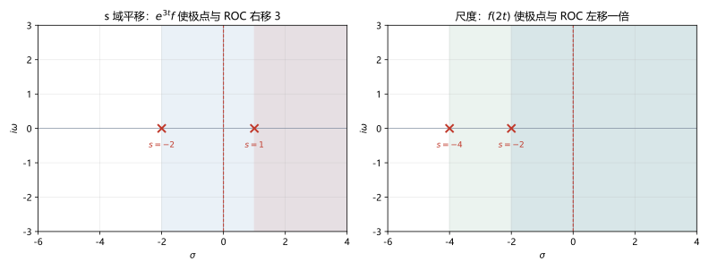

# 第 22 讲 拉普拉斯变换的性质

> **前置**：第 21 讲（单边定义、$0^-$、收敛域、典型表、$s=i\omega$ 的条件）。
> **预计时间**：约 4.5 小时（含作业；第 2、3 节的推导建议自己写一遍）。
> **本讲回答**：每求一个变换就积一次分，能不能像傅里叶那样查表？时移、乘指数、时间缩放各自把 $F(s)$ 变成什么、ROC 怎么动？微分为什么多出 $f(0^-)$，高阶为什么带一串初值？乘 $t$ 与卷积在 $s$ 域是什么？初值/终值定理怎么用，为什么 $\cos t$ 不能用终值？

## 本讲要解决什么

第 21 讲给了定义与六个基本变换，但每个新信号仍要按定义积分。实际遇到的信号是基本信号经过操作得到的：延迟、乘指数、压窄、求导、积分、乘 $t$、与另一个信号卷积。这些操作在 $s$ 域都有对应的代数动作，推出来就能查表，不必重积。

本讲按"哪条规则解决哪种运算"分五组：

1. 四个自变量变换：线性、时移、$s$ 域平移、尺度；
2. 微分与积分——初值如何自动进入；
3. $s$ 域微分与卷积定理；
4. 初值定理与终值定理（带条件）；
5. 性质表、使用顺序与 ROC 跟踪。

其中第 2 组是解微分方程的关键：$\mathcal L[f']=sF(s)-f(0^-)$，微分变成乘 $s$，初值自动出现。

学完之后，你应该能做到：

- 对延迟、乘指数、时间缩放，直接写出 $F(s)$ 与新的 ROC；
- 推出并记住一阶、二阶导数的变换，正确带入 $0^-$ 初值；
- 用 $s$ 域微分求乘 $t$ 的变换，用卷积定理把时域卷积变成乘法；
- 判断初值/终值定理的条件，识别 $\cos t$ 这类反例；
- 按固定顺序使用性质表，并逐步跟踪 ROC。

---

## 1. 线性、时移、s 域平移、尺度

### 1.1 线性与 ROC 的交集

$$\mathcal L[af+bg]=aF(s)+bG(s),\qquad
\mathrm{ROC}\supseteq \mathrm{ROC}(F)\cap\mathrm{ROC}(G). \tag{22.1}$$

推导只是把积分拆开。ROC 取交集（至少），因为两项都收敛时和才收敛；个别抵消可能让 ROC 变大，本课程不追这种例外。

### 1.2 时移：多一个 $e^{-st_0}$

**定理 22.1（时移）** 若 $t_0>0$，

$$\mathcal L[f(t-t_0)u(t-t_0)]=e^{-st_0}F(s),\qquad \mathrm{ROC}\ \text{不变}. \tag{22.2}$$

**证明**：单边积分从 $0^-$ 开始，$u(t-t_0)$ 把 $t<t_0$ 的部分切掉：

$$\int_{0^-}^{\infty}f(t-t_0)u(t-t_0)e^{-st}dt
=\int_{t_0}^{\infty}f(t-t_0)e^{-st}dt.$$

换元 $\tau=t-t_0$（$dt=d\tau$，下限变 $0$）：

$$=\int_0^\infty f(\tau)e^{-s(\tau+t_0)}d\tau
=e^{-st_0}\int_0^\infty f(\tau)e^{-s\tau}d\tau
=e^{-st_0}F(s).$$

**为什么必须带 $u(t-t_0)$**：若只写 $f(t-t_0)$，在 $0\le t<t_0$ 区间里 $t-t_0<0$，$f$ 的负半轴部分会被算进单边积分，结果多出一块。阶跃因子保证了"延迟后的信号在 $t_0$ 之前为零"。

**例 22.1** 求 $\mathcal L[u(t-2)]$。

**解**：$u(t)$ 的变换是 $1/s$（ROC $\sigma>0$），延迟 $2$：

$$\mathcal L[u(t-2)]=e^{-2s}\cdot\frac1s,\qquad \sigma>0. \tag{22.3}$$

**数值核对**（EXP1）：$s=0.5+i$ 时数值积分给 $-0.328854-0.011348i$，与 $e^{-2s}/s=-0.328846-0.011331i$ 差 $1.8\times10^{-5}$（跳变处的梯形误差）。

### 1.3 s 域平移：乘指数，$s$ 换成 $s-a$

**定理 22.2（$s$ 域平移）**

$$\mathcal L[e^{at}f(t)]=F(s-a),\qquad \mathrm{ROC}\ \text{平移}\ a. \tag{22.4}$$

**证明**：把两个指数合并：

$$\int_0^\infty e^{at}f(t)e^{-st}dt
=\int_0^\infty f(t)e^{-(s-a)t}dt=F(s-a).$$

ROC 也随之平移：若 $F$ 的 ROC 是 $\sigma>\sigma_0$，则 $F(s-a)$ 的 ROC 是 $\sigma-a>\sigma_0$，即 $\sigma>\sigma_0+a$。

**例 22.2（a）** 求 $\mathcal L[e^{-2t}\sin3t\,u(t)]$。

**解**：已知 $\mathcal L[\sin3t]=3/(s^2+9)$，ROC $\sigma>0$。乘 $e^{-2t}$ 把 $s$ 换成 $s+2$：

$$F(s)=\frac{3}{(s+2)^2+9},\qquad \sigma>-2. \tag{22.5}$$

**数值核对**（EXP2）：$s=0.5+i$ 时数值 $0.187449-0.065771i$，与上式一致（差 $2.5\times10^{-9}$）。

### 1.4 尺度：时间压窄，$s$ 放大

**定理 22.3（尺度）** 对 $a>0$，

$$\mathcal L[f(at)]=\frac1aF\!\left(\frac sa\right),\qquad
\mathrm{ROC}\ \text{按}\ a\ \text{缩放}. \tag{22.6}$$

**证明**：换元 $\tau=at$（$dt=d\tau/a$，$a>0$ 时上下限同向）：

$$\int_0^\infty f(at)e^{-st}dt
=\frac1a\int_0^\infty f(\tau)e^{-(s/a)\tau}d\tau
=\frac1aF\!\left(\frac sa\right).$$

若 $F$ 的 ROC 是 $\sigma>\sigma_0$，则 $F(s/a)$ 的 ROC 是 $\sigma/a>\sigma_0$，即 $\sigma>a\sigma_0$。时间压窄 $a$ 倍，极点与 ROC 都放大 $a$ 倍。

**例 22.2（b）** 设 $f(t)=e^{-2t}u(t)$，求 $\mathcal L[f(2t)]$。

**解**：$F(s)=1/(s+2)$，ROC $\sigma>-2$。$f(2t)=e^{-4t}u(t)$，按 (22.6)：

$$\frac12F\!\left(\frac s2\right)
=\frac12\cdot\frac{1}{s/2+2}=\frac{1}{s+4},\qquad \sigma>-4. \tag{22.7}$$

与按定义积分 $e^{-4t}u$ 得到的 $1/(s+4)$ 一致。

**数值核对**（EXP3）：$s=0.5+i$ 时数值 $0.211765-0.047059i$，与 $1/(s+4)$ 一致（差 $3.8\times10^{-9}$）。

**关于 $a<0$**：$a<0$ 会把 $t\ge0$ 映到 $\tau\le0$，单边积分对不上，需要双边拉普拉斯；本课程只处理 $a>0$。

### 1.5 图：ROC 怎么动

图 1 左：$F(s)=1/(s+2)$ 的极点在 $-2$、ROC 为 $\sigma>-2$；乘 $e^{3t}$ 后极点移到 $1$，ROC 右移到 $\sigma>1$。右：$f(t)=e^{-2t}u$ 的极点 $-2$；$f(2t)$ 的极点变为 $-4$，ROC 左移到 $\sigma>-4$。**每条性质都要把 ROC 一起搬。**

### 1.6 易错

- 时移忘乘 $u(t-t_0)$，把负半轴算进来。
- $s$ 域平移方向写反：乘 $e^{at}$ 是 $F(s-a)$，ROC 右移 $a$。
- 尺度漏 $1/a$；$a<0$ 直接套单边公式。

---

## 2. 时域微分与时域积分：初值怎么进来

### 2.1 一阶与高阶导数

**定理 22.4（时域微分）** 若 $f$ 在 $[0,\infty)$ 分段光滑、增长不过指数，

$$\mathcal L[f']=sF(s)-f(0^-). \tag{22.8}$$

**证明**：按定义分部积分。取 $u=e^{-st}$、$dv=f'dt$：

$$\int_{0^-}^{\infty}f'(t)e^{-st}dt
=\Big[f(t)e^{-st}\Big]_{0^-}^{\infty}
+s\int_{0^-}^{\infty}f(t)e^{-st}dt.$$

上界 $f(\infty)e^{-s\infty}=0$（增长不过指数），下界给 $-f(0^-)$，于是

$$=sF(s)-f(0^-).$$

**二阶**：对 $f'$ 再用一次 (22.8)：

$$\mathcal L[f'']=s\big[sF(s)-f(0^-)\big]-f'(0^-)
=s^2F(s)-sf(0^-)-f'(0^-). \tag{22.9}$$

每升一阶，多带一个低阶初值；$n$ 阶逐次套。

**为什么初值取 $0^-$**：$0^-$ 是换路前的值，冲激在 $0$ 处的作用已经包含在 $f(0^-)$ 与 $\delta$ 的分解里。取 $0^+$ 会把冲激造成的跳变漏掉。

### 2.2 积分：除以 $s$

**定理 22.5（时域积分）** 设 $g(t)=\int_0^tf(\tau)d\tau$，则

$$\mathcal L[g]=\frac{F(s)}{s},\qquad \mathrm{ROC}\ \text{还要加}\ \sigma>0. \tag{22.10}$$

**证明**：$g'=f$、$g(0^-)=0$。对 $g$ 用 (22.8)：$sG(s)-0=F(s)$，除过去得 $G=F/s$。多出的 $\sigma>0$ 来自 $1/s$ 这一因子。

### 2.3 带初值的例子

**例 22.3** 设

$$f(t)=\begin{cases}e^{-3t},&t\ge0,\\2,&t<0.\end{cases}$$

求 $F(s)$ 与 $\mathcal L[f']$。

**解**：单边积分只看 $t\ge0$：

$$F(s)=\int_0^\infty e^{-3t}e^{-st}dt=\frac{1}{s+3},\qquad \sigma>-3.$$

初值：$f(0^-)=2$、$f(0^+)=1$。按 (22.8)：

$$\mathcal L[f']=s\cdot\frac{1}{s+3}-2=\frac{s-2(s+3)}{s+3}=\frac{-s-6}{s+3}. \tag{22.11}$$

**独立核对**：$f'=-3e^{-3t}u(t)+(f(0^+)-f(0^-))\delta(t)=-3e^{-3t}u(t)-\delta(t)$，变换为

$$-\frac{3}{s+3}-1=\frac{-3-(s+3)}{s+3}=\frac{-s-6}{s+3},$$

与 (22.11) 一致。

**数值核对**（EXP4）：$s=0.5+i$ 时数值 $-1.792640+0.226365i$，与 (22.11) 的 $-1.792453+0.226415i$ 差 $1.9\times10^{-4}$（$\delta$ 用矩形近似的误差）。

### 2.4 易错

- 初值取 $0^+$；本例中 $f(0^+)=1$，代进去会得到错误结果。
- 二阶只写 $s^2F$，漏掉 $-sf(0^-)-f'(0^-)$。
- 积分性质忘写 $\sigma>0$。

---

## 3. s 域微分与卷积定理

### 3.1 乘 $t$：对 $s$ 求导

**定理 22.6（$s$ 域微分）**

$$\mathcal L[tf(t)]=-F'(s),\qquad \mathrm{ROC}\ \text{不变}. \tag{22.12}$$

**证明**：对 $F(s)=\int_0^\infty f(t)e^{-st}dt$ 关于 $s$ 求导（$\lvert tf\rvert$ 可积保证可在积分号下求导）：

$$F'(s)=\int_0^\infty f(t)(-t)e^{-st}dt=-\int_0^\infty tf(t)e^{-st}dt.$$

两边乘 $-1$ 即得 (22.12)。反复用：$\mathcal L[t^nf]=(-1)^nF^{(n)}(s)$。

**例 22.4** 求 $\mathcal L[t\sin3t]$。

**解**：$\mathcal L[\sin3t]=3/(s^2+9)$。求导：

$$\frac{d}{ds}\frac{3}{s^2+9}=-\frac{6s}{(s^2+9)^2},
\qquad
\mathcal L[t\sin3t]=\frac{6s}{(s^2+9)^2}. \tag{22.13}$$

**数值核对**（EXP5）：$s=0.5+i$ 时数值 $0.062937+0.073984i$，与上式差 $8.8\times10^{-17}$。

### 3.2 卷积：时域卷积变乘法

**定义 22.1（单边卷积）**

$$(f*g)(t)=\int_0^t f(\tau)g(t-\tau)d\tau\qquad(t\ge0). \tag{22.14}$$

积分上限是 $t$ 而不是 $\infty$：两个因果信号在 $\tau<0$ 或 $\tau>t$ 时至少一个为零。

**定理 22.7（卷积定理）**

$$\mathcal L[f*g]=F(s)G(s),\qquad \mathrm{ROC}\supseteq \mathrm{ROC}(F)\cap\mathrm{ROC}(G). \tag{22.15}$$

**证明**：按定义并把积分区域写成 $0\le\tau\le t<\infty$：

$$\mathcal L[f*g]=\int_0^\infty\left[\int_0^t f(\tau)g(t-\tau)d\tau\right]e^{-st}dt.$$

交换次序（区域是三角形 $0\le\tau\le t$，$\tau$ 从 $0$ 到 $\infty$，$t$ 从 $\tau$ 到 $\infty$）：

$$=\int_0^\infty f(\tau)\left[\int_\tau^\infty g(t-\tau)e^{-st}dt\right]d\tau.$$

内层换元 $u=t-\tau$（$t=u+\tau$，$dt=du$）：

$$\int_0^\infty g(u)e^{-s(u+\tau)}du=e^{-s\tau}G(s).$$

代回外层，$G(s)$ 与 $\tau$ 无关提出来：

$$=G(s)\int_0^\infty f(\tau)e^{-s\tau}d\tau=F(s)G(s).$$

**与傅里叶版的区别**：这里卷积是单边的（$0$ 到 $t$），所以 $F,G$ 是单边拉普拉斯；第 19 讲的傅里叶卷积是全轴，且对偶式带 $1/(2\pi)$。单边版本没有那个 $2\pi$，但要求两个信号都因果。

**例 22.5** 求 $e^{-2t}u(t)$ 与 $e^{-3t}u(t)$ 的卷积及其变换。

**解**：先算卷积：

$$\int_0^t e^{-2\tau}e^{-3(t-\tau)}d\tau
=e^{-3t}\int_0^t e^{\tau}d\tau
=e^{-3t}(e^t-1)=e^{-2t}-e^{-3t}\qquad(t\ge0).$$

变换：

$$\mathcal L[e^{-2t}-e^{-3t}]
=\frac{1}{s+2}-\frac{1}{s+3}
=\frac{1}{(s+2)(s+3)}=F(s)G(s). \tag{22.16}$$

**数值核对**（EXP6）：$s=0.5+i$ 时数值 $0.080677-0.062459i$，与 $1/((s+2)(s+3))$ 差 $8.3\times10^{-10}$。

### 3.3 易错

- 把单边卷积写成 $\int_{-\infty}^{\infty}$；两个因果信号这样做结果相同，但非因果信号会错。
- $s$ 域微分漏负号：是 $-F'$。
- 卷积定理写出后忘了 ROC 取交集。

---

## 4. 初值定理与终值定理（含条件）

### 4.1 初值定理

**定理 22.8（初值）** 若 $F(s)$ 为真分式、$f(0^+)$ 存在，则

$$f(0^+)=\lim_{s\to\infty}sF(s). \tag{22.17}$$

**证明**：对 $f'$ 用微分性质，起点取 $0^+$：

$$sF(s)-f(0^+)=\int_0^\infty f'(t)e^{-st}dt.$$

令 $s\to\infty$：被积函数含 $e^{-st}$，除 $t=0$ 附近外迅速衰减，右端趋于 $0$，于是 $sF(s)\to f(0^+)$。

### 4.2 终值定理

**定理 22.9（终值）** 若 $f(\infty)$ 存在，且 $sF(s)$ 的极点全在左半平面（原点最多一阶），则

$$f(\infty)=\lim_{s\to0}sF(s). \tag{22.18}$$

**证明**：把 (22.17) 的积分式令 $s\to0$：

$$\lim_{s\to0}\big[sF(s)-f(0^+)\big]
=\int_0^\infty f'(t)dt=f(\infty)-f(0^+).$$

移项得 (22.18)。条件的作用是保证 $\lim_{s\to0}sF(s)$ 与 $f(\infty)$ 都存在且相等；极点跑到虚轴或右半平面时，$f$ 根本不收敛或振荡。

### 4.3 正例与反例

**例 22.6**（a）$F(s)=\dfrac{1}{s(s+2)}$，求 $f(0^+)$ 与 $f(\infty)$；（b）$F(s)=\dfrac{s}{s^2+1}$，检验两个定理。

**解**：

（a）$sF(s)=\dfrac{1}{s+2}$。$s\to\infty$ 给 $0$，所以 $f(0^+)=0$；$s\to0$ 给 $1/2$，所以 $f(\infty)=1/2$。核对：$F=\dfrac{1/2}{s}-\dfrac{1/2}{s+2}$，逆变换 $f=\frac12(1-e^{-2t})$，$f(0^+)=0$、$f(\infty)=1/2$，一致。

（b）$sF(s)=\dfrac{s^2}{s^2+1}$。$s\to\infty$ 给 $1$，所以 $f(0^+)=1$（$\cos0=1$，初值定理成立）。$s\to0$ 给 $0$，但 $\cos t$ 在 $t\to\infty$ 没有极限——终值定理**不成立**。原因：$sF$ 的极点是 $\pm i$，落在虚轴上，不满足"全在左半平面"的条件。

### 4.4 易错

- 不查 $sF$ 的极点位置就套终值；$\cos t$、$\sin t$ 都会给出假的 0。
- 初值写成 $f(0^-)$；初值定理给的是 $0^+$。
- $F$ 不是真分式时先做多项式除法，否则 $sF\to\infty$。

---

## 5. 性质表与使用顺序

### 5.1 表

| 时域操作 | $s$ 域效果 | ROC |
|---|---|---|
| $af+bg$ | $aF+bG$ | $\supseteq$ 交集 |
| $f(t-t_0)u(t-t_0)$ | $e^{-st_0}F(s)$ | 不变 |
| $e^{at}f(t)$ | $F(s-a)$ | 平移 $a$ |
| $f(at)$，$a>0$ | $\frac1aF(s/a)$ | 缩放 $a$ |
| $f'$ | $sF-f(0^-)$ | $\supseteq$ |
| $f''$ | $s^2F-sf(0^-)-f'(0^-)$ | $\supseteq$ |
| $\int_0^t f$ | $F/s$ | 再加 $\sigma>0$ |
| $tf(t)$ | $-F'(s)$ | 不变 |
| $f*g$ | $FG$ | $\supseteq$ 交集 |
| 初值 | $\lim_{s\to\infty}sF$ | $F$ 真分式 |
| 终值 | $\lim_{s\to0}sF$ | $sF$ 极点全在左半平面 |

### 5.2 使用顺序

1. **拆**：把信号拆成表内项（阶跃、指数、三角、幂）；
2. **位移/尺度**：先用时移、$s$ 域平移、尺度，把参数对上；
3. **微分/积分**：遇到导数或积分，套 (22.8)–(22.10)，带入 $0^-$ 初值；
4. **整理**：合并成真分式（必要时先做多项式除法）；
5. **写 ROC**：每一步按表跟踪；
6. **校验**：用初值/终值、终值条件、$t=0$ 的跳变、或数值积分核对。

顺序不能乱：先平移后微分与先微分后平移，结果不同（时移与微分不对易）。

### 5.3 例：组合使用

**例 22.7** 求 $\mathcal L[e^{-2t}(t+\cos3t)u(t)]$。

**解**：先算括号内的变换：

$$\mathcal L[t+\cos3t]=\frac{1}{s^2}+\frac{s}{s^2+9},\qquad \sigma>0.$$

乘 $e^{-2t}$ 把 $s$ 换成 $s+2$：

$$F(s)=\frac{1}{(s+2)^2}+\frac{s+2}{(s+2)^2+9},\qquad \sigma>-2. \tag{22.19}$$

**数值核对**（EXP7）：$s=0.5+i$ 时数值 $0.278012-0.087452i$，与上式一致（差 $1.5\times10^{-9}$）。

### 5.4 易错

- 先微分后平移，或先平移后微分，顺序混用。
- 整理时不化真分式，初值定理直接失效。
- 只写 $F(s)$ 不写 ROC；每条性质都会动 ROC。

---

## 6. 本讲小结

| 性质 | 时域 → $s$ 域 | 关键点 |
|---|---|---|
| 线性 | $af+bg\to aF+bG$ | ROC 取交集 |
| 时移 | $f(t-t_0)u(t-t_0)\to e^{-st_0}F$ | 必须带阶跃；ROC 不变 |
| $s$ 域平移 | $e^{at}f\to F(s-a)$ | ROC 平移 $a$ |
| 尺度 | $f(at)\to\frac1aF(s/a)$ | $a>0$；ROC 缩放 |
| 微分 | $f'\to sF-f(0^-)$ | 高阶带全部低阶初值 |
| 积分 | $\int_0^tf\to F/s$ | ROC 加 $\sigma>0$ |
| $s$ 域微分 | $tf\to-F'$ | 负号 |
| 卷积 | $f*g\to FG$ | 单边、因果；ROC 交集 |
| 初值 | $f(0^+)=\lim_{s\to\infty}sF$ | $F$ 真分式 |
| 终值 | $f(\infty)=\lim_{s\to0}sF$ | $sF$ 极点全在左半平面 |

**三句话带走**：

1. 性质表把时域操作翻译成 $s$ 域代数：平移乘指数、缩放改 $s/a$、微分乘 $s$、卷积变乘法。
2. 微分性质带出 $f(0^-)$，这是拉普拉斯能解初值问题的根本原因；高阶逐项带全。
3. 初值/终值定理有前提：$F$ 真分式、$sF$ 极点全在左半平面；$\cos t$ 是终值的反例。

---

## 7. 掌握度自测

- [ ] 我能推出时移因子 $e^{-st_0}$，并说清为什么必须带 $u(t-t_0)$。
- [ ] 我能写出 $s$ 域平移与尺度，并说出 ROC 怎么动。
- [ ] 我能推出一阶、二阶导数的变换，正确带入 $0^-$ 初值。
- [ ] 我能用积分性质求 $\int_0^t f$ 的变换，并补上 $\sigma>0$。
- [ ] 我能用 $s$ 域微分求 $t\sin\omega t$ 这类变换。
- [ ] 我能用卷积定理算两个指数信号的卷积，并核对结果。
- [ ] 我能判断初值/终值定理的条件，举出 $\cos t$ 的反例。
- [ ] 我能按六步顺序使用性质表，并逐步跟踪 ROC。

---

## 作业

### 基础

**1.** 求 $\mathcal L[u(t-3)]$ 与 ROC。

**参考答案：**

由时移（$t_0=3$），$\mathcal L[u(t-3)]=e^{-3s}\cdot\dfrac1s$，ROC $\sigma>0$。

---

**2.** 求 $\mathcal L[e^{2t}u(t-1)]$ 与 ROC。

**参考答案：**

先把指数写成"延迟后的函数"：$e^{2t}=e^2\cdot e^{2(t-1)}$，于是

$$e^{2t}u(t-1)=e^2\cdot e^{2(t-1)}u(t-1).$$

$\mathcal L[e^{2t}u(t)]=\dfrac{1}{s-2}$，ROC $\sigma>2$。时移 $1$：

$$F(s)=e^2\cdot e^{-s}\cdot\frac{1}{s-2}=\frac{e^{2-s}}{s-2},\qquad \sigma>2.$$

---

**3.** 求 $\mathcal L[e^{-3t}\cos2t\,u(t)]$ 与 ROC。

**参考答案：**

$\mathcal L[\cos2t]=\dfrac{s}{s^2+4}$，ROC $\sigma>0$。$s$ 域平移 $a=-3$：

$$F(s)=\frac{s+3}{(s+3)^2+4},\qquad \sigma>-3.$$

---

**4.** 求 $\mathcal L[t^2e^{-t}u(t)]$ 与 ROC。

**参考答案：**

$\mathcal L[t^2]=\dfrac{2}{s^3}$，ROC $\sigma>0$。乘 $e^{-t}$ 把 $s$ 换成 $s+1$：

$$F(s)=\frac{2}{(s+1)^3},\qquad \sigma>-1.$$

---

### 提高

**5.** 设 $f(t)=u(t-1)$。用微分性质求 $\mathcal L[f']$，并与直接变换对照。

**参考答案：**

$f(0^-)=0$，$F(s)=e^{-s}/s$。按 (22.8)：

$$\mathcal L[f']=s\cdot\frac{e^{-s}}{s}-0=e^{-s}.$$

按分布意义，$f'=\delta(t-1)$，其变换为 $e^{-s}$，一致。

---

**6.** 求 $\mathcal L\left[\int_0^t e^{-2\tau}d\tau\right]$ 与 ROC。

**参考答案：**

内层变换 $\mathcal L[e^{-2t}]=\dfrac{1}{s+2}$，ROC $\sigma>-2$。积分性质除以 $s$：

$$F(s)=\frac{1}{s(s+2)},\qquad \sigma>0.$$

（RO 加 $\sigma>0$；也可先算出积分 $\frac12(1-e^{-2t})$ 再查表，结果相同。）

---

**7.** 求 $\mathcal L[t\cos3t]$。

**参考答案：**

$\mathcal L[\cos3t]=\dfrac{s}{s^2+9}$。$s$ 域微分：

$$\frac{d}{ds}\frac{s}{s^2+9}
=\frac{(s^2+9)-s\cdot2s}{(s^2+9)^2}
=\frac{9-s^2}{(s^2+9)^2},$$

$$\mathcal L[t\cos3t]=-\frac{9-s^2}{(s^2+9)^2}=\frac{s^2-9}{(s^2+9)^2}.$$

---

**8.** 求 $u(t)*u(t)$，并用卷积定理核对变换。

**参考答案：**

$$(u*u)(t)=\int_0^t1\cdot1\,d\tau=t\qquad(t\ge0).$$

$\mathcal L[t]=1/s^2$；另一方面 $F(s)G(s)=\dfrac1s\cdot\dfrac1s=\dfrac1{s^2}$，一致。

---

### 综合

**9.** 设 $F(s)=\dfrac{2s+3}{s(s+1)(s+2)}$。求 $f(0^+)$ 与 $f(\infty)$，并检查终值定理的条件。

**参考答案：**

$$sF(s)=\frac{2s+3}{(s+1)(s+2)}.$$

$s\to\infty$：分子次数低于分母，极限 $0$，所以 $f(0^+)=0$。

$s\to0$：$\dfrac{3}{1\cdot2}=\dfrac32$，所以 $f(\infty)=\dfrac32$。

条件：$sF$ 的极点是 $-1,-2$，全在左半平面；原点不是 $sF$ 的极点（已被约去），终值定理可用。

---

**10.** 设 $F(s)=\dfrac{1}{s^2+1}$。分别用初值、终值定理算，并与 $f(t)=\sin t$ 对照；说明哪个定理失效。

**参考答案：**

$sF(s)=\dfrac{s}{s^2+1}$。

$s\to\infty$：$\dfrac{s}{s^2+1}\to0$，所以 $f(0^+)=0$，与 $\sin0=0$ 一致，初值定理成立。

$s\to0$：$\dfrac{s}{s^2+1}\to0$，终值定理给出 $0$；但 $\sin t$ 在 $t\to\infty$ 没有极限。原因是 $sF$ 的极点 $\pm i$ 在虚轴上，不满足"全在左半平面"的条件，终值定理失效。

---

**11.** 用性质表六步顺序求 $\mathcal L[e^{-3t}(2t+\sin2t)u(t)]$，写出 ROC，并用 $s=0.5+i$ 核对。

**参考答案：**

1. 拆：括号内是 $2t$ 与 $\sin2t$。
2. 查表：$\mathcal L[2t]=\dfrac{2}{s^2}$，$\mathcal L[\sin2t]=\dfrac{2}{s^2+4}$，ROC $\sigma>0$。
3. 乘 $e^{-3t}$：$s$ 域平移，$s\to s+3$：

$$F(s)=\frac{2}{(s+3)^2}+\frac{2}{(s+3)^2+4},\qquad \sigma>-3.$$

4. 核对：$s=0.5+i$ 时，$s+3=3.5+i$，逐项算出后相加；定义积分数值上给同一值（可仿 EXP7 的写法核对，差在 $10^{-9}$ 量级）。

---

## 下一讲预告

变换与性质都有了，方向还差一半：给定 $F(s)$，怎么变回 $f(t)$？

第 23 讲做逆变换：反演公式（认识层）、部分分式（单实极点、共轭复极点、重极点）、留数法，以及"同一 $F(s)$ 配不同收敛域"在单边口径下如何收口。部分分式是主力，重极点的阶乘与导数阶数要对上。