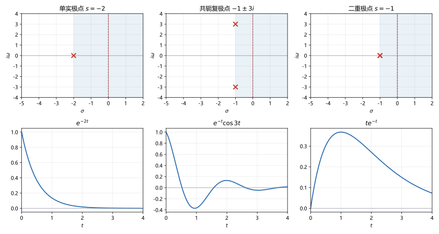

# 第 23 讲 拉普拉斯逆变换

> **前置**：第 21 讲（单边定义、收敛域、典型表）、第 22 讲（性质表、卷积定理、初值/终值）、第 14 讲（留数定理）。
> **预计时间**：约 5 小时（含作业；部分分式与重极点建议各手算两遍）。
> **本讲回答**：给定 $F(s)$，怎么系统地把 $f(t)$ 求出来？反演复积分真的要算吗？部分分式为什么能覆盖大多数情况？单实极点、共轭复极点、重极点各自怎么拆、怎么查表？留数法和部分分式哪个快？什么时候用卷积？单边逆变换为什么默认 $t<0$ 为零？

## 本讲要解决什么

第 21、22 讲把时域信号送进了 $s$ 域，也给了性质表。现在方向反过来：已知 $F(s)$，要找回 $f(t)$。这是第 25、26 讲解微分方程与电路的最后一环——方程在 $s$ 域解出 $F(s)$ 后，必须变回时域；第 24 讲先补方程本身的基础。

理论上，逆变换有反演公式：

$$f(t)=\frac1{2\pi i}\int_{\sigma-i\infty}^{\sigma+i\infty}F(s)e^{st}ds, \tag{23.1}$$

$\sigma$ 取在收敛域内。它是一个复积分，考试与工程手算都不走这条路；本讲把它标为认识层，只要求知道它存在、知道它和留数的关系。

手算的主线是部分分式：把有理函数 $F(s)$ 拆成表里已有的项，再逐项查表。按分母的极点类型分三种情况：

1. 单实极点：$A/(s-s_k)$，逆变换 $Ae^{s_kt}$；
2. 共轭复极点：配成 $e^{\alpha t}(B\cos\beta t+C\sin\beta t)$；
3. 重极点：出现 $t^{k-1}e^{s_0t}$，系数用导数公式。

另外两条替代路径：留数法（对每个极点取一次留数）与卷积求逆（$F=GH$ 时用 $f=g*h$）。最后说清单边口径下 $t<0$ 的约定。

学完之后，你应该能做到：

- 说清反演公式与收敛域的关系，知道它为什么不是手算主力；
- 把真分式拆成单实极点项，正确求出每个系数；
- 把共轭复极点配成阻尼正弦/余弦，不把 $\beta$ 漏在分子外；
- 对二重、三重极点用导数公式求系数，阶乘与阶数配对；
- 用留数法核对部分分式的结果；
- 对乘积形式的 $F(s)$ 用卷积求逆；
- 说清单边逆变换的 $t<0$ 约定与双边情形的差别。

---

## 1. 唯一性与反演公式（认识层）

### 1.1 反演公式长什么样

第 21 讲已经说明：单边口径下，$(F,\mathrm{ROC})$ 一起唯一确定因果信号。把这句话写成积分，就是 (23.1)。积分沿 $s$ 平面上的一条竖直线 $\operatorname{Re}s=\sigma$，$\sigma$ 必须落在 $F$ 的收敛域内；直线从 $\sigma-i\infty$ 到 $\sigma+i\infty$。

**为什么必须选在 ROC 内**：只有在这条线上，$F(s)$ 才有定义（积分收敛）；选到 ROC 外，$F$ 本身不存在，反演公式无从谈起。

**为什么 $t<0$ 时结果是零**：$t<0$ 时 $e^{st}$ 在右半平面衰减，可以把积分围线向右闭合；$F(s)$ 在右半平面没有极点（单边信号的 ROC 是右半平面，极点都在边界左侧），围线内无极点，积分为零。这就是"单边逆变换默认 $f(t)=0\ (t<0)$"的来源。

### 1.2 与留数的联系

若 $F(s)e^{st}$ 沿左半平面的大弧趋于零（约当引理的条件，第 14 讲），把 (23.1) 的竖线向左闭合，围线内只剩下 $F(s)e^{st}$ 的极点。留数定理给出

$$f(t)=\sum_k\operatorname{Res}\big[F(s)e^{st},\,s_k\big]\qquad(t>0). \tag{23.2}$$

这条式子是第 4 节留数法的依据。它说明：**逆变换可以逐极点读取**，每个极点贡献一个留数。

### 1.3 现在怎么对待它

反演公式与 (23.2) 属于**认识层**：知道它们存在、知道它们解释"为什么部分分式够了"即可，不要求用复积分手算。本讲的手算主线从第 2 节开始。

**易错**：把反演公式当成每题的必用工具；或者拿 $F(s)$ 直接查表，不管 ROC 与 $t<0$ 的约定。

---

## 2. 部分分式：单实极点与共轭复极点

### 2.1 先化真分式

部分分式的标准形式只对**真分式**成立：分子次数低于分母次数。若 $F=P/Q$ 是假分式（$\deg P\ge\deg Q$），先做多项式除法：

$$F(s)=P_0(s)+\frac{R(s)}{Q(s)},\qquad \deg R<\deg Q. \tag{23.3}$$

多项式部分 $P_0(s)$ 的逆变换是 $\delta(t)$ 及其导数（常数项给 $\delta$，$s$ 项给 $\delta'$）。$\delta'$ 不在本课程范围，所以本课程的题目默认 $F$ 为真分式；遇到假分式，至少要先除法，把真分式部分拆开。

### 2.2 单实极点：系数怎么来

设分母有互不相同的实根 $s_1,\dots,s_n$，且 $F$ 为真分式。部分分式写成

$$F(s)=\sum_{k=1}^n\frac{A_k}{s-s_k}. \tag{23.4}$$

求 $A_k$：两边同乘 $(s-s_k)$，

$$(s-s_k)F(s)=A_k+\sum_{j\ne k}A_j\frac{s-s_k}{s-s_j}.$$

令 $s\to s_k$：右边除 $A_k$ 外，每一项的分子趋于零，于是

$$A_k=\lim_{s\to s_k}(s-s_k)F(s). \tag{23.5}$$

对单实极点，这个极限就是代入 $s=s_k$（分母的 $(s-s_k)$ 已被约掉，不会再出零）。

逐项查表：$\mathcal L^{-1}\left[\dfrac{1}{s-s_k}\right]=e^{s_kt}$，所以

$$f(t)=\sum_{k=1}^nA_ke^{s_kt}\qquad(t\ge0). \tag{23.6}$$

**例 23.1** 求 $F(s)=\dfrac{3s+5}{(s+1)(s+2)}$ 的逆变换。

**解**：真分式，两个单实极点 $-1,-2$。设

$$\frac{3s+5}{(s+1)(s+2)}=\frac{A}{s+1}+\frac{B}{s+2}.$$

求 $A$：两边乘 $s+1$，令 $s=-1$：

$$A=\frac{3(-1)+5}{-1+2}=\frac{2}{1}=2.$$

求 $B$：两边乘 $s+2$，令 $s=-2$：

$$B=\frac{3(-2)+5}{-2+1}=\frac{-1}{-1}=1.$$

于是

$$F(s)=\frac{2}{s+1}+\frac{1}{s+2},\qquad
f(t)=2e^{-t}+e^{-2t}\quad(t\ge0). \tag{23.7}$$

**核对**（EXP1）：把 $f$ 在 $s=0.5+i$ 处做正变换，得 $1.267905-0.753316i$，与 $F(0.5+i)$ 一致（差 $5.2\times10^{-9}$）。

### 2.3 共轭复极点：配成阻尼正弦与余弦

设分母有一对共轭复根 $\alpha\pm i\beta$（$\beta>0$），对应二次因子

$$(s-\alpha)^2+\beta^2.$$

把这一项的分子写成 $B(s-\alpha)+C\beta$，于是

$$\frac{B(s-\alpha)+C\beta}{(s-\alpha)^2+\beta^2}
=B\frac{s-\alpha}{(s-\alpha)^2+\beta^2}
+C\frac{\beta}{(s-\alpha)^2+\beta^2}. \tag{23.8}$$

两个基本变换（第 21 讲表值加 $s$ 域平移）：

$$\mathcal L^{-1}\left[\frac{s-\alpha}{(s-\alpha)^2+\beta^2}\right]=e^{\alpha t}\cos\beta t,\qquad
\mathcal L^{-1}\left[\frac{\beta}{(s-\alpha)^2+\beta^2}\right]=e^{\alpha t}\sin\beta t. \tag{23.9}$$

所以这一对极点贡献

$$e^{\alpha t}\big(B\cos\beta t+C\sin\beta t\big). \tag{23.10}$$

**为什么分子要写成 $B(s-\alpha)+C\beta$**：如果只写常数分子，拆不出 $\cos$ 项；如果写 $Bs+C$ 而不配 $\beta$，$\sin$ 项的系数会差一个 $\beta$。按 (23.8) 的写法，$B$ 与 $C$ 就是时域里 $\cos$ 与 $\sin$ 的系数，不用再换算。

**例 23.2** 求 $F(s)=\dfrac{2s+5}{s^2+2s+5}$ 的逆变换。

**解**：分母配方：

$$s^2+2s+5=(s+1)^2+4,$$

所以 $\alpha=-1$、$\beta=2$。把分子写成 $B(s+1)+C\cdot2$：

$$2s+5=2(s+1)+3=2(s+1)+\frac32\cdot2.$$

因此 $B=2$、$C=\dfrac32$。按 (23.8)–(23.10)：

$$F(s)=2\frac{s+1}{(s+1)^2+4}+\frac32\frac{2}{(s+1)^2+4},$$

$$f(t)=e^{-t}\left(2\cos2t+\frac32\sin2t\right)\qquad(t\ge0). \tag{23.11}$$

**核对**（EXP2）：正变换在 $s=0.5+i$ 处给 $1.025641-0.205128i$，与 $F(0.5+i)$ 一致（差 $1.7\times10^{-9}$）。

### 2.4 图：极点位置决定时域形态

图 1 上排是 $s$ 平面的极点，下排是对应的时域响应：

- 左：单实极点 $s=-2$，响应 $e^{-2t}$，单调衰减；
- 中：共轭复极点 $-1\pm3i$，响应 $e^{-t}\cos3t$，指数衰减包络乘振荡；
- 右：二重极点 $s=-1$，响应 $te^{-t}$，先从零升上去再衰减。

**读图要点**：极点的实部决定衰减快慢（越靠左衰减越快），虚部决定振荡频率；重极点会多出 $t$ 的因子。这张图在第 26 讲判断稳定性时还会用到。

### 2.5 易错

- 不先化真分式，直接对假分式设部分分式，次数对不上。
- 共轭极点只写常数分子，拆不出 $\cos$ 项。
- 把 $\beta$ 留在分母外：$\dfrac{1}{(s-\alpha)^2+\beta^2}$ 的逆变换是 $\dfrac1\beta e^{\alpha t}\sin\beta t$，不是 $e^{\alpha t}\sin\beta t$。
- 求系数时忘记先乘 $(s-s_k)$ 再令 $s=s_k$，直接代入会得到 $0/0$。

---

## 3. 重极点

### 3.1 系数公式怎么推

设 $s_0$ 是 $m$ 阶极点。把 $F$ 在 $s_0$ 附近写成

$$F(s)=\sum_{k=1}^m\frac{A_k}{(s-s_0)^k}+G(s), \tag{23.12}$$

其中 $G(s)$ 在 $s_0$ 解析（不含负幂项）。两边乘 $(s-s_0)^m$：

$$H(s)=(s-s_0)^mF(s)=\sum_{k=1}^mA_k(s-s_0)^{m-k}+(s-s_0)^mG(s). \tag{23.13}$$

右边第一项是 $A_m+A_{m-1}(s-s_0)+\cdots+A_1(s-s_0)^{m-1}$。要取出 $A_k$，看它对应的幂次 $m-k$：对 $H$ 求 $m-k$ 阶导，其他幂次的项要么降为零，要么仍含 $(s-s_0)$；令 $s=s_0$，只剩

$$A_k=\frac1{(m-k)!}\frac{d^{m-k}}{ds^{m-k}}\Big[(s-s_0)^mF(s)\Big]_{s=s_0}. \tag{23.14}$$

**逐项查表**：第 21 讲给出 $\mathcal L[t^n]=n!/s^{n+1}$。乘 $e^{s_0t}$ 把 $s$ 换成 $s-s_0$（$s$ 域平移）：

$$\mathcal L\left[\frac{t^{k-1}}{(k-1)!}e^{s_0t}\right]=\frac{1}{(s-s_0)^k}. \tag{23.15}$$

所以

$$\mathcal L^{-1}\left[\frac{A_k}{(s-s_0)^k}\right]=A_k\frac{t^{k-1}}{(k-1)!}e^{s_0t}. \tag{23.16}$$

**为什么重极点会多出 $t$ 的幂**：分母的幂次越高，对应的时域就是 $t$ 的越高次幂乘指数；这是 (23.15) 的直接结果，不是额外规则。

### 3.2 二重极点

**例 23.3** 求 $F(s)=\dfrac{s+3}{(s+1)^2}$ 的逆变换。

**解**：$s_0=-1$，$m=2$。设

$$F(s)=\frac{A_1}{s+1}+\frac{A_2}{(s+1)^2}.$$

按 (23.14)：

$$A_2=(s+1)^2F(s)\Big|_{s=-1}=(s+3)\Big|_{s=-1}=2.$$

$$A_1=\frac1{1!}\frac{d}{ds}\Big[(s+1)^2F(s)\Big]_{s=-1}
=\frac{d}{ds}(s+3)\Big|_{s=-1}=1.$$

于是

$$F(s)=\frac{1}{s+1}+\frac{2}{(s+1)^2},\qquad
f(t)=e^{-t}+2te^{-t}\quad(t\ge0). \tag{23.17}$$

**核对**（EXP3）：正变换在 $s=0.5+i$ 处给 $0.698225-0.875740i$，与 $F(0.5+i)$ 一致（差 $9.3\times10^{-10}$）。

### 3.3 三重极点

**例 23.4** 求 $F(s)=\dfrac{1}{(s+1)^3}$ 的逆变换。

**解**：$s_0=-1$，$m=3$。设

$$F(s)=\frac{A_1}{s+1}+\frac{A_2}{(s+1)^2}+\frac{A_3}{(s+1)^3}.$$

按 (23.14)：

$$A_3=(s+1)^3F(s)\Big|_{s=-1}=1;$$

$$A_2=\frac1{1!}\frac{d}{ds}\Big[(s+1)^3F(s)\Big]_{s=-1}
=\frac{d}{ds}(1)\Big|_{s=-1}=0;$$

$$A_1=\frac1{2!}\frac{d^2}{ds^2}\Big[(s+1)^3F(s)\Big]_{s=-1}
=\frac12\frac{d^2}{ds^2}(1)\Big|_{s=-1}=0.$$

所以只有 $A_3=1$：

$$f(t)=\frac{t^{2}}{2!}e^{-t}=\frac{t^2}{2}e^{-t}\quad(t\ge0). \tag{23.18}$$

**核对**（EXP3）：正变换在 $s=0.5+i$ 处给 $-0.032772-0.167501i$，与 $1/(s+1)^3$ 一致（差 $2.8\times10^{-17}$）。

### 3.4 易错

- 阶乘配错：$A_k$ 对应的是 $\dfrac{t^{k-1}}{(k-1)!}$，不是 $\dfrac{t^k}{k!}$。
- 导数阶数配错：求 $A_k$ 时求的是 $m-k$ 阶导，不是 $k$ 阶。
- 分子在 $s_0$ 处有零点时，先约分再判断阶数；否则会把可去奇点当成极点。
- 忘记乘 $e^{s_0t}$，只写 $t$ 的幂。

---

## 4. 留数法求逆变换

### 4.1 留数是什么

第 14 讲定义：$f$ 在孤立奇点 $z_0$ 的留数，是洛朗展开中 $(z-z_0)^{-1}$ 项的系数 $a_{-1}$，记作 $\operatorname{Res}[f,z_0]$。对一阶极点，

$$\operatorname{Res}[f,z_0]=\lim_{z\to z_0}(z-z_0)f(z). \tag{23.19}$$

对 $m$ 阶极点，

$$\operatorname{Res}[f,z_0]=\frac1{(m-1)!}\lim_{z\to z_0}\frac{d^{m-1}}{dz^{m-1}}\Big[(z-z_0)^mf(z)\Big]. \tag{23.20}$$

### 4.2 为什么逆变换等于留数之和

把 (23.2) 重说一遍：$t>0$ 时，把反演积分向左闭合，围线内只有 $F(s)e^{st}$ 的极点，留数定理给出

$$f(t)=\sum_k\operatorname{Res}\big[F(s)e^{st},s_k\big]. \tag{23.21}$$

对一阶极点 $s_k$：

$$\operatorname{Res}\big[F(s)e^{st},s_k\big]
=\lim_{s\to s_k}(s-s_k)F(s)e^{st}
=A_ke^{s_kt}, \tag{23.22}$$

其中 $A_k$ 正是部分分式的系数。所以留数法与部分分式法给出同一结果；区别只在于计算路径。

**条件**：$F(s)e^{st}$ 沿大弧趋于零（约当引理）；极点都在所选竖线左侧。极点全在左半平面时最稳。

### 4.3 例子

**例 23.5** 用留数法求 $F(s)=\dfrac{s}{(s+1)(s+2)}$ 的逆变换。

**解**：$F(s)e^{st}$ 的极点是一阶的 $-1,-2$。

在 $s=-1$：

$$\operatorname{Res}=\lim_{s\to-1}(s+1)\frac{s}{(s+1)(s+2)}e^{st}
=\frac{-1}{-1+2}e^{-t}=-e^{-t}.$$

在 $s=-2$：

$$\operatorname{Res}=\lim_{s\to-2}(s+2)\frac{s}{(s+1)(s+2)}e^{st}
=\frac{-2}{-2+1}e^{-2t}=2e^{-2t}.$$

相加：

$$f(t)=-e^{-t}+2e^{-2t}\quad(t>0). \tag{23.23}$$

**部分分式对照**：

$$\frac{s}{(s+1)(s+2)}=\frac{-1}{s+1}+\frac{2}{s+2},$$

逆变换与 (23.23) 一致。**核对**（EXP4）：正变换在 $s=0.5+i$ 处给 $0.228117+0.031830i$，与 $F(0.5+i)$ 一致（差 $3.0\times10^{-9}$）。

### 4.4 什么时候用留数

- 极点少、尤其重极点时，留数法只需对每个极点取一次极限/导数，不必把所有系数都拆出来；
- 需要核对部分分式结果时，留数法是一条独立路径；
- 极点很多、且都是一阶时，部分分式更直观，留数法优势不明显。

### 4.5 易错

- 忘记先乘 $e^{st}$：对 $F(s)$ 取留数得到的是部分分式系数，不是时域项。
- 对非真分式直接用：多项式部分不满足大弧衰减，必须先除法。
- 重极点用一阶公式，或导数阶数写成 $m$ 而不是 $m-1$。

---

## 5. 卷积求逆（提高档）

### 5.1 把卷积定理反过来用

第 22 讲已经证明：两个因果信号 $g,h$ 的卷积，变换等于 $G(s)H(s)$。反过来，若

$$F(s)=G(s)H(s),$$

且 $g=\mathcal L^{-1}[G]$、$h=\mathcal L^{-1}[H]$ 都已知，则

$$f(t)=(g*h)(t)=\int_0^t g(\tau)h(t-\tau)d\tau\qquad(t\ge0). \tag{23.24}$$

这条路径不拆部分分式，直接做时域卷积；适合 $F$ 已经是两个熟悉变换的乘积的情形。

### 5.2 例子

**例 23.6** 求 $F(s)=\dfrac{1}{(s+2)(s+3)}$ 的逆变换，用卷积法。

**解**：取

$$G(s)=\frac{1}{s+2}\ \longleftrightarrow\ g(t)=e^{-2t},\qquad
H(s)=\frac{1}{s+3}\ \longleftrightarrow\ h(t)=e^{-3t}.$$

按 (23.24)：

$$f(t)=\int_0^t e^{-2\tau}e^{-3(t-\tau)}d\tau
=e^{-3t}\int_0^t e^{\tau}d\tau
=e^{-3t}(e^t-1)=e^{-2t}-e^{-3t}. \tag{23.25}$$

**部分分式对照**：

$$\frac{1}{(s+2)(s+3)}=\frac{1}{s+2}-\frac{1}{s+3},$$

逆变换同样是 $e^{-2t}-e^{-3t}$。**核对**（EXP5）：正变换在 $s=0.5+i$ 处给 $0.080677-0.062459i$，与 $F(0.5+i)$ 一致（差 $8.3\times10^{-10}$）。

### 5.3 什么时候用卷积

- $F$ 已是两个（或多个）已知变换的乘积，且因式对应的时域函数简单；
- 不想拆部分分式，或拆开后项数很多；
- 需要把结果写成卷积形式（例如系统响应 $y=h*x$）。

若乘积中的因式不是表内已知变换，先做部分分式更稳。

### 5.4 易错

- 把 $F=GH$ 误当成 $f=gh$（乘法而不是卷积）。
- 卷积限写成 $-\infty$ 到 $\infty$；两个因果信号的单边卷积是 $0$ 到 $t$。
- 卷积后不整理，保留积分形式却声称已经求出。

---

## 6. 逆变换结果的口径

### 6.1 单边：默认 $t<0$ 为零

单边拉普拉斯只积 $t\ge0$，所以逆变换得到的只是 $t\ge0$ 上的那一段。本课程约定

$$f(t)=0\quad(t<0),$$

结果可以写成 $f(t)u(t)$，或注明 $t\ge0$。在这个口径下，同一个 $F(s)$ 只对应一个因果信号，逆变换唯一。

### 6.2 双边：同一个 $F$，不同 ROC，不同信号

若允许双边拉普拉斯，同一个代数式可以配不同 ROC，对应不同信号。第 21 讲的例子：

$$F(s)=\frac{1}{s+1}.$$

- ROC 取 $\sigma>-1$：$f(t)=e^{-t}u(t)$；
- ROC 取 $\sigma<-1$：$f(t)=-e^{-t}u(-t)$。

两者在 $t\ge0$ 上不同（一个衰减，一个为零），所以**只给 $F(s)$ 不给 ROC，在双边口径下不足以定信号**。本课程只做单边，遇到双边只作这一句对照。

### 6.3 易错

- 把单边结果套到双边问题，忽略 $t<0$ 的约定。
- 结果不写适用范围，读者不知道 $t<0$ 时取零。
- 认为"逆变换一定唯一"，不区分单边与双边。

---

## 7. 本讲小结

| 分母情形 | 部分分式形态 | 逆变换 |
|---|---|---|
| 单实极点 $s_k$ | $\dfrac{A_k}{s-s_k}$ | $A_ke^{s_kt}$ |
| 共轭复极点 $\alpha\pm i\beta$ | $\dfrac{B(s-\alpha)+C\beta}{(s-\alpha)^2+\beta^2}$ | $e^{\alpha t}(B\cos\beta t+C\sin\beta t)$ |
| $m$ 重极点 $s_0$ | $\sum_{k=1}^m\dfrac{A_k}{(s-s_0)^k}$ | $\sum A_k\dfrac{t^{k-1}}{(k-1)!}e^{s_0t}$ |
| 假分式的多项式部分 | $P_0(s)$ | $\delta$ 及其导数（认识层） |
| 乘积 $F=GH$ | 不拆 | $f=g*h$ |

**三句话带走**：

1. 有理函数的逆变换走部分分式加查表：单实极点给指数，共轭复极点给阻尼正弦/余弦，重极点给 $t$ 的幂乘指数。
2. 反演复积分是认识层；留数法 $f=\sum\operatorname{Res}[F(s)e^{st},s_k]$ 是它的留数版本，与部分分式同值。
3. 单边逆变换默认 $t<0$ 为零；双边才需要 ROC 区分，同一个 $F$ 可以对应不同信号。

---

## 8. 掌握度自测

- [ ] 我能写出反演公式，并说清 $\sigma$ 为什么必须在 ROC 内。
- [ ] 我能把真分式拆成单实极点项，并用乘因子取极限求系数。
- [ ] 我能把共轭复极点配成 $B(s-\alpha)+C\beta$，写出阻尼正弦/余弦。
- [ ] 我能用导数公式求二重、三重极点的系数，阶乘与阶数不错配。
- [ ] 我能用留数法核对部分分式的结果，记得先乘 $e^{st}$。
- [ ] 我能对乘积形式的 $F$ 用卷积求逆，并整理结果。
- [ ] 我能说清单边与双边逆变换的区别，举出 $1/(s+1)$ 的两个 ROC。
- [ ] 我能判断什么时候必须先做多项式除法。

---

## 作业

### 基础

**1.** 求 $F(s)=\dfrac{s+3}{(s+1)(s+2)}$ 的逆变换。

**参考答案：**

设 $\dfrac{s+3}{(s+1)(s+2)}=\dfrac{A}{s+1}+\dfrac{B}{s+2}$。

$A=\dfrac{-1+3}{-1+2}=2$；$B=\dfrac{-2+3}{-2+1}=-1$。

$$f(t)=2e^{-t}-e^{-2t}\qquad(t\ge0).$$

---

**2.** 求 $F(s)=\dfrac{2s+1}{s(s+2)}$ 的逆变换。

**参考答案：**

设 $\dfrac{2s+1}{s(s+2)}=\dfrac{A}{s}+\dfrac{B}{s+2}$。

$A=\dfrac{2\cdot0+1}{0+2}=\dfrac12$；$B=\dfrac{2(-2)+1}{-2}=\dfrac{3}{2}$。

$$f(t)=\frac12+\frac32e^{-2t}\qquad(t\ge0).$$

---

**3.** 求 $F(s)=\dfrac{s+1}{s^2+2s+5}$ 的逆变换。

**参考答案：**

分母配方：$s^2+2s+5=(s+1)^2+4$，$\alpha=-1$、$\beta=2$。分子正好是 $s+1$，所以

$$F(s)=\frac{s+1}{(s+1)^2+4},\qquad f(t)=e^{-t}\cos2t\qquad(t\ge0).$$

---

**4.** 求 $F(s)=\dfrac{3s+4}{s^2+4s+13}$ 的逆变换。

**参考答案：**

分母配方：$s^2+4s+13=(s+2)^2+9$，$\alpha=-2$、$\beta=3$。把分子写成 $3(s+2)-2$：

$$F(s)=3\frac{s+2}{(s+2)^2+9}-\frac23\frac{3}{(s+2)^2+9}.$$

$$f(t)=3e^{-2t}\cos3t-\frac23e^{-2t}\sin3t\qquad(t\ge0).$$

---

### 提高

**5.** 求 $F(s)=\dfrac{1}{(s+2)^2}$ 的逆变换。

**参考答案：**

这是 $m=2$、$s_0=-2$ 的重极点，且分子只有 $(s+2)^{-2}$ 项：

$$f(t)=\frac{t^{2-1}}{(2-1)!}e^{-2t}=te^{-2t}\qquad(t\ge0).$$

---

**6.** 求 $F(s)=\dfrac{s+4}{(s+2)^2}$ 的逆变换。

**参考答案：**

先把分子拆成 $(s+2)+2$：

$$F(s)=\frac{s+2}{(s+2)^2}+\frac{2}{(s+2)^2}=\frac{1}{s+2}+\frac{2}{(s+2)^2}.$$

$$f(t)=e^{-2t}+2te^{-2t}\qquad(t\ge0).$$

---

**7.** 求 $F(s)=\dfrac{1}{(s+1)^3}$ 的逆变换。

**参考答案：**

$m=3$、$s_0=-1$，只有最高次项非零：

$$f(t)=\frac{t^{3-1}}{(3-1)!}e^{-t}=\frac{t^2}{2}e^{-t}\qquad(t\ge0).$$

---

**8.** 用留数法求 $F(s)=\dfrac{1}{(s+1)(s+3)}$ 的逆变换。

**参考答案：**

$F(s)e^{st}$ 的极点是一阶的 $-1,-3$。

在 $s=-1$：$\operatorname{Res}=\dfrac{1}{-1+3}e^{-t}=\dfrac12e^{-t}$。

在 $s=-3$：$\operatorname{Res}=\dfrac{1}{-3+1}e^{-3t}=-\dfrac12e^{-3t}$。

$$f(t)=\frac12\left(e^{-t}-e^{-3t}\right)\qquad(t>0).$$

---

**9.** 用卷积法求 $F(s)=\dfrac{1}{(s+1)(s+4)}$ 的逆变换。

**参考答案：**

$G(s)=\dfrac{1}{s+1}\leftrightarrow g=e^{-t}$，$H(s)=\dfrac{1}{s+4}\leftrightarrow h=e^{-4t}$。

$$f(t)=\int_0^t e^{-\tau}e^{-4(t-\tau)}d\tau
=e^{-4t}\int_0^t e^{3\tau}d\tau
=e^{-4t}\frac{e^{3t}-1}{3}
=\frac13\left(e^{-t}-e^{-4t}\right).$$

---

### 综合

**10.** 求 $F(s)=\dfrac{2s^2+3s+3}{s(s+1)}$ 的逆变换，说明为什么必须先做多项式除法。

**参考答案：**

分子次数等于分母次数（都是 $2$），是假分式。做除法：

$$\frac{2s^2+3s+3}{s^2+s}=2+\frac{s+3}{s^2+s}.$$

再拆真分式：

$$\frac{s+3}{s(s+1)}=\frac{3}{s}-\frac{2}{s+1}.$$

（$A=\dfrac{0+3}{0+1}=3$，$B=\dfrac{-1+3}{-1}=-2$。）

$$F(s)=2+\frac{3}{s}-\frac{2}{s+1},$$

$$f(t)=2\delta(t)+3-2e^{-t}\qquad(t\ge0).$$

必须先除法，是因为部分分式的系数公式只对真分式成立；不除，$s\to\infty$ 时 $F$ 不趋于零，留数法的大弧条件也不满足。

---

**11.** 说明单边拉普拉斯逆变换为什么默认 $t<0$ 时为零；再用 $F(s)=\dfrac{1}{s+1}$ 说明双边情形为什么必须给 ROC。

**参考答案：**

单边变换只积 $t\ge0$，$t<0$ 的信息从未进入 $F(s)$；反演时把围线向右闭合，右半平面没有极点，积分为零，所以默认 $f(t)=0\ (t<0)$。在这个口径下，$F$ 与因果信号一一对应，逆变换唯一。

双边情形：$F(s)=\dfrac{1}{s+1}$ 的极点在 $-1$。

- ROC 取 $\sigma>-1$：$f(t)=e^{-t}u(t)$；
- ROC 取 $\sigma<-1$：$f(t)=-e^{-t}u(-t)$。

两个信号在 $t\ge0$ 上不同，却给出同一个代数式，所以只给 $F(s)$ 不给 ROC 无法定信号。

---

## 下一讲预告

逆变换会了，接下来把它用于方程。第 24 讲先补常微分方程的最小基础：阶、通解、初值问题、一阶线性方程与积分因子、二阶常系数齐次方程的特征根三种情形。这些是第 25 讲"用拉普拉斯解微分方程"和经典法对照的地基；如果这部分生疏，第 25 讲的 $s$ 域解法会变成纯记步骤。

第 25 讲的主线是：方程 → 逐项变换（初值自动进入）→ 解出 $F(s)$ → 部分分式 → 逆变换。第 26 讲再把同样的流程搬到电路，给出 $s$ 域元件模型与传递函数。