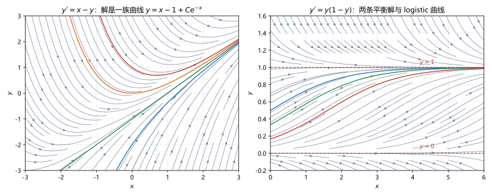

# 第 24 讲 常微分方程最小复习

> **前置**：一元微积分（导数、不定积分、分部积分、换元）、第 21–23 讲（拉普拉斯变换与逆变换，本讲只作接口预告）。
> **预计时间**：约 5 小时（含作业；三种特征根与待定系数建议各手算两遍）。
> **本讲回答**：微分方程的阶、通解、特解、初值问题各指什么？为什么二阶方程的通解里恰好有两个任意常数？一阶线性方程的积分因子是怎么想出来的？可分离变量为什么会丢解？特征方程从哪来，重根为什么乘 $x$、复根为什么变三角？非齐次为什么是"齐次通解 + 一个特解"？待定系数怎么设，共振时为什么多乘 $x$？

## 本讲要解决什么

第 25 讲要用拉普拉斯变换解微分方程，第 26 讲要用它分析电路暂态。这两讲都默认你会：

- 分清方程的阶、通解、特解与初值问题；
- 解一阶线性方程与可分离变量方程；
- 由特征方程写出二阶常系数齐次方程的通解；
- 对指数、三角、多项式右端求一个特解，识别共振。

如果这些只剩模糊印象，第 25 讲会退化成背三步流程，遇到初值或共振就不知道自己在做什么。本讲按"从方程到解"的链条重建这四块，只保留后续要用的最小集；变系数方程的一般解法不写，欧拉方程只作认识层。

学完之后，你应该能做到：

- 判断方程的阶，区分通解、特解、初值问题；
- 用积分因子解 $y'+P(x)y=Q(x)$，并正确写出指数符号；
- 用分离变量解 $y'=f(x)g(y)$，并检查被除掉的常数解；
- 由特征方程写出三种根情形下的齐次通解；
- 对非齐次方程写出"齐次通解 + 特解"，正确设待定系数、处理共振；
- 把欧拉方程化为常系数（认识层），并说清经典法与下一讲拉普拉斯法的分工。

---

## 1. 基本概念：阶、通解、特解、初值问题

### 1.1 阶与通解

含未知函数及其导数的方程叫**微分方程**。方程中出现的最高阶导数的阶，叫方程的**阶**。例如

$$y'+2y=e^{-x}$$

是一阶，$y''+3y'+2y=0$ 是二阶。

对 $n$ 阶线性方程，**通解**含 $n$ 个任意常数。二阶方程的通解长这样：

$$y=C_1y_1(x)+C_2y_2(x), \tag{24.1}$$

其中 $y_1,y_2$ 是两个线性无关的解（比值不是常数）。

**为什么恰好是 $n$ 个**：对二阶线性方程，给定 $x_0$ 处的一对初值 $(y(x_0),y'(x_0))$，解存在且唯一（这条存在唯一性定理本课程只引用，不证明）。一对初值恰好定两个常数，所以通解需要两个独立解；三阶就需要三个，依此类推。

**通解不一定是全部解**：非线性方程可能有奇解（例如 $y'=\sqrt{y}$ 的 $y=0$）。本讲只处理线性方程；线性方程的通解覆盖全部解，不存在奇解。

### 1.2 特解与初值问题

把初值代入通解，定出常数，得到的解叫**特解**。带初值的方程叫**初值问题**。二阶方程的初值一般给两条：

$$y(x_0)=y_0,\qquad y'(x_0)=y_0'. \tag{24.2}$$

初值的个数要与阶数相同：二阶给两条，一阶给一条。少给一条，常数定不下来；多给一条，方程可能无解。

**例 24.1** 验证 $y=C_1\cos x+C_2\sin x$ 是 $y''+y=0$ 的通解，并求满足 $y(0)=1$、$y'(0)=0$ 的特解。

**解**：先验证。$y'=-C_1\sin x+C_2\cos x$，$y''=-C_1\cos x-C_2\sin x=-y$，所以 $y''+y=0$。

两个解 $\cos x$ 与 $\sin x$ 的比值 $\tan x$ 不是常数，线性无关，通解形式正确。

代入初值：

$$y(0)=C_1=1,\qquad y'(0)=C_2=0.$$

所以

$$y=\cos x. \tag{24.3}$$

**核对**（EXP1）：$y=\cos x$ 的 $y''+y$ 在 $[0,6]$ 上最大绝对残差为 $0$，$y(0)=1$、$y'(0)=0$。

### 1.3 易错

- 把特解当通解交卷：特解不含任意常数，只对应一组初值。
- 初值少用一条，或把 $y'(0)$ 当成 $y(0)$ 代入。
- 把非线性方程的奇解硬塞进通解。

---

## 2. 一阶线性方程与积分因子

### 2.1 标准形与积分因子

一阶线性方程的标准形是

$$y'+P(x)y=Q(x). \tag{24.4}$$

解法的关键是找一个函数 $\mu(x)$，使左边乘上它以后变成一个导数：

$$\mu y'+\mu Py=(\mu y)'. \tag{24.5}$$

右边展开是 $\mu y'+\mu'y$。要与左边相等，需要

$$\mu'=P\mu. \tag{24.6}$$

这是一个可分离方程，解出

$$\mu=e^{\int P(x)dx}. \tag{24.7}$$

这个 $\mu$ 叫**积分因子**。它的作用不是"凑"，而是让左边合并成 $(\mu y)'$。

### 2.2 公式怎么来

把 (24.4) 两边乘 $\mu$：

$$\mu y'+\mu Py=\mu Q.$$

左边是 $(\mu y)'$，所以

$$(\mu y)'=\mu Q.$$

两边积分：

$$\mu y=\int\mu Q\,dx+C. \tag{24.8}$$

除以 $\mu$：

$$y=e^{-\int Pdx}\left[\int Qe^{\int Pdx}dx+C\right]. \tag{24.9}$$

这就是一阶线性方程的通解公式。实际做题不必背 (24.9)，按"乘 $\mu$ → 合并 → 积分 → 除回"走更稳。

**条件**：$P,Q$ 在讨论区间上连续；非线性方程不能套这个公式。

**例 24.2** 解初值问题

$$y'+2y=e^{-x},\qquad y(0)=2.$$

**解**：$P=2$，积分因子

$$\mu=e^{\int2dx}=e^{2x}.$$

两边乘 $e^{2x}$：

$$e^{2x}y'+2e^{2x}y=e^{x}.$$

左边合并：

$$(ye^{2x})'=e^{x}.$$

积分：

$$ye^{2x}=e^{x}+C.$$

除以 $e^{2x}$：

$$y=e^{-x}+Ce^{-2x}. \tag{24.10}$$

代入 $y(0)=2$：

$$2=1+C\Longrightarrow C=1.$$

所以

$$y=e^{-x}+e^{-2x}. \tag{24.11}$$

**核对**（EXP2）：$y'+2y-e^{-x}$ 在 $[0,6]$ 上最大残差 $4.4\times10^{-16}$，$y(0)=2$。

### 2.3 易错

- 积分因子的指数符号写反：$P=2$ 时 $\mu=e^{2x}$，不是 $e^{-2x}$。
- 只乘左边一项，右边 $Q$ 忘了乘 $\mu$。
- 积分后忘记除以 $\mu$，把 $\mu y$ 当成 $y$。

---

## 3. 可分离变量方程

### 3.1 分离与积分

若方程能写成

$$y'=f(x)g(y), \tag{24.12}$$

且 $g(y)\ne0$，就可以把 $y$ 与 $x$ 分开：

$$\frac{dy}{g(y)}=f(x)dx. \tag{24.13}$$

两边积分：

$$\int\frac{dy}{g(y)}=\int f(x)dx+C. \tag{24.14}$$

左边是 $y$ 的函数，右边是 $x$ 的函数，得到的是**隐式解**；能解出 $y$ 就写成显式解。

**为什么可以分开积分**：把 $y$ 看成 $x$ 的函数，$y'=dy/dx$，(24.13) 就是链式法则下的微分关系；两边对 $x$ 积分，左边做换元 $u=y(x)$，得到 $\int dy/g(y)$。

### 3.2 丢解：先检查 $g(y)=0$

分离时除以了 $g(y)$，若 $g(y_0)=0$，这个常数解 $y\equiv y_0$ 被除掉了。它可能是初值对应的解，必须单独检查。

**例 24.3** 解初值问题

$$y'=y(1-y),\qquad y(0)=\frac12,$$

并说明哪些解在分离时被丢掉。

**解**：$f(x)=1$、$g(y)=y(1-y)$。分离：

$$\frac{dy}{y(1-y)}=dx.$$

左边部分分式：

$$\frac{1}{y(1-y)}=\frac1y+\frac1{1-y}.$$

积分：

$$\ln\lvert y\rvert-\ln\lvert1-y\rvert=x+C.$$

合并对数：

$$\frac{y}{1-y}=Ce^{x}.$$

代入 $y(0)=\dfrac12$：

$$\frac{1/2}{1/2}=1=C.$$

所以

$$y=\frac{1}{1+e^{-x}}. \tag{24.15}$$

**被丢掉的解**：$g(y)=y(1-y)=0$ 给 $y=0$ 与 $y=1$。它们是常数解（$y'=0$，右边也为零），在分离时被除掉了。若初值是 $y(0)=0$ 或 $y(0)=1$，答案就是对应的常数解，不能套 (24.15)。

图 1 左是 $y'=x-y$ 的方向场与几条积分曲线 $y=x-1+Ce^{-x}$：不同的 $C$ 给出不同曲线，初值选哪条就定哪个 $C$。右是 $y'=y(1-y)$：两条红色虚线是平衡解 $y=0$、$y=1$，其余曲线是不同初值的 logistic 解，全部夹在两条平衡解之间；这两条平衡解正是分离时被除掉的常数解。

**核对**（EXP3）：logistic 解在 $[0,6]$ 上最大残差 $1.5\times10^{-16}$，$y(0)=0.5$；$y=0$ 与 $y=1$ 都满足方程。

### 3.3 易错

- 丢常数解：不检查 $g(y)=0$。
- 积分后不加 $C$，或把 $C$ 加在错误的边上（不影响结果，但容易在代入初值时混乱）。
- 初值落在哪个分支没判断，直接把两个分支的常数混用。

---

## 4. 二阶常系数齐次：特征方程与三种根

### 4.1 特征方程从哪来

考虑

$$ay''+by'+cy=0\qquad(a\ne0). \tag{24.16}$$

尝试 $y=e^{rx}$：$y'=re^{rx}$、$y''=r^2e^{rx}$。代入：

$$(ar^2+br+c)e^{rx}=0.$$

$e^{rx}\ne0$，所以括号必须为零：

$$ar^2+br+c=0. \tag{24.17}$$

这叫**特征方程**。它的根决定通解的形态。

### 4.2 三种根

**情形一：两个相异实根 $r_1\ne r_2$。** $e^{r_1x}$ 与 $e^{r_2x}$ 都是解，比值 $e^{(r_1-r_2)x}$ 不是常数，线性无关。通解

$$y=C_1e^{r_1x}+C_2e^{r_2x}. \tag{24.18}$$

**情形二：二重实根 $r_1=r_2=r$。** 一个解是 $e^{rx}$，第二个解不能再用 $e^{rx}$（线性相关）。设 $y=u(x)e^{rx}$，代入 (24.16)：

$$y'=(u'+ru)e^{rx},\qquad y''=(u''+2ru'+r^2u)e^{rx}.$$

代回并除以 $e^{rx}$：

$$a(u''+2ru'+r^2u)+b(u'+ru)+cu=0.$$

按 $u'',u',u$ 合并：

$$au''+(2ar+b)u'+(ar^2+br+c)u=0.$$

因为 $r$ 是特征根，$ar^2+br+c=0$；又 $r=-\dfrac{b}{2a}$，所以 $2ar+b=0$。只剩

$$au''=0\Longrightarrow u''=0\Longrightarrow u=C_1+C_2x.$$

通解

$$y=(C_1+C_2x)e^{rx}. \tag{24.19}$$

**情形三：共轭复根 $r=\alpha\pm i\beta$。** 形式上 $e^{(\alpha+i\beta)x}$ 是解。用欧拉公式：

$$e^{(\alpha+i\beta)x}=e^{\alpha x}\big(\cos\beta x+i\sin\beta x\big). \tag{24.20}$$

实系数方程的实部与虚部分别是解，所以取

$$y_1=e^{\alpha x}\cos\beta x,\qquad y_2=e^{\alpha x}\sin\beta x. \tag{24.21}$$

通解

$$y=e^{\alpha x}\big(C_1\cos\beta x+C_2\sin\beta x\big). \tag{24.22}$$

**为什么实部、虚部都是解**：把 $e^{(\alpha+i\beta)x}$ 代进实系数方程，实部与虚部分开写，两边实部相等、虚部相等；所以两部分各自满足方程。

### 4.3 三种情形各一例

**例 24.4** 解下列初值问题：

（a）$y''+3y'+2y=0$，$y(0)=1$，$y'(0)=0$；

（b）$y''+2y'+y=0$，$y(0)=1$，$y'(0)=0$；

（c）$y''+2y'+5y=0$，$y(0)=1$，$y'(0)=0$。

**解**：

（a）特征方程

$$r^2+3r+2=(r+1)(r+2)=0,$$

根 $r_1=-1$、$r_2=-2$。通解

$$y=C_1e^{-x}+C_2e^{-2x}.$$

代入初值：

$$C_1+C_2=1,\qquad -C_1-2C_2=0.$$

第二式给 $C_1=-2C_2$；代入第一式：$-2C_2+C_2=-C_2=1$，所以 $C_2=-1$、$C_1=2$。

$$y=2e^{-x}-e^{-2x}. \tag{24.23}$$

（b）特征方程

$$r^2+2r+1=(r+1)^2=0,$$

二重根 $r=-1$。通解

$$y=(C_1+C_2x)e^{-x}.$$

代入初值：

$$y(0)=C_1=1.$$

求导：

$$y'=C_2e^{-x}-(C_1+C_2x)e^{-x}.$$

在 $x=0$：

$$y'(0)=C_2-C_1=0\Longrightarrow C_2=1.$$

$$y=(1+x)e^{-x}. \tag{24.24}$$

（c）特征方程

$$r^2+2r+5=0.$$

配方：

$$(r+1)^2+4=0\Longrightarrow r=-1\pm2i.$$

所以 $\alpha=-1$、$\beta=2$。通解

$$y=e^{-x}\big(C_1\cos2x+C_2\sin2x\big).$$

代入 $y(0)=1$：

$$C_1=1.$$

求导：

$$y'=e^{-x}\big[(-C_1+2C_2)\cos2x+(-2C_1-C_2)\sin2x\big].$$

在 $x=0$：

$$y'(0)=-C_1+2C_2=0\Longrightarrow -1+2C_2=0\Longrightarrow C_2=\frac12.$$

$$y=e^{-x}\left(\cos2x+\frac12\sin2x\right). \tag{24.25}$$

**核对**（EXP4–EXP6）：三组解在 $[0,6]$ 上的最大残差分别为 $2.2\times10^{-16}$、$2.2\times10^{-16}$、$8.9\times10^{-16}$，初值都对。

### 4.4 易错

- 重根只写 $C_1e^{rx}$，漏掉 $C_2xe^{rx}$。
- 复根直接写 $e^{(\alpha+i\beta)x}$ 交卷，不取实部/虚部。
- 初值方程解错：二阶有两条初值，必须都用。

---

## 5. 非齐次：通解结构、待定系数法与共振

### 5.1 通解结构

考虑非齐次方程

$$Ly=f(x),\qquad L=a\frac{d^2}{dx^2}+b\frac{d}{dx}+c. \tag{24.26}$$

若 $y_1,y_2$ 都是它的解，则 $L(y_1-y_2)=f-f=0$，差是齐次解。所以

$$\text{非齐次通解}=\text{齐次通解}+\text{一个特解}. \tag{24.27}$$

求特解常用**待定系数法**：根据右端 $f$ 的形状设一个带未知系数的 trial，代入方程比较系数。

### 5.2 怎么设 trial

**(1) 右端 $P_n(x)e^{\lambda x}$**（$P_n$ 是 $n$ 次多项式）：设

$$y_p=x^kQ_n(x)e^{\lambda x}, \tag{24.28}$$

其中 $Q_n$ 是与 $P_n$ 同次的待定多项式，$k$ 是 $\lambda$ 作为特征根的**重数**（不是根取 $0$，单根取 $1$，二重根取 $2$）。

**(2) 右端含 $\cos\omega x$ 或 $\sin\omega x$**：设

$$y_p=A\cos\omega x+B\sin\omega x, \tag{24.29}$$

两项都要设，即使右端只有 $\cos$ 或只有 $\sin$。因为求导会把 $\cos$ 与 $\sin$ 混合，只设一项通常解不出。

**(3) 右端是两类之和**：分别求特解，再相加（叠加原理，只对线性方程成立）。

### 5.3 三小问

**例 24.5** 求下列非齐次方程的一个特解，并写出通解：

（a）$y''+3y'+2y=e^{3x}$；

（b）$y''-3y'+2y=e^{x}$；

（c）$y''+y'+y=\cos2x$。

**解**：

（a）右端 $\lambda=3$，特征根是 $-1,-2$，$3$ 不是根，所以 $k=0$。设

$$y_p=Ae^{3x}.$$

求导：$y_p'=3Ae^{3x}$、$y_p''=9Ae^{3x}$。代入：

$$(9A+9A+2A)e^{3x}=20Ae^{3x}=e^{3x}.$$

所以 $A=\dfrac1{20}$，

$$y_p=\frac{1}{20}e^{3x}. \tag{24.30}$$

通解：

$$y=C_1e^{-x}+C_2e^{-2x}+\frac{1}{20}e^{3x}. \tag{24.31}$$

（b）右端 $\lambda=1$，特征根是 $1,2$，$1$ 是**单根**，所以 $k=1$。设

$$y_p=Axe^{x}.$$

求导：

$$y_p'=A(x+1)e^{x},\qquad y_p''=A(x+2)e^{x}.$$

代入左边：

$$A\big[(x+2)-3(x+1)+2x\big]e^{x}
=A(-1)e^{x}=-Ae^{x}.$$

要等于 $e^{x}$，取 $A=-1$：

$$y_p=-xe^{x}. \tag{24.32}$$

通解：

$$y=C_1e^{x}+C_2e^{2x}-xe^{x}. \tag{24.33}$$

**为什么多乘 $x$**：不乘 $x$ 时，$Ae^{x}$ 代入左边会被特征方程"吃掉"（因为 $e^x$ 是齐次解），左边恒为零，解不出 $A$。多乘一个 $x$ 才跳出齐次解的空间。

（c）右端 $\cos2x$，$2i$ 不是特征根（特征根是 $-\dfrac12\pm\dfrac{\sqrt3}{2}i$），所以不共振。设

$$y_p=A\cos2x+B\sin2x.$$

求导：

$$y_p'=-2A\sin2x+2B\cos2x,$$

$$y_p''=-4A\cos2x-4B\sin2x.$$

代入 $y''+y'+y$，按 $\cos$ 与 $\sin$ 合并：

$$\cos:\ -4A+2B+A=-3A+2B,$$

$$\sin:\ -4B-2A+B=-3B-2A.$$

要求等于 $\cos2x$，比较系数：

$$-3A+2B=1,\qquad -2A-3B=0.$$

第二式给 $B=-\dfrac23A$。代入第一式：

$$-3A-\frac43A=1\Longrightarrow -\frac{13}{3}A=1\Longrightarrow A=-\frac{3}{13}.$$

于是 $B=\dfrac{2}{13}$，

$$y_p=\frac{-3\cos2x+2\sin2x}{13}. \tag{24.34}$$

通解：

$$y=e^{-x/2}\left(C_1\cos\frac{\sqrt3}{2}x+C_2\sin\frac{\sqrt3}{2}x\right)
+\frac{-3\cos2x+2\sin2x}{13}. \tag{24.35}$$

**核对**（EXP7）：三个特解在 $[0,6]$ 上的最大残差分别为 $7.5\times10^{-9}$（指数增长带来的绝对误差）、$1.2\times10^{-12}$、$2.2\times10^{-16}$。

### 5.4 易错

- $k$ 漏判：右端指数正好是特征根时，仍设 $Ae^{\lambda x}$，解不出。
- 三角右端只设 $\cos$，漏掉 $\sin$。
- 把特解当通解交卷；特解不含任意常数，不能作为初值问题的最终答案。
- 右端是两类之和时，只求其中一类。

---

## 6. 欧拉方程（认识层）与拉普拉斯接口

### 6.1 欧拉方程

形如

$$x^2y''+axy'+by=0\qquad(x>0) \tag{24.36}$$

的方程叫**欧拉方程**（Euler equation）。它看起来是变系数，但令 $x=e^t$（$t=\ln x$）可以化为常系数；也可以直接试 $y=x^r$。

代入 $y=x^r$：$y'=rx^{r-1}$、$y''=r(r-1)x^{r-2}$。乘 $x^2$ 后：

$$\big[r(r-1)+ar+b\big]x^r=0. \tag{24.37}$$

得到**指标方程**

$$r(r-1)+ar+b=0. \tag{24.38}$$

按三种根写解，形式与常系数类似，只是 $e^{rx}$ 换成 $x^r$。

**例 24.6** 解 $x^2y''-2xy'+2y=0$（$x>0$）。

**解**：这里 $a=-2$、$b=2$。指标方程：

$$r(r-1)-2r+2=r^2-3r+2=(r-1)(r-2)=0.$$

根 $r=1,2$。通解

$$y=C_1x+C_2x^2. \tag{24.39}$$

**核对**（EXP9）：取 $C_1=2$、$C_2=3$，$y=2x+3x^2$ 在 $[0.1,3]$ 上的最大残差 $1.4\times10^{-13}$。

**边界**：欧拉方程的标准推导只对 $x>0$；$x<0$ 时令 $x=-e^t$ 分段处理，本课程不展开。它是认识层：知道有这类方程、知道怎么化成常系数即可。

### 6.2 与拉普拉斯的接口

经典法解初值问题的步骤是：

1. 求齐次通解（特征根三种情形）；
2. 求一个特解（待定系数）；
3. 相加得通解；
4. 代入初值定常数。

第 25 讲换一条路：两边取拉普拉斯变换，微分性质把初值自动带进来，方程变成 $s$ 域的代数方程；解出 $Y(s)$ 后做逆变换。它不需要先求通解、再定常数，对含冲激或延迟的输入更省事。

**边界**：变系数方程取拉普拉斯会产生 $s$ 域的微分方程，不一定更简单；本课程只用拉普拉斯处理常系数线性方程。欧拉方程可以用拉普拉斯（先换元化常系数），但本课程不要求。

### 6.3 易错

- 把欧拉方程直接套常系数特征方程，忘记 $r(r-1)$ 而不是 $r^2$。
- 忽略 $x>0$ 的条件。
- 以为拉普拉斯能解所有变系数方程。

---

## 7. 本讲小结

| 方程类型 | 解法 | 关键点 |
|---|---|---|
| 一阶线性 $y'+Py=Q$ | 积分因子 $\mu=e^{\int P}$ | 左边合并为 $(\mu y)'$；除回 $\mu$ |
| 可分离 $y'=f(x)g(y)$ | 分离、积分 | 先检查 $g(y)=0$ 的常数解 |
| 二阶齐次，$\Delta>0$ | $C_1e^{r_1x}+C_2e^{r_2x}$ | 两个相异实根 |
| 二阶齐次，$\Delta=0$ | $(C_1+C_2x)e^{rx}$ | 重根多乘 $x$ |
| 二阶齐次，$\Delta<0$ | $e^{\alpha x}(C_1\cos\beta x+C_2\sin\beta x)$ | 复根取实部/虚部 |
| 非齐次 | 齐次通解 + 特解 | 待定系数；共振多乘 $x$ |
| 欧拉方程 | $y=x^r$ 或 $x=e^t$ | 指标方程 $r(r-1)+ar+b=0$；认识层 |

**三句话带走**：

1. 通解含 $n$ 个常数，初值定常数；特解是定好常数后的那一个。
2. 二阶常系数齐次的形态完全由特征根决定：相异实根给两条指数，重根多乘 $x$，复根给阻尼三角。
3. 非齐次 = 齐次通解 + 一个特解；右端与特征根重合时（共振），特解要多乘 $x$。

---

## 8. 掌握度自测

- [ ] 我能判断方程的阶，并说清通解为什么含 $n$ 个常数。
- [ ] 我能写出积分因子，正确合并左边并除回 $\mu$。
- [ ] 我能分离变量，并在最后检查 $g(y)=0$ 的常数解。
- [ ] 我能由特征方程写出三种根情形的通解。
- [ ] 我能推导重根为什么多乘 $x$（降阶法）。
- [ ] 我能用欧拉公式把复根写成阻尼三角。
- [ ] 我能对指数、三角右端设待定系数，识别共振并多乘 $x$。
- [ ] 我能把欧拉方程化为指标方程（认识层）。

---

## 作业

### 基础

**1.** 判断 $y''-y=0$ 的阶；验证 $y=C_1e^{x}+C_2e^{-x}$ 是它的通解，并求满足 $y(0)=2$、$y'(0)=0$ 的特解。

**参考答案：**

最高阶导数是二阶，所以是二阶方程。

$y'=C_1e^x-C_2e^{-x}$，$y''=C_1e^x+C_2e^{-x}=y$，所以 $y''-y=0$。两个解 $e^x$ 与 $e^{-x}$ 的比值 $e^{2x}$ 不是常数，线性无关。

代入初值：

$$C_1+C_2=2,\qquad C_1-C_2=0.$$

所以 $C_1=C_2=1$，

$$y=e^{x}+e^{-x}.$$

---

**2.** 解 $y'+3y=e^{-2x}$，$y(0)=0$。

**参考答案：**

$P=3$，$\mu=e^{3x}$。两边乘 $\mu$：

$$(ye^{3x})'=e^{x}.$$

积分：

$$ye^{3x}=e^{x}+C.$$

$$y=e^{-2x}+Ce^{-3x}.$$

代入 $y(0)=0$：$1+C=0$，$C=-1$。

$$y=e^{-2x}-e^{-3x}.$$

---

**3.** 解 $y'=xy$，$y(0)=1$。

**参考答案：**

分离：

$$\frac{dy}{y}=x\,dx.$$

积分：

$$\ln\lvert y\rvert=\frac{x^2}{2}+C.$$

$$y=Ce^{x^2/2}.$$

代入 $y(0)=1$：$C=1$。

$$y=e^{x^2/2}.$$

---

**4.** 解 $y'=y(y-2)$，$y(0)=1$，并写出被丢掉的常数解。

**参考答案：**

分离：

$$\frac{dy}{y(y-2)}=dx.$$

部分分式：

$$\frac{1}{y(y-2)}=\frac12\left(\frac{1}{y-2}-\frac{1}{y}\right).$$

积分：

$$\frac12\ln\left\lvert\frac{y-2}{y}\right\rvert=x+C.$$

代入 $y(0)=1$：$\left\lvert\dfrac{1-2}{1}\right\rvert=1$，$\ln1=0$，所以 $C=0$。在 $x=0$ 处 $(y-2)/y=-1$，取负支：

$$\frac{y-2}{y}=-e^{2x}.$$

解出：

$$y-2=-ye^{2x}\Longrightarrow y(1+e^{2x})=2\Longrightarrow y=\frac{2}{1+e^{2x}}.$$

被丢掉的常数解：$y=0$ 与 $y=2$（分离时分母为零）。

---

### 提高

**5.** 解 $y''-4y'+3y=0$，$y(0)=0$，$y'(0)=2$。

**参考答案：**

特征方程：

$$r^2-4r+3=(r-1)(r-3)=0.$$

通解：

$$y=C_1e^{x}+C_2e^{3x}.$$

代入初值：

$$C_1+C_2=0,\qquad C_1+3C_2=2.$$

第一式给 $C_1=-C_2$；代入第二式：$-C_2+3C_2=2C_2=2$，所以 $C_2=1$、$C_1=-1$。

$$y=e^{3x}-e^{x}.$$

---

**6.** 解 $y''+4y'+4y=0$，$y(0)=1$，$y'(0)=0$。

**参考答案：**

特征方程：

$$r^2+4r+4=(r+2)^2=0,$$

二重根 $r=-2$。通解

$$y=(C_1+C_2x)e^{-2x}.$$

$y(0)=C_1=1$。

求导：

$$y'=C_2e^{-2x}-2(C_1+C_2x)e^{-2x}.$$

在 $x=0$：$y'(0)=C_2-2C_1=0$，所以 $C_2=2$。

$$y=(1+2x)e^{-2x}.$$

---

**7.** 解 $y''+4y=0$，$y(0)=1$，$y'(0)=2$。

**参考答案：**

特征方程：

$$r^2+4=0\Longrightarrow r=\pm2i.$$

通解：

$$y=C_1\cos2x+C_2\sin2x.$$

$y(0)=C_1=1$。

求导：$y'=-2C_1\sin2x+2C_2\cos2x$。在 $x=0$：$y'(0)=2C_2=2$，所以 $C_2=1$。

$$y=\cos2x+\sin2x.$$

---

**8.** 求 $y''+y=2e^{x}$ 的通解。

**参考答案：**

齐次特征方程 $r^2+1=0$，根 $\pm i$，齐次通解

$$y_h=C_1\cos x+C_2\sin x.$$

右端 $2e^{x}$，$\lambda=1$ 不是特征根，设 $y_p=Ae^{x}$。代入：

$$Ae^{x}+Ae^{x}=2Ae^{x}=2e^{x}\Longrightarrow A=1.$$

所以

$$y=C_1\cos x+C_2\sin x+e^{x}.$$

---

**9.** 求 $y''-y=e^{x}$ 的通解，注意共振。

**参考答案：**

特征方程 $r^2-1=0$，根 $1,-1$。右端 $\lambda=1$ 是单根，所以 $k=1$，设

$$y_p=Axe^{x}.$$

求导：

$$y_p'=A(x+1)e^{x},\qquad y_p''=A(x+2)e^{x}.$$

代入 $y''-y$：

$$A\big[(x+2)-x\big]e^{x}=2Ae^{x}=e^{x}\Longrightarrow A=\frac12.$$

通解：

$$y=C_1e^{x}+C_2e^{-x}+\frac12xe^{x}.$$

---

**10.** 求 $y''+y'+y=\sin2x$ 的一个特解。

**参考答案：**

右端不含共振（特征根不是 $\pm2i$），设

$$y_p=A\cos2x+B\sin2x.$$

求导：

$$y_p'=-2A\sin2x+2B\cos2x,$$

$$y_p''=-4A\cos2x-4B\sin2x.$$

代入并按 $\cos$、$\sin$ 合并：

$$\cos:\ -3A+2B=0,\qquad \sin:\ -2A-3B=1.$$

第一式给 $B=\dfrac32A$。代入第二式：

$$-2A-\frac92A=1\Longrightarrow -\frac{13}{2}A=1\Longrightarrow A=-\frac{2}{13}.$$

于是 $B=-\dfrac{3}{13}$，

$$y_p=\frac{-2\cos2x-3\sin2x}{13}.$$

---

### 综合

**11.** 解欧拉方程 $x^2y''-3xy'+3y=0$（$x>0$）。

**参考答案：**

设 $y=x^r$。代入后乘 $x^2$ 之前，先算：

$$y'=rx^{r-1},\qquad y''=r(r-1)x^{r-2}.$$

代入 $x^2y''-3xy'+3y$：

$$\big[r(r-1)-3r+3\big]x^r=0.$$

指标方程：

$$r^2-4r+3=(r-1)(r-3)=0.$$

根 $r=1,3$。通解

$$y=C_1x+C_2x^3\qquad(x>0).$$

---

## 下一讲预告

这一讲把经典法的四块地基补齐了：一阶线性、可分离、二阶三种根、非齐次与共振。

第 25 讲换一条路线：对微分方程两边取拉普拉斯变换，用 $\mathcal L[f']=sF(s)-f(0^-)$ 把导数变成乘 $s$，初值自动进入；解出 $Y(s)$ 后做部分分式与逆变换。含冲激、延迟的输入在 $s$ 域只是乘 $1$ 或乘 $e^{-sT}$，比经典法省事。第 26 讲再把同一套流程搬到电路。