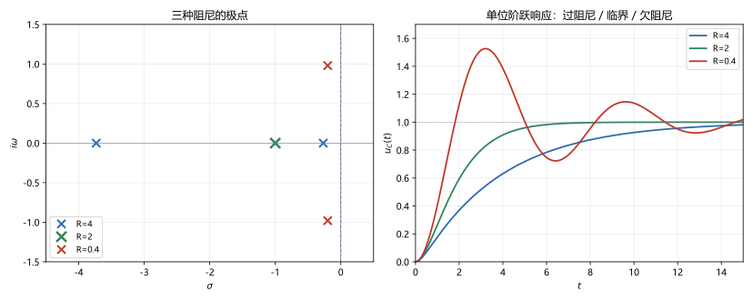

# 第 25 讲 拉普拉斯变换解微分方程

> **前置**：第 21–23 讲（拉普拉斯变换、性质、逆变换）、第 24 讲（常微分方程最小复习：一阶线性、二阶三种根、待定系数与共振）。
> **预计时间**：约 4.5 小时（含作业；例 25.1、25.2 建议先用经典法做一遍，再用本讲方法对照）。
> **本讲回答**：为什么微分方程取拉普拉斯就变成代数方程？初始条件是怎么自动进去的？初值取 $0^-$ 还是 $0^+$？三种阻尼与特征根三种情形怎么对应？冲激、延迟输入在 $s$ 域怎么处理？什么时候拉普拉斯法比经典法更省事？

## 本讲要解决什么

第 24 讲的经典法是：求齐次通解 → 求一个特解 → 相加 → 代入初值定常数。步骤多，初值要到最后才用，遇到冲激或延迟还要分段处理。

这一讲换一条路线，三步：

1. 对微分方程两边取拉普拉斯变换，用微分性质把初值带进来；
2. 在 $s$ 域解一个代数方程，得到 $Y(s)$；
3. 对 $Y(s)$ 做部分分式与逆变换，得到 $y(t)$。

初值在第一步就进入方程，不需要最后另定常数。含冲激的输入在 $s$ 域只是乘 $1$；含延迟的输入只是乘 $e^{-sT}$，逆变换时整体延迟并带阶跃。这两类输入是经典法最容易出错的地方。

本讲用串联 RLC 的阶跃响应作二阶例子：同一个 $Y(s)$ 的分母有三种极点，对应过阻尼、临界、欠阻尼三种响应。第 26 讲会把同一套方法搬到电路与传递函数。

学完之后，你应该能做到：

- 写出三步法，并把一阶、二阶初值问题完整解出来；
- 说清初值为什么在变换步自动进入，且取 $0^-$；
- 由 RLC 方程得到 $Y(s)$，按极点三种情形写出响应；
- 处理冲激输入与延迟输入，逆变换不漏阶跃；
- 用经典法核对同一题的结果，判断什么时候用哪种方法。

---

## 1. 三步法

### 1.1 为什么变成代数方程

第 22 讲给过微分性质：

$$\mathcal L[y']=sY(s)-y(0^-),\qquad
\mathcal L[y'']=s^2Y(s)-sy(0^-)-y'(0^-). \tag{25.1}$$

对二阶常系数方程

$$ay''+by'+cy=f(t), \tag{25.2}$$

两边取拉普拉斯，记 $F(s)=\mathcal L[f]$：

$$a\big[s^2Y-sy(0^-)-y'(0^-)\big]
+b\big[sY-y(0^-)\big]+cY=F(s).$$

按 $Y$ 合并：

$$(as^2+bs+c)Y(s)=F(s)+a\big[sy(0^-)+y'(0^-)\big]+b\,y(0^-). \tag{25.3}$$

**关键点**：右边多出的两项就是初值。它们不是在最后"代"进去的，而是在变换这一步被微分性质搬进来的。除以 $as^2+bs+c$：

$$Y(s)=\frac{F(s)+a\big[sy(0^-)+y'(0^-)\big]+b\,y(0^-)}{as^2+bs+c}. \tag{25.4}$$

这是一个关于 $Y$ 的代数方程的解，不再含导数。接下来只需逆变换。

### 1.2 一阶例子

**例 25.1** 解初值问题

$$y'+2y=e^{-t},\qquad y(0)=2.$$

**解**：两边取拉普拉斯。$\mathcal L[y']=sY-y(0^-)=sY-2$，$\mathcal L[e^{-t}]=\dfrac1{s+1}$：

$$(sY-2)+2Y=\frac1{s+1}.$$

按 $Y$ 合并：

$$(s+2)Y=2+\frac1{s+1}.$$

除以 $s+2$：

$$Y(s)=\frac{2}{s+2}+\frac{1}{(s+1)(s+2)}. \tag{25.5}$$

第二项部分分式：

$$\frac{1}{(s+1)(s+2)}=\frac{1}{s+1}-\frac{1}{s+2}.$$

代回：

$$Y(s)=\frac{2}{s+2}+\frac{1}{s+1}-\frac{1}{s+2}
=\frac{1}{s+1}+\frac{1}{s+2}.$$

逆变换：

$$y=e^{-t}+e^{-2t}. \tag{25.6}$$

**核对**（EXP1）：$y'+2y-e^{-t}$ 在 $[0,6]$ 上最大残差 $4.4\times10^{-16}$，$y(0)=2$。

### 1.3 二阶例子（两个初值）

**例 25.2** 解初值问题

$$y''+3y'+2y=0,\qquad y(0)=1,\quad y'(0)=0.$$

**解**：两边取拉普拉斯。$\mathcal L[y'']=s^2Y-s\cdot1-0=s^2Y-s$，$\mathcal L[y']=sY-1$：

$$(s^2Y-s)+3(sY-1)+2Y=0.$$

按 $Y$ 合并：

$$(s^2+3s+2)Y=s+3.$$

分母因式分解：

$$s^2+3s+2=(s+1)(s+2),$$

所以

$$Y(s)=\frac{s+3}{(s+1)(s+2)}. \tag{25.7}$$

部分分式：

$$\frac{s+3}{(s+1)(s+2)}=\frac{A}{s+1}+\frac{B}{s+2}.$$

求 $A$：两边乘 $s+1$，令 $s=-1$：

$$A=\frac{-1+3}{-1+2}=2.$$

求 $B$：两边乘 $s+2$，令 $s=-2$：

$$B=\frac{-2+3}{-2+1}=-1.$$

于是

$$Y(s)=\frac{2}{s+1}-\frac{1}{s+2},\qquad
y=2e^{-t}-e^{-2t}. \tag{25.8}$$

**核对**（EXP2）：$y''+3y'+2y$ 在 $[0,6]$ 上最大残差 $2.2\times10^{-16}$，$y(0)=1$、$y'(0)=0$。

**与经典法对照**：第 24 讲用特征根 $r=-1,-2$ 得通解 $C_1e^{-t}+C_2e^{-2t}$，再代入两条初值解出 $C_1=2,C_2=-1$。这里两条初值在变换步就进入了 $Y(s)$ 的分子 $s+3$，没有"先通解再定常数"。

### 1.4 边界与深度

**只对常系数线性方程**：$a,b,c$ 是常数。变系数方程（如 $t y''+y=0$）取拉普拉斯会把 $t$ 变成 $-d/ds$，得到 $s$ 域的微分方程，不一定更简单；本课程不展开。

**初值取 $0^-$**：换路前的值。若输入含冲激，冲激在 $0$ 处造成跳变，$0^+$ 的值已经把跳变算进去了，再用 $0^+$ 会重复计算。

**逆变换前先化真分式**：$Y(s)$ 若是假分式，先做多项式除法；多项式部分对应 $\delta$ 及其导数（认识层）。

**深度**：三步法要会独立走完；存在唯一性、变系数情形属于认识层，不要求。

### 1.5 易错

- 初值取 $0^+$，冲激题会错。
- $\mathcal L[y'']$ 漏掉 $-sy(0^-)-y'(0^-)$。
- 逆变换前不化真分式。
- 把 $Y(s)$ 的分子算错：合并时忘了把初值项移到右边。

---

## 2. 二阶三种阻尼情形

### 2.1 从 RLC 方程出发

串联 RLC 电路，输入电压为 $E$，取电容电压 $u_C$ 为未知量。KVL：

$$L\frac{di}{dt}+Ri+u_C=E.$$

电容电流 $i=C\dfrac{du_C}{dt}$，代入：

$$LC\frac{d^2u_C}{dt^2}+RC\frac{du_C}{dt}+u_C=E. \tag{25.9}$$

取 $L=1$、$C=1$（归一化），方程变成

$$u_C''+Ru_C'+u_C=E. \tag{25.10}$$

这一步把电路问题变成了第 24 讲的二阶常系数方程；$R$ 同时扮演阻尼系数的角色。

### 2.2 零初值下的 $Y(s)$

设 $u_C(0^-)=0$、$u_C'(0^-)=0$，输入为单位阶跃 $E=1$。取拉普拉斯：

$$(s^2+Rs+1)Y=\frac1s,$$

$$Y(s)=\frac{1}{s(s^2+Rs+1)}. \tag{25.11}$$

分母的二次因子

$$s^2+Rs+1=0 \tag{25.12}$$

的判别式是 $R^2-4$。三种情形：

| 条件 | 极点 | 响应形态 |
|---|---|---|
| $R>2$ | 两个相异负实根 | 过阻尼，单调上升，无过冲 |
| $R=2$ | 二重负实根 $s=-1$ | 临界阻尼，最快无过冲 |
| $0<R<2$ | 共轭复根 $-\dfrac R2\pm i\sqrt{1-\dfrac{R^2}{4}}$ | 欠阻尼，振荡衰减，有过冲 |

$R=0$ 时极点在虚轴 $\pm i$，不衰减（无阻尼振荡）；$R<0$ 时极点在右半平面，响应增长（无源 RLC 不会出现，作为数学边界）。

### 2.3 三组参数

**例 25.3** 对 $L=C=1$、$E=1$、零初值，分别取 $R=4$、$R=2$、$R=0.4$，求 $u_C(t)$ 并比较。

**解**：

**（a）$R=4$（过阻尼）**。分母：

$$s(s^2+4s+1).$$

二次因子根：

$$r_{1,2}=\frac{-4\pm\sqrt{16-4}}{2}=-2\pm\sqrt3. \tag{25.13}$$

数值 $r_1\approx-0.267949$、$r_2\approx-3.73205$。部分分式：

$$\frac{1}{s(s-r_1)(s-r_2)}=\frac{1}{s}+\frac{A}{s-r_1}+\frac{B}{s-r_2}.$$

常数项为 $1$（因为 $r_1r_2=1$）。求 $A$：两边乘 $s-r_1$，令 $s=r_1$：

$$A=\frac{1}{r_1(r_1-r_2)}\approx\frac{1}{(-0.267949)(3.4641)}\approx-1.07735.$$

求 $B$：两边乘 $s-r_2$，令 $s=r_2$：

$$B=\frac{1}{r_2(r_2-r_1)}\approx\frac{1}{(-3.73205)(-3.4641)}\approx0.07735.$$

逆变换：

$$u_C(t)=1-1.07735\,e^{-0.267949t}+0.07735\,e^{-3.73205t}. \tag{25.14}$$

两项指数都衰减，第二项很快消失，剩下慢的 $e^{-0.267949t}$；响应单调上升，无过冲。

**（b）$R=2$（临界）**。分母：

$$s(s^2+2s+1)=s(s+1)^2.$$

部分分式：

$$\frac{1}{s(s+1)^2}=\frac{1}{s}-\frac{1}{s+1}-\frac{1}{(s+1)^2}.$$

逆变换：

$$u_C(t)=1-e^{-t}-te^{-t}=1-(1+t)e^{-t}. \tag{25.15}$$

这是临界情形：二重极点，响应最快地上升到 $1$ 且不过冲。

**（c）$R=0.4$（欠阻尼）**。阻尼比

$$\zeta=\frac R2=0.2,\qquad
\omega_d=\sqrt{1-\zeta^2}=\sqrt{0.96}\approx0.979898.$$

分母写成

$$s\big[(s+0.2)^2+\omega_d^2\big].$$

部分分式：

$$\frac{1}{s\big[(s+0.2)^2+\omega_d^2\big]}
=\frac{1}{s}-\frac{s+0.4}{(s+0.2)^2+\omega_d^2}.$$

验证：右边通分后分子为 $(s+0.2)^2+\omega_d^2-s(s+0.4)=s^2+0.4s+0.04+0.96-s^2-0.4s=1$，与左边一致。

把第二项拆成

$$\frac{s+0.4}{(s+0.2)^2+\omega_d^2}
=\frac{s+0.2}{(s+0.2)^2+\omega_d^2}
+\frac{0.2}{\omega_d}\cdot\frac{\omega_d}{(s+0.2)^2+\omega_d^2}.$$

逆变换：

$$u_C(t)=1-e^{-0.2t}\left[\cos(\omega_d t)+\frac{0.2}{\omega_d}\sin(\omega_d t)\right]. \tag{25.16}$$

响应以 $e^{-0.2t}$ 包络振荡，最终趋于 $1$，但会先冲过 $1$。

### 2.4 图与过冲

图 1 左是三种 $R$ 的极点：$R=4$ 两个相异负实根，$R=2$ 在 $-1$ 处二重，$R=0.4$ 一对共轭复根。右是对应的单位阶跃响应：过阻尼缓慢单调上升；临界最快且无过冲；欠阻尼先冲过 $1$ 再振荡回落。

**过冲量**（EXP3）：$R=0.4$ 时最大值为 $1.5266$，峰值时间 $t\approx3.21$，过冲约 $52.7\%$。理论公式

$$M_p=e^{-\pi\zeta/\sqrt{1-\zeta^2}} \tag{25.17}$$

给 $e^{-\pi\cdot0.2/0.979898}=e^{-0.6414}\approx0.527$，与数值一致。峰值时间

$$t_p=\frac{\pi}{\omega_d}\approx\frac{\pi}{0.979898}\approx3.206, \tag{25.18}$$

也与数值一致。

**数值核对**（EXP3）：三种响应代回 $u_C''+Ru_C'+u_C=1$，用有限差分算二阶导，内部最大残差在 $10^{-4}$ 量级（差分误差，不是公式误差）。

### 2.5 与第 24 讲特征根的对应

| 第 24 讲 | 本讲 RLC | 极点 | 响应 |
|---|---|---|---|
| $\Delta>0$ 相异实根 | $R>2$ 过阻尼 | 两个负实根 | 两个指数，无振荡 |
| $\Delta=0$ 重根 | $R=2$ 临界 | 二重负实根 | $(C_1+C_2t)e^{rt}$ |
| $\Delta<0$ 共轭复根 | $0<R<2$ 欠阻尼 | 负实部共轭对 | 衰减三角 |

**易错**：把阻尼比 $\zeta=R/2$ 与极点实部混为一谈。极点实部是 $-\zeta$（本例 $\omega_0=1$），不是 $-\zeta\omega_d$；振荡频率是 $\omega_d=\sqrt{1-\zeta^2}$，不是 $\omega_0$。

---

## 3. 含冲激与延迟的输入

### 3.1 冲激输入

第 21 讲给过 $\mathcal L[\delta(t)]=1$。对零初值的系统

$$ay''+by'+cy=\delta(t),$$

取拉普拉斯：

$$(as^2+bs+c)Y=1\Longrightarrow Y(s)=\frac{1}{as^2+bs+c}. \tag{25.19}$$

也就是说，**冲激响应就是传递函数 $H(s)$ 的逆变换**（第 26 讲会给 $H(s)$ 的一般定义）。

**例 25.4** 解

$$y''+3y'+2y=\delta(t),\qquad y(0^-)=0,\quad y'(0^-)=0.$$

**解**：

$$(s^2+3s+2)Y=1,$$

$$Y(s)=\frac{1}{(s+1)(s+2)}=\frac{1}{s+1}-\frac{1}{s+2}.$$

逆变换：

$$y=e^{-t}-e^{-2t}\quad(t>0). \tag{25.20}$$

**初值的跳变**：$y(0^+)=0$，但 $y'(0^+)=1$。冲激没有改变 $y$ 本身，却把导数从 $0$ 抬到 $1$；这正是必须用 $0^-$ 初值的原因——$0^-$ 的零初值是对的，$0^+$ 的导数值已经被冲激改过。

**核对**（EXP4）：正变换在 $s=0.5+i$ 处给 $0.116711-0.169761i$，与 $1/((s+1)(s+2))$ 一致；$y(0^+)=0$、$y'(0^+)=1$。

### 3.2 延迟输入

第 22 讲的时移性质：

$$\mathcal L[f(t-T)u(t-T)]=e^{-sT}F(s). \tag{25.21}$$

若解出的 $Y(s)$ 含因子 $e^{-sT}$，逆变换就是"把原响应整体延迟 $T$，并乘 $u(t-T)$"。

**例 25.5** 解

$$y'+2y=u(t-2),\qquad y(0^-)=0.$$

**解**：$\mathcal L[u(t-2)]=\dfrac{e^{-2s}}{s}$。取拉普拉斯：

$$sY+2Y=\frac{e^{-2s}}{s},$$

$$Y(s)=\frac{e^{-2s}}{s(s+2)}. \tag{25.22}$$

先算不带延迟的部分：

$$\frac{1}{s(s+2)}=\frac12\left(\frac1s-\frac1{s+2}\right)
\longleftrightarrow
\frac12\left(1-e^{-2t}\right)u(t).$$

乘 $e^{-2s}$ 后整体延迟 $2$：

$$y(t)=\frac12\left(1-e^{-2(t-2)}\right)u(t-2). \tag{25.23}$$

**核对**（EXP5）：$y(1)=0$、$y(3)=0.432332$、$y(6)=0.499832$；正变换与 $e^{-2s}/[s(s+2)]$ 差 $3.1\times10^{-10}$。

**为什么必须带 $u(t-2)$**：不写阶跃，表达式在 $t<2$ 也会给出非零值（甚至负值），与"输入在 $2$ 之前为零"矛盾。

### 3.3 易错

- 把 $\mathcal L[\delta]$ 写成 $1/s$；$1/s$ 是阶跃的变换。
- 冲激题用 $0^+$ 初值，把冲激造成的导数跳变又算一遍。
- 延迟逆变换忘乘 $u(t-T)$，或把 $t$ 直接换成 $t-T$ 却漏掉阶跃。
- 把 $e^{-sT}$ 当成普通常数，逆变换时忘记它对应延迟。

---

## 4. 与经典法对照

### 4.1 同一题两法

**例 25.6** 用经典法与拉普拉斯法分别解

$$y'+2y=e^{-t},\qquad y(0)=2,$$

并核对结果。

**经典法**：齐次方程 $y'+2y=0$ 的通解 $y_h=Ce^{-2t}$。右端 $e^{-t}$ 不是齐次解，设特解 $y_p=Ae^{-t}$。代入：

$$-Ae^{-t}+2Ae^{-t}=Ae^{-t}=e^{-t}\Longrightarrow A=1.$$

通解

$$y=Ce^{-2t}+e^{-t}.$$

代入 $y(0)=2$：

$$C+1=2\Longrightarrow C=1.$$

$$y=e^{-t}+e^{-2t}. \tag{25.24}$$

**拉普拉斯法**：例 25.1 已算出

$$Y(s)=\frac{1}{s+1}+\frac{1}{s+2}\Longrightarrow y=e^{-t}+e^{-2t}. \tag{25.25}$$

两法逐项相同。

### 4.2 什么时候用哪种

| 情形 | 更适合 |
|---|---|
| 常系数、初值非零 | 拉普拉斯：初值自动进入，不用先通解再定常数 |
| 输入含冲激、延迟、分段 | 拉普拉斯：乘 $1$ 或 $e^{-sT}$，不必分段 |
| 右端简单、阶数低（一阶、二阶） | 经典法可能更快，尤其只需特解形状时 |
| 变系数 | 经典法（或级数法）；拉普拉斯会产生 $s$ 域微分方程 |
| 只想看稳态或终值 | 经典法或终值定理（第 22 讲），不必完整逆变换 |

**边界**：拉普拉斯不是万能。右端是复杂但可积的函数、或方程阶数很低时，经典法的计算量可能更小；变系数方程不适用。

### 4.3 易错

- 两法结果不核对，符号错一个就交卷。
- 把拉普拉斯当唯一方法，遇到变系数仍硬套。
- 经典法求特解时忘记检查共振（第 24 讲）。

---

## 5. 本讲小结

| 输入 / 方程 | $s$ 域特征 | 时域结果 |
|---|---|---|
| 一阶 $y'+ay=f$ | $(s+a)Y=y(0^-)+F(s)$ | 部分分式后查表 |
| 二阶 $ay''+by'+cy=f$ | $(as^2+bs+c)Y=F+a(sy_0+y_0')+by_0$ | 初值在分子 |
| 阶跃输入 | $1/s$ | 响应趋于常数（稳定时） |
| 冲激输入 | $1$ | $Y=H(s)$，冲激响应 |
| 延迟输入 | $e^{-sT}$ | 整体延迟并乘 $u(t-T)$ |
| $R>2$ | 两个负实根 | 过阻尼，无过冲 |
| $R=2$ | 二重负实根 | 临界，最快无过冲 |
| $0<R<2$ | 共轭复根 | 欠阻尼，振荡有过冲 |

**三句话带走**：

1. 三步法：变换（初值自动进入）→ 解 $Y(s)$ → 部分分式与逆变换。
2. 初值取 $0^-$；冲激会改变导数，但不能用 $0^+$ 重复计算。
3. 极点决定响应：两个负实根过阻尼，重根临界，共轭复根欠阻尼；冲激是 $1$，延迟是 $e^{-sT}$。

---

## 6. 掌握度自测

- [ ] 我能写出二阶方程变换后的代数方程 (25.3)，并说清初值在哪一项。
- [ ] 我能独立解例 25.1、25.2，并用经典法核对。
- [ ] 我能由 RLC 方程得到 $Y(s)=E/[s(s^2+Rs+1)]$。
- [ ] 我能按 $R>2$、$R=2$、$0<R<2$ 写出三种响应。
- [ ] 我能解释冲激响应为什么是 $H(s)$ 的逆变换，以及 $y'(0^+)$ 的跳变。
- [ ] 我能处理延迟输入，逆变换带 $u(t-T)$。
- [ ] 我能判断什么时候用拉普拉斯、什么时候用经典法。
- [ ] 我能说出变系数方程为什么不能用这套三步法。

---

## 作业

### 基础

**1.** 用拉普拉斯法解 $y'+3y=e^{-2t}$，$y(0)=0$。

**参考答案：**

取拉普拉斯：

$$(sY-0)+3Y=\frac{1}{s+2},$$

$$(s+3)Y=\frac{1}{s+2}\Longrightarrow Y=\frac{1}{(s+2)(s+3)}.$$

部分分式：

$$\frac{1}{(s+2)(s+3)}=\frac{1}{s+2}-\frac{1}{s+3}.$$

$$y=e^{-2t}-e^{-3t}.$$

---

**2.** 用拉普拉斯法解 $y''-y=0$，$y(0)=2$，$y'(0)=0$。

**参考答案：**

取拉普拉斯：

$$(s^2Y-2s)-Y=0\Longrightarrow(s^2-1)Y=2s.$$

$$Y=\frac{2s}{(s-1)(s+1)}=\frac{1}{s-1}+\frac{1}{s+1}.$$

$$y=e^{t}+e^{-t}.$$

---

**3.** 用拉普拉斯法解 $y''+4y=0$，$y(0)=1$，$y'(0)=2$。

**参考答案：**

$$(s^2Y-s-2)+4Y=0\Longrightarrow(s^2+4)Y=s+2.$$

$$Y=\frac{s}{s^2+4}+2\cdot\frac{1}{s^2+4}\cdot\frac{2}{2}
=\frac{s}{s^2+4}+\frac{2}{s^2+4}.$$

$$y=\cos2t+\sin2t.$$

---

**4.** 解 $y''+2y'+y=0$，$y(0)=0$，$y'(0)=1$。

**参考答案：**

$$(s^2Y-0-1)+2(sY-0)+Y=0,$$

$$(s^2+2s+1)Y=1\Longrightarrow Y=\frac{1}{(s+1)^2}.$$

$$y=te^{-t}.$$

---

### 提高

**5.** 解 $y''+3y'+2y=u(t)$，$y(0)=0$，$y'(0)=0$。

**参考答案：**

$$(s^2+3s+2)Y=\frac1s,$$

$$Y=\frac{1}{s(s+1)(s+2)}.$$

部分分式：

$$\frac{1}{s(s+1)(s+2)}=\frac{A}{s}+\frac{B}{s+1}+\frac{C}{s+2}.$$

$A=\dfrac{1}{(0+1)(0+2)}=\dfrac12$；

$B=\dfrac{1}{(-1)(-1+2)}=-1$；

$C=\dfrac{1}{(-2)(-2+1)}=\dfrac12$。

$$y=\frac12-e^{-t}+\frac12e^{-2t}.$$

---

**6.** 解 $y''+4y'+4y=\delta(t)$，$y(0^-)=0$，$y'(0^-)=0$。

**参考答案：**

$$(s^2+4s+4)Y=1\Longrightarrow Y=\frac{1}{(s+2)^2}.$$

$$y=te^{-2t}\quad(t>0).$$

冲激使 $y'(0^+)=1$；$y(0^+)=0$。

---

**7.** 解 $y'+y=u(t-1)$，$y(0^-)=0$。

**参考答案：**

$$(s+1)Y=\frac{e^{-s}}{s}\Longrightarrow Y=\frac{e^{-s}}{s(s+1)}.$$

$$\frac{1}{s(s+1)}=\frac1s-\frac1{s+1}
\longleftrightarrow 1-e^{-t}.$$

整体延迟 $1$：

$$y=\left(1-e^{-(t-1)}\right)u(t-1).$$

---

**8.** 对 $L=C=1$、$E=1$、零初值、$R=3$，判断阻尼类型，写出极点和阶跃响应的形式（不必把系数化成小数）。

**参考答案：**

方程 $u_C''+3u_C'+u_C=1$。判别式 $9-4=5>0$，过阻尼。

极点：

$$r_{1,2}=\frac{-3\pm\sqrt5}{2}.$$

响应形式：

$$u_C(t)=1+Ae^{r_1t}+Be^{r_2t},$$

其中

$$A=\frac{1}{r_1(r_1-r_2)},\qquad B=\frac{1}{r_2(r_2-r_1)}.$$

数值约 $r_1\approx-0.382$、$r_2\approx-2.618$、$A\approx-1.171$、$B\approx0.171$。

---

**9.** 对 $L=C=1$、$E=1$、零初值、$R=0.4$，求过冲量与峰值时间，并用第 25 讲公式核对。

**参考答案：**

$\zeta=R/2=0.2$，$\omega_d=\sqrt{1-0.04}=\sqrt{0.96}\approx0.979898$。

过冲：

$$M_p=e^{-\pi\zeta/\sqrt{1-\zeta^2}}
=e^{-\pi\cdot0.2/0.979898}
=e^{-0.6414}\approx0.527.$$

即约 $52.7\%$。

峰值时间：

$$t_p=\frac{\pi}{\omega_d}\approx\frac{\pi}{0.979898}\approx3.206.$$

---

### 综合

**10.** 用经典法与拉普拉斯法分别解 $y'+y=e^{-2t}$，$y(0)=1$，并核对结果。

**参考答案：**

经典法：齐次通解 $Ce^{-t}$；设特解 $Ae^{-2t}$，代入：

$$-2Ae^{-2t}+Ae^{-2t}=-Ae^{-2t}=e^{-2t}\Longrightarrow A=-1.$$

通解 $y=Ce^{-t}-e^{-2t}$。代入 $y(0)=1$：

$$C-1=1\Longrightarrow C=2.$$

$$y=2e^{-t}-e^{-2t}.$$

拉普拉斯法：

$$(sY-1)+Y=\frac{1}{s+2}\Longrightarrow(s+1)Y=1+\frac{1}{s+2}=\frac{s+3}{s+2}.$$

$$Y=\frac{s+3}{(s+1)(s+2)}=\frac{2}{s+1}-\frac{1}{s+2}.$$

$$y=2e^{-t}-e^{-2t}.$$

两法一致。

---

**11.** 说明冲激输入为什么必须用 $0^-$ 初值；再说明延迟输入的逆变换为什么必须带 $u(t-T)$。

**参考答案：**

冲激 $\delta(t)$ 在 $t=0$ 处把二阶系统的导数抬高一个单位（本例 $y'(0^+)-y'(0^-)=1$），$y$ 本身可能连续。若用 $0^+$ 初值，等于把冲激已经造成的跳变再算一次，结果多算。$0^-$ 是冲激作用前的状态，配合 $\mathcal L[\delta]=1$ 正好只算一次。

延迟输入 $f(t-T)u(t-T)$ 在 $t<T$ 时为零。逆变换得到的是"原响应整体推迟 $T$"，若不乘 $u(t-T)$，表达式在 $t<T$ 会给出非零值，与输入为零矛盾。阶跃因子负责把 $t<T$ 的部分切掉。

---

## 下一讲预告

这一讲把"方程 → $s$ 域 → 响应"打通了。第 26 讲把这套方法直接用到电路：

- 电感、电容的 $s$ 域模型为什么带初始条件，初值怎么变成等效电压源/电流源；
- 不列微分方程，直接在 $s$ 域画电路、列 KCL/KVL；
- 传递函数 $H(s)=Y(s)/X(s)$（零初始），以及 $H(i\omega)$ 与相量法的关系；
- 极点位置如何判稳定性、定响应形态。

本讲的 RLC 阶跃响应会在第 26 讲作为 $s$ 域电路与传递函数的对照例子再次出现。