# 第 02 讲：电路元件与基尔霍夫定律

> **前置**：第 01 讲 §2–§4（电流参考方向、电压极性、电位、关联方向与吸收功率）。
> **预计时间**：3–4 小时（含作业）。
>
> **一句话定位**：从认识电压、电流，进入独立计算电路。元件的伏安关系约束单个元件，基尔霍夫电流定律（Kirchhoff's Current Law，KCL）与电压定律（Kirchhoff's Voltage Law，KVL）约束接线；把两类关系联立，就能求出小电路的电流、电压和功率。
>
> **本讲回答什么**：
> 1. 电阻、独立源、受控源各约束什么量，另一量怎样求？
> 2. KCL/KVL 的符号看箭头还是看极性，标准列法怎样执行？
> 3. 两个理想源能否串并联，方程数够是否就保证有唯一解？
> 4. 受控源的控制量怎样进入方程，控制信号和供电有什么区别？
> 5. 分压器为何空载输出 3 V，接负载后怎样重新计算？
>
> **本讲目标（学完你能）**：
> 1. 写出本讲元件的约束、单位与参考方向，判断开短路及理想源连接是否相容；
> 2. 识别结点、支路、回路与网孔，按统一符号列 KCL/KVL，并说明适用条件与计数的局限；
> 3. 完整求解空载/带载分压器、单结点对和带内阻电源，回代电压、电流与功率；
> 4. 标出受控源的控制量，联立控制/输出关系，并正确判断受控源吸收或发出功率。
>
> **目标达成 = 末尾“掌握度自测”全部打勾。**
>
> **怎么学这一讲**：每道题按“标方向 → 写元件关系 → 写连接关系 → 联立 → 回代”做完。负数先按参考方向解释；V/Ω 得 A，V/kΩ 得 mA，不能混写。先会直接联立，下一讲再学习等效化简。
>
> **这一讲有真实验证**：`scripts/lec02-04_verify_reconstruction.py` 验证六个完整电路算例、数值作业、理想源相容性及符号/单位，并配套本讲 12 张图。只计算时加 `--check-only`，无需安装绘图库。

## 本讲怎么走（脉络图）

```text
9 V 分压器的空载/带载问题                 <- 引子
    |
元件关系：电阻、电源、受控源              <- §1–§2
    |
接线识别与 KCL/KVL 的标准列法             <- §3.1–§3.3
    |
方程怎样联立，什么情况无解或不唯一        <- §3.4–§3.5
    |
六个算例：空载、受控、并联、内阻、带载、跨支路控制 <- §4
    |
验算结果 → 小结 → 自测 → 作业
```

## 引子：一个 3 V 的分压器

**问题**：用 9 V 理想电压源、$R_1=2\,\mathrm{k\Omega}$、$R_2=1\,\mathrm{k\Omega}$，获得相对电源负端的 3 V 输出。导线理想，先不接负载。

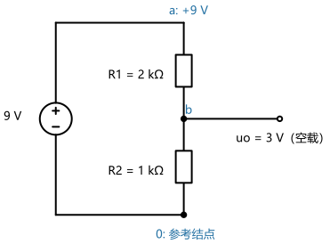

图 1 的接线是：电源正端 a → $R_1$ → 中间点 b → $R_2$ → 电源负端 0。输出取 b、0 两点，$u_o=V_b-V_0$。**空载（open-circuit/no-load）**指输出端不接用电设备，因此引出的输出线上电流为零；内部电阻回路仍有电流。

本讲要把三件事算清：电流和两只电阻的电压怎样由方程一起确定；接在输出端的**负载（load）**怎样改变接线与电流；真实电池有内阻时，负载所得电压为何小于内部理想源电压。§4 给出完整求解，不靠预先记住分压公式。

**下一站**：接线之外，每个元件还各自约束电压和电流；先从线性电阻开始。

## 1. 电阻元件：正比关系

### 1.1 欧姆定律与参考方向

**伏安关系（volt-ampere relationship）**是元件端电压与端电流之间的约束。它不一定让“知道一个就能推出另一个”：线性电阻可以，理想电压源却只固定电压，不固定电流。

**线性电阻（linear resistor）**在关联参考方向下满足**欧姆定律（Ohm's law）**：

$$u=Ri,\qquad i=\frac{u}{R}\quad(R>0).$$

关联参考方向指电流箭头从电压参考“+”端流入。$R$ 是阻值，单位欧姆（ohm，$\Omega$），$1\,\Omega=1\,\mathrm{V/A}$。横轴取 $i$、纵轴取 $u$，特性是过原点的直线，斜率为 $R$。

**方向变了怎样写**：保留电压极性、把电流箭头反过来，新的电流 $\tilde i=-i$（波浪号只用于区分新旧变量），元件关系成为 $u=-R\tilde i$。这叫非关联参考方向。改变箭头只改变数值的符号，不改变元件。

例如 $R=1\,\mathrm{k\Omega}$、$u=2\,\mathrm{V}$：关联方向电流 $i=2\,\mathrm{mA}$；反向箭头电流 $\tilde i=-2\,\mathrm{mA}$。两式都给出同一个物理电流。

| 关联方向电流 $i$ | -2 mA | 0 mA | 1 mA | 2 mA | 3 mA |
|---|---|---|---|---|---|
| $u=Ri$，$R=1\,\mathrm{k\Omega}$ | -2 V | 0 V | 1 V | 2 V | 3 V |

**单位检查**：$2\,\mathrm{V}/1000\,\Omega=0.002\,\mathrm{A}=2\,\mathrm{mA}$；也可以直接用 $2\,\mathrm{V}/1\,\mathrm{k\Omega}=2\,\mathrm{mA}$。后面所有联立方程都遵守这两种配套单位。

### 1.2 短路与开路

- **短路（short circuit）**：约束为 $u=0$，电流由其余电路决定。理想导线、闭合的理想开关满足这个关系；$u=0$ 不代表 $i=0$。
- **开路（open circuit）**：约束为 $i=0$，两端电压由其余电路决定。断开的理想开关满足这个关系；$i=0$ 不代表 $u=0$。

把 $R\to0$ 或 $R\to\infty$ 当直觉可以，但处理理想开短路时直接写上述约束，不做“除以零”或“无穷大乘零”。在开路端用理想电压表测电压，电表电流为零；实际电表会取很小的电流，这属于负载效应。

### 1.3 线性与时不变是两种分类

**线性**说电压与电流是否成比例；**时不变（time-invariant）**说参数关系是否显含时间。$u=R(t)i$ 在每个时刻仍对电流线性，却不是时不变电阻。若 $u$ 是 $i$ 的非直线函数，这条曲线可以不显含时间，却是非线性的。

实际电阻有容差与温度变化。近似成常数 $R$，要看该误差对当前计算是否可忽略；灯丝启动时温度变化显著，就不能用热态阻值算完整启动过程。具体元件是否近似线性，必须看它的工作范围。

### 1.4 非线性曲线不能直接套 $u=Ri$

对**非线性（nonlinear）**电阻，当前电流为 $I_0$、电压为 $U_0$ 的点叫**工作点（operating point）**。在其附近取 $\Delta i=i-I_0$、$\Delta u=u-U_0$（$\Delta$ 读 delta，表示变化量），曲线的一阶近似是：

$$\Delta u\approx r_d\Delta i,\qquad
r_d=\left.\frac{\mathrm du}{\mathrm di}\right|_{I_0},\qquad
u\approx U_0+r_d(i-I_0).$$

$r_d$ 叫微分电阻（differential resistance），是切线斜率；一般不等于 $U_0/I_0$。这是认识层：知道“切线近似针对变化量”即可，系统非线性分析不在本课范围。

具体例子：若 $u=\alpha i^3$、$\alpha=1\,\mathrm{V/A^3}$，在 $I_0=1\,\mathrm{A}$ 时 $U_0=1\,\mathrm{V}$，切线斜率 $r_d=3\,\Omega$。$i=1.1\,\mathrm{A}$ 时，切线近似给 $1+3\times0.1=1.3\,\mathrm{V}$，精确值为 $1.331\,\mathrm{V}$；直接错套 $u=r_di$ 会给 $3.3\,\mathrm{V}$。

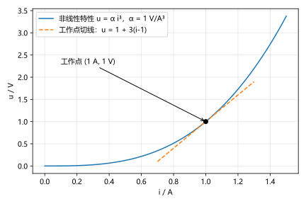

图 2 蓝线是 $u=\alpha i^3$，其中 $\alpha$（读 alpha）规定曲线尺度；虚线是经过 $(1\,\mathrm A,1\,\mathrm V)$ 的切线。切线接近工作点时才近似曲线，其斜率 3 Ω 并不表示工作点电压等于 $3\,\Omega\times1\,\mathrm A$。

电容、电感是储能元件，其关系涉及电压或电流的变化率，不是常数电阻的 $u=Ri$；第 09 讲从储能关系推导。这里不需要它们的公式，但不能把欧姆定律当全部元件的定义。

### 1.5 电阻功率与额定值

对 $R>0$ 的线性电阻，在关联方向下：

$$p_{\mathrm{abs}}=ui=Ri^2=\frac{u^2}{R}\ge0.$$

因此电流求成负数，电阻仍吸收功率。例如 $R=1\,\mathrm{k\Omega}$、$i=-2\,\mathrm{mA}$，则 $u=-2\,\mathrm{V}$，$p_{\mathrm{abs}}=(-2)\times(-0.002)=0.004\,\mathrm W=4\,\mathrm{mW}$。

**额定功率（rated power）**是元件在规定使用条件下允许长期耗散的功率。例：$R=1\,\mathrm{k\Omega}$ 接 10 V，$p=10^2/1000=0.1\,\mathrm W$；接 20 V，$p=0.4\,\mathrm W$，已超过 0.25 W 的额定值。实际选型还要按温度、通风和厂家要求留余量，不能以“算出的电流没错”替代安全检查。

本节要会用欧姆定律、开短路约束和三种功率式；非线性切线关系只需能识别误用。

**下一站**：电阻让电压与电流成比例；电源则先规定其中一个量，另一个由接线求出。

## 2. 独立源与受控源

### 2.1 理想电压源：给定电压，求电流

**独立源（independent source）**的给定量不依赖电路中其他电压、电流。它既可以是常数，也可以是题目规定的时间波形；“独立”不等于“不随时间变化”。本讲用直流数值。

**理想电压源（ideal voltage source）**固定端电压：

$$u=u_S(t)\quad\text{或直流下 }u=U_S.$$

$t$ 是时间，$u_S(t)$ 是给定的电压波形，$U_S$ 是本讲的常数电压；它们都按源符号的参考极性取值。

电流不由这条关系规定，而由所接电路求出。例如上正下负的 9 V 源接电阻：

| 所接电路 | 流向负载的电流 | 电源端电压 |
|---|---|---|
| $R=1\,\mathrm{k\Omega}$ | $9/1000=0.009\,\mathrm A=9\,\mathrm{mA}$ | 9 V |
| $R=2\,\mathrm{k\Omega}$ | 4.5 mA | 9 V |
| 开路 | 0 | 9 V |

零电压源只要求 $u=0$，因而在端口上与短路相同。**非零理想电压源不能直接短路**：源要求 $u=9\,\mathrm V$，导线要求 $u=0$，两条约束矛盾。理想模型是无解，不是计算出一个可接受的“无限大电流”；真实短路可能造成大电流和损坏。

### 2.2 理想电流源：给定电流，求电压

**理想电流源（ideal current source）**沿符号内箭头固定电流：

$$i=i_S(t)\quad\text{或直流下 }i=I_S.$$

$i_S(t)$ 是按源箭头给定的电流波形，$I_S$ 是本讲的常数电流。

电压由外电路求出。例如 2 mA 源把电流送入电阻：

| 所接电路 | 两端电压的大小 | 源电流 |
|---|---|---|
| $R=1\,\mathrm{k\Omega}$ | $(0.002)(1000)=2\,\mathrm V$ | 2 mA |
| $R=2\,\mathrm{k\Omega}$ | 4 V | 2 mA |
| 短路 | 0 | 2 mA |

零电流源只要求 $i=0$，在端口上与开路相同。**非零理想电流源不能直接开路**：开路要求 $i=0$，源要求 $i=2\,\mathrm{mA}$，仍然矛盾。实际恒流电路只能在有限的输出电压范围内保持恒流，超过范围就不能继续用这个理想模型。

“电压不由源规定”不代表电压可以随意填，“电流不由源规定”也不代表电流可以随意填；两者都必须满足其余电路的约束。

### 2.3 内阻：内部源电压与端电压不同

近似实际电池时，可用理想电压源 $U_S$ 串联内阻 $R_i$。**内阻（internal resistance）**描述内部的压降与损耗；**端电压（terminal voltage）**是这个组合模型对外两个接线端之间的电压。

电流 $i_{\mathrm{out}}$ 从电池正端流向负载，负载电压上正下负。内阻压降为 $R_i i_{\mathrm{out}}$，因此：

$$u=U_S-R_i i_{\mathrm{out}}.$$

这里是**输出电流**口径。若改用从电池正端流入的关联电流 $i_{\mathrm{in}}=-i_{\mathrm{out}}$，同一关系写成 $u=U_S+R_i i_{\mathrm{in}}$。不能只看一个负号而不看箭头。

设 $U_S=3\,\mathrm V$、$R_i=0.5\,\Omega$，模型计算为：

| $i_{\mathrm{out}}$ | 0 A | 0.5 A | 1 A | 2 A |
|---|---|---|---|---|
| $u=3-0.5i_{\mathrm{out}}$ | 3 V | 2.75 V | 2.5 V | 2 V |

这是模型计算，**不是对某节实体电池的测量**。内阻可随温度、电量和工作状态改变；这些因素显著时，常数内阻近似需要调整。

### 2.4 受控源：控制关系与功率要分开

**受控源（controlled/dependent source）**的输出电压或电流由另一个标明的电压、电流决定。它是电源模型的一类，常用于描述放大器等有源器件的输入输出关系；不能说“受控源不是电源”或“受控源不会发出功率”。

命名按“什么量控制什么源”。Voltage 是电压，Current 是电流，Controlled 是受控，Source 是源：

| 类型与英文全称 | 关系 | 系数单位 | 一个具体数值 |
|---|---|---|---|
| 压控压源 VCVS（voltage-controlled voltage source） | $u_d=\mu u_c$ | $\mu$ 无量纲 | $\mu=3,u_c=2\,\mathrm V\Rightarrow u_d=6\,\mathrm V$ |
| 压控流源 VCCS（voltage-controlled current source） | $i_d=g u_c$ | $g$ 为 S，即 A/V | $g=0.5\,\mathrm{mS},u_c=2\,\mathrm V\Rightarrow i_d=1\,\mathrm{mA}$ |
| 流控压源 CCVS（current-controlled voltage source） | $u_d=r i_c$ | $r$ 为 Ω | $r=2\,\mathrm{k\Omega},i_c=1\,\mathrm{mA}\Rightarrow u_d=2\,\mathrm V$ |
| 流控流源 CCCS（current-controlled current source） | $i_d=\beta i_c$ | $\beta$ 无量纲 | $\beta=4,i_c=1\,\mathrm{mA}\Rightarrow i_d=4\,\mathrm{mA}$ |

$u_c,i_c$ 是控制量，$u_d,i_d$ 是源规定的输出量。$\mu$ 读 mu，$\beta$ 读 beta，它们在此只是控制系数的名字。S 读西门子（siemens），$1\,\mathrm S=1\,\mathrm{A/V}$，$1\,\mathrm{mS}=10^{-3}\,\mathrm S$。独立源用圆形或电池符号，受控源用菱形；压源标极性，流源标输出箭头。

**控制量入方程的三步**：

1. 标控制位置：电压控制必须给出两点与极性，如 $u_c=V_a-V_b$；电流控制必须指明哪条支路及其箭头。
2. 写该处的关系：例如控制量是一只 1 kΩ 电阻的关联电压，便写 $u_c=(1\,\mathrm{k\Omega})i_c$。
3. 写源关系并联立：$i_d=(0.5\,\mathrm{mS})u_c$。控制量若已知可代入，若未知要和电路一起求，不能因为“它是受控的”就删掉。

控制位置可以在其他支路，也可以就是某个端口。改变控制极性后，还要同步改控制关系的符号，不能改变箭头而保留原方程。§4.3 给流控压源，§4.7 给另一支路电压控制输出电流的完整算例。

**控制信号不等于供电**。例如放大器用小输入信号控制输出，负载能量主要来自它的供电电源。只画受控源的小信号模型可能把供电过程省略了；不能据此断言真实器件无须供电，也不能强行要求模型里的全部输出功率都由可见的控制支路提供。

受控源的吸收功率照样算：电流从其参考“+”端流入时 $p_d=u_di_d$，否则 $p_d=-u_di_d$。正值吸收，负值发出。源的控制关系只给 $u_d$ 或 $i_d$ 中一个，另一个仍要从接线求。

若线性受控源的控制量为零，受控压源要求 $u_d=0$（短路型约束），受控流源要求 $i_d=0$（开路型约束）。**控制量为零必须来自电路求解或题目条件**，不是任意把受控源“关掉”。

### 2.5 伏安特性图怎样帮助求解

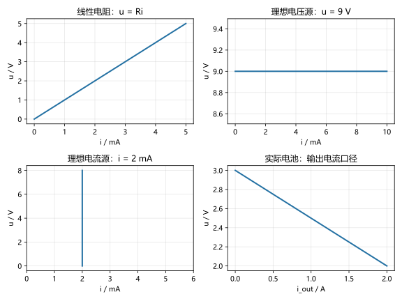

图 3 中，电阻是过原点的斜线；9 V 压源是水平线；2 mA 流源是竖直线；实际电池按输出电流口径是下垂直线。**元件关系只限定允许的工作点，外电路才决定实际取哪一点**。这就是后面要同时写元件方程和连接方程的原因。

受控源不是“绝对画不出伏安曲线”：固定控制量时，受控压源也是给定高度的水平线，受控流源也是给定位置的竖直线；改变控制量会得到一族曲线。未指定控制量时，不能用一条固定的两端特性替代它的完整控制关系。

### 2.6 理想源串并联：先检查相容性

**串联（series connection）**是元件首尾相接、中间无其他分流支路，因此通过它们的电流相同。**并联（parallel connection）**是各元件接在同一对结点上，因此按相同两端顺序取的电压相同。详细化简在第 03 讲，这里先检查源能否这样连接。

| 连接 | 接线要求 | 判断 |
|---|---|---|
| 电压源串联 | 电流相同；总电压是各源沿同一方向的代数和 | 同向 5 V 与 3 V 得 8 V；反向抵消得 2 V |
| 电流源并联 | 电压相同；总电流是各源沿同一方向的代数和 | 同向 2 mA 与 3 mA 得 5 mA；反向得 1 mA，方向按较大者 |
| 电压源并联 | 两源对同一对端子规定的电压必须相同 | 同极性 5 V 与 3 V 并联，无解 |
| 电流源串联 | 两源对同一串联电流规定的值必须相同 | 同方向 1 mA 与 2 mA 串联，无解 |

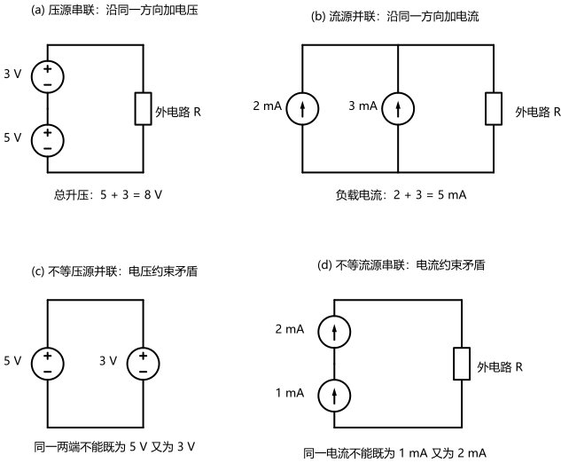

图 4(a) 沿源从负端到正端上行，两次升压相加；(b) 两流源箭头都向上，在上结点合成负载电流。(c) 两压源同接一对结点，却规定不同电压；(d) 两流源在无分岔的同一路径，却规定不同电流。这两种画法本身就显示了矛盾，不应试图硬解成有限电压电流。

**数值相同只说明相容，不保证内部各量唯一**：

- 两个同极性 5 V 理想压源并联接 1 kΩ 负载。负载电流确定为 5 mA，但只得到两源输出电流 $i_{S1}+i_{S2}=5\,\mathrm{mA}$；$2+3$、$1+4$ 都满足，不能推成“每个分一半”。
- 两个同方向 1 mA 理想流源串联接 2 kΩ 电阻。电阻电压为 2 V，但两源沿供电方向的升压只满足 $u_{S1}+u_{S2}=2\,\mathrm V$，分别是多少无法由这套理想关系确定。

上述判断看的是**带极性/箭头的值**：把其中一个 5 V 压源反接到同一对端子，就变成规定 $u_{ab}=-5\,\mathrm V$，不再与 $u_{ab}=5\,\mathrm V$ 相容。

真实电池有内阻与其他限制，理想矛盾可能表现为很大的均衡电流，而不是“没有问题”。本节是模型分析，不是电池并联的操作建议。

本节要会写源关系、标控制量和检查连接是否相容；求解时源的未知电压/电流和其他量一起列入方程。

**下一站**：元件关系已经齐全；再把理想导线的连接方式翻译成 KCL/KVL。

## 3. 基尔霍夫定律：两条连接定律

本节在**集总参数模型**下使用电路：导线理想，元件的电气行为由端子关系描述。定律不以“恒定直流”为前提；它们同样用于后面的动态电路和交流电路。

### 3.1 结点、支路、回路与网孔

- **结点（node）**：理想导线直接连通的一组端子。导线上无电压差，因此这一组端子具有同一电位；它在图上可以很长，不限于一个黑点。
- **支路（branch）**：连接两个结点的电路部分。本讲列元件关系时默认一个二端元件（具有两个接线端）一条支路。也可以把中间无分岔的多个串联元件合成一条支路，此时支路电压为各元件电压的代数和。
- **回路（loop）**：沿支路构成的闭合路径；通常选不重复经过结点（起终点除外）的回路。
- **网孔（mesh）**：能画成支路不交叉的平面电路中，内部不再包含其他支路的回路。每个网孔是回路，外面围着多个网孔的大回路不是网孔。

**两路连接点也是结点**。为了减少支路法的未知量，教材可能把它与相邻串联元件一起合并；这只是改变描述粒度，**不是用导线短接两个不同电位的结点**。电路里是否串联，看无分流的连接方式，不看算出的电流是否碰巧相等。

以图 1 的空载分压器为例，按元件级口径有 a、b、0 三个结点和三条支路。b 虽然只有两个元件相连，仍能列 $i_1-i_2=0$。带载后新增 b→0 的负载支路，关系变为 $i_1-i_2-i_L=0$，不能继续把 $R_1,R_2$ 当无分流的一条串联支路。

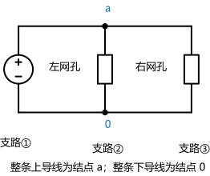

图 5 的上导线整体是 a，下面整体是 0，共两结点、三支路。支路①+②、②+③是两个网孔；①+③构成外回路。导线转弯不新增结点，图上距离也不改变连接关系。线条交叉处是否相接，必须按连接点标记判断。

### 3.2 KCL：按电流参考箭头列方程

**基尔霍夫电流定律**：同一时刻，流入任一结点的电流之和等于流出之和。本课程固定使用：

$$\sum i_{\mathrm{出}}-\sum i_{\mathrm{入}}=0.$$

电荷守恒的一般形式是“流入减流出 = 结点储存电荷的变化率”。理想集总结点本身不作为独立储电元件，所以右边取零；若寄生储电不可忽略，就把它建模为电容支路，并把那条支路电流计入 KCL。**电流随时间变化不妨碍 KCL 逐时成立**。

**标准列法**：

1. 指定结点，给所有相连支路标电流参考箭头。
2. 箭头离开结点的变量取正，指向结点的变量取负。
3. 代数和等于零，求未知量；求成负数时按原箭头反向解释，不重列方程。

**例**：$i_1=2\,\mathrm{mA}$ 指向结点，$i_2=1\,\mathrm{mA}$、$i_3=0.5\,\mathrm{mA}$ 离开结点，$i_4$ 箭头也向外。统一用 mA：

$$-2+1+0.5+i_4=0\quad\Rightarrow\quad i_4=0.5\,\mathrm{mA}.$$

进出分别为 2 mA 与 $1+0.5+0.5=2$ mA。假如流入改为 1 mA，其他已知值不变，则 $i_4=-0.5\,\mathrm{mA}$，表示实际有 0.5 mA 从第四支路流入。

**广义结点（generalized node）**是对一块电路整体列 KCL。若 A→B 的内部支路电流为 $i$，对 A 列式时记 $+i$，对 B 列式时记 $-i$；两式相加，内部支路抵消，只剩穿过整体边界的电流。这不是把 A、B 短接，也不要求它们电位相等。

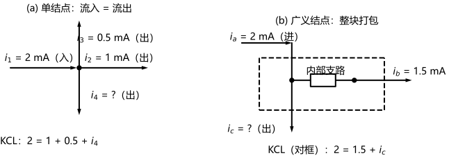

图 6(a) 对应上述四支路例。图 6(b) 对虚线框整体列式，单位统一为 mA：$-2+1.5+i_c=0$，故 $i_c=0.5\,\mathrm{mA}$。只数穿过虚线的电流；框内的内部支路不重复计入。第 05 讲会利用这种相加的做法处理含电压源的结点方程。

### 3.3 KVL：按电压参考极性与绕行方向列方程

**基尔霍夫电压定律**：在所用集总模型中，沿任一回路绕行，各支路的有向电压降代数和为零。

先用电位差解释其来源。沿 a→b→c→a：

$$u_{ab}+u_{bc}+u_{ca}
=(V_a-V_b)+(V_b-V_c)+(V_c-V_a)=0.$$

中间电位逐个抵消。电源、电阻等的电压虽不相同，却必须满足这个连接关系。它与能量守恒相容，但列式不必想象某个电子真的绕行一圈。

**标准列法**：

1. 给每个元件标电压参考“+”“-”。对电阻可让电流箭头从“+”流入，便于直接用 $u=Ri$。
2. 任选绕行方向，它与电流箭头无须一致。
3. 沿走向从参考“+”到“-”记 $+u$，从参考“-”到“+”记 $-u$；逐项相加为零。

“降正升负”指的是**参考极性**。未知电压最终可能为负，不能先猜实际高低再决定式子的符号。

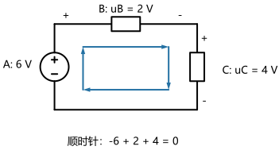

图 7 选顺时针，从底部向左边 A 上行，再经过上边 B 和右边 C。A 从“-”到“+”记 $-u_A$；B、C 从“+”到“-”分别记 $+u_B,+u_C$。已知 $u_A=6\,\mathrm V,u_B=2\,\mathrm V$，求 $u_C$：

$$-6+2+u_C=0\quad\Rightarrow\quad u_C=4\,\mathrm V.$$

反向绕行，式子为 $6-2-u_C=0$，结果仍为 4 V。不是把电流反过来，而是把同一条方程整体乘以 -1。

**路径版**：从 a 到 b，沿途有向电压降之和为 $V_a-V_b=u_{ab}$。例如 a→c→b：$u_{ac}+u_{cb}=u_{ab}$。任挑一条已知电压较多的路径，注意端子顺序即可；这会用于后面求结点电位。

### 3.4 联立的是什么，方程数说明什么

连接定律不知道阻值，元件关系不知道其他支路怎么连，两者缺一不可。以连通电路、元件级二端支路为例，记支路数为 $b$、结点数为 $n$；$b$ 条支路有 $2b$ 个电流/电压变量；元件给 $b$ 条关系，连接关系可选 $n-1$ 条独立 KCL、$b-n+1$ 条独立 KVL：

$$b+(n-1)+(b-n+1)=2b.$$

这里**独立**指某条方程不能由其他已选方程推出。例如图 5 在 a 列 $-i_S+i_1+i_2=0$，在 0 列 $i_S-i_1-i_2=0$，两式只差整体负号，只提供一条独立信息。三个回路也只有两条独立 KVL，外回路可由两个网孔的式子相减得到。如何系统选满独立方程，第 04 讲详讲。

**方程数相等不保证有解，更不保证唯一**。两个未知量也可能满足 $x+y=1$ 与 $2x+2y=2$，有无数解；把第二式右边改成 3 就无解。§2.6 的等值源连接与不等值源冲突，是这种问题的电路实例。求解遇到矛盾或自由变量，先查接线、方向、单位、控制关系是否完整，再判断是不是理想模型本身退化。

**解电路五步**：

1. 标参考方向和电压极性，写明所求量。
2. 给各元件写关系；受控源同时写控制位置的关系。
3. 按结点列 KCL，按回路列 KVL。
4. 用代入或消元联立求解，保留正确单位。
5. 代回元件关系、KCL/KVL；各元件统一按吸收口径求功率，检查 $\sum p_{\mathrm{abs}}=0$。

### 3.5 适用范围不是“只许直流”

KCL/KVL 对线性或非线性元件都可列；非线性只是元件方程更难解。动态电路也照列，只是电容、电感的元件关系含变化率。

若电路尺寸不能忽略、导线有显著传播和储电效应，就不能继续把整段导线视作一个理想结点。若外部时变磁场造成了未计入模型的感应电压，也不能直接套用只含原有元件的 KVL，必须补上感应效应。电感和变压器中已经用元件关系描述的感应电压，则正常计入 KVL，不是见到感应或交流就停用定律。

本节要求能直接执行两套标准列法，并解释内部电流/电位怎样抵消；不要把“公式写出来了”当作已完成联立。

**下一站**：用同一套五步流程算完具体电路，包括带载后新增支路的情形。

## 4. 从元件关系到完整求解

### 4.1 约束同时成立，求解可以有先后

元件关系与 KCL/KVL 必须**同时满足**，但代入、消元当然可以按方便的顺序做。简单回路先求电流再回代电压，并不违背联立；关键是每一步依据已列出的关系，而不是凭“电流先出现、电压后来分配”猜答案。

以下六题都用元件关系与连接定律求解。计算电流时配套使用 V、Ω、A；功率也可用 V 与 mA 相乘直接得到 mW，不能漏掉单位换算。

### 4.2 例 1：空载分压器

**题**：9 V 理想压源上正下负；正端 a 经 2 kΩ 电阻 $R_1$ 到 b，再经 1 kΩ 电阻 $R_2$ 到负端 0。输出 b、0 不接负载。求回路电流、两电阻电压和 $u_o=u_{b0}$，验证功率。

**1. 标方向**：回路顺时针，电阻电流向下；$u_1=u_{ab},u_2=u_{b0}$，均关联。空载 KCL 给出 $i_1=i_2=i$。

**2–3. 写元件关系与 KVL**：

$$u_1=(2000\,\Omega)i,\qquad u_2=(1000\,\Omega)i,
\qquad -9\,\mathrm V+u_1+u_2=0.$$

**4. 联立**：

$$3000\,\Omega\,i=9\,\mathrm V
\quad\Rightarrow\quad i=0.003\,\mathrm A=3\,\mathrm{mA}.$$

回代：$u_1=2000\times0.003=6\,\mathrm V$，$u_2=1000\times0.003=3\,\mathrm V$，所以 $u_o=3\,\mathrm V$。

**5. 验算**：KVL 为 $-9+6+3=0$。电源电流从“-”流入，吸收功率为 $(-9\,\mathrm V)(0.003\,\mathrm A)=-0.027\,\mathrm W=-27\,\mathrm{mW}$；两电阻吸收 18 mW 与 9 mW，总和为零。

对总电压为 $U$、电阻为 $R_1,R_2>0$ 且中间无分流的串联段，同样由 $-U+R_1i+R_2i=0$ 得到：

$$i=\frac{U}{R_1+R_2},\qquad u_2=\frac{UR_2}{R_1+R_2}.$$

这是**分压公式**，成立条件是两电阻之间没有其他分流支路。输出接负载后要重新写 b 点 KCL，例 5 会直接计算。

### 4.3 例 2：流控压源与回路电流联立

**题**：3 V 独立压源、1 Ω 电阻、CCVS 串联成回路；回路电流 $i$ 顺时针。CCVS 控制量就是 $i$，规定上正下负电压 $u_d=(2\,\Omega)i$。求电流、元件电压与吸收功率。

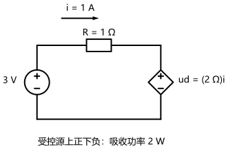

图 8 左源上正下负，顶部电流向右，通过电阻后向下进入 CCVS 的正端。控制电流箭头与公式中的 $i$ 是同一个量。

写元件关系及顺时针 KVL：

$$u_R=(1\,\Omega)i,\qquad u_d=(2\,\Omega)i,
\qquad -3\,\mathrm V+u_R+u_d=0.$$

代入：$(1+2)\,\Omega\,i=3\,\mathrm V$，故 $i=1\,\mathrm A$。回代 $u_R=1\,\mathrm V,u_d=2\,\mathrm V$。

吸收功率：独立源 -3 W，电阻 +1 W，CCVS +2 W，和为零。受控源在这道题中吸收功率，是由**它的电压与电流方向**算出的，不是定义要求；例 6 会出现发出功率的受控源。

### 4.4 例 3：单结点对与电流源

**题**：2 mA 理想电流源从结点 0 向 a 注入；两只 1 kΩ 电阻分别接在 a、0 之间。求共同电压 $u=u_{a0}$、各电阻向下电流与功率。

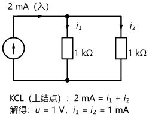

各元件同接 a、0，故电阻电压相同。两电阻电流按关联方向向下：

$$i_1=\frac{u}{1000\,\Omega},\qquad i_2=\frac{u}{1000\,\Omega}.$$

a 点 KCL：

$$-0.002\,\mathrm A+\frac{u}{1000\,\Omega}+\frac{u}{1000\,\Omega}=0
\quad\Rightarrow\quad \frac{2u}{1000\,\Omega}=0.002\,\mathrm A.$$

解得 $u=1\,\mathrm V$，$i_1=i_2=0.001\,\mathrm A=1\,\mathrm{mA}$。若改用 V、kΩ、mA，式子可写成 $-2+u/1+u/1=0$；**不能写 $2=2u/1000$ 却同时把 2 当 mA、分母当 Ω**。

KCL 回代为 $-2+1+1=0$（mA）。电流源从参考负端流入，吸收功率 $-uI_S=-2\,\mathrm{mW}$，两电阻各 +1 mW，平衡。

这里电流相等是阻值相同与电压相同的结果，接法仍是并联，不是串联。单结点对的未知电压直接由 KCL 求出，是第 05 讲结点电压法的最小例子。

### 4.5 例 4：有内阻的电源带负载

**题**：电池模型由 6 V 理想源与 1 kΩ 内阻串联构成；输出端接 2 kΩ、1 kΩ 串联负载。求电流、端电压和各功率。内阻 1 kΩ 是为演示选取的数值，不代表普通实体电池的内阻量级。

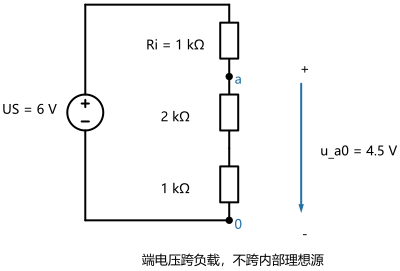

图 10 的 6 V 是内部源电压；负载跨 a、0 两点，电池端电压也跨这两点。**不能把端电压标在内部理想源两端**。

回路电流取从正端流向负载。元件关系给 $u_i=1000i,u_{2k}=2000i,u_{1k}=1000i$，顺时针 KVL：

$$-6+(1000+2000+1000)i=0,$$

这里数值单位为 V、Ω、A。故 $i=6/4000=0.0015\,\mathrm A=1.5\,\mathrm{mA}$。

回代：内阻压降 1.5 V，两个负载电压 3 V、1.5 V，端电压

$$u_{a0}=u_{2k}+u_{1k}=4.5\,\mathrm V
=6\,\mathrm V-(1\,\mathrm{k\Omega})(1.5\,\mathrm{mA}).$$

KVL 为 $-6+1.5+3+1.5=0$。吸收功率：内部源 -9 mW；内阻 +2.25 mW；2 kΩ 负载 +4.5 mW；1 kΩ 负载 +2.25 mW，总和为零。若只统计电池整体，其对外发出功率为 $4.5\times1.5=6.75\,\mathrm{mW}$，不是内部源的 9 mW。

### 4.6 例 5：分压器带载，直接用 KCL 重算

**题**：9 V 理想源的正端 a 经 $R_1=2\,\mathrm{k\Omega}$ 到 b，b 经 $R_2=1\,\mathrm{k\Omega}$ 到负端 0；另将 $R_L=1\,\mathrm{k\Omega}$ 负载接在 b、0。求输出 $u_o=u_{b0}$、三个电阻电流与功率。

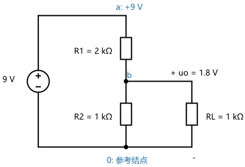

图 11 新增的是 b→0 支路，不是“输出端的电压变成另一个给定值”。取 $i_1$ 从 a 到 b，$i_2,i_L$ 从 b 到 0，各电阻均关联。

**写元件关系**：上电阻两端电压是 $9-u_o$，下电阻与负载都是 $u_o$：

$$i_1=\frac{9-u_o}{2000},\qquad
 i_2=\frac{u_o}{1000},\qquad i_L=\frac{u_o}{1000}.$$

这里电压用 V，电阻用 Ω，电流用 A。b 点 KCL $-i_1+i_2+i_L=0$，所以：

$$\frac{9-u_o}{2000}=\frac{u_o}{1000}+\frac{u_o}{1000}
\quad\Rightarrow\quad 9-u_o=4u_o
\quad\Rightarrow\quad u_o=1.8\,\mathrm V.$$

回代得 $i_1=7.2/2000=0.0036\,\mathrm A=3.6\,\mathrm{mA}$，$i_2=i_L=1.8\,\mathrm{mA}$。KCL 为 $-3.6+1.8+1.8=0$；上电阻 KVL 为 $-9+7.2+1.8=0$。

源发出 $9\times3.6=32.4\,\mathrm{mW}$；上电阻吸收 $7.2\times3.6=25.92\,\mathrm{mW}$，下电阻与负载各吸收 $1.8\times1.8=3.24\,\mathrm{mW}$，$25.92+3.24+3.24=32.4$。

**为什么不再是 3 V**：空载时 $i_1=i_2$；带载时 $i_1=i_2+i_L$，上电阻必须供两支路电流。上电阻压降增大，留给 b、0 的电压减小。并不是负载“用掉电压”，而是新接线改变了共同满足方程的解。

同样方法对源电压 $U$、正电阻 $R_1,R_2,R_L$，以及相同的三支路接法给出：

$$\frac{U-u_o}{R_1}=\frac{u_o}{R_2}+\frac{u_o}{R_L}
\quad\Rightarrow\quad
u_o=\frac{U}{1+R_1/R_2+R_1/R_L}.$$

$R_L$ 越大，负载电流越小，输出越接近空载值，但有限负载不能无条件继续用空载公式。

### 4.7 例 6：另一支路的电压控制输出电流

**题**：控制侧为上正下负的 2 V 独立压源，a、0 两端接 $R_c=1\,\mathrm{k\Omega}$。输出侧菱形 VCCS 从 0 向 b 注入 $i_d=g u_c$，$g=0.5\,\mathrm{mS}$，$u_c=u_{a0}$；b、0 接 $R_L=2\,\mathrm{k\Omega}$。两侧只共享参考结点 0，a 与 b 不连。求控制电流、输出电流/电压及功率。

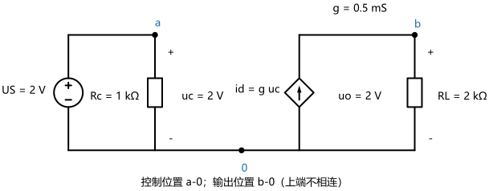

控制侧给定 $u_c=2\,\mathrm V$，电阻向下电流

$$i_c=\frac{2}{1000}=0.002\,\mathrm A=2\,\mathrm{mA}.$$

源关系给定的是输出电流，不是输出电压：

$$i_d=(0.0005\,\mathrm{A/V})(2\,\mathrm V)
=0.001\,\mathrm A=1\,\mathrm{mA}.$$

b 点 KCL 为 $-i_d+i_L=0$，负载关系为 $u_o=(2000\,\Omega)i_L$。于是 $i_L=1\,\mathrm{mA}$，$u_o=u_{b0}=2\,\mathrm V$。

功率分别检查：控制侧独立源 -4 mW，$R_c$ +4 mW；输出侧 VCCS 电流从其负端流入，吸收功率 $-u_oi_d=-2\,\mathrm{mW}$，$R_L$ +2 mW。**受控源发出了 2 mW**，与例 2 吸收 2 W 的结果并不矛盾。

这个模型规定控制关系，却不描述受控源内部的供电装置。若把它用来模拟放大器，真实输出能量要由供电提供，不能从 $i_d=g u_c$ 推断“控制信号提供了全部能量”。计算模型时仍把受控源的功率计入，不能漏项。

### 4.8 数值验证怎样读

归档脚本 `scripts/lec02-04_verify_reconstruction.py` 用完整元件/KCL/KVL 方程求解，再与上述解析值比较。从工作区根目录运行纯计算命令：

```text
uv run --with numpy python tutorials/electric_circuits/scripts/lec02-04_verify_reconstruction.py --check-only
```

| 算例 | 求解结果 | 独立验算的关系 |
|---|---|---|
| 空载分压器 | $i=3\,\mathrm{mA},u_o=3\,\mathrm V$ | KVL、两电阻关系、功率 |
| CCVS 回路 | $i=1\,\mathrm A,u_d=2\,\mathrm V$ | 控制关系、KVL、功率 |
| 单结点对 | $u=1\,\mathrm V,i_1=i_2=1\,\mathrm{mA}$ | KCL、两电阻关系、功率 |
| 内阻电源 | $i=1.5\,\mathrm{mA},u_{a0}=4.5\,\mathrm V$ | 内阻压降、KVL、功率 |
| 带载分压器 | $u_o=1.8\,\mathrm V,i_1=3.6\,\mathrm{mA}$ | 新增负载关系、b 点 KCL、功率 |
| 跨支路 VCCS | $i_d=1\,\mathrm{mA},u_o=2\,\mathrm V$ | 控制关系、输出 KCL、两侧功率 |

负载从 1 kΩ、10 kΩ 增大到 100 kΩ，同一模型的输出分别为 1.8 V、2.8125 V、2.9801324503 V，逐渐接近空载 3 V。这个比较只改变 $R_L$，保留其余接线与参数，所以能看清负载的影响。

脚本还检测所有数值作业和理想源约束。阈值是为这些小规模计算**当场选取**的 $10^{-10}$；改用 $10^{-9}$、$10^{-11}$ 结果相同。它不代表实体电路测量精度。有限数值与回代残差不能替代前面定律的推导。

**下一站**：把源模型、符号和带载最容易混的结论校准，再独立做作业。

## 常见误区校准

本节零新知识，只校准前面已讲过的结论。

- **受控源不是电源、不会发出功率？** 不是。它是受控制关系约束的源模型；功率仍按端口电压、电流判断。例 2 吸收，例 6 发出（§2.4、§4.3、§4.7）。
- **KCL 只对恒定直流或三叉结点成立？** 不是。它对集总模型的结点逐时成立，合并结点也由相加抵消得到（§3.1–§3.2）。
- **KVL 的正负跟着电流走？** 不是。符号看电压参考极性与绕行方向；绕反只使整个方程变号（§3.3）。
- **方程数等于未知数就有唯一解？** 不是。理想源可能产生矛盾或自由变量，必须检查相容性（§2.6、§3.4）。
- **空载输出 3 V，带载继续代原分压公式？** 不行。负载增加分流支路，要重列中间结点 KCL（§4.6）。
- **联立求解禁止先算电流再算电压？** 不是。约束同时满足，代入消元可有先后；次序不能代替依据（§4.1）。

**下一站**：把元件约束、连接定律和求解流程整理为能独立使用的结论。

## 本讲小结

- **元件关系**：关联方向电阻 $u=Ri$；压源固定电压，流源固定电流；零压源短路型、零流源开路型。正电阻吸收功率不取决于电流数值是否为正。
- **实际电池**：$u=U_S-R_i i_{\mathrm{out}}$，这里 $i_{\mathrm{out}}$ 从正端流向负载；端电压跨组合模型的外端，不是内部源电压。
- **受控源**：$u_d=\mu u_c$、$i_d=g u_c$、$u_d=r i_c$、$i_d=\beta i_c$。标控制位置及方向，补关系后联立；控制关系不能替代供能分析。
- **KCL**：按支路参考箭头，流出为正、流入为负；广义结点相加后内部电流抵消。
- **KVL**：按绕行方向，参考“+”到“-”取 $+u$，反向取 $-u$；路径版求两点电压。定律在所用集总模型中也用于变化电流、电压。
- **源连接**：电压源串联加电压，电流源并联加电流；并联压源/串联流源要先检查相容性，相同数值也不保证内部量唯一。
- **求解**：标方向 → 元件关系 → KCL/KVL → 联立 → 回代元件、连接与功率。方程数只帮检查遗漏，不证明有唯一解。
- **分压器**：空载 3 V；本讲 1 kΩ 负载接到输出后为 1.8 V。变化来自新支路改变 KCL，不是把某个电压“消耗掉”。

## 掌握度自测（与开头四项目标对应）

- [ ] 我能写出电阻、源与内阻模型的关系、单位及方向；识别零值源，并判断理想源连接相容或不唯一（目标 1）。
- [ ] 我能识别结点、支路、回路、网孔；按参考箭头/极性列 KCL/KVL，解释其适用前提和独立计数的局限（目标 2）。
- [ ] 我能遮住答案算完空载/带载分压器、单结点对、内阻电源，给出带单位的方程及功率回代（目标 3）。
- [ ] 我能给四类受控源标控制量并写方程，完成单回路及跨支路控制例题，说明其功率与能量来源不能混为一谈（目标 4）。

## 作业

先独立完成再对照。需要的元件关系、相容性与联立方法均已在正文教过；数值题可以用 `scripts/lec02-04_verify_reconstruction.py --check-only` 复核。

### 基础

**Q1. 概念辨析**：判断下列说法对不对，并给一句话理由。

(a) "受控源不会发出功率，因为它不是电源。"
(b) "理想电压源输出多少电流，是由它内部决定的。"
(c) "欧姆定律 $u = Ri$ 对所有元件都成立，是电路分析的基本公式。"
(d) "只有三条以上支路交汇的点才配用 KCL，两条支路的连接点不行。"
(e) "写 KVL 时绕行方向必须与电流方向一致，否则会算错。"

**参考答案：**

(a) 错。受控源是源模型，按端电压、电流可算出发出功率；例 6 就发出 2 mW。控制关系不说明真实器件怎样供电。

(b) 错。理想压源规定端电压，电流要与外电路共同求解。

(c) 错。常数 $R$ 的 $u=Ri$ 是线性电阻关系；储能或非线性元件关系不同。

(d) 错。两路结点也能列 KCL；广义结点的关系由各结点方程相加得到。

(e) 错。KVL 看电压极性与绕行，绕反后所有项变号，物理结果相同。

**Q2. 计算·单回路全流程**：3 V 理想压源上正下负，两只 100 Ω、200 Ω 电阻在右侧首尾相接，与源构成一圈回路。取电流顺时针，各电阻电压按电流流入端为正。求电流、两电阻电压与功率验证。

**参考答案：**

1. 电源上正下负，回路顺时针；两电阻电流从各自正端流入。
2. 元件关系为 $u_1=(100\,\Omega)i,u_2=(200\,\Omega)i$，KVL 为 $-3\,\mathrm V+u_1+u_2=0$。
3. 代入：$(100+200)i=3$（Ω、A、V），$i=3/300=0.01\,\mathrm A=10\,\mathrm{mA}$；电阻电压为 1 V、2 V。
4. 回代 $-3+1+2=0$；吸收功率为电源 -30 mW、电阻 +10 mW、+20 mW，和为零。

**Q3. 计算·单结点对**：4 mA 理想电流源从下结点向上结点注入，两只 2 kΩ 电阻同接这对结点。取电压上正下负、两电阻电流向下。求共同电压、各电流与吸收功率。

**参考答案：**

源从下结点向上结点注入 4 mA，$u$ 上正下负，电阻电流向下。

$$-0.004\,\mathrm A+\frac{u}{2000\,\Omega}+\frac{u}{2000\,\Omega}=0
\quad\Rightarrow\quad u=\frac{0.004\times2000}{2}=4\,\mathrm V.$$

各电流 $i_1=i_2=4/2000=0.002\,\mathrm A=2\,\mathrm{mA}$。KCL 回代为 $-4+2+2=0$（mA）；电流源吸收功率 -16 mW，两电阻各 +8 mW，和为零。

### 提高

**Q4. 计算·含受控源**：6 V 理想压源上正下负，顺时针回路经过 2 Ω 电阻与 CCVS。电流 $i$ 在 CCVS 中向下，CCVS 电压也上正下负，$u_d=(2\,\Omega)i$。求电流、两元件电压及吸收功率。

**参考答案：**

电阻 $u_R=(2\,\Omega)i$，受控源 $u_d=(2\,\Omega)i$。KVL：$-6+u_R+u_d=0$（V），所以 $(2+2)\,\Omega\,i=6\,\mathrm V$，$i=1.5\,\mathrm A$。

回代 $u_R=u_d=3\,\mathrm V$，$-6+3+3=0$。吸收功率分别为独立源 -9 W、电阻 +4.5 W、受控源 +4.5 W，和为零。

**Q5. 计算·分压器设计**：12 V 理想压源上正下负，$R_1$ 在正端与输出点之间，$R_2$ 在输出点与负端之间。输出空载，要求相对负端为 4 V。用正整数 kΩ 电阻设计一组，并验算电流、电压与功率。

**参考答案：**

空载公式给 $4=12R_2/(R_1+R_2)$，整理：$R_1+R_2=3R_2$，故 $R_1=2R_2$。可取 $R_1=2\,\mathrm{k\Omega},R_2=1\,\mathrm{k\Omega}$；也有其他同比例选择，不是唯一设计。

$i=12/(2000+1000)=0.004\,\mathrm A=4\,\mathrm{mA}$。上、下电阻电压 8 V、4 V，KVL 为 $-12+8+4=0$。吸收功率为源 -48 mW、上电阻 +32 mW、下电阻 +16 mW。有限负载会改变分流，必须像 §4.6 重新计算。

**Q6. 路径与电压**：从 a 点沿一条路径走到 b 点，依次经过三个元件，沿走向的"电压降"读数分别是 $+2\,\mathrm{V}$、$+3\,\mathrm{V}$、$-1\,\mathrm{V}$（$-1$ 表示这是一次"升 $1\,\mathrm{V}$"）。求 $U_{ab}$（a 相对 b 的电压）。

(2) 如果 a、b 之间还有另一条路径，那条路径上从 a 到 b 的净电压降应该是多少？为什么？

**参考答案：**

(1) 净电压降 $= 2 + 3 + (-1) = 4\,\mathrm{V}$，即沿途一共"降"了 4 V：$U_{ab} = 4\,\mathrm{V}$（a 比 b 高 4 V）。
(2) 也必须是 $4\,\mathrm{V}$。否则两条路径一正一反构成回路，回路上的净电压降不为零，违反 KVL。
验算：把路径 b→a 反向读一遍：净降 $= -4\,\mathrm{V}$，即 $U_{ba} = -4\,\mathrm{V} = -U_{ab}$ ✓。

### 综合（回扣本讲主任务）

**Q7. 综合·实际电池带分压器**：12 V 理想源上正下负，正端经 0.4 kΩ 内阻、1.6 kΩ 上电阻到输出点 b，再经 0.4 kΩ 下电阻回负端 0。输出 b、0 空载。理想源与内阻合起来是电池模型。

(1) 求回路电流与电池端电压；
(2) 求输出点（下电阻上端）相对电池负极的电压；
(3) 做功率验证。

**参考答案：**

(1) 取回路顺时针、电阻均关联，KVL 为 $-12+(400+1600+400)i=0$（V、Ω、A），所以 $i=12/2400=0.005\,\mathrm A=5\,\mathrm{mA}$；端电压 $= 12 - 0.4\,\mathrm{k\Omega} \times 5\,\mathrm{mA} = 12 - 2 = 10\,\mathrm{V}$。
(2) 输出点电压 $= u_{0.4k} = 0.4 \times 5 = 2\,\mathrm{V}$。（顺带：$u_{1.6k} = 8\,\mathrm{V}$，$2 + 8 = 10\,\mathrm{V}$ = 端电压 ✓。）
(3) 源发出 $12 \times 5 = 60\,\mathrm{mW}$；内阻吸收 $2 \times 5 = 10\,\mathrm{mW}$；$1.6\,\mathrm{k\Omega}$ 吸收 $8 \times 5 = 40\,\mathrm{mW}$；$0.4\,\mathrm{k\Omega}$ 吸收 $2 \times 5 = 10\,\mathrm{mW}$；$10 + 40 + 10 = 60$ ✓。
KVL 回代为 $-12+2+8+2=0$（V）；电池整体对外发出 $10\,\mathrm V\times5\,\mathrm{mA}=50\,\mathrm{mW}$，正好为两负载所吸收的 40 mW 与 10 mW。

**Q8. 开放简答·两条连接定律的分工**：用一句话分别说出 KCL 与 KVL 背后的守恒律；再解释：为什么 KCL、KVL 这两条定律"与元件是什么无关"，而"解电路"还需要元件伏安关系？

**参考答案：**

KCL 来自电荷守恒：集总模型中的结点不另作储电元件，流入与流出逐时相等。KVL 表示回路电位差相消，并与能量守恒相容；外部感应效应要按模型计入，不能脱离适用前提使用。

连接定律只约束“同接哪些结点、沿哪些路径”；它不含阻值，也不指定受控源的系数。元件关系补上这些固有约束，才能联立求电路。方程数可用来查漏，但源连接的矛盾与不唯一还要单独检查。

**Q9. 带载分压器**：9 V 理想源，正端经 2 kΩ 上电阻到 b，b 经 1 kΩ 下电阻到负端 0；再接 2 kΩ 负载于 b、0。求输出、三个电阻电流及功率。

**参考答案：**

取 $u_o=u_{b0}$，电阻电流分别从上到下，KCL 与元件关系给：

$$\frac{9-u_o}{2000}=\frac{u_o}{1000}+\frac{u_o}{2000}
\quad\Rightarrow\quad 9-u_o=3u_o
\quad\Rightarrow\quad u_o=2.25\,\mathrm V.$$

$i_1=(9-2.25)/2000=0.003375\,\mathrm A=3.375\,\mathrm{mA}$，$i_2=2.25\,\mathrm{mA}$，$i_L=1.125\,\mathrm{mA}$；KCL 为 $-3.375+2.25+1.125=0$。

吸收功率为源 -30.375 mW，上电阻 $6.75\times3.375=22.78125$ mW，下电阻 $2.25\times2.25=5.0625$ mW，负载 $2.25\times1.125=2.53125$ mW，和为零。与正文 1 kΩ 负载的 1.8 V 比，负载电阻增大使输出更接近空载值。

**Q10. 跨支路控制**：3 V 压源上正下负，a、0 接 1 kΩ 控制电阻；$u_c=u_{a0}$。VCCS 从 0 向 b 注入 $i_d=(1\,\mathrm{mS})u_c$，b、0 接 1 kΩ 负载；两侧只共享 0。求控制电流、输出电流/电压与各功率。

**参考答案：**

$u_c=3\,\mathrm V$，控制电流 $i_c=3/1000=0.003\,\mathrm A=3\,\mathrm{mA}$。$i_d=(0.001\,\mathrm{A/V})(3\,\mathrm V)=3\,\mathrm{mA}$；b 点 KCL 给 $i_L=i_d$，因此 $u_o=(1000\,\Omega)(0.003\,\mathrm A)=3\,\mathrm V$。

控制侧源吸收 -9 mW，控制电阻 +9 mW；输出侧受控源从负端流入，吸收 -9 mW，负载 +9 mW。控制关系与功率计算分开使用。

**Q11. 理想源相容性**：(a) 同极性 5 V、3 V 理想压源并联是否有解？(b) 两个同极性 5 V 理想压源并联接 1 kΩ，是否各输出 2.5 mA？(c) 同方向 1 mA、2 mA 理想流源串联是否有解？

**参考答案：**

(a) 同一对结点不能同时满足 $u=5\,\mathrm V$ 与 $u=3\,\mathrm V$，无解。

(b) 负载电流确定为 $5/1000=5\,\mathrm{mA}$，只得到 $i_{S1}+i_{S2}=5\,\mathrm{mA}$。各 2.5 mA 是一种可能，却不是唯一解。

(c) 同一串联电流不能同时为 1 mA 与 2 mA，无解。三问都只用源约束与连接条件，不把理想模型的矛盾解释成实际器件的安全状态。

第 03 讲会从相同端口伏安关系出发，系统整理串并联、分压分流、Y-Δ 及电源模型互换。本讲已经能直接联立算带载；等效变换提供的是更省步骤的算法，不是补上本讲尚未允许使用的原理。
