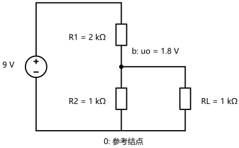
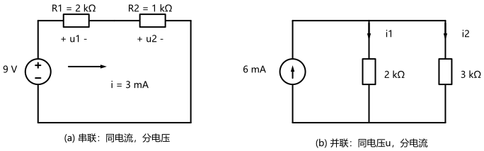
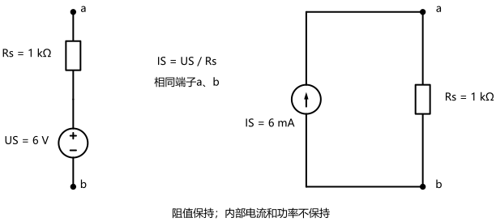
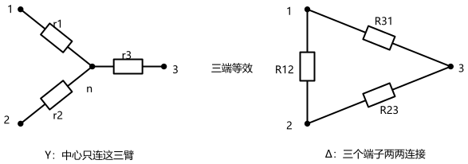
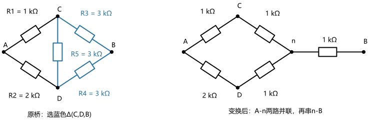
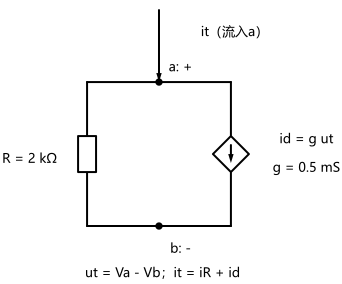
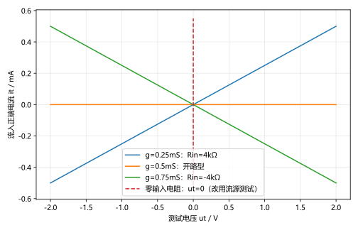

# 第 03 讲：等效变换

> **前置**：第 02 讲 §1–§4（元件关系、关联方向、KCL/KVL、理想源相容性、空载/带载分压器）；第 01 讲 §4（统一按吸收口径算功率）。
> **预计时间**：3–4 小时（含作业）。
>
> **一句话定位**：第 02 讲已经能直接列方程解小电路。本讲把其中一块替换成端口关系相同、但更容易计算的网络；计算量减小，保留量与不保留量必须分清。
>
> **本讲回答什么**：
> 1. 先对哪几个端子等效，怎样判断替换没有改变题目？
> 2. 串并联怎样认，分压和分流里的总量究竟是哪一段的量？
> 3. 电源互换为什么保持端口关系，却不保持内部源功率和电阻损耗？
> 4. Y-Δ 的六条式子怎样推出，怎么用它把桥式电路化简？
> 5. 含受控源时怎样求输入电阻，零、负、开路型结果怎样处理？
>
> **本讲目标（学完你能）**：
> 1. 指明变换边界与参考方向，区分完整关系等效、一个工作点相同和内部量不保留；
> 2. 按接线识别串并联，使用分压分流和局部化简，逆序还原原元件电流、电压、功率；
> 3. 用端口方程推导源互换，写全 Y-Δ 六式，并完整化简和验算一个桥式电路；
> 4. 保留受控源及控制关系，用非零测试激励求输入电阻，识别适用条件与零、负、开路型边界。
>
> **目标达成 = 末尾"掌握度自测"全部打勾。**
>
> **怎么学这一讲**：每次变换都标出边界端子，在简图旁记录替换前后的对应关系。端口电流默认从电压正端流入；源互换另用输出电流时明确反号。算完总量后，按原接线还原内部量，不能直接把等效元件的功率当作原元件功率。
>
> **这一讲有真实验证**：`scripts/lec03-04_verify_reconstruction.py` 从原接线独立组装 KCL，核对带载电路、源互换、三端 Y-Δ、桥与数值作业；还检查受控源的正、零、负、开路型关系。默认只计算，不覆盖原脚本与原图。

## 本讲怎么走（脉络图）

```text
同一个带载分压器：直接联立之后还能怎样少算？ <- 引子
    |
先固定变换边界，再从串并联推出分配公式       <- §1
    |
源的完整端口关系相同，内部功率却不同         <- §2
    |
串并联停住时：三端Y-Δ推导、桥与平衡判据      <- §3
    |
含受控源：外施测试、符号和适用边界           <- §4
    |
选化简或直接列方程 → 小结 → 自测 → 作业     <- §5与收尾
```

## 引子：同一个带载分压器，少写一些方程

**题**：9 V 理想源上正下负。正端经 $R_1=2\,\mathrm{k\Omega}$ 到 b，b 经 $R_2=1\,\mathrm{k\Omega}$ 到负端 0；另将 $R_L=1\,\mathrm{k\Omega}$ 接在 b、0。求输出 $u_o=V_b-V_0$ 和各元件功率。



第 02 讲已用 b 点 KCL 得到 $u_o=1.8\,\mathrm V$。这次用同一接线研究等效化简：$R_2$ 与 $R_L$ 可先替换为一只电阻，再与 $R_1$ 合并。§1.4 会算完，并回到原图求两条下支路的电流与功率。等效变换提供的是另一条计算路径，不是本来缺少的物理定律。

**下一站**：先确定替换对哪些端子成立，再判断哪一块确实可以合并。

## 1. 对外等效与串并联

### 1.1 固定端子，再谈等效

**单口网络（one-port network）**是对外通过一对端子 a、b 连接的电路部分；这一对端子称为**端口（port）**。端口电流从 a 流入多少，就从 b 流出多少。若还有第三根电气连线，或有未包含在模型关系中的外部控制量，就不能只用这一对端子的 $u,i$ 描述完整外部行为。

约定 $u=V_a-V_b$，端口电流 $i$ 从 a 流入网络，这就是关联方向。**对外等效（external equivalence）**指两个网络在同一边界、同一参考方向下具有完全相同的端口关系。

例如 $u=(2\,\mathrm{k\Omega})i$ 与 $u=1\,\mathrm V+(1\,\mathrm{k\Omega})i$ 在 $i=1\,\mathrm{mA}$ 时都给 2 V，但在 $i=2\,\mathrm{mA}$ 时分别给 4 V、3 V，所以不等效。一个工作点相同不是完整关系相同。

**使用等效的三步**：

1. 圈出要替换的网络与保留端子，标 $u,i$ 的参考方向。
2. 用元件关系和 KCL/KVL 导出端口关系，再用具有相同关系的简单网络替代。
3. 求外部量后，若需要原内部元件的量，按原接线回代；变换中不能忘掉被别处引用的控制量。

等效保证端口净功率 $ui$ 相同，但内部各元件的电流、源功率、损耗不一定相同。§2.2 会算出这一区别。合法等效可连续进行，因为端口关系相同具有传递性。

定义本身不要求线性；以下串并联电阻公式则以**有限正线性电阻**为前提。本讲不把电容、电感直接当常数电阻合并。

### 1.2 串联电阻：从共同电流推出分压

**判定接法**：电阻首尾相接，中间结点没有别的分流支路。电流相同是 KCL 的结果，不能倒过来用一次计算结果相同来断言串联。

取 $n$ 只电阻上的电流沿串联路径同向，各电阻电压为关联电压 $u_k$。令这段路径总电压为 $U$：

$$U=\sum_{k=1}^{n}u_k=i\sum_{k=1}^{n}R_k
\quad\Rightarrow\quad R_{\mathrm{eq}}=\sum_{k=1}^{n}R_k.$$

$R_{\mathrm{eq}}$ 是这段网络对其两端的等效电阻，$k$ 标第几只电阻。共同电流 $i=U/R_{\mathrm{eq}}$，代回 $u_k=R_ki$：

$$u_k=U\frac{R_k}{R_{\mathrm{eq}}}.$$

**分压标准做法**：确认无分流的串联段 → 标明该段的总电压 $U$ → 求 $R_{\mathrm{eq}}$ → 分子放所求电阻 $R_k$。$U$ 不一定是全电路电源电压。

**例**：9 V 理想源接 2 kΩ、1 kΩ 无分流串联段，求下方 1 kΩ 的关联电压：$R_{\mathrm{eq}}=3\,\mathrm{k\Omega}$，$u_2=9\times1/3=3\,\mathrm V$；$i=9/3000=0.003\,\mathrm A$，直接回代 $u_2=1000\times0.003=3\,\mathrm V$。

### 1.3 并联电阻：从共同电压推出分流

**判定接法**：各电阻接在同一对结点 a、b 之间。按 a 到 b 的同一极性取电压 $u$，支路电流都从 a 到 b；因此 $i_k=u/R_k$。

**电导（conductance）**是电阻的倒数 $G_k=1/R_k$，单位西门子 S，$1\,\mathrm S=1\,\mathrm{A/V}$。例如 2 kΩ 的电导为 0.5 mS。后面交流的导纳（admittance）也表示电流与电压的比例，但还要表达两者随时间变化的错位关系，其复数形式第 14 讲展开。这里使用纯电阻的实数电导；纯电阻时两者数值相同，现在不需要交流表示法。

令 $I$ 为**进入这组并联支路的总电流**。KCL 给出：

$$I=\sum i_k=u\sum G_k
\quad\Rightarrow\quad G_{\mathrm{eq}}=\sum G_k,\qquad
R_{\mathrm{eq}}=\frac{1}{\sum G_k}.$$

共同电压 $u=I/G_{\mathrm{eq}}$，所以：

$$i_k=I\frac{G_k}{G_{\mathrm{eq}}}.$$

两只电阻时，代入 $G_1=1/R_1,G_2=1/R_2$，整理得到：

$$R_{\mathrm{eq}}=\frac{R_1R_2}{R_1+R_2},\qquad
i_1=I\frac{R_2}{R_1+R_2},\qquad
i_2=I\frac{R_1}{R_1+R_2}.$$

**分流标准做法**：确认同对结点 → 确认进入这组支路的 $I$ → 统一支路电流参考方向 → 用电导比分配。两电阻写成阻值时，分子放另一条支路的电阻；若单独反转一个箭头，该支路数值要反号。

**例**：6 mA 从下向上注入，两只 2 kΩ、3 kΩ 电阻并联，电阻电流参考都向下。$R_{\mathrm{eq}}=2\times3/(2+3)=1.2\,\mathrm{k\Omega}$，电压 $u=(6\,\mathrm{mA})(1.2\,\mathrm{k\Omega})=7.2\,\mathrm V$。

$$i_{2k}=6\frac{3}{5}=3.6\,\mathrm{mA},\qquad
i_{3k}=6\frac{2}{5}=2.4\,\mathrm{mA}.$$

回代电压：$(3.6\,\mathrm{mA})(2\,\mathrm{k\Omega})=(2.4\,\mathrm{mA})(3\,\mathrm{k\Omega})=7.2\,\mathrm V$。若用 Ω，则电流先换成 0.0036 A、0.0024 A；不能把数值 3.6 与 2000 相乘后直接标 7.2 V。

| 关系 | 串联 | 并联 |
|---|---|---|
| 接线判据 | 无分流的首尾连接 | 同接一对结点 |
| 共同量 | 同一电流 | 同一有向电压 |
| 等效 | $R_{\mathrm{eq}}=\sum R_k$ | $G_{\mathrm{eq}}=\sum G_k$ |
| 分配 | $u_k=UR_k/R_{\mathrm{eq}}$ | $i_k=IG_k/G_{\mathrm{eq}}$ |



图 2(a) 的电阻电流从左到右，两个电阻电压都左正右负；(b) 的源注入上结点，两电阻电流都向下，电压上正下负。图中方向正是上述公式的约定。

### 1.4 混联化简：标边界、逐块替换、逆序还原

**标准流程**：

1. 在原图标同电位结点与所求端子；找到一个满足串并联判据的子网络。
2. 标它的边界端子，替换为等效电阻，并记录哪些原元件被合并。
3. 在新图上重新判断串并联，继续化简；若找不到合法组合，不强合并。
4. 求所保留的外部量，再逆序展开各子网络，恢复原元件的电压、电流与功率。

所谓由内到外，指子网络层次，不是纸上离端口远近；可以有多种正确次序。需要某个被替换内部结点的电压时，先保存其还原关系，不能直接把它当作新图中的结点。

**例**：9 V 理想源正端 → 2 kΩ 上电阻 → b，b → 1 kΩ 下电阻 → 负端 0；1 kΩ 负载另接 b、0。求 $u_o=V_b-V_0$、三条电阻电流和功率。

- 下电阻与负载同接 b、0：$R_p=1\times1/(1+1)=0.5\,\mathrm{k\Omega}$。
- $R_p$ 与上电阻无分流串联：$R_{\mathrm{tot}}=2+0.5=2.5\,\mathrm{k\Omega}$；源电流 $I=9/2500=0.0036\,\mathrm A=3.6\,\mathrm{mA}$。
- 并联体电压 $u_o=IR_p=(3.6\,\mathrm{mA})(0.5\,\mathrm{k\Omega})=1.8\,\mathrm V$。
- 回原图：下电阻电流和负载电流各为 $1.8/1000=0.0018\,\mathrm A=1.8\,\mathrm{mA}$，上电阻电压为 $9-1.8=7.2\,\mathrm V$。

验算 KCL：$-3.6+1.8+1.8=0$（mA）；KVL：$-9+7.2+1.8=0$（V）。源吸收 -32.4 mW，上电阻 +25.92 mW，下电阻与负载各 +3.24 mW，总和为零。与不化简时的方程

$$\frac{9-u_o}{2000}=\frac{u_o}{1000}+\frac{u_o}{1000}$$

所得 1.8 V 一致。$R_1$ 与 $R_2$ 此时不能直接相加，因为 b 上存在负载分流；等效公式对所选模型是精确关系，不是靠误差小的近似。

### 1.5 开短路与快速自检

- 并联一条理想短路时，整个并联体电压为零；有限正电阻的电流为零，但短路支路电流还要由外电路确定。
- 串联开路时，串联路径电流为零；有限电阻上压降为零，开路处电压另求。并联开路支路不影响其余支路。
- 不把无穷大或零硬塞进会除零的公式。先写 $i=0$ 或 $u=0$，再处理剩下的网络。
- 对正电阻，串联等效不小于任一个成员；两只以上有限正电阻并联，等效小于最小成员。相同 $R$ 的 $n$ 只串联为 $nR$，并联为 $R/n$。

这些是接线与结果检查，不代替完整求解。功率核对涉及原元件时仍按原图计算。

**下一站**：含源子网络不是单纯电阻；要合并它们，先推导源加电阻的完整端口关系。

## 2. 电源模型互换：端口关系相同，内部不同

### 2.1 从端口方程推出互换公式

取外端 a、b，$u=V_a-V_b$。本节为了描述供电，使用**从 a 流向外电路的输出电流** $i_{\mathrm{out}}$；它与 §1 的关联输入电流相反。

理想电压源 $U_S$ 串电阻 $R_s$，按朝 a 升压的极性放置。KVL 得：

$$u=U_S-R_si_{\mathrm{out}}
\quad\Rightarrow\quad i_{\mathrm{out}}=\frac{U_S}{R_s}-\frac{u}{R_s}.$$

若将理想电流源 $I_S$ 与 $R_s$ 并联在 a、b，箭头 b→a，KCL 得：

$$i_{\mathrm{out}}=I_S-\frac{u}{R_s}.$$

比较完整关系，两式对任意允许的 $u$ 相同，当且仅当：

$$I_S=\frac{U_S}{R_s},\qquad U_S=I_SR_s.$$

这才是等效的依据；扫描几组端口数值只用于核对计算，不是对所有负载的证明。**保持的是电阻的阻值，不是原电阻的电流或实际耗散功率**。

**互换标准流程**：

1. 圈定只有外端 a、b 的源加电阻网络，确认内部中间结点没有另接出去。
2. 电压源串电阻换成电流源并电阻，$I_S=U_S/R_s$；反向换则 $U_S=I_SR_s$。
3. 保留阻值，电流源参考箭头指向原电压源正端所对应的外端。若采用带符号的负源值，按所标方向解释负号。
4. 在原两外端接回外电路，核对端口关系；求原内部量时回原模型。



图 3 左边 6 V 压源串 1 kΩ；右边 6 mA 流源并 1 kΩ，箭头从 b 到 a。源和电阻的相对位置不必与左图一模一样，端子与端口关系必须对应。

### 2.2 算例：同一个负载，不同的内部功率

**题**：6 V 理想压源与 1 kΩ 内阻串联组成两端网络，a 对 b 为正；a、b 接 3 kΩ 负载。用两种模型分别求负载电压、电流及内部元件功率。

压源模型：内阻与负载串联，$i_L=6/(1000+3000)=0.0015\,\mathrm A=1.5\,\mathrm{mA}$，负载电压 $u=(1.5\,\mathrm{mA})(3\,\mathrm{k\Omega})=4.5\,\mathrm V$。

流源模型：$I_S=6/1000=0.006\,\mathrm A=6\,\mathrm{mA}$。1 kΩ 与负载并联，$R_p=1\times3/(1+3)=0.75\,\mathrm{k\Omega}$，所以 $u=(6\,\mathrm{mA})(0.75\,\mathrm{k\Omega})=4.5\,\mathrm V$，$i_L=4.5/3000=0.0015\,\mathrm A=1.5\,\mathrm{mA}$。

压源模型内阻电流就是 1.5 mA；流源模型并联电阻的电流为 $4.5/1000=0.0045\,\mathrm A=4.5\,\mathrm{mA}$。功率均从各自的元件关系计算：

| 模型 | 内部源发出 | 内部电阻吸收 | 负载吸收 |
|---|---|---|---|
| 压源串电阻 | $6\times1.5=9$ mW | $(1.5)^2\times1=2.25$ mW | $4.5\times1.5=6.75$ mW |
| 流源并电阻 | $4.5\times6=27$ mW | $(4.5)^2\times1=20.25$ mW | $4.5\times1.5=6.75$ mW |

这里 V×mA=mW，mA²×kΩ=mW。两模型分别满足 $9=2.25+6.75$ 与 $27=20.25+6.75$。流源模型的源发出功率是压源模型的 **3 倍**，内部电阻耗散是 **9 倍**，不是两者都为九倍。

两个两端网络的净发出功率都为 6.75 mW，与端口电压、电流一致。若原物理电池用串内阻模型描述，求其实际发热必须用 2.25 mW；替代并阻的 20.25 mW 不是原电池的发热，不能据此重新选散热或计算原器件效率。

### 2.3 含源子网络先互换，再合并

**题**：两个子网络同接 a、b：第一个为朝 a 升压的 6 V 源串 1 kΩ；第二个为 b→a 的 3 mA 源并 1 kΩ。求合成的两端等效模型。

- 第一网络换成 b→a 的 6 mA 源并 1 kΩ。
- 两个同向电流源合计 $6+3=9\,\mathrm{mA}$；两只 1 kΩ 并联合计 0.5 kΩ。
- 若换回压源模型，电压为 $(9\,\mathrm{mA})(0.5\,\mathrm{k\Omega})=4.5\,\mathrm V$，串阻 0.5 kΩ。

用原网络关系复核，电压用 V、电阻用 Ω、电流用 A：

$$i_{\mathrm{out}}=\frac{6-u}{1000}+0.003-\frac{u}{1000}
=0.009-\frac{u}{500}.$$

这正是 9 mA 源并 500 Ω 的端口关系。两个源箭头相反时要代数相减，不按幅值相加。

### 2.4 哪些情况下不能按这套互换

- **理想源的退化**：零串阻的理想压源不可能用有限的 $I_S=U_S/R_s$ 表示。理想流源也不能靠一个有限并阻变成同样的理想压源；不能把除零结果当有效模型。
- **多出外接端子**：如果源和串阻的中间结点另接外支路，原网络就不只暴露 a、b，不能用删掉中间结点的两端模型替代。
- **控制量丢失**：受控源也能用同一端口方程推导。例如 $u_S=\mu u_c$ 串 $R_s$，可换成 $i_S=(\mu/R_s)u_c$ 并 $R_s$；但 $u_c$ 必须保留原定义。若控制量来自将被删去的内部元件，先给出其还原关系。

具体例子：受控压源 $u_S=2u_c$ 串 1 kΩ，换成 $i_S=(2\,\mathrm{mS})u_c$ 并 1 kΩ。$u_c=3\,\mathrm V$ 时两源的规定量分别为 6 V、6 mA；$u_c=1\,\mathrm V$ 时改为 2 V、2 mA。换算后的源仍受控，不能把首个 6 mA 固定下来后忘掉控制关系。

本节实际内阻取有限正值。公式从代数上可推广到非零负等效阻值，但那表示有源关系，不能当作普通电池的正内阻解释。

源连接仍要检查第 02 讲的相容性：同极性不等压源直接并联、同方向不等流源直接串联均无解；等值时端口关系相容，但各源内部电流或电压分配可能不唯一。同向压源串联加电压，同向流源并联加电流，都是带方向的代数和。模型相容不等于真实电源可以安全地随意连接。

**下一站**：源互换能简化部分连接；电阻桥中找不到纯串并联时，需要保持三个外端关系的变换。

## 3. Y-Δ 变换：保持三个外端的关系

### 3.1 找三端结构，不按外形猜

**桥式电路（bridge circuit）**的典型接线是 A-C-B、A-D-B 两路，中间再有 C-D 支路。外端取 A、B。C、D 处都有分流，不能把两侧各自硬当串联；C-D 支路也没有与其他单只电阻同接一对结点。

可以尝试找 C、D、B 三个结点：它们之间的 C-D、D-B、B-C 三条电阻构成三角形。把这个三端网络换成星形后，C、D 可能变为两路连接点，就能继续串并联合并。

**Y-Δ 变换（wye-delta transformation）**的对象是内部只含三只电阻、对外保留三个端子的星形（wye/star）或三角形（delta）网络。选取标准：

- Δ：三个端子两两之间各有一条所选电阻边。
- Y：一个内部中心只通过三条所选电阻臂连接三个外端；中心不能还连接第四条外支路。
- 换完仍保留同三个外端，再判断是否产生可合并的串并联。一次变换不保证任意网络都能化为一只电阻。

### 3.2 六条公式及其来源



图 4 左边中心 n 到端子 1、2、3 的阻值分别为 $r_1,r_2,r_3$；右边连接 1-2、2-3、3-1 的阻值分别为 $R_{12},R_{23},R_{31}$。这些符号都表示有限正电阻，**小写臂与双下标边不要混用**。

**Δ→Y**：令三边之和 $S_\Delta=R_{12}+R_{23}+R_{31}$，单位 Ω：

$$r_1=\frac{R_{12}R_{31}}{S_\Delta},\qquad
r_2=\frac{R_{12}R_{23}}{S_\Delta},\qquad
r_3=\frac{R_{23}R_{31}}{S_\Delta}.$$

每条星臂取与该端相接的两条 Δ 边的乘积，除以三边和。

**推导**：暂时让第三端不连接外电路，从 1、2 测总电阻。Y 只有两臂串联；Δ 为直连边与另两边串联的并联：

$$T_{12}=r_1+r_2=\frac{R_{12}(R_{23}+R_{31})}{S_\Delta}.$$

同理 $T_{23}=r_2+r_3$、$T_{31}=r_3+r_1$。三式相加减，消去另外两臂：

$$r_1=\frac{T_{12}+T_{31}-T_{23}}2
=\frac{R_{12}(R_{23}+R_{31})+R_{31}(R_{12}+R_{23})-R_{23}(R_{12}+R_{31})}{2S_\Delta}
=\frac{R_{12}R_{31}}{S_\Delta}.$$

其余两式分别由 $(T_{12}+T_{23}-T_{31})/2$ 和 $(T_{23}+T_{31}-T_{12})/2$ 得到。三条式子都是在保相同三对测试电阻，不是凭图形相似猜参数。

**Y→Δ**：令 $P_Y=r_1r_2+r_2r_3+r_3r_1$，单位 Ω²：

$$R_{12}=\frac{P_Y}{r_3},\qquad
R_{23}=\frac{P_Y}{r_1},\qquad
R_{31}=\frac{P_Y}{r_2}.$$

每条 Δ 边除以**不与该边端子相接的那条星臂**。例如 1-2 边除以 $r_3$，而不是 $r_1$ 或 $r_2$。

**为什么第三端接回电路后仍成立**：取同一参考点下的三端电位 $V_1,V_2,V_3$，电流 $I_k$ 从第 k 端流入。令 $G_\Sigma$ 为三臂电导之和，单位 S；Y 中心 n 的 KCL 给出

$$G_\Sigma=\frac1{r_1}+\frac1{r_2}+\frac1{r_3},\qquad
V_n=\frac{V_1/r_1+V_2/r_2+V_3/r_3}{G_\Sigma}.$$

消去中心电位后，第一端电流为：

$$I_1=\frac{V_1-V_n}{r_1}
=\frac{V_1-V_2}{r_1r_2G_\Sigma}+\frac{V_1-V_3}{r_1r_3G_\Sigma}.$$

注意 $r_1r_2G_\Sigma=r_1+r_2+r_1r_2/r_3=P_Y/r_3=R_{12}$，而 $r_1r_3G_\Sigma=P_Y/r_2=R_{31}$，所以

$$I_1=\frac{V_1-V_2}{R_{12}}+\frac{V_1-V_3}{R_{31}}.$$

这正是 Δ 第一端的 KCL；第二、第三端同样得到两条相连边的电流和。因此两网络对**任意同时施加的三端电位**给出同样的三端电流，且 $I_1+I_2+I_3=0$。第三端开路只是推导或测试的一种条件，**不是使用变换时的限制**。中心另接外支路则上述 KCL 改变，不能继续删去那个外接边界。

**数值与标准操作**：

1. 标三个保留端子，确定是 Y 还是 Δ，按端子给臂或边编号。
2. 算 $S_\Delta$ 或 $P_Y$，逐个填三条公式；不是只填一个再凭形状摆另外两个。
3. 新画一张保留同端子的图，合并新出现的串并联；抽查端口阻值。

Δ 三边均 3 kΩ 时，$r_1=r_2=r_3=3\times3/9=1\,\mathrm{k\Omega}$。反向，Y 三臂均 $r$ 时，每边为 $3r$。**只在三臂或三边相等的对称条件下**使用 $R_\Delta=3R_Y$。

非对称例：$r_1=1\,\mathrm{k\Omega},r_2=2\,\mathrm{k\Omega},r_3=3\,\mathrm{k\Omega}$，$P_Y=11(\mathrm{k\Omega})^2$，得到 $R_{12}=11/3\,\mathrm{k\Omega},R_{23}=11\,\mathrm{k\Omega},R_{31}=5.5\,\mathrm{k\Omega}$。检查 1-2：$r_1+r_2=3\,\mathrm{k\Omega}$；Δ 为 $(11/3)\parallel(11+5.5)=3\,\mathrm{k\Omega}$。

用 kΩ 数值算乘积时，单位为 **$(\mathrm{k\Omega})^2$**，再除以 kΩ 才回到 kΩ；它不是 $\mathrm{k\Omega^2}$。推导要能说清，六式与端子对应要能直接使用。

### 3.3 算例：桥式化简与原桥回代

**题**：外端 A、B；$R_1$ 接 A-C 为 1 kΩ，$R_2$ 接 A-D 为 2 kΩ，$R_3$ 接 C-B、$R_4$ 接 D-B、$R_5$ 接 C-D，后三者均 3 kΩ。求 $R_{AB}$；再令 $V_A=11\,\mathrm V,V_B=0$，求原桥的 C、D 电位与桥电流，验算功率。



图 5 左边蓝色边是 Δ(C,D,B)；右图保留 C、D、B，新增内部中心 n。$R_1,R_2$ 不变，三条新星臂各 1 kΩ。

**化简**：A→C→n 为 2 kΩ，A→D→n 为 3 kΩ，两路同接 A、n；并联得 1.2 kΩ。再与 n→B 的 1 kΩ 串联：

$$R_{AB}=\frac{2\times3}{2+3}+1=2.2\,\mathrm{k\Omega}.$$

11 V 激励时总电流 $I=11/2200=0.005\,\mathrm A=5\,\mathrm{mA}$。A-n 电压为 $(5\,\mathrm{mA})(1.2\,\mathrm{k\Omega})=6\,\mathrm V$，上路电流 3 mA，下路 2 mA。

回原图，$V_C=11-(3\,\mathrm{mA})(1\,\mathrm{k\Omega})=8\,\mathrm V$，$V_D=11-(2\,\mathrm{mA})(2\,\mathrm{k\Omega})=7\,\mathrm V$。C、D 是保留端子，能对应；新增 n 并不是原桥中间的某个结点。

**原桥独立核对**：直接对 C、D 写 KCL，全部电流按流出为正：

$$\frac{V_C-11}{1000}+\frac{V_C}{3000}+\frac{V_C-V_D}{3000}=0,$$

$$\frac{V_D-11}{2000}+\frac{V_D}{3000}+\frac{V_D-V_C}{3000}=0.$$

电压用 V、阻值用 Ω。两式分别乘 3000、6000，化为 $5V_C-V_D=33$、$-2V_C+7V_D=33$。第一式给 $V_D=5V_C-33$，代入第二式：$-2V_C+7(5V_C-33)=33$，所以 $33V_C=264$，$V_C=8\,\mathrm V,V_D=7\,\mathrm V$。

原 C→D 桥电流为

$$i_5=\frac{8-7}{3000}\,\mathrm A=\frac13\,\mathrm{mA}.$$

其余原支路电流为 A→C 的 3 mA、A→D 的 2 mA、C→B 的 $8/3$ mA、D→B 的 $7/3$ mA。C 点 $3=8/3+1/3$，D 点 $2+1/3=7/3$，符合 KCL。

源发出 $(11\,\mathrm V)(5\,\mathrm{mA})=55\,\mathrm{mW}$；原五电阻吸收分别为 $9,8,64/3,49/3,1/3$ mW，总和 55 mW。原桥与变换后的端口一致，求原桥支路电流仍须用原连接关系。

### 3.4 平衡电桥：先证零电流，再删支路

仍按 A-C-B、A-D-B 与 C-D 五电阻接线，阻值均为有限正值。**平衡电桥（balanced bridge）**指施加端口电压时 C、D 等电位，中间 $R_5$ 电流为零。

暂断 $R_5$，两侧各是一组分压器。令 $V_B=0,V_A=U$：

$$V_C=U\frac{R_3}{R_1+R_3},\qquad
V_D=U\frac{R_4}{R_2+R_4}.$$

对非零 $U$，两者相等要求 $R_3(R_2+R_4)=R_4(R_1+R_3)$，消去公共项后：

$$R_1R_4=R_2R_3
\quad\Longleftrightarrow\quad\frac{R_1}{R_3}=\frac{R_2}{R_4}.$$

满足此条件时，把有限 $R_5$ 接回去，其两端电压仍为零，电流仍为零，原结点方程不变；因此可以把 $R_5$ 断开用于求其他量。判据来自电位与方程，不是图画得对称。

**例**：$R_1=1\,\mathrm{k\Omega},R_2=2\,\mathrm{k\Omega},R_3=2\,\mathrm{k\Omega},R_4=4\,\mathrm{k\Omega},R_5=1\,\mathrm{k\Omega}$。比例均为 1/2；$U=1\,\mathrm V$ 时 $V_C=V_D=2/3\,\mathrm V$、$i_5=0$。断开 $R_5$ 后：$R_{AB}=(1+2)\parallel(2+4)=3\parallel6=2\,\mathrm{k\Omega}$。

不平衡时可以用 Y-Δ，也可以直接 KCL/KVL。上一例不平衡桥若误删 $R_5$，会得 $4\parallel5=20/9\,\mathrm{k\Omega}$，不是正确的 2.2 kΩ。零激励下电流碰巧全为零，也不证明接线满足平衡判据。

**下一站**：三端电阻结构已经能变换；含受控源的两端网络要先求完整端口关系，再判断能否等效为电阻。

## 4. 含受控源的单口：先求关系，再取输入电阻

### 4.1 输入电阻的对象与条件

本节处理直流电阻与线性受控源组成的网络。**输入电阻（input resistance）**描述端口电压与关联输入电流之间的整体比例；若完整关系为 $u=R_{\mathrm{in}}i$，则在非零测试激励下可以取 $R_{\mathrm{in}}=u/i$。

使用固定输入电阻前，检查：网络不含未处理的独立源；关系线性；控制量都能用所选网络的内部量或端口量表达，而非另一个独立的外部信号；选定测试后端口关系能够确定。受控源仍留在原图，不能因为它不是独立源就置零。

### 4.2 外施测试的标准流程

**外施激励法（test-source method）**是主动加一个已知测试量，求端口另一个量：

1. 标端口 a、b，$u_t=V_a-V_b$；$i_t$ 从 a 流入网络，不能把源支路电流与端口总电流混成同一变量。
2. 加非零测试电压（如 1 V）或测试电流（如 1 mA）。测试源是新增的外部源，不把原网络中的受控源删除。
3. 按元件关系、控制关系与 KCL/KVL 求另一个量，或直接得到一般关系。
4. 判定线性比例后取 $u_t/i_t$。若某一种测试与理想端口约束矛盾，尝试另一种；仍矛盾或多解时检查模型，不硬除零。

测试值只是在模型中求系数，1 V 与 1 mA 是为计算方便选取，不代表实际器件必须在这个电压或电流运行。不能用零激励使 $u=i=0$ 后取 $0/0$。

### 4.3 算例：电阻与同向受控流源并联

**题**：a、b 间接 2 kΩ 电阻，另接 VCCS，箭头 a→b，规定 $i_d=g u_t$、$g=0.5\,\mathrm{mS}$。控制量就是 $u_t=V_a-V_b$，端口输入电流 $i_t$ 从 a 流入。求输入电阻。



a 点按流出为正：$-i_t+i_R+i_d=0$。元件关系 $i_R=u_t/(2000\,\Omega)$、$i_d=(0.0005\,\mathrm{A/V})u_t$，故：

$$i_t=\left(\frac1{2000\,\Omega}+0.0005\,\mathrm S\right)u_t
=(0.001\,\mathrm S)u_t.$$

这已经给出与测试大小无关的比例，$R_{\mathrm{in}}=1000\,\Omega=1\,\mathrm{k\Omega}$。取 $u_t=1\,\mathrm V$，电阻与受控源各有 0.5 mA 向下电流，总输入 1 mA。

功率回代：原电阻吸收 0.5 mW，受控源从其正端流入也吸收 0.5 mW，测试源发出 1 mW。忽略受控源会报成 2 kΩ，那是漏掉控制关系，不是允许的近似。

### 4.4 反向受控源、开路型、负阻与零阻

保持 a、b 上的 2 kΩ 电阻和控制电压 $u_t=V_a-V_b$，但把 VCCS 箭头改为 **b→a**，沿该箭头的电流为 $i_d=g u_t$。它向 a 注入电流，所以端口关系变为：

$$i_t=\frac{u_t}{R}-g u_t=\left(\frac1R-g\right)u_t.$$

不是直接把上一例的阻值沿用。取 $R=2\,\mathrm{k\Omega}$、$u_t=1\,\mathrm V$：

| $g$ | 输入电导 $1/R-g$ | $i_t$ | 整体端口关系 |
|---|---|---|---|
| 0.25 mS | 0.25 mS | 0.25 mA | $R_{\mathrm{in}}=4\,\mathrm{k\Omega}$ |
| 0.5 mS | 0 | 0 | $i_t=0$，开路型 |
| 0.75 mS | -0.25 mS | -0.25 mA | $R_{\mathrm{in}}=-4\,\mathrm{k\Omega}$ |

负输入电阻并不是普通电阻变成负值，而是这个**有源网络的整体关系**。最后一行输入功率 $(1\,\mathrm V)(-0.25\,\mathrm{mA})=-0.25\,\mathrm{mW}$，即网络向外发出功率。内部电阻吸收 0.5 mW，受控源发出 0.75 mW；测试源吸收剩余 0.25 mW，仍平衡。

**零输入电阻的另一种例子**：端口 a→电阻 2 kΩ→CCVS→b 串联，电流为 $i_t$。两元件的电压参考均沿 a 到 b 取压降，CCVS 规定 $u_d=-(2\,\mathrm{k\Omega})i_t$。KVL 给

$$u_t=u_R+u_d=(2\,\mathrm{k\Omega})i_t-(2\,\mathrm{k\Omega})i_t=0.$$

这是短路型端口，不能强加 $u_t=1\,\mathrm V$。改用 $i_t=1\,\mathrm{mA}$ 测试，电阻压降 +2 V、CCVS 压降 -2 V，端电压 0，$R_{\mathrm{in}}=0$。电阻吸收 2 mW，CCVS 发出 2 mW；端口净功率为零，不代表内部无功率交换。



图 7 横轴为 $u_t$、纵轴为关联输入 $i_t$。前三条是本节反向 VCCS 改变 $g$ 得到的斜线或水平线；竖线 $u_t=0$ 对应串联 CCVS 抵消的零阻例，不来自同一套 VCCS 参数。

### 4.5 不能报一个固定输入电阻的情况

- **外部控制未包含**：若某源规定 $i_d=g u_c$，而 $u_c$ 是所选两端网络外部独立的控制电压，端口关系为 $i=u/R+g u_c$。同一端电压 $u=1\,\mathrm V$、$R=2\,\mathrm{k\Omega},g=0.5\,\mathrm{mS}$，$u_c=0$ 与 2 V 分别产生 0.5 mA、1.5 mA，不能声称电流只由端电压决定。保留控制关系或扩大分析边界。
- **含独立源**：6 V 源串 1 kΩ 的关联输入关系为 $i=(u-6)/1000$，有截距，一般不能用工作点 $u/i$ 代替固定比例电阻；正确等效是源与电阻的整体。独立源也可能互相抵消，所以要看实际关系，不仅看图中是否画了源。第 07 讲系统讲一般含源网络等效。
- **非线性**：若 $i=\kappa u^3$、$\kappa=1\,\mathrm{mA/V^3}$（读 kappa，给定系数），1 V 时 $u/i=1\,\mathrm{k\Omega}$，2 V 时 $i=8\,\mathrm{mA}$、$u/i=0.25\,\mathrm{k\Omega}$。一个测试点有比值，不代表整个工作范围等效为常数电阻。局部增量电阻与整体输入关系也不能混用。

本节需会执行测试法、保留控制变量并读懂端口关系；不要求把所有有源网络硬归成一只普通电阻。

**下一站**：选择化简或直接列方程时，既看接线是否可合并，也看题目要保留哪些量。

## 5. 怎样选方法与复核结果

### 5.1 化简和直接方程可以配合

若目标只是两端等效或总电流，且有明显串并联、三端 Y/Δ 结构，先化简能减少未知量。若目标是原桥支路电流、内部源功率或很多结点电位，可保留相关支路，化简其他部分，或者直接列 KCL/KVL。

**停止规则**：当前图找不到满足判据的局部组合，就停止强行变换。不能因为已学 Y-Δ，就认定每个网络都必须用它。第 04–05 讲把已有连接定律组织成系统的支路、回路与结点方程，不增加新的物理定律。

### 5.2 计算验证与使用方式

从工作区根目录运行：

```text
uv run --with numpy python tutorials/electric_circuits/scripts/lec03-04_verify_reconstruction.py
```

脚本从**原接线**求结点电位与支路电流，再与化简结果比较；三端 Y-Δ 同时检查第三端开路的三对电阻、以及三个端子同时施加不同电位时的完整电流向量。所用电位组含正、负与同电位，能检查漏掉某一端关系的错误，而不是仅打印同一公式的两种写法。

例如本讲原桥误删中支路，得到 2222.222222 Ω，而不是 2200 Ω；原桥 $i_5=1/3$ mA 已说明它不能删。验证用来查实现与算术，不替代 §3.2 的等效证明。

数值检查阈值 $10^{-10}$ 是为这些小规模例题当场选取的；$10^{-9}$、$10^{-11}$ 都通过。功率接近零时不以接近零的功率当分母放大舍入误差；程序按至少 1 W 归一化检查功率，另回代 KCL。它不是实际测量的误差承诺。

**下一站**：按已推导的条件校准几个容易混淆的结论，再独立做题。

## 常见误区校准

本节零新知识，只校准正文已推导的关系。

- **一个工作点一样就等效？** 不够，要完整端口关系一样（§1.1）。
- **分流总电流就是电源总电流？** 只有电源电流全部进入所选并联体时才相同；先明确子网络（§1.3）。
- **电源互换后阻值没变，实际损耗也没变？** 不对，接法与内部电流改变，原串阻与替代并阻功率不同（§2.2）。
- **三端变换只在第三端开路时有效？** 不对，中心消元已经证明任意三端电位下电流相同；中心另接第四支路则不能删（§3.2）。
- **不平衡桥只能用 Y-Δ？** 不是，还可直接列原桥 KCL/KVL，不能误删桥支路（§3.3–§3.4）。
- **受控源可以置零后只看电阻？** 不行，先保控制关系，求一般端口关系；零、负、开路型都按所用方向解释（§4）。

**下一站**：整理成能按条件调用的公式，再通过自测与作业检验是否会独立使用。

## 本讲小结

- **对外等效**保同一边界的完整端口关系与净端口功率，不保各内部元件的电流、损耗或供能。
- **串并联**先按连接判定：无分流串联加 $R$，同端子并联加 $G=1/R$（电导）。分压总量是所选串联段两端电压，分流总量是进入所选并联体的电流；单位与方向保持一致。
- **混联流程**：圈端子 → 替换合法子网络 → 重认接线 → 求总量 → 逆序还原。找不到合法组合就停止强合并。
- **源互换**：$I_S=U_S/R_s$，阻值不变、连接改为串/并；电流源箭头指向原正端对应的外端。内部结点另引出或控制关系被删，不能照原两端变换。
- **Y-Δ**：三端身份不变，Δ→Y 每臂为相接两边积除三边和，Y→Δ 每边为两两臂积之和除对面臂；对称才用 $R_\Delta=3R_Y$。桥式例得到 2.2 kΩ，原中支路仍有 $1/3$ mA。
- **平衡桥**：按本讲命名 $R_1R_4=R_2R_3$ 时，C、D 等电位，中支路零电流，可以断开它。
- **输入电阻**：先确认无未处理的独立源、关系线性、控制量可在网络内表达且方程可解；加非零测试源、保全部关系。正、负、零、开路型按端口整体关系读，不套普通正电阻的直觉。

## 掌握度自测（对应开头四项目标）

- [ ] 我能固定端子和参考方向，区分完整关系等效、一次读数相同与内部量不保留（目标 1）。
- [ ] 我能按接线化简并计算分压分流，遮住答案独立完成带载分压器，再还原每只元件功率（目标 2）。
- [ ] 我能从端口方程推出源互换、说明内部功率差异；写全 Y-Δ 六式并完成桥的化简、KCL 消元和验算（目标 3）。
- [ ] 我能用测试源求含受控源输入关系，解释正、开路型、负、零阻；识别未处理独立源、非线性和跨边界控制的限制（目标 4）。

## 作业

先独立做再对照。答案只使用本讲与第 01–02 讲已教的关系；数值题由 `scripts/lec03-04_verify_reconstruction.py` 核对。

### 基础：接线、方向与等效

**Q1. 概念辨析**：说明下列推断对错并给出理由：(a) 一个端电压/电流工作点相同，就可替换网络；(b) 等效后内部电阻损耗必相同；(c) 电流相等的两个电阻必串联；(d) 理想压源只要数值相等就可唯一确定各自输出电流；(e) Y-Δ 后第三端必须开路。

**参考答案：**

(a) 错，要完整端口关系相同；例如 §1.1 的两条不同直线可经过同一工作点。

(b) 错，保净端口功率而不保逐元件功率；串内阻 2.25 mW 与替代并阻 20.25 mW 就不同。

(c) 错，串联是无分流的首尾接法；并联等阻也可算出相同电流。

(d) 错，等值只保证端电压相容，源电流的和确定但内部如何分配可能不唯一。

(e) 错，第三端开路用于某组测试；中心消元已给出三端同时接入时的相同电流关系。

**Q2. 混联与分流**：12 V 理想源上正下负，正端经 2 kΩ 电阻到 b；b、负端 0 之间接 6 kΩ、3 kΩ 两电阻并联。求源电流、b 点电压、两下支路向下电流及各功率。

**参考答案：**

$R_p=6\times3/(6+3)=2\,\mathrm{k\Omega}$，总阻 4 kΩ；$I=12/4000=0.003\,\mathrm A=3\,\mathrm{mA}$。$u_b=(3\,\mathrm{mA})(2\,\mathrm{k\Omega})=6\,\mathrm V$。

分流总量是 3 mA：$i_{6k}=3\times3/9=1\,\mathrm{mA}$，$i_{3k}=3\times6/9=2\,\mathrm{mA}$。KCL 为 $-3+1+2=0$（mA），各下支路 $u=iR=6\,\mathrm V$；上电阻压降也为 6 V。

吸收功率：源 -36 mW，上电阻 +18 mW，6 kΩ +6 mW，3 kΩ +12 mW，总和零。

**Q3. 源互换与负载**：朝 a 升压的 10 V 理想源串 2 kΩ 形成 a、b 两端网络；a、b 接 3 kΩ 负载。写电流源模型，求负载电压、电流，并分别核对两模型功率。

**参考答案：**

$I_S=10/2000=0.005\,\mathrm A=5\,\mathrm{mA}$，源箭头 b→a，并阻 2 kΩ。与负载并联等效 $2\parallel3=1.2\,\mathrm{k\Omega}$，$u=(5\,\mathrm{mA})(1.2\,\mathrm{k\Omega})=6\,\mathrm V$，$i_L=6/3000=0.002\,\mathrm A=2\,\mathrm{mA}$。

原串联模型 $i_L=10/(2000+3000)=0.002\,\mathrm A=2\,\mathrm{mA}$，负载同为 6 V。原模型源发出 20 mW、内阻吸收 8 mW、负载 12 mW；替代模型源发出 30 mW、并阻吸收 18 mW、负载 12 mW。净发出都为 12 mW，内部不同。

### 提高：三端变换与受控源

**Q4. Y-Δ 双向**：端子固定为 1、2、3。(1) Δ 的 $R_{12},R_{23},R_{31}$ 均为 3 kΩ，求三条 Y 臂；(2) Y 臂 $r_1=1\,\mathrm{k\Omega},r_2=1\,\mathrm{k\Omega},r_3=2\,\mathrm{k\Omega}$，求三条 Δ 边；(3) 第三端开路时，核对 (2) 的 1-2 电阻。

**参考答案：**

(1) $S_\Delta=9\,\mathrm{k\Omega}$，每臂为 $3\times3/9=1\,\mathrm{k\Omega}$。

(2) $P_Y=(1\times1+1\times2+2\times1)(\mathrm{k\Omega})^2=5(\mathrm{k\Omega})^2$；$R_{12}=P_Y/r_3=2.5\,\mathrm{k\Omega}$，$R_{23}=P_Y/r_1=5\,\mathrm{k\Omega}$，$R_{31}=P_Y/r_2=5\,\mathrm{k\Omega}$。

(3) Y 的 1-2 路径为 $r_1+r_2=2\,\mathrm{k\Omega}$；Δ 为 $2.5\parallel(5+5)=2.5\times10/12.5=2\,\mathrm{k\Omega}$。注意乘积单位是 $(\mathrm{k\Omega})^2$，不是 $\mathrm{k\Omega^2}$。

**Q5. 桥式化简**：A-C 为 2 kΩ，A-D 为 4 kΩ，C-B、D-B、C-D 各为 6 kΩ。求 $R_{AB}$；令 $V_A=11\,\mathrm V,V_B=0$ 时，用原图求输入电流作独立验算。

**参考答案：**

Δ(C,D,B) 的三边均为 6 kΩ，换成三条 2 kΩ 星臂。A-n 两路为 4 kΩ 与 6 kΩ，并联 $4\times6/10=2.4\,\mathrm{k\Omega}$；再串 n-B 的 2 kΩ，$R_{AB}=4.4\,\mathrm{k\Omega}$。

原 C、D 点 KCL（V、Ω、A）：

$$\frac{V_C-11}{2000}+\frac{V_C}{6000}+\frac{V_C-V_D}{6000}=0,$$

$$\frac{V_D-11}{4000}+\frac{V_D}{6000}+\frac{V_D-V_C}{6000}=0.$$

分别乘 6000、12000 后得 $5V_C-V_D=33$、$-2V_C+7V_D=33$。由第一式 $V_D=5V_C-33$，代入第二式得 $33V_C=264$，所以 $V_C=8\,\mathrm V,V_D=7\,\mathrm V$。

原输入电流 $(11-8)/2000+(11-7)/4000=0.0025\,\mathrm A=2.5\,\mathrm{mA}$；$(11\,\mathrm V)/(2.5\,\mathrm{mA})=4.4\,\mathrm{k\Omega}$，吻合。

**Q6. 输入电阻**：a、b 间接 4 kΩ 电阻，并联 VCCS，箭头 a→b；控制电压 $u=V_a-V_b$，$i_d=(0.25\,\mathrm{mS})u$。端口电流从 a 流入。求输入电阻，取 1 V 验算功率。

**参考答案：**

端口 $i=u/(4000\,\Omega)+(0.00025\,\mathrm S)u=(0.0005\,\mathrm S)u$，因此 $R_{\mathrm{in}}=2000\,\Omega$。1 V 时两支路各 0.25 mA，总输入 0.5 mA；原电阻和受控源各吸收 0.25 mW，测试源发出 0.5 mW。

### 综合：还原内部量与判断边界

**Q7. 带载分压器**：12 V 理想源上正下负，正端经 2 kΩ 上电阻到 b，下电阻 2 kΩ 接 b、负端 0，负载 2 kΩ 也接 b、0。求空载及带载输出、电阻电流与带载功率。

**参考答案：**

空载 $u_o=12\times2/(2+2)=6\,\mathrm V$。带载，下电阻并负载为 $2\parallel2=1\,\mathrm{k\Omega}$，总阻 3 kΩ，$I=12/3000=0.004\,\mathrm A=4\,\mathrm{mA}$；输出 $u_o=(4\,\mathrm{mA})(1\,\mathrm{k\Omega})=4\,\mathrm V$。

下电阻与负载各 $4/2000=0.002\,\mathrm A=2\,\mathrm{mA}$；KCL 为 $-4+2+2=0$（mA），上电阻压降 8 V。带载时源发出 48 mW，上电阻吸收 32 mW，下电阻与负载各 8 mW，平衡。求原电阻功率时已经逆序还原，不能把并联体的总功率全部当作某只成员功率。

**Q8. 原内部量为什么不能直接取替代模型值？**：6 V 源串 1 kΩ 与 6 mA 源并 1 kΩ 对同一 a、b 端口等效，均接 3 kΩ 负载。解释并计算：负载功率为什么相同、原电池内阻发热为何不能用替代并阻的数值？

**参考答案：**

端电压都为 4.5 V，负载电流 1.5 mA，负载吸收 6.75 mW；完整端口关系相同，因而端口净功率也相同。原串阻电流为 1.5 mA，发热 $(1.5)^2\times1=2.25$ mW；替代并阻电流 4.5 mA，发热 $(4.5)^2\times1=20.25$ mW。不同元件连接导致不同内部电流，等效未承诺逐元件功率相同。

**Q9. 反向受控流源**：a、b 间接 2 kΩ，VCCS 箭头 b→a，$i_d=(0.75\,\mathrm{mS})(V_a-V_b)$。端口关联输入从 a 流入。取端电压 1 V，求输入电阻并验算谁供能。

**参考答案：**

$i=1/2000-0.00075=-0.00025\,\mathrm A=-0.25\,\mathrm{mA}$，一般关系 $i=-(0.25\,\mathrm{mS})u$，所以 $R_{\mathrm{in}}=-4\,\mathrm{k\Omega}$。电阻吸收 0.5 mW，受控源发出 0.75 mW，外部测试源吸收 0.25 mW；有源网络净发出 0.25 mW。

**Q10. 一个比值够不够？**：某两端元件关系为 $i=(1\,\mathrm{mA/V^3})u^3$。测试 1 V 与 2 V，分别求 $u/i$；能否以 1 V 的结果把它在整个范围替换为常数电阻？

**参考答案：**

1 V 时 $i=1\,\mathrm{mA}$、$u/i=1\,\mathrm{k\Omega}$；2 V 时 $i=8\,\mathrm{mA}$、$u/i=0.25\,\mathrm{k\Omega}$。不能用一次比值证明常数电阻等效；这两个值描述不同工作点，固定输入电阻要求一般关系成比例。

第 04 讲会选取独立 KCL/KVL，建立支路电流法和回路电流法。本讲能保端口关系减少变量，下一讲处理仍需联立的变量及系统选方程的方法。
