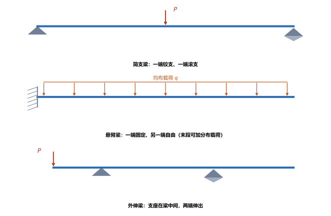
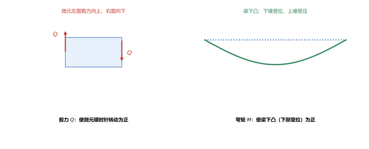
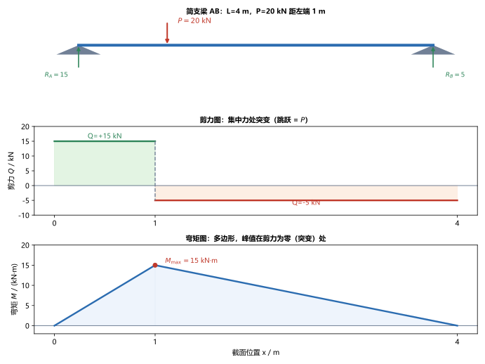

# 第 08 讲：平面弯曲的内力：剪力与弯矩

> **前置**：第 01 讲（截面法）、第 07 讲（截面几何量，本讲暂不直接用，但为后面几讲备好）。
> **预计时间**：约 3 小时（含作业；本讲是全课程最需要动手练画图的一讲）。
>
> **一句话定位**：前几讲处理的都是"沿轴线"的受力（拉压、扭转）。弯曲是第四种基本变形——**力垂直于轴线**压在梁上。本讲先解决弯曲的"内力"：梁内部各截面上有**剪力 $Q$** 和**弯矩 $M$**，把它们的分布画成图，并掌握载荷—剪力—弯矩之间的微分关系。这是弯曲的起点。
>
> **本讲回答什么**：
> 1. 梁有哪几种？支座和载荷怎么归类？静定梁的反力怎么求？
> 2. 弯曲时截面上的内力是什么？$Q$、$M$ 的正负怎么定？
> 3. 剪力图、弯矩图怎么画？为什么"弯矩极值在剪力为零处"？
>
> **这一讲有真实验证**：简支梁受集中力、简支梁受均布载荷、悬臂梁的剪力与弯矩计算，以及微分关系 $dM/dx=Q$、$dQ/dx=q$ 的数值核对（脚本 `scripts/lec08-01_verify_shear_moment.py`）；另有梁类型、正负约定、剪力图弯矩图三张图（`figures/`）。

---

## 引子：一根梁，内部发生了什么

一根简支梁（两端搁在支座上），中间压一个重物。梁没有断，但内部**每一处截面**都在承受两种内力：

- **剪力 $Q$**：截面内、垂直于梁轴线的内力（"想把这个截面两侧上下错开"）；
- **弯矩 $M$**：截面内的力偶（"想让这段梁弯起来"）。

不同位置的 $Q$、$M$ 大小不同——靠近支座和靠近载荷处差别很大。想知道"哪个截面最危险"，就要把 $Q$、$M$ 沿梁长的分布画出来，这就是**剪力图**和**弯矩图**。本讲从头建立这套方法。

---

## 1. 梁、支座与载荷

### 1.1 支座与梁的类型

按支座约束方式：

- **铰支座**：限制平动、允许转动（提供水平与竖向反力）；
- **滚动支座**：只提供竖向反力，允许水平移动与转动；
- **固定端**：限制平动与转动（提供反力 + 反力偶）。

由此得到几种常见梁：

- **简支梁**：一端铰支、一端滚支（最常见）；
- **悬臂梁**：一端固定、另一端自由；
- **外伸梁**：支座在梁的中部，梁的两端伸出支座之外。

> **图 1 怎么读**：从上到下依次是简支梁（铰+滚）、悬臂梁（固定端 + 均布载荷）、外伸梁（支座在中、两端外伸）。

### 1.2 载荷类型

- **集中力**（如吊重、支座反力）；
- **集中力偶**（如作用在梁上的力矩）；
- **分布载荷** $q$：沿梁长连续分布（如自重、雪载），单位 $\mathrm{N/m}$；均匀分布时叫均布载荷。

### 1.3 支座反力：先由整体平衡求

**静定梁**（简支、悬臂、外伸）的支座反力，全部可以由**整体平衡**求出：

$$\sum F_y = 0,\qquad \sum M = 0.$$

求出反力后，才用截面法去求各截面的内力。**顺序不能反**：先反力、后内力。

---

## 2. 剪力与弯矩及其正负约定

### 2.1 截面法：切开之后到底发生了什么

**先说物理图像。** 梁是一根连续的杆。在某个截面处"假想切开"，不是真的把梁锯断，而是为了看清**这个截面上两侧的相互作用力**。

切开之后，梁分成左、右两段。两段并没有分开——它们仍然通过这个截面互相作用：左段拉住右段，右段也拉住左段。这一对力就是**内力**，大小相等、方向相反（作用与反作用）。

**为什么恰好是"一个力 + 一个力偶"。** 截面上分布着无数微小的内力。它们都作用在**同一个截面**上，所以可以按静力等效做一次简化：

- 把所有微小内力**平移到截面形心**，得到一个**合力**；
- 平移过程中产生的矩，汇总成一个**合力偶矩**。

一堆分布内力，就这样被等效成"**一个力 + 一个力偶**"。这两个量就是：

> - **剪力** $Q$：截面上分布内力沿截面方向的**合力**；
> - **弯矩** $M$：这些内力对截面**形心**的**合力偶矩**。

**注意 $M$ 的定义**：它是**合力偶矩**，单位 $\mathrm{N\cdot mm}$（或 $\mathrm{kN\cdot m}$）。解题时你可能会用"力 × 力臂"去算它，但那只是**计算手段**，不是定义——$M$ 本身是一个力偶，不是"一个力乘一个距离"。

**求法**：对保留下来的这一段列平衡方程

$$\sum F_y=0,\qquad \sum M_{\text{形心}}=0,$$

两个方程正好解出两个未知量 $Q$、$M$。

### 2.2 正负约定

弯矩、剪力的正负必须先约定。本课程采用：

> **剪力 $Q$**：使微元（截取的一小段梁）产生**顺时针转动趋势**的剪力为正。等价地说，正剪力下，微元的**左面剪力向上、右面剪力向下**（口诀"左上右下"）。
>
> **弯矩 $M$**：使梁**下凸**（即**下部受拉、上部受压**）的弯矩为正。

> **图 2 怎么读**：(a) 一小段梁（微元），左面剪力向上、右面向下 → 微元顺时针转 → 正剪力；(b) 梁向下凸出（像一张笑脸），下缘受拉 → 正弯矩。

> **为什么正弯矩规定为"下凸"**：约定本身可以任意选，但要和后面的弯曲应力公式自洽。本课程一律采用"下凸为正"（工科常用）。**务必全程统一**，中途换约定会全错。

### 2.3 取哪一侧？结果为什么不随选择改变

**取左侧还是右侧，都是合法的。** 因为你要解的是"这个截面上的内力"，它客观存在，不因为你切哪一边而改变。

标准三步：

1. **切开**：在所求截面处假想切开；
2. **保留**其中一段（左段或右段都行），丢掉另一段；
3. **替代**：丢掉的那一段原来对保留下来的这一段的作用，就用截面上的 $Q$、$M$ 代替（按 §2.2 的正方向画箭头），再列平衡。

**为什么两侧算出来一样**：两侧的 $Q$、$M$ 是一对作用与反作用——等值、反向。你按**同一套正负约定**去读，数值和符号必然相同（箭头方向相反这件事，已经被"左面/右面"的约定吸收掉了，见 §2.5）。

> **取侧的取舍原则**：哪一侧外力少、不含未知的支座反力，就取哪一侧。这只影响计算量，不影响结果。

### 2.4 对面是墙怎么办（固定端）

悬臂梁的固定端就是"墙"：它提供两个未知量（竖向反力 + 反力偶）。如果先求它们，就多一步。

**做法：取不含固定端的那一侧。** 比如在距自由端 $x$ 处切开，取**自由端那一段**——这一段上只有你已知的外载荷，墙被"丢掉了"，它的作用由截面上的 $Q$、$M$ 代替。于是不需要求墙的反力，直接平衡就能得到 $Q$、$M$。

反过来，如果取了**含墙**的那一段，就必须**先**用整体平衡求出墙的反力和反力偶，再代进去。

> 这是 §1.3"先反力、后内力"的一个**例外**：只要切开的截面把固定端隔在外面，就可以绕过反力。简支梁没有这个便利——两侧都有支座，切哪边都躲不开一个反力。

### 2.5 从右边算：箭头要镜像

这是全讲最容易出错的地方。

"左上右下"说的是**左段**：切开后保留左边那一段，截面在它的**右端**，这个面叫**右面**——正剪力在右面上**朝下**，在左面上**朝上**，合起来就是"左上右下"。

如果你保留**右段**，截面在它的**左端**，这个面叫**左面**。同一个正剪力，在左面上必须**朝上**（与右段受的箭头相反，因为两者是作用与反作用）。

| 你保留的段 | 截面在这一段的 | 正剪力 $Q$ 的箭头 | 正弯矩 $M$ 的转向 |
|---|---|---|---|
| 左段 | 右端（**右面**） | **向下** | **逆时针** |
| 右段 | 左端（**左面**） | **向上** | **顺时针** |

（两种画法对应的梁变形都是**下凸、下部受拉**，所以都代表正弯矩。）

> **关键**：不要用箭头方向去记正负，要用**梁的变形形态**去记——"下凸为正"。箭头怎么画，取决于你保留了哪一段；变形形态是客观的，不随取侧改变。

### 2.6 常见误解

| 误解 | 为什么错 |
|---|---|
| "弯矩就是力乘距离" | 弯矩是截面上分布内力的**合力偶矩**；"力×力臂"只是算它的手段 |
| "取左边和取右边会得到不同的内力" | 内力是客观的；两侧结果按同一约定必然相同（§2.3） |
| "集中力处弯矩也突变" | 集中力处突变的是**剪力**；弯矩连续，只是斜率变了（图上出现折点）。弯矩真正突变是在**集中力偶**处（跳跃量 = 该力偶） |
| "背下'左上右下'就能判正负" | 口诀只对**保留左段**时的右面成立；取右段时必须镜像（§2.5） |
| "悬臂梁一定要先求固定端反力" | 取**不含固定端**的一段可以绕过（§2.4） |

### 2.7 一个自检法

**同一切面，左右各算一次。** 按 §2.3 的方法分别保留左段和右段，各求一次 $Q$、$M$：

- 若两次得到的**数值与符号都相同** → 取侧、箭头、约定都用对了；
- 若只差一个负号 → 八成是某一段的切面方向搞反了（右段的切面是"左面"，箭头要镜像）；
- 若数值不同 → 外力抄错、或漏了某个载荷。

这个自检在考场上只要十几秒，能挡掉这类题最高频的失分。

---

## 3. 剪力方程、弯矩方程与内力图

### 3.1 先回答三个前提问题

在写方程之前，有三个问题必须先说清，否则后面的式子就是"天上掉下来的"。

**（1）弯矩是对哪一点取矩？——所求截面的形心。**

$M$ 的定义（§2.1）是"截面上分布内力对**截面形心**的合力偶矩"。所以求 $M$ 时，取矩点也必须选这个截面的形心 $O$——也就是中性轴与横截面的交点。对别的点取矩，方程里会多出 $Q$ 的力臂项（$Q\cdot a$），算出来的不是"这个截面的内力偶矩"。**每次写 $\sum M=0$，都要在纸上标明"对截面形心 $O$ 取矩"**。

**（2）它是"一瞬间"的还是稳态的？——静力平衡下的稳态量。**

内力是梁在**当前载荷下处于平衡**时，截面两侧的相互作用。载荷不动，它就一直是这个值，与时间无关。它不是"外力撞上来的一瞬间"——那种情形属于第 20 讲的动载荷，要用动荷系数修正。画内力图时，默认梁已经稳稳地受着这些载荷。

**（3）$x$ 必须从左往右量吗？——不必。**

$x$ 只是一个**标记截面位置**的坐标。习惯上从左端起、向右为正，因为这样"左段"就是 $[0,x]$，外力集合最简单。你也可以从右端量、向左为正——那是把同一个截面的位置换个写法：**各段的函数表达式会变，但同一个物理截面上的 $Q$、$M$ 不变**。

> **关键**：$M$ 的正负由**梁的变形形态**（下凸为正）决定，**不由 $x$ 的方向决定**。坐标翻转不改变梁怎么弯，所以也不改变 $M$ 的符号。把"坐标方向"和"内力正负"分开，这一块就不会乱。

### 3.2 内力方程：把截面法写成公式

设截面位置为 $x$，截面形心为 $O$。由 §2.3 的三步（切开、保留、替代）列平衡，可以得到两条**通用公式**。

**取左段**（保留 $0\sim x$，丢掉右边）：

$$\boxed{Q(x)=\sum_{\text{左}}F_{y,i}\quad(\text{向上为正})},\qquad \boxed{M(x)=\sum_{\text{左}}M_{O,i}\quad(\text{顺时针为正})}.$$

**取右段**（保留 $x\sim L$，丢掉左边）：

$$\boxed{Q(x)=-\sum_{\text{右}}F_{y,i}\quad(\text{向上为正})},\qquad \boxed{M(x)=\sum_{\text{右}}M_{O,i}\quad(\text{逆时针为正})}.$$

**这两组符号不是背出来的，是从 §2.5 的正方向表推出来的。** 以左段为例：

- $\sum F_y=0$：左段上的外力之和，加上截面上的 $Q$（正 $Q$ 在右面**朝下**，所以代数值是 $-Q$）等于零，即 $\sum F_y-Q=0\Rightarrow Q=\sum F_y$；
- $\sum M_O=0$：外力对 $O$ 的矩之和，加上截面上的 $M$（正 $M$ 在右面是**逆时针**，所以代数值是 $+M$）等于零，即 $\sum M_O+M=0\Rightarrow M=-\sum M_O$。把"逆时针为正"取反，就是"**顺时针为正**"。

右段同理，只是切面换成"左面"，正 $Q$ 朝上、正 $M$ 顺时针，于是两条式子各差一个符号。

> **实用记法**：**取左段时，"左侧外力对截面形心的顺时针力矩之和"就是正弯矩；取右段时，"右侧外力对截面形心的逆时针力矩之和"就是正弯矩。** 剪力则看外力把这一段往哪边推：左段取向上为正，右段取向下为正（因为右段的公式带负号）。

### 3.3 内力图：图是什么、凭什么画得出来

**定义**：以梁轴为横轴 $x$、以内力值为纵轴，把 $Q(x)$、$M(x)$ 逐点画出来，就是**剪力图**和**弯矩图**。

**凭什么每段只有三种形状**：因为 $Q$ 与 $M$ 是逐次积分的关系（§4 会推）：

$$\frac{\mathrm{d}Q}{\mathrm{d}x}=q(x),\qquad \frac{\mathrm{d}M}{\mathrm{d}x}=Q(x).$$

- 无载荷段（$q=0$）：$Q$ 是常数 → 水平线；$M$ 的斜率是常数 → 直线；
- 均布载荷段（$q$ 常数）：$Q$ 是斜线；$M$ 是抛物线；
- 集中力、集中力偶处：函数出现**跳跃**，图上用一条竖线表示"从这里开始换成另一个值"。

**画图五步**：

1. **求反力**（整体平衡）；
2. **分段**：在集中力、集中力偶、分布载荷的起止点处把梁切开；
3. **写方程**：每段用 §3.2 的公式写出 $Q(x)$、$M(x)$；
4. **算端点值**：把每段两端的 $x$ 代进去（这一步决定竖向高度）；
5. **连线**：按第 3 步判定的形状连起来；突变处画竖线。

**正负画在哪边**：本课约定**正值画在横轴上方、负值画在下方**，并在图旁标出 $+/-$。有些土木教材习惯"弯矩图画在受拉侧"（不标正负），那是另一种表示法；**本课不用它**，以免与"下凸为正"打架。

### 3.4 算例一：简支梁受集中力（完整过程）

（脚本 EXP1，图 3）简支梁 $AB$：跨长 $L=4\ \mathrm{m}$，集中力 $P=20\ \mathrm{kN}$，距左端 $a=1\ \mathrm{m}$（$b=3\ \mathrm{m}$）。

**第一步，求反力**（整体平衡）：$R_A=\dfrac{Pb}{L}=\dfrac{20\times3}{4}=15\ \mathrm{kN}$，$R_B=\dfrac{Pa}{L}=\dfrac{20\times1}{4}=5\ \mathrm{kN}$（$15+5=20=P$ ✓）。

**第二步，分段**：集中力在 $x=a$ 处，把梁分成 AC 段（$0<x<a$）与 CB 段（$a<x<L$）。

**第三步，AC 段（取左段，以截面形心 $O$ 为矩心）**。左段上只有 $R_A$（向上）：

$$\sum F_y=0:\quad R_A-Q=0\ \Longrightarrow\ Q=+15\ \mathrm{kN};$$

$$\sum M_O=0:\quad R_A\cdot x-M=0\ \Longrightarrow\ M=15x.$$

（$R_A$ 在截面左侧、方向向上，对 $O$ 的矩是**顺时针**；正 $M$ 也按顺时针取，两项同号相加为零，所以 $M=R_Ax$。）

**第四步，CB 段（仍取左段）**。左段上多了 $P$（向下）：

$$Q=R_A-P=15-20=-5\ \mathrm{kN};$$

$$M=R_A x-P(x-a)=15x-20(x-1)=20-5x.$$

**第五步，作图**：把两段函数画出来（图 3）。端点值：$M(0)=0$、$M(1)=15$、$M(4)=0$。

> **图 3 怎么读**：上面是剪力图——$x<1$ 时 $+15$，$x>1$ 时 $-5$，在 $x=1$ 处**跳变**（正值画在轴上方、负值画在下方）；下面是弯矩图——两段直线，在 $x=1$ 处形成尖峰 $M_{\max}=15\ \mathrm{kN\cdot m}$（该处剪力从 $+15$ 跨到 $-5$，正好经过零）。

**三条独立验算**：

1. **端点**：$M(0)=0$、$M(4)=0$——简支端没有集中力偶，弯矩必须为零 ✓；
2. **微分关系**：AC 段 $\dfrac{\mathrm{d}M}{\mathrm{d}x}=15=Q$ ✓；CB 段 $\dfrac{\mathrm{d}M}{\mathrm{d}x}=-5=Q$ ✓；
3. **极值**：$Q$ 在 $x=1$ 变号，$M$ 在该处取极大值 $15$，与 $\dfrac{Pab}{L}=15$ 一致 ✓。

**从本例读出两条规律**（§4 给一般证明）：

- 集中力处，**剪力图突变**，跳跃量等于该集中力（$15\to-5$，跳跃 $-20=-P$）；
- 集中力处，**弯矩图出现折点**（斜率突变），但弯矩本身连续。

### 3.5 算例二：简支梁受均布载荷（图是积分出来的）

（脚本 EXP2）简支梁 $L=4\ \mathrm{m}$，均布载荷 $q=10\ \mathrm{kN/m}$（向下）。

**反力**：$R_A=R_B=\dfrac{qL}{2}=20\ \mathrm{kN}$。

**剪力方程**：取左段，左段上的竖向外力 = $R_A$ 加上从 $0$ 到 $x$ 的均布载荷（向下，代数值 $-qx$）：

$$Q(x)=\frac{qL}{2}-qx=20-10x.$$

这是一条**斜线**：$Q(0)=+20$、$Q(4)=-20$，在 $x=2$ 处过零。

**弯矩方程**：由 $\dfrac{\mathrm{d}M}{\mathrm{d}x}=Q$ 积分，并用边界条件 $M(0)=0$：

$$M(x)=\int_0^x Q(s)\,\mathrm{d}s=\frac{qLx}{2}-\frac{qx^2}{2}=20x-5x^2.$$

这是一条**抛物线**（开口向下，因为二次项系数为负）。跨中 $x=2$：$Q=0$，$M$ 取极值

$$M_{\max}=\frac{qL^2}{8}=\frac{10\times4^2}{8}=20\ \mathrm{kN\cdot m}.$$

**这说明图不是装饰性的曲线**：$M$ 图就是把 $Q$ 图"积一次分"——$Q$ 是斜线，$M$ 就必然是抛物线；而 $Q$ 过零处就是抛物线的顶点。

---

## 4. 载荷、剪力、弯矩之间的微分关系

这是本讲最有用的一条规律。取长 $\mathrm{d}x$ 的一小段梁：两端截面上各有内力（左端 $Q$、$M$，右端因沿长度变化而变成 $Q+\mathrm{d}Q$、$M+\mathrm{d}M$），段上还作用分布载荷 $q(x)\,\mathrm{d}x$。对这一段列两个平衡方程。

**竖向力平衡**（向上为正）：左面正 $Q$ 朝上（$+Q$），右面正 $Q+\mathrm{d}Q$ 朝下（$-(Q+\mathrm{d}Q)$），均布载荷 $q\,\mathrm{d}x$ 向上（$+q\,\mathrm{d}x$）：

$$Q-(Q+\mathrm{d}Q)+q\,\mathrm{d}x=0\quad\Longrightarrow\quad\frac{\mathrm{d}Q}{\mathrm{d}x}=q(x).$$

**对右端截面形心取矩**（逆时针为正）：左端 $M$ 在左面，正方向是顺时针，故为 $-M$；右端 $M+\mathrm{d}M$ 是逆时针，为 $+M+\mathrm{d}M$；左端剪力 $Q$ 向上、力臂 $\mathrm{d}x$ 在左侧，产生顺时针矩 $-Q\,\mathrm{d}x$。于是

$$-M+(M+\mathrm{d}M)-Q\,\mathrm{d}x=0\quad\Longrightarrow\quad\frac{\mathrm{d}M}{\mathrm{d}x}=Q(x).$$

> **$q$ 的正负不能含糊**：上式里的 $q$ 是**向上为正**的代数量。题目若给"向下的均布载荷 $q$"（正数），代进去要写 $-q$——这正是 §3.5 里 $Q(x)=\frac{qL}{2}-qx$ 出现负号的原因。

（脚本 EXP4）数值核对：在 AC 段 $M = 15x$ 是直线，$\dfrac{\mathrm{d}M}{\mathrm{d}x} = 15 = Q$，差分实测均值 $15.0$，与剪力完全一致。

### 4.1 由微分关系得到作图规律

| 区段 | 剪力 $Q$ | 弯矩 $M$ |
|---|---|---|
| 无载荷段（$q=0$） | 常数（水平线） | 直线（斜率为 $Q$） |
| 均布载荷段（$q$ 常数） | 斜线 | 抛物线 |
| 集中力处 | **突变**（跳跃 $=P$） | 折点（斜率突变） |
| 集中力偶处 | 不变 | **突变**（跳跃 $=M_0$） |
| $Q=0$ 处 | — | **$M$ 取极值**（最大或最小） |

> **最后一条最重要**：$\dfrac{\mathrm{d}M}{\mathrm{d}x}=Q$，所以 $M$ 的极值点正是 $Q=0$ 的位置。**要找最大弯矩，先找剪力为零的截面。** 这正是图 3 里弯矩峰值出现在集中力处（剪力跨过零）的原因。

---

## 5. 用微分关系快速作图（控制截面法）

熟练后不必逐段列方程，用"控制截面 + 微分关系"更稳妥：

1. **求反力**；
2. **标控制截面**：集中力、集中力偶、分布载荷起止点、梁端点；
3. **逐段定形状**：按 §4.1 的表判断每段的 $Q$、$M$ 是水平线、斜线还是抛物线；
4. **标关键值**：段端点的 $Q$、$M$ 值（由截面法或微分关系积分）；
5. **连图**：突变处画竖线，抛物线按开口方向画。

> **自检口诀**：剪力图"哪里突变？跳到多少？"——突变一定发生在集中力/集中力偶处，跳跃量可反查载荷；弯矩图"哪里是峰值？"——一定在 $Q=0$ 处或突变点。画完对一遍，错了立刻能发现。

---

## 6. 叠加原理作内力图（认识层）

当梁上同时作用多种载荷时，可以**分别作出每种载荷的剪力图、弯矩图，再叠加**（对应位置的纵坐标相加）。依据是小变形假设下的线性叠加。

> **现在只需知道**：叠加法在多载荷时更省事，尤其配合第 11 讲弯曲变形的查表方法。本课先掌握单载荷的作图，叠加在作业里体会。

---

## 7. 本讲的心智模型

把这一讲压缩成一条主线：

> **弯曲内力题 = 先求反力 → 分段写 $Q(x)$、$M(x)$（或按微分关系作图）→ 画剪力图、弯矩图 → 找 $Q=0$ 处的 $M$ 极值。**

遇到一道题，按这个顺序走：

1. **求反力**：整体平衡 $\sum F_y=0$、$\sum M=0$；
2. **分段**：在集中力、力偶、分布载荷起止处断开；
3. **定内力**：每段用截面法（或由微分关系积分）；
4. **作图 + 自检**：集中力处 $Q$ 突变、力偶处 $M$ 突变、均布段抛物、$Q=0$ 处 $M$ 极值。

---

## 8. 小结

- **梁与支座**：铰支/滚支/固定端；**简支梁**（铰+滚）、**悬臂梁**（固定+自由）、**外伸梁**。载荷分集中力、集中力偶、分布载荷。**静定梁反力由整体平衡求出。**
- **弯曲内力**：剪力 $Q$ = 截面上分布内力沿截面方向的**合力**；弯矩 $M$ = 这些内力对截面**形心**的**合力偶矩**（单位 $\mathrm{N\cdot mm}$）。正负约定：**$Q$ 使微元顺时针为正（左上右下）；$M$ 使梁下凸（下部受拉）为正。**
- **取侧与约定**：取左段、右段都合法，内力与取侧无关；**右段的切面是"左面"，正剪力箭头朝上、正弯矩顺时针**（与左段镜像）。取**不含固定端**的一段，可绕开求墙的反力。自检：同一切面左右各算一次，符号应一致。
- **内力方程（通用式）**：取左段 $Q=\sum_{\text{左}}F_y$（向上为正）、$M=\sum_{\text{左}}M_O$（顺时针为正）；取右段 $Q=-\sum_{\text{右}}F_y$、$M=\sum_{\text{右}}M_O$（逆时针为正）。**取矩点必须是所求截面的形心**；$x$ 可从任一端量起，只改表达式、不改内力。
- **内力图**：横轴 $x$、纵轴内力值，正值画上方。每段形状由 $\dfrac{\mathrm{d}Q}{\mathrm{d}x}=q$、$\dfrac{\mathrm{d}M}{\mathrm{d}x}=Q$ 决定（无载段水平/直线、均布段斜线/抛物线）；集中力处 $Q$ **突变**、$M$ **折点**；集中力偶处 $M$ **突变**。
- **微分关系**：$\dfrac{\mathrm{d}Q}{\mathrm{d}x}=q$、$\dfrac{\mathrm{d}M}{\mathrm{d}x}=Q$。由此：无载段 $Q$ 常数、$M$ 直线；均布段 $Q$ 斜线、$M$ 抛物线；**$Q=0$ 处 $M$ 取极值。**
- **典型结果**：简支梁中点集中力 $M_{\max}=\dfrac{PL}{4}$、任意位置 $\dfrac{Pab}{L}$；简支梁均布 $M_{\max}=\dfrac{qL^2}{8}$；悬臂端部集中力 $M_{\max}=PL$。
- **叠加**：多载荷时可分别作图再叠加（认识层）。

---

## 9. 作业

### 基础

**Q1. 简支梁中点集中力**：简支梁 $L = 6\ \mathrm{m}$，跨中集中力 $P = 30\ \mathrm{kN}$。求支座反力、剪力方程、最大弯矩。

**参考答案**：

对称，反力 $R_A = R_B = \dfrac{P}{2} = 15\ \mathrm{kN}$。
剪力：左半段 $Q=+15\ \mathrm{kN}$，右半段 $Q=-15\ \mathrm{kN}$（跨中突变 $-P=-30$）。
最大弯矩在跨中：$M_{\max} = \dfrac{PL}{4} = \dfrac{30\times6}{4} = 45\ \mathrm{kN\cdot m}$。
验算：用 $\dfrac{Pab}{L}$（$a=b=3$）得 $\dfrac{30\times3\times3}{6}=45$，一致。

**Q2. 简支梁均布载荷**：简支梁 $L = 6\ \mathrm{m}$，均布载荷 $q = 8\ \mathrm{kN/m}$。求反力与最大弯矩。

**参考答案**：

$R_A = R_B = \dfrac{qL}{2} = \dfrac{8\times6}{2} = 24\ \mathrm{kN}$；
$M_{\max} = \dfrac{qL^2}{8} = \dfrac{8\times36}{8} = 36\ \mathrm{kN\cdot m}$（跨中）。
验算：跨中 $Q(x)=qL/2-qx=24-8\times3=0$，确实剪力为零，故弯矩取极值。

**Q3. 悬臂梁端部集中力**：悬臂梁长 $L = 2\ \mathrm{m}$，自由端集中力 $P = 10\ \mathrm{kN}$。求固定端弯矩。

**参考答案**：

剪力 $Q = -10\ \mathrm{kN}$（全长常量）；弯矩 $M = -Px$，固定端 $|M_{\max}| = PL = 10\times2 = 20\ \mathrm{kN\cdot m}$。
验算：固定端弯矩等于"载荷对固定端的力矩" $=P\cdot L=20\ \mathrm{kN\cdot m}$，与整体平衡一致。

### 提高

**Q4. 非对称集中力**：简支梁 $L = 6\ \mathrm{m}$，集中力 $P = 30\ \mathrm{kN}$ 距左端 $a = 2\ \mathrm{m}$。求反力、剪力突变、最大弯矩。

**参考答案**：

$R_A = \dfrac{Pb}{L} = \dfrac{30\times4}{6} = 20\ \mathrm{kN}$，$R_B = \dfrac{Pa}{L} = \dfrac{30\times2}{6} = 10\ \mathrm{kN}$（$20+10=30$ ✓）。
剪力：AC 段 $Q=+20\ \mathrm{kN}$，CB 段 $Q=20-30=-10\ \mathrm{kN}$；$x=2$ 处突变 $-30=-P$。
最大弯矩在 $x=2$：$M_{\max} = \dfrac{Pab}{L} = \dfrac{30\times2\times4}{6} = 40\ \mathrm{kN\cdot m}$。
验算：$M(2)=R_A\times2=20\times2=40$，与公式一致。

**Q5. 由微分关系求弯矩**：某梁一段内剪力为常数 $Q = +12\ \mathrm{kN}$，该段起点（$x=0$）弯矩 $M = 6\ \mathrm{kN\cdot m}$。求该段弯矩方程，并说明弯矩图的形状。

**参考答案**：

由 $\dfrac{\mathrm{d}M}{\mathrm{d}x}=Q=12$，积分得 $M(x)=12x+C$；代入 $M(0)=6$ 得 $C=6$，故 $M(x)=12x+6\ (\mathrm{kN\cdot m})$。
形状：$Q$ 为常数 → $M$ 是**斜率 $12$ 的直线**。
验算：$M(1)=18$，$\Delta M/\Delta x=(18-6)/1=12=Q$，与微分关系一致。

**Q6. 图形判断**：一根梁的一段上作用均布载荷 $q$（向下）。判断这段的剪力图和弯矩图各是什么形状，并说明弯矩极值在哪。

**参考答案**：

均布载荷段：剪力图是**斜线**（斜率 $=q$），弯矩图是**抛物线**。
弯矩极值出现在该段内**剪力为零**处（$\mathrm{d}M/\mathrm{d}x=Q=0$）。
验算：简支梁均布载荷例子中 $Q$ 从 $+qL/2$ 线性降到 $-qL/2$，在跨中过零，恰是 $M$ 的最大值 $qL^2/8$ 所在。

### 综合

**Q7. 完整作图**：简支梁 $L = 4\ \mathrm{m}$，在距左端 $a = 1\ \mathrm{m}$ 处作用集中力 $P = 24\ \mathrm{kN}$。求反力、作剪力图与弯矩图、给出最大弯矩及其位置。

**参考答案**：

$R_A = \dfrac{Pb}{L} = \dfrac{24\times3}{4} = 18\ \mathrm{kN}$，$R_B = \dfrac{Pa}{L} = \dfrac{24\times1}{4} = 6\ \mathrm{kN}$。
剪力：AC 段 $Q=+18\ \mathrm{kN}$；CB 段 $Q=18-24=-6\ \mathrm{kN}$；$x=1$ 处突变 $-24$。
弯矩：AC 段 $M=18x$（$0\to18$）；CB 段 $M=18x-24(x-1)=24-6x$（$x=1$ 时 $18$，$x=4$ 时 $0$）。
最大弯矩在 $x=1$：$M_{\max}=\dfrac{Pab}{L}=\dfrac{24\times1\times3}{4}=18\ \mathrm{kN\cdot m}$。
验算：$M(1)=18\times1=18$，且此处剪力从 $+18$ 跳到 $-6$（跨零），符合"极值在 $Q$ 变号处"。

**Q8. 开放简答**：为什么最大弯矩一定出现在剪力为零（或变号）的截面？用分段和微分关系解释。

**参考答案**：

因为 $\dfrac{\mathrm{d}M}{\mathrm{d}x}=Q$。在 $Q>0$ 的区段，$M$ 随 $x$ 递增；在 $Q<0$ 的区段，$M$ 递减。所以 $M$ 的"由增转减"只能发生在 $Q$ 由正变负（变号）的截面——那里就是 $M$ 的极大值。同理 $Q$ 由负变正处是 $M$ 的极小值。
若全段 $Q$ 不变号，则 $M$ 单调，极值落在区段端点。
验算（自检方向）：这就是"$\dfrac{\mathrm{d}M}{\mathrm{d}x}=Q$ 找极值"的标准应用——把 $Q=0$ 当成"$M$ 的驻点"，与一元函数求极值完全同构。

**Q9. 换一侧算（悬臂梁）**：悬臂梁长 $L=4\ \mathrm{m}$，左端固定（墙），右端自由，自由端作用向下集中力 $P=10\ \mathrm{kN}$。
（1）在距左端 $x$ 处切开，取**右段**（自由端那一段），求 $Q(x)$、$M(x)$，并说明为什么不必先求墙的反力；
（2）取**左段**（含墙）再算一次，核对结果；
（3）给出固定端截面的 $Q$、$M$。

**参考答案**：

(1) 取右段（$x$ 到 $L$）。这一段上只有自由端的 $P$。右段的切面是**左面**，正剪力朝上、正弯矩顺时针。

$\sum F_y=0$：$Q-P=0\Rightarrow Q=+10\ \mathrm{kN}$（沿全长不变）。

对切面取矩：$P$ 在切面右侧、距离 $L-x$、方向向下，产生顺时针矩 $P(L-x)$；正弯矩也定为顺时针，故
$M+P(L-x)=0\Rightarrow M=-P(L-x)=-10(4-x)\ \mathrm{kN\cdot m}$。
**负号的含义**：负弯矩 = 上凸 = 上部受拉，悬臂下挠正是这个形态。

取右段时，墙被切在外面，它的作用已经由 $Q$、$M$ 代替——所以**不需要**求墙的反力。

(2) 取左段（$0$ 到 $x$）。这一段上除了墙的竖向反力 $R=+P=10\ \mathrm{kN}$（向上），还有墙的**反力偶** $M_R=+PL=+40\ \mathrm{kN\cdot m}$（逆时针，由整体平衡 $\sum M=0$ 得到）。

对切面取矩：$R$ 产生顺时针矩 $Px$；$M_R$ 是逆时针 $+PL$；正弯矩（在右面上）逆时针，记为 $+M$：
$-Px+PL+M=0\Rightarrow M=Px-PL=-10(4-x)\ \mathrm{kN\cdot m}$——与 (1) 相同。

> 这一步正好说明 §2.4 的话：取含墙的一侧，必须把 $R$ 和 $M_R$ **都**先求出来，多两个未知量。

(3) 固定端 $x=0$：$Q=+10\ \mathrm{kN}$，$M=-40\ \mathrm{kN\cdot m}$（$|M|=PL=40$，与小结的典型结果一致）。

验算：$M(L)=0$（自由端无集中力偶，弯矩必为零）✓；$M$ 从 $-40$ 线性变到 $0$，斜率 $\dfrac{\mathrm{d}M}{\mathrm{d}x}=+10=Q$ ✓，与 §4 的微分关系一致。

---

*下一讲预告——第 09 讲《平面弯曲的正应力》：这一讲求出了截面上的内力（$Q$、$M$）。下一讲把**弯矩 $M$** 变成横截面上的**正应力** $\sigma=\dfrac{My}{I_z}$——这需要第 07 讲的惯性矩 $I_z$，也会推出"中性轴过形心""离中性轴最远处最危险"两条关键结论。*
