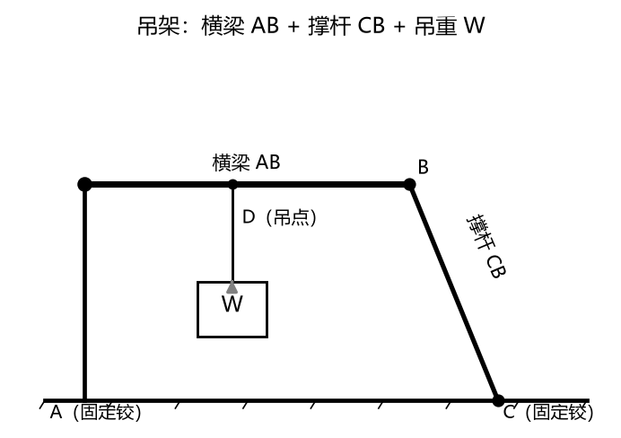
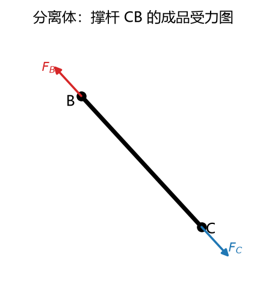
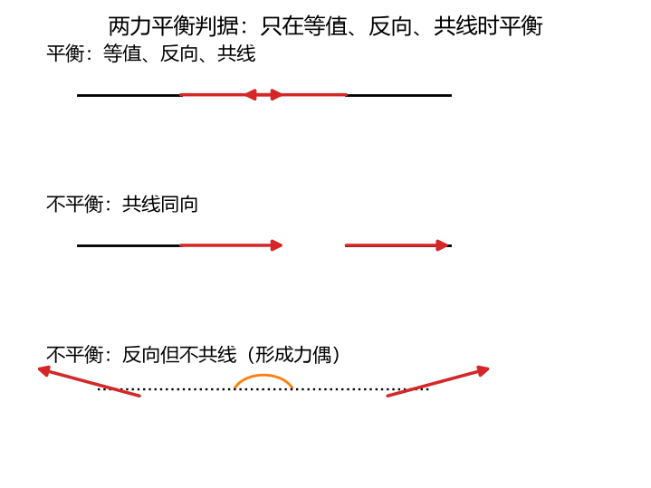
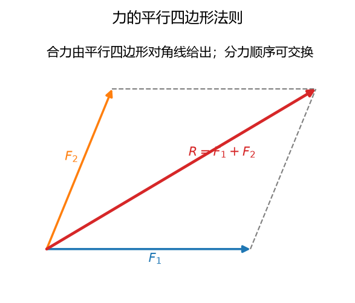
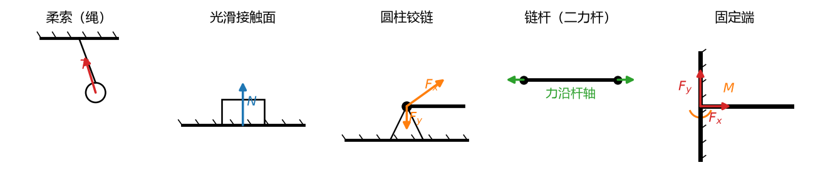
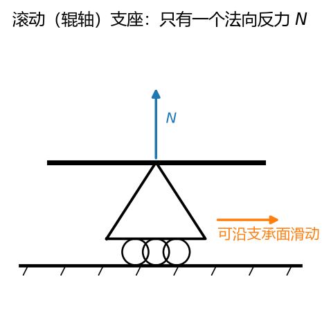
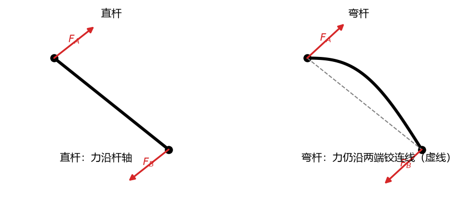
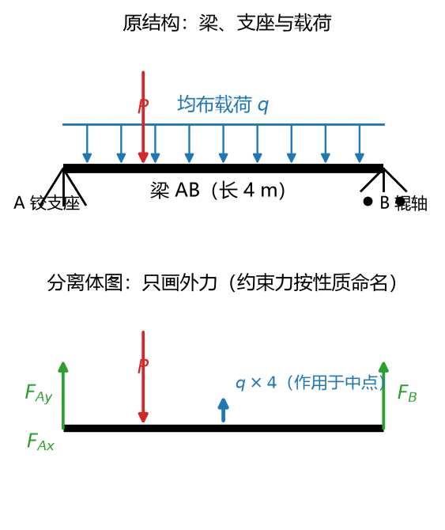
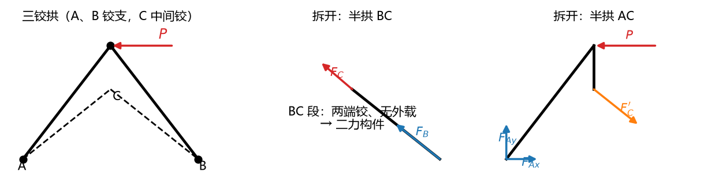
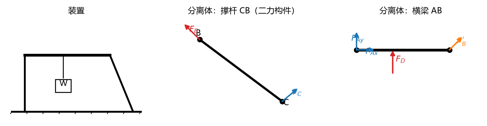

# 第 01 讲：受力分析入门——约束、约束力与受力图

> 前置：高中物理（力的基本概念）｜ 预计投入：2.5–3.5 小时（正文 + 作业）
> 本讲回答什么问题：工程结构里的一个物体到底被谁"抓着"？每种"抓法"给出什么样的反力？怎么把这一切画成一张规范、能直接拿去列方程的受力图？

> **本讲目标（学完你能）：**
> 1. 给定一个平面工程装置的描述，能说出每个连接处是什么约束类型、它限制了哪些运动方向；
> 2. 对单个构件和物体系，能画出规范的受力图——含分量假定、二力构件识别、作用反作用成对画；
> 3. 能数出一张受力图上有几个未知量（下一讲列平衡方程的弹药清点）。
>
> 目标达成 = 文末"掌握度自测"全打勾。

> **怎么学这一讲：** 先看成品（§0 一张完整的受力图长什么样、和高中差在哪）→ 拆解（§1–§4 把缺的概念和约束类型补齐）→ 学规范（§5 四步流程）→ 在例题里练（§6）→ 自测 → 作业。

---

## 0. 开场：一张受力图是怎么炼成的

先看一个真实的东西：一个简易吊架。

**图 L01-1**：吊架装置：横梁 AB 一端铰支、一端由撑杆 CB 支撑，吊点在 D。先认清装置，再拆分离体。

装置读法（工程图就这么读，先练起来）：

- **横梁 AB**：水平杆。左端 A 通过一个**固定铰支座**锚在地上——就是一根销钉，横梁可以绕它转，但不能被拽走；右端 B 与**撑杆 CB** 用销钉铰接，撑杆从地面上的 C 点斜着撑住 B；
- 横梁中间 D 点用**吊绳**挂着重物 W（画出重力的合力 $W$，作用在 D）；
- 撑杆 CB 两端都是铰，自身不受别的力。

问题来了：横梁 AB 受哪些力？撑杆 CB 受哪些力？整台吊架呢？

学完这一讲，你画出来的是这样的（以撑杆 CB 为例的**成品受力图**）：

**图 L01-2**：撑杆 CB 的成品受力图：两端都是铰、中间无载荷，所以两端各只受一个力，且都沿 B、C 连线、等值反向（指向为假定，拉/压待定）。§4 会把这类构件正式命名为二力构件。

两个力，等值、反向、沿两端连线——这张图信息完整、符号规范，下一讲直接拿它列方程。

**你高中就会画斜面上物块的受力图，为什么还要专门学一讲？** 差别在两件事：

1. **高中的"三大件"分类法不够用了**。高中把力分成重力、弹力、摩擦力——那是按力的**性质**分的，对付"一个物块+一个斜面"绰绰有余。但工程里物体怎么被连接，花样多得多：销钉、绳、滚轮、焊死、滑槽……**每种连接方式给出的反力形态都不同**。这讲要把这张"抓法清单"一次性学全（§3）。
2. **工程画图有规范**。画给谁看？画给自己列方程用、画给阅卷老师看。分量怎么假定、方向不知道怎么办、内力画不画——这些不规范，方程列不对，考试要丢分（§5）。

这两件事学全，你就从"会画物块受力图"升级到"能拆任何平面装置"。下面开始拆解。

---

## 1. 三个基本概念：刚体、力、力系

### 1.1 刚体

**刚体**：在力作用下不变形的物体——严格说，**任意两点之间的距离永远不变**的物体。

世界上没有真刚体（受力多少会变形），它是个**理想化模型**。为什么要引入？因为真实的变形（微米级）对"这根梁受力平衡吗""这根杆往哪倒"这类问题的影响完全可以忽略，而忽略之后，计算量大幅缩水。理论力学里到处是这种"抓住主要、扔掉次要"的理想化——刚体是第一个，后面还会遇到光滑面、不计自重的杆、不可伸长的绳，都是一个家族。

> **理解层次：要会用**。"什么时候能当刚体处理"这门课默认替你判断好了（教材题目给的都是刚体场景）；你只需要知道它是理想化，别把结论当成对一切真实物体都成立（§2.5 的刚化原理会精确说清这条边界）。

### 1.2 力

**力**是物体间的相互作用，效果是改变物体的运动状态（或变形）。对刚体，一个力由三要素完全确定：

- **大小** $F$（单位：牛顿 N，工程常用 kN）；
- **方向**（含指向）；
- **作用点**（力画在物体上的那个点）。

三要素齐了，力就是一个**定位矢量**：画在图上是一根带箭头的线段，箭头指向力的方向，起点（或终点）落在作用点上。本讲义矢量记粗体：$\mathbf{F}$；它的大小（模）记 $F = |\mathbf{F}|$。

（对刚体还有一条宽松政策——作用点可以沿线滑移，见 §2.2 的"力的可传性"。）

### 1.3 力系、等效力系、平衡力系

- **力系**：作用在同一物体上的一群力。两个力、五个力、分布的无数个力，都叫力系。
- **等效力系**：对同一刚体作用效果相同的两个力系，互称等效力系。把复杂力系换成简单等效力系（比如一堆力合成一个合力），是第 02 讲的主线。
- **平衡力系**：效果为零的力系——物体在它作用下运动状态不变（静止或匀速直线运动）。最简单的平衡力系：两个等值反向共线的力（§2.1）。

### 1.4 工程分法：主动力与约束力

高中按性质分力（重力/弹力/摩擦力）。静力学换一个角度，按"**谁给的**"分，只分两类：

- **主动力**（载荷）：别人主动施加给研究对象的力——重力、风载、吊着的重物拉力、加工时的冲压力。特点：**大小方向通常已知**（题目直接给你）。
  载荷的给法有两种：**集中力**——作用在一点（如吊绳在挂点的拉力，本讲例题与作业全用这种）；**分布力**——铺在一段长度或面积上（如桥面的雪载），怎么等效处理是 L02 的事。
- **约束力**（反力）：约束施加给研究对象的力。特点：**大小（常常还有方向）未知，是要解的量**。

一句话记住分工：**主动力是"题目给的"，约束力是"要你算的"**。这一讲的重头戏就是把约束力的形态规则学全，让"未知"变得"形态已知、只差大小（或分量）"。

---

## 2. 静力学公理：五条公理

公理不是推导出来的，是被工程实践反复检验、大家公认的基础规则。静力学整座大厦（简化、平衡方程、虚位移原理）全部立在这五条上。每条按"**内容 → 管什么用 → 使用边界**"讲。

### 2.1 二力平衡公理

**内容**：作用在**刚体**上的两个力平衡的充要条件是——**等值、反向、共线**（大小相等、方向相反、作用在同一条直线上）。

**图 L01-3**：两力平衡的三种情形：等值反向共线才平衡；同向不平衡；反向但不共线会形成力偶，刚体转动。

**管什么用**：它是判断"最简单平衡"的尺子，更是**二力构件**（§4）的根基——工程里满地都是只受两个力的杆，一根链杆两端力必然沿连线，靠的就是这条公理。

**边界**：前提是刚体。两个等值反向共线的力压一根软绳的两端，绳会弯——变形体不吃这一套（这就是 §2.5 刚化原理要处理的边界）。

### 2.2 加减平衡力系公理与力的可传性

**内容**：在作用于刚体的任意力系上，加上或减去一个平衡力系，不改变原力系对刚体的效果。

它本身少用，**它生的推论天天用**：

**推论（力的可传性）**：作用于刚体上的力，可以沿其作用线移动到刚体内任意一点，不改变力对刚体的效果。

为什么？把力从 A 点沿线搬到 B 点，等价于在 B 点加一对等值反向共线的平衡力（其中一员与原力抵消），一路"接力"过去——就是反复用加减平衡力系公理。

**管什么用**：对刚体，力的三要素里的"作用点"降级为"作用线"——只要力沿自己的作用线滑，效果不变。第 02 讲做力系简化（力线平移定理）就靠它铺路。

**边界**：又是只对刚体成立。对变形体，力作用在哪一点**改变内部受力**（比如压一根绳的头和中间，断的地方不一样）。本课程在刚体框架内，放心用；但你要知道这是理想化送的红利。

### 2.3 力的平行四边形法则（与分量表示法、三力汇交定理）

**内容**：作用在同一点的两个力，可以合成为一个力——合力等于以这两个力为邻边所作平行四边形的对角线（过该点）。反过来说，**一个力可以按任意两个方向分解为两个分量**。

**图 L01-4**：力的平行四边形：两个分力为邻边，合力沿对角线。分力顺序交换不改变合力。

**管什么用（两条）**：

1. **分量表示法的合法性**。一个方向未知的力 $\mathbf{F}$，可以正交分解为 $F_x$、$F_y$ 两个分量：方向未知的"1 个斜着的未知量"变成"2 个方向已知的未知量"（大小待解）。§3.3 铰链反力为什么敢画成两个分量，靠山就是这条。分解方向可以任选，**工程默认沿坐标轴**。
2. **推论（三力汇交定理）**：刚体受**三个力**平衡，若其中两个力的作用线交于一点，则第三个力的作用线必过该点（三个力平行时定理退化为"平行"情形）。

**边界**：分解是"计算方式"不是"物理拆分"——分量只是原力的等价表示，物体上并不真的存在两个分开的力（这点在受力图上要按规范画，别画成一力+两分量同时存在的三个力）。三力汇交定理只对"恰好三个力"的平衡成立，多一个力都不行。

### 2.4 作用与反作用定律

**内容**：两物体间相互作用的力（作用力与反作用力）总是**等值、反向、共线**，且**分别作用在两个物体上**。

它和牛顿第三定律是同一条。注意它讲的是"两个物体之间"的关系，**不是平衡条件**。

**防错重点——与二力平衡公理的区别**（考试和作业的经典陷阱）：

| | 二力平衡公理 | 作用反作用定律 |
| --- | --- | --- |
| 力作用在几个物体上 | **同一个**刚体上 | **两个**物体上（各一个） |
| 两力关系 | 等值、反向、共线 | 等值、反向、共线 |
| 性质 | **平衡条件**（说这个物体平衡） | **相互作用关系**（与平衡无关，运动的物体间照样成立） |

一句话：**平衡看"一物身上的力"，相互作用看"两物之间的成对力"**。物体系拆开画受力图时（§5、§6 例 2），铰链两侧那一对力就是作用反作用——等值反向、各画各的构件上。

### 2.5 刚化原理

**内容**：变形体在某力系作用下处于平衡时，若将此变形体**刚化**为刚体，其平衡状态保持不变。

**管什么用**：它划定了刚体静力学的适用边界。把它翻译成大白话：

- 变形体平衡 ⇒ 刚化后仍平衡。也就是说，**刚体的平衡条件，是任何物体（含变形体）平衡的必要条件**——所以刚体力学推出的 $\sum F = 0$ 这类条件，对真实结构也"必要"；
- 但反向不成立：满足刚体平衡条件，变形体不一定平衡——两根杆受压平衡，换成软绳立刻趴下。**刚体平衡条件对变形体不充分**。

**理解层次：知道有这回事 + 边界在哪**。你现在不需要用它做题，只需要在"软绳受压会散"这类问题上心里有杆秤：刚体结论不是万能通行证。

### 2.6 公理速查表

| 公理 | 一句话 | 主要用途 |
| --- | --- | --- |
| 二力平衡 | 等值反向共线 ⇔ 两力平衡（刚体） | 二力构件判定 |
| 加减平衡力系 | 加减平衡力系不改效果 | 证明力的可传性 |
| 力的平行四边形 | 合力=对角线；力可分解 | 分量表示法、三力汇交定理 |
| 作用反作用 | 两物体间力成对等值反向 | 物体系拆开画图 |
| 刚化原理 | 变形体平衡⇒刚化后平衡 | 划适用边界 |

---

## 3. 约束与约束力：工程"抓法"全家福

### 3.1 约束是什么

**约束**：限制研究对象运动的物体。**约束力**（反力）：约束施加给研究对象的力。

先建立方向感：一个在平面里自由的物体，能动的方式有三种——左右移动、上下移动、转动。约束就是来没收其中若干种"动"的：**它没收哪个方向的动，就在哪个方向上顶着你**——所以约束力的方向与被限制的运动方向相反。这句话是全家福所有规律的总纲，记住它，每种约束的反力形态都能现场推出来。

主动力/约束力的分工（§1.4）在这里落地：画受力图时，主动力照题目给的画，约束力按本节规则画。

下面逐个学"抓法"。每种给齐四件套：**长什么样 → 意味着什么（没收了哪种动） → 反力形态 → 画法**。（本讲只讲平面形态；空间形态的约束在 L04 补全。）

**图 L01-5**：五类常见约束的受力方向：柔索沿绳背离物体、光滑面沿法线指向物体、铰链两个分量、链杆沿杆轴、固定端三个量（两力 + 一力偶）。速查表配这张图，认约束就是认箭头方向。

### 3.2 柔索（绳、链、皮带）

**长什么样**：软绳吊灯、滑轮组的钢缆、皮带传动。

**意味着什么**：绳是软的，只能**拉**，不能**推**（抗压能力为零——软绳一压就弯）。它没收的：沿绳方向**离开**绳的运动（你往外逃，它拽住）；放任的：朝绳里去（绳松了，管不着）、垂直绳方向的摆动（绳可绕悬挂点转）。

**反力形态**：沿绳的方向、**背离**被约束物体（拉力）。作用点在绳与物体的连接点。

**画法**：从连接点出发、沿绳画一个离开物体的箭头，记 $\mathbf{F}_T$（T 取自 tension，张力）。

顺手记一个词：**张力**——绳内部任一截面两侧互相拉着的力，柔索受拉时处处有张力。光滑滑轮两侧张力大小相等（忽略滑轮摩擦与质量），这个结论到 L03 解滑轮系统时会用到。

### 3.3 光滑接触面（面、棱、点接触）

**长什么样**：物块搁在桌面上、圆柱靠在 V 形槽里、齿轮的齿面啮合。

**光滑**是什么意思：忽略摩擦。有摩擦的接触是第 05 讲的事，在这之前一律先"光滑"。

**意味着什么**：面与面贴着，一个想**压进**另一个面里去——这个被没收；沿面**滑动**、绕接触区转动，都放任（光滑=无摩擦阻力）。

**反力形态**：沿接触面的**公法线**方向（垂直于接触面/接触点处公切面），**指向**被约束物体（压力）。工程名字：**法向反力**，记 $\mathbf{F}_N$。

变体提醒——**曲面与曲面点接触**：接触退化为一个点，法线是**过接触点的公法线**（两曲面在该点各自的法线重合的方向）。圆球搁在 V 形槽里，两个接触点各给一个沿公法线的反力，方向由几何现场定。

对照高中：你学过的"支持力"就是光滑接触面的法向反力——**同一个东西，工程换了名字并把它归入约束力**。这就是 §0 说的"高中分类法 vs 工程分类法"的接缝。

### 3.4 光滑圆柱铰链（本讲重头戏）

**长什么样**：一根圆柱销钉穿过两个构件上的圆孔——合页、门轴、剪刀的两片刀、发动机里连杆与曲轴的连接。工程简图里画成一个小圆圈。

**意味着什么**：销钉卡在孔里，两构件想沿垂直于销钉轴的任意方向**相对移开**——被没收（销钉会顶着孔壁）；想**相对转动**——放行（孔可以绕销钉转，转多顺滑取决于"光滑"假设）。

**反力形态**：作用于销钉中心（即孔中心），**方向未知**——销钉可以顶着孔的任意一侧，顶哪一侧取决于主动力把构件往哪边压。这个"方向未知"是铰链的典型特征。

**怎么画**：用分量表示（§2.3 给的合法性）：过铰心画两个相互垂直的分量，习惯沿坐标轴 $F_x$、$F_y$（或 $F_{Ax}$、$F_{Ay}$，角标写约束名）。

**分量不是偷懒，是精确**：真实方向待定，分量表示把"1 个方向未知的力"翻成"2 个方向已知的待定量"，交给方程去解。解出来 $F_{Ax}$ 若是负数，说明真实方向与画的箭头相反——这不是算错，是分量计算的正常结果（负号的完整判读规则 L03 讲解方程时给）。

铰链在工程里有三种常见落法，反力形态略有差别，逐个过：

**（a）中间铰**——销钉连接两个**都能动**的构件（如剪刀两片的轴）。对每个构件，铰给的反力都过铰心、方向未知、画两分量。两构件受到的这对铰链力是作用反作用（§2.4），等值反向各画各的。

**（b）固定铰支座**——铰链的一侧焊死在地/墙上（支座符号：一个小三角加底面斜线阴影）。构件能动（绕铰转），但拽不走。反力：过铰心、方向未知、两分量。§0 吊架的 A、C 就是它。

**（c）滚动（辊轴）支座**——固定铰支座下面垫一排滚珠/滚轮，简图是三角+下方小圆圈。垫了滚轮后，构件还能**沿支承面滑动**（热胀冷缩的桥梁就这么处理——桥面伸长缩短时支座跟着滚）。

**图 L01-6**：滚动支座：三角下面垫滚珠，只提供垂直于支承面的一个反力 $N$；沿支承面方向可自由滑动。

**反力形态**：沿支承面滚动方向的移动被放行了，那个方向不再有反力——只剩**垂直于支承面**的一根反力（指向可指向物体或背离，画图时假定一个指向）。对比：固定铰是"2 个未知量"，滚动支座是"1 个未知量"。**给结构装滚动支座 = 主动降未知量**，工程和考试都爱用它。

**（d）变体：光滑导槽（销钉在滑槽里滑）**——构件上开一条直槽，另一构件的销钉插在槽里滑动。销钉在槽里能沿槽滑（放行），垂直于槽壁的方向被槽壁顶着（没收）。反力：**垂直于槽的中心线**，方向未知正反（单面槽时指向待定）。把它当成"弯成直线的双面接触"理解即可，出现频率低，**认识即可**。

### 3.5 链杆（二力杆约束）

**长什么样**：一根不计自重的**直**杆，两端各一个铰，此外没有任何别的连接和载荷——撑杆、桁架里的杆（桁架=许多二力杆铰接成的三角形骨架结构，桥梁大梁、起重机臂的常见骨架，L03 专门讲它的算法）、发动机连杆（近似）。

**意味着什么**：它自己只受两个力（两端各一），且平衡——§2.1 二力平衡公理立刻出手：**两个力等值、反向、共线**，而两端铰的力都过各自铰心，"共线"只有一种可能：**沿两端铰心的连线**。

**反力形态**：对被约束物体，链杆提供的反力**沿杆两端连线**——比普通铰链（两分量）少一个未知量！至于是拉还是压（箭头指向两端中哪一端），画图时**任假定一个**，解出正负定乾坤。

原理证明与应用的展开（曲杆情形、识别条件）单独放 §4，那里是重点。

### 3.6 固定端（插入端约束）

**长什么样**：电线杆栽进地里、悬臂梁一端浇筑进墙、旗杆插在基座上。简图：构件端部接一段粗黑线+斜线阴影。

**意味着什么**：最严的抓法——移动和转动**全部没收**（不许走、不许转）。

**反力形态**：两个力分量（顶住移动：$F_{Ax}$、$F_{Ay}$）**外加一个反力偶 $M_A$**（摁住转动）。图上力偶画成一段带箭头的弧线，记 $M$。

**力偶现在还没学怎么办**（P2 缓期声明）：力偶是"一对等值反向、不共线的平行力"，效果是**纯转动**——它使物体转的本事的大小用 $M$ 度量。**现在只需知道**：固定端除了"顶住你"（两个力分量），还会"拧住你"（一个反力偶），画固定端时**千万别漏画这个弧线箭头**——漏画它是受力图第一大扣分点。力偶的完整理论（怎么算、怎么合成）第 02 讲立刻讲。

对比记住差别：**固定铰允许转**（所以无力偶）；**固定端禁止转**（所以有力偶）。抓得越紧，反力越"厚"。

### 3.7 平面约束速查表（本讲核心产出，做题时翻这张表）

| 约束类型 | 简图特征 | 没收的运动 | 反力形态 | 未知量个数 |
| --- | --- | --- | --- | --- |
| 柔索 | 绳、链、皮带 | 沿绳离开 | 沿绳、背离物体（拉） | 1（大小） |
| 光滑接触面 | 面贴面/点接触 | 沿法线压入 | 沿公法线、指向物体 | 1（大小） |
| 光滑圆柱铰（中间铰/固定铰支座） | 小圆圈/三角+阴影 | 平面内任意方向移动（不限制转动） | 过铰心，两分量 | 2（$F_x, F_y$） |
| 滚动（辊轴）支座 | 三角+滚珠 | 垂直支承面移动 | 垂直支承面 | 1 |
| 链杆（二力杆） | 两端铰直杆 | 沿杆线移动 | 沿两端连线 | 1（拉/压） |
| 固定端 | 粗黑线+阴影 | 移动+转动全没收 | 两分量+反力偶 | 3（$F_x, F_y, M$） |

> 注意最后一列——**未知量个数**。它就是你解题要付出的"代价清单"：约束越强，未知量越多；链杆和滚动支座之所以在工程里受欢迎，就是因为它们"便宜"。数未知量是画完受力图的固定动作（§5 第 4 步），也是 L03 判断"静定/静不定"的弹药。

---
## 4. 二力构件：受力分析的第一个"捷径"

§3.5 已经预告了它，这里把原理、判定和用法一次讲透——这是本讲性价比最高的知识，用一次省一个未知量，工程和考试都高频出现。

### 4.1 定义与原理

**二力构件**（二力杆）：只受**两个力**作用且处于平衡的构件。

原理就一条推理链：两端各一个力（都过各自的作用点）→ 二力平衡公理（§2.1）要求**共线** → 两力的作用线只能是**两作用点的连线** → 于是：**二力构件两端的力，等值、反向、沿两端作用点连线**。

最常见的形态：杆两端是铰（力过铰心），中间无载荷、不计自重——**力沿两铰心连线**。

### 4.2 为什么它有用：未知量减少

一个普通铰链约束反力是 2 个未知量（两分量）。认出一个二力构件，两端铰的反力都被"钉死"在连线方向——**每个铰从 2 个未知量降为 1 个**（只剩大小和拉压符号）。§6 例 2 会现场演示清单从 4 个未知量减少到 3 个的完整过程。

### 4.3 两个易错点

**易错点一：曲杆二力构件——力沿"两铰连线"，不是沿"杆的形状"**。

**图 L01-7**：二力杆的力沿两端铰连线：直杆沿杆轴，弯杆也沿两铰连线（不是杆的切线）。

判定条件只关心"**只受两个力**"，跟杆长什么样无关。弧形撑杆两端铰接、中间无载，照样是二力构件，两端力沿**铰心连线**。考试专门爱拿弯杆考这个。

**易错点二：看着像二力构件，其实不是**。判定条件必须**逐条核对**：

| 判定 checklist | 说明 |
| --- | --- |
| ① 恰好两个受力点 | 两端各一，没有第三个连接或接触 |
| ② 中间无主动力 | 无载荷、绳拴点、别的杆搭上来 |
| ③ 不计自重 | 自重是一个独立的第三个力（作用于杆的重心——重心是重力合力的作用点，匀质杆就在杆中点），重杆不能当二力构件（题目说"不计自重/不计杆重"才行） |

三缺一，就不是二力构件——老实用两分量，别硬套。典型反例：桁架杆中间挂了灯（多了主动力）、粗重立柱自重不可忽略。

> **理解层次：要会用**。给定构件判定是否二力构件，并说出两端力沿哪条线——这是受力图的必备动作，不是可选技巧。

---

## 5. 受力图画法：四步流程与规范

### 5.1 什么是受力图（分离体图）

**受力图**：把研究对象从它周围的约束中**剥离**出来（这一步叫"取分离体"），单独画出它的简图轮廓，再画上它受到的**全部**力——主动力照题目给，约束力按 §3.7 的表给。

它为什么管用：周围物体对研究对象的作用，全部被**等价的约束力**顶替了——分离体拎出来后，它身上"看似孤立"，实则每一个力都有出处。接下来（下一讲）就是在受力图上列平衡方程解未知量。**受力图是静力学解题的第一道工序，图画错，后面全错。**

### 5.2 四步流程

**第 1 步：取分离体——先画边界，再画轮廓。**
选定研究对象（一个构件，或几个构件的组合，或整个系统），把它从周围的约束中"剪"出来，单独画轮廓。这一剪子下去，**边界**就定了：边界以外的东西对它的作用，全部表现为边界上的约束力；边界以内的东西之间互拉互拽的力（内力），**不出现在图上**。

**第 2 步：画主动力。**
重力（画在**重心**处、竖直向下——重心是重力合力的作用点，匀质物体的重心就是它的几何中心；题目给了质量就用 $\mathbf{W}=m\mathbf{g}$）、外加集中力（作用点、方向照题目）、绳挂重物的拉力……照题目给的画，一个不许漏。

**第 3 步：画约束力——逐个连接处对照 §3.7 的表。**
每个被剪断的连接处，按它的约束类型给反力：柔索沿绳背离、光滑面沿法线、铰链两分量、链杆沿连线、固定端两分量+力偶。**方向不确定的（铰链分量、滚动支座指向、链杆拉压）一律任意假定一个，并在心里记住"负号=真实方向相反"**（L03 会给出完整判读）。

**第 4 步：检查 + 数未知量。**
- 每个力都能指出**施力者**吗？（受力图上不允许出现"无源之力"——每个箭头都得回答"这是谁给的"）
- 数一数连接处，每个都画了吗？（漏画约束是第二常见事故）
- 画内力了吗？（取的是整体/组合体时，内部铰链对**不许**出现在图上）
- 画了"地面、墙、销钉"这些**已被剪掉的东西**吗？（不允许——它们的作用已被约束力顶替，再画就是重复计入）
- 最后**数出未知量个数**（每个约束对照 §3.7 表的"未知量"列）。

### 5.3 内力与外力：一把剪刀定内外

**内力/外力不是力自带的属性，而是取决于你把边界画在哪**。同一个铰链 C 的相互作用力：

- 取**整体**（两半拱一起）作研究对象 → C 处两半拱互拽的力是**边界之内**的事，是内力，**不画**；
- **拆开**取半拱 → C 处的力跨了边界，是外力，**必须画**，而且两半拱图上要画成作用反作用（等值、反向、共线，各画各的构件，§2.4）。

这就是"整体图干净、拆开图热闹"的原因：整体图不画内力所以未知量少，但内部力信息也被藏起来了；拆开图暴露内部力但未知量变多。**什么时候取整体、什么时候拆开，是 L03 的战术课**，本讲先把两种图都画对。

### 5.4 好习惯 / 坏习惯对照表

| 好习惯（加分项） | 坏习惯（扣分重灾区） |
| --- | --- |
| 动笔前先扫一遍二力构件（§4） | 见铰就画两分量，未知量爆炸 |
| 铰链分量沿坐标轴，符号带角标（$F_{Ax}$） | 分量方向随手画斜，坐标不声明 |
| 每个力标注施力者（可口头/草稿） | 图上出现说不出来源的力 |
| 力矢箭头画在作用点处，方向清晰 | 箭头悬空、作用点含糊 |
| 画完数未知量、数连接处 | 画完就完，漏了约束不知道 |
| 拆开图成对约束力等值反向共线 | 拆开后两图各画各的、互不相认 |

---

## 6. 完整例题：从装置到全套受力图

三道例题由浅入深。**先自己试着画，再往下读**——受力图是技能不是知识，看会的画不出来。

### 例 1（单构件）：简支梁

**题目**：水平梁 AB，A 端固定铰支座，B 端滚动支座（支承面水平），跨中 C 点受竖直向下的集中力 $\mathbf{P}$。画梁的受力图，数未知量。

**图 L01-8**：上为原结构（支座与载荷），下为分离体图。约束力按性质逐项命名：A 处两个分量（$F_{Ax}$、$F_{Ay}$）、B 处一个法向反力 $F_B$；均布载荷先合成为过中点的 $q\times4$。照这张图数未知量，就不会把销钉、墙、地面再画一遍。

**逐步示范**：

1. **取分离体**：梁 AB 单独画出（一根水平线段）。
2. **主动力**：$\mathbf{P}$ 画在 C 点，竖直向下。
3. **约束力**（对照 §3.7）：
   - A 是固定铰支座 → 两分量 $F_{Ax}$（假定水平向右）、$F_{Ay}$（假定竖直向上），过铰心 A；
   - B 是滚动支座 → 垂直于支承面 = 竖直方向，1 个未知量，假定 $F_B$ 向上。
4. **检查+计数**：每个力有施力者（P 是载荷给的，分量是支座 A 给的，$F_B$ 是支座 B 给的）；连接处 A、B 都画了；无内力问题；未知量 $F_{Ax}, F_{Ay}, F_B$ 共 **3 个**。

**一个值得想的注记**：P 和 $F_B$ 都竖直，似乎 A 端"理应"没有水平力（不然谁平衡它？）。这个直觉**列方程后自然兑现**（L03 将解出 $F_{Ax}=0$）；但画图阶段**照样老老实实画分量**——稳妥派画图求"全"，聪明推断留给方程。另一种"聪明派"是用三力汇交定理（§2.3）直接论证 $F_A$ 必竖直——两派都对，考试两种都给分，**初学阶段建议稳妥派**，熟练后随意。

### 例 2（物体系+二力构件升级）：三铰拱

**题目**：三铰拱由半拱 AC、BC 组成：A、B 为底部固定铰支座，C 为顶部中间铰。（"拱"原指弧形构件，下面示意图画成折线轮廓；由直杆段拼成的同类结构叫"刚架"，作业题 4 见。）半拱 AC 上的 D 点受水平向右的集中力 $\mathbf{P}$。不计各件自重。画：整体受力图、两个半拱的拆开受力图，数未知量。

**图 L01-9**：三铰拱：整体（A、B 铰支、C 中间铰）与两个半拱的分离体。BC 无外载、两端铰，是二力构件；C 处力沿 BC 连线。

**逐步示范**：

0. **先扫二力构件**（§5.4 好习惯第一条）：半拱 BC——两端铰（B、C）、中间无载荷、不计自重 → **是二力构件**！B、C 两处的力都沿 B、C 铰心连线。半拱 AC 呢？它有主动力 P（三个力），不是二力构件，A、C 处老实分量。还没开始数未知量，先省一个。

1. **整体图**（研究对象：整个三铰拱）：
   - 主动力：P（D 点，水平向右）；
   - 边界约束：A、B 都是固定铰支座 → 各两分量；
   - **C 铰在边界之内，不画**（§5.3 内力规则）。

   咦，整体图里 B 为何还是两分量？——整体图的 B 是"固定铰支座对整个拱的作用"，二力构件的判定信息用不上（C 的力被藏进内力了）。**二力构件的便宜要拆开图才兑现**，这是常见初学困惑，特意演示。

2. **拆开图 BC**（二力构件）：

   未知量：1 个（连线方向力的大小，$F_C = F_B$）。

3. **拆开图 AC**：

   未知量：$F_{Ax}, F_{Ay}$ 和连线力大小（$F_C'$ 与 BC 图的 $F_B$ 同大小，不另算）。

**未知量总结**：拆开后真正要解的未知量 = $F_{Ax}, F_{Ay}, F_B$ 共 **3 个**（对比"全程两分量"的 4 个，省 1 个）。**先扫二力构件的价值兑现了。**

### 例 3（首尾呼应）：开场那个吊架

**题目**：回到 §0 的吊架：横梁 AB（A 固定铰支座、D 点用竖直吊绳挂重物 W、B 端与撑杆 CB 铰接），撑杆 CB（C 固定铰支座、B 与横梁铰接，自身无载荷、不计自重）。画横梁、撑杆、重物各自的受力图，数未知量。

**图 L01-10**：吊架的全套受力图：装置、撑杆 CB（二力构件，力沿 CB）、横梁 AB（A 处两分量、D 处绳力、B 处撑杆反力）。

**逐步示范**：

0. **扫二力构件**：撑杆 CB——两端铰、无中间载荷、不计自重 → **二力构件**，B、C 处的力都沿 CB 铰心连线。横梁不是（D 处有主动力）。重物单独看：重力 + 绳拉力，两个力（也算"二力平衡"的用武之地，见下）。

1. **撑杆 CB 图**：

   **这里有个精妙的逻辑**：C 是固定铰支座，§3.7 的表说它"2 个未知量"——为什么图上只画了 1 个？因为二力构件的平衡**强制**两端两力共线：C 处约束力**可以**是任意方向（固定铰的本事），但撑杆只受 B、C 两个力，二力平衡公理**钉死** C 处力必须与 B 处力沿同一连线。约束"允许的方向范围"是一回事，构件**平衡要求的实际方向**是另一回事——固定铰+二力构件，实际反力沿连线。这个逻辑链（表给自由度、公理收紧它）是受力分析的深层套路，例 3 特意拿来演示。

2. **重物图**：重力 $\mathbf{W}$（竖直向下，作用在重心）+ 绳拉力 $\mathbf{F}_T$（沿绳竖直向上，作用在挂点）。两个力平衡（§2.1：等值反向共线）→ **$F_T = W$**。这就是"绳的张力等于所挂重物重量"的来源——不是背的，是二力平衡推的。

3. **横梁 AB 图**：

   D 处的力哪来的：横梁与绳在 D 相连——**绳给横梁的力沿绳竖直方向**；方向判定用作用反作用想最稳：横梁向上拽绳（撑着它），绳就向下拽横梁——**竖直向下、大小 $W$**（绳自己是二力平衡——上端被梁拽、下端被重物拽，两力等值，都等于 $W$）。
   未知量：$F_{Ax}, F_{Ay}, F_B'$ 共 **3 个**。

4. **检查**：横梁 4 个力（$F_{Ax}, F_{Ay}, F_D, F_B'$），每个都有施力者；撑杆 2 个力；重物 2 个力；拆开图中 B 处两力（$F_B$、$F_B'$）等值反向共线 ✓。

三张图合在一起，吊架的受力全貌清清楚楚——§0 那个"看不懂的成品"，现在你可以独立复现了。

---

## 7. 常见错误清单（对答案，校准感觉）

> 本节零新知识，逐条对应正文小节。

| # | 错误 | 为什么错 | 锚定 |
| --- | --- | --- | --- |
| 1 | 固定端只画了两分量 | 固定端没收转动，反力里还有"摁住转动"的反力偶，漏画=漏一个未知量+模型错误 | §3.6 |
| 2 | 铰链反力凭直觉画一根斜线 | 铰链反力方向未知，凭感觉画等于把猜想当已知，错了还查不出来；必须两分量 | §3.4 |
| 3 | 柔索反力画成指向物体（推） | 柔索只能拉不能推 | §3.2 |
| 4 | 没扫二力构件，全图两分量 | 白白多背未知量，解不动 | §4 |
| 5 | 弯的二力构件力沿杆的切线画 | 判定只看"两力"，力沿**两铰心连线**，与杆形无关 | §4.3 |
| 6 | 整体图上画了内部铰链力 | 整体图边界内是内力，不出图 | §5.3 |
| 7 | 拆开后两图的同名约束力没画成等值反向 | 那是一对作用反作用，必须等值反向共线 | §2.4 |
| 8 | 受力图上画了"地面/墙"的轮廓 | 已被剪掉的约束，作用已由约束力顶替，再画是重复计入 | §5.2 |
| 9 | 多点接触只画了一个法向反力（V 形槽两壁各一个） | 每个接触点各给各的反力，要逐点数 | §3.3 |
| 10 | 把约束力画成"构件给约束的力"（方向整体反了） | 受力图画的是**别人给研究对象的力**；反作用力留在别人的图上 | §5.2 |

---

## 8. 本讲小结（一页骨架）

- **总纲**：约束没收哪个方向的动，就在那个方向给反力（§3.1）。
- **公理五件**：二力平衡（→二力构件）、加减平衡力系（→可传性）、平行四边形（→分量法、三力汇交）、作用反作用（→拆开成对画）、刚化原理（边界意识）（§2）。
- **约束六类**（§3.7 表）：柔索（沿绳拉，1）、光滑面（法向压，1）、铰链（两分量，2）、滚动支座（垂直面，1）、链杆（沿连线，1）、固定端（两分量+力偶，3）。**括号里是未知量个数，画完图必须数。**
- **二力构件**：两端力沿两铰心连线（判据：恰两处受力+无中间载荷+不计自重；弯杆也行，沿连线不沿杆形）（§4）。
- **受力图四步**：取分离体（定边界）→ 主动力 → 约束力（对照表，未知方向任意假定）→ 检查（施力者、连接处数、内力）+数未知量（§5.2）。
- **内外力随边界走**：整体图不画内力；拆开图成对画作用反作用（§5.3）。
- **下一讲**：图画对了，力还算不出来——一堆乱力怎么向一点简化成"主矢+主矩"？力偶到底是个什么东西（兑现本讲的欠条）？合力怎么求？→ L02。

## 9. 掌握度自测（行为化清单，全部打勾才算讲过）

- [ ] 我能不看正文说出约束力方向总纲（"没收哪个方向的动……"）
- [ ] 遮住 §3.7 表右侧两列，我能默写 6 类约束的反力形态和未知量个数
- [ ] 我能用两句话说清"二力平衡公理"和"作用反作用定律"的区别，并指出各自作用在几个物体上
- [ ] 我能完整复述"链杆两端力为什么沿连线"的证明（用哪条公理、怎么推）
- [ ] 我能默写受力图四步，并说出第 4 步检查的三个要点
- [ ] 给我"取整体/拆开"两种画法，我能解释内力外力为什么随边界变
- [ ] 我能解释固定端为什么有力偶、固定铰为什么没有
- [ ] 拿一个没见过的平面装置，我敢按流程下手：扫二力构件 → 逐个约束对照表 → 分量假定 → 数未知量

## 10. 作业（先独立做，再看参考答案——答案只用本讲内容）

**题 1（判断，每小题答"对/错"+一句理由）**
(a) 作用在物体上的两个力等值反向，则物体必平衡。
(b) 作用力与反作用力大小相等方向相反，所以它们使两个物体都平衡。
(c) 力沿作用线移动不改变对刚体的效果，所以对任何物体都随便移。
(d) 固定端约束有 3 个未知量，固定铰支座有 2 个。

**参考答案：**
(a) **错**。缺"共线"：反向不共线的两力使刚体转动（§2.1）。软绳两端受等值反向拉力也不平衡（变形体，§2.5 刚化原理的边界）。
(b) **错**。作用反作用是相互作用关系，与平衡无关（§2.4）；两个被踢的球各自加速。
(c) **错**。可传性只对**刚体**成立；变形体上移力会改变内部受力（§2.2）。
(d) **对**。固定端：$F_x, F_y, M$；固定铰：$F_x, F_y$（§3.7 表）。

**题 2（约束识别）**说出下列每个连接的约束类型、反力形态、未知量个数：
(a) 用钢缆斜拉住灯柱顶部的绳；(b) 轮子停在水平轨道上（忽略滚动摩擦）；(c) 门轴（合页）；(d) 桥梁一端的辊轴支座；(e) 阳台的挑梁：一端浇进墙里、另一端悬空（这种"一端插死、一端自由"的梁叫悬臂梁），问浇进墙里的那一端。

**参考答案：**
(a) 柔索：沿绳背离柱顶（拉），1。
(b) 光滑接触面（轨道面）：竖直向上法向反力，1。（"忽略滚动摩擦"= 光滑提示语）
(c) 光滑圆柱铰链（中间铰形态，门可绕轴转）：过轴线、平面内方向未知，画两分量，2。
(d) 滚动支座：垂直于桥面（这里竖直），1。
(e) 固定端：两分量+反力偶，3。（悬臂=固定端的典型场景，§3.6 电线杆同族）

**题 3（单构件受力图）**水平外伸梁 AB：A 端（左）固定铰支座，跨内 B 处滚动支座（支承面水平），梁从 B 再向右外伸至 C，外伸端 C 受斜向下 $30°$（与水平夹角）集中力 $\mathbf{P}$。画梁的受力图并数未知量。

**参考答案：**
分离体：整根梁 AB（含外伸段 BC）。
- 主动力：$\mathbf{P}$ 画在 C 点，与水平成 $30°$ 斜向下（照题目给的方向画，**不要**自行分解到图上——分解是列方程时的事，§2.3）；
- A 固定铰：$F_{Ax}$（假定水平向右）、$F_{Ay}$（假定向上）；
- B 滚动支座：$F_B$ 垂直支承面（竖直），假定向上。
- 检查：3 处连接（A、B、C 处的力源）都画了，每个力有施力者。
- **未知量：3**（$F_{Ax}, F_{Ay}, F_B$）。P 的斜向**不影响**未知量计数（主动力已知）。

**题 4（物体系受力图）**三铰刚架：左半刚架 ADC 与右半刚架 BCE 在顶部 C 铰接，底部 A、B 均为固定铰支座。左半刚架上作用水平向右的力 $\mathbf{P}_1$，右半刚架上作用竖直向下的力 $\mathbf{P}_2$。不计自重。画：整体受力图、两半刚架拆开受力图，数拆开后真正的未知量个数。

**参考答案：**
先扫二力构件：两半都受主动力（各有一个 P），**都不是**二力构件——这题考的就是"别硬套"。
- 整体图：主动力 $P_1$（左半上，向右）、$P_2$（右半上，向下）；约束 A、B 各两分量；C 铰是内力**不画**。未知量 4。
- 拆开图（左半 ADC）：$P_1$ + A 两分量 + C 处来自右半的力（中间铰，两分量 $F_{Cx}, F_{Cy}$，方向假定）。
- 拆开图（右半 BCE）：$P_2$ + B 两分量 + C 处来自左半的力（$F_{Cx}', F_{Cy}'$——与左半图中的 $F_{Cx}, F_{Cy}$ **等值反向**，作用反作用）。
- 未知量计数：$F_{Ax}, F_{Ay}, F_{Bx}, F_{By}, F_{Cx}, F_{Cy}$ 共 **6 个**（两图联立时的未知量总数；解题战术 L03 讲）。C 处两图的力是 3 对作用反作用关系，各自等值反向。

**题 5（二力构件专题）**(a) 一根弧形撑杆，两端铰接、中间无载、不计自重，两端力沿什么方向？(b) 一根直杆两端铰接、中间挂了一盏灯，还是二力构件吗？(c) 例 3 吊架中，为什么 C 处固定铰支座的反力只画了 1 个未知量（沿连线）而不是 2 个分量？

**参考答案：**
(a) 沿**两端铰心的连线**（不是沿弧的切线）——二力构件判定只看受力数，弯杆直杆一视同仁（§4.3 易错点一）。
(b) **不是**。中间的灯是第三个力（主动力），判定条件"中间无主动力"被破坏；两端铰老实两分量（§4.3 checklist ②）。
(c) 固定铰**允许**给任意方向的力（2 分量的自由度），但撑杆 CB 是二力构件，只受 B、C 两力，二力平衡公理**强制**这两力沿连线——约束的能力范围（"可以"）和平衡的要求（"必须"）是两回事，后者收紧前者（例 3 第 1 步的逻辑链）。

**题 6（数未知量）**一个平面装置由三根杆 AB、BC、CD 首尾铰接成折线链：A 是固定铰支座，D 是固定铰支座，中间铰 B、C 处各挂一个已知重量 $W_1$、$W_2$ 的重物（通过竖直短绳）。各杆不计自重。问：画全部三根杆的拆开受力图后，总共几个未知量？

**参考答案：**
逐杆想：三根杆各自两端铰接，但 B、C 处有竖直绳的力（主动力已知大小），所以每根杆都受"两铰+可能的已知绳力"——**都不是**二力构件（B、C 铰处受三个力：两杆互施+绳力；对单根杆，两端铰反力是"2+2"四个分量起步）。直接核对（画完图数）：
- A 支座：2（$F_{Ax}, F_{Ay}$）；D 支座：2；
- 铰 B（AB 杆与 BC 杆互施）：2（$F_{Bx}, F_{By}$，另一侧是反作用，不另计）；
- 铰 C（BC 与 CD 互施）：2。
- 主动力 $W_1, W_2$ 已知，不占清单。
**未知量共 8 个**。数对这个数，说明你对"未知量=约束反力（本题为 8 个分量）"的计算逻辑已经内化。至于这 8 个未知量够不够方程解（每根杆能列几个独立平衡方程、方程怎么列），那是 L03 的正式内容——现在先把未知量数对。

**题 7（绳+滑轮系统）**定滑轮装在水平横梁中点：绳绕过滑轮，一端挂重物 W，另一端受向下的拉力 $\mathbf{F}$（人拽着，已知 $F=W$）。画：重物、绳、滑轮各自的受力图（滑轮轴视作光滑圆柱铰）。绳与滑轮的自重、摩擦均忽略。

**参考答案：**
- **重物图**：重力 $\mathbf{W}$ 竖直向下 + 绳拉力 $\mathbf{F}_T$ 竖直向上，二力平衡 → $F_T = W$（例 3 重物同款，§6）。
- **绳图**（两端各一小段为分离体，或把绳当整体——绳绕过滑轮两侧各一段竖直绳）：左段绳上下两力各 $W$（上端被滑轮托着：滑轮给绳的法向+摩擦的综合…——这里按"忽略滑轮摩擦"的理想化，绳在滑轮上**只受法向反力**且张力处处相等 $F_T = W = F$（§3.2 张力）。绳两侧竖直段各传一对 $W$。
- **滑轮图**（含轮与轴）：绳两侧给的力——两段竖直绳各**向下**拉滑轮边缘：左缘 $F_T = W$ 竖直向下（作用反作用：绳受滑轮向上托，滑轮受绳向下拉）、右缘同样 $F = W$ 竖直向下；轴（光滑铰）给滑轮的约束力：过轴心两分量 $F_{Ox}, F_{Oy}$（方向假定，假定 $F_{Oy}$ 向上）。
- 未知量：**2**（$F_{Ox}, F_{Oy}$）。
- 顺手得一个漂亮结论的预感：滑轮受两段绳的力都竖直向下、各为 W，加上轴的反力平衡——轴的反力竖直分量必然 $F_{Oy} = 2W$、水平 $F_{Ox} = 0$（这个"预感"到 L03 列完方程就是正式结论；"定滑轮轴载 = 2 倍绳张力"是滑轮设计的经典常识，你现在能从受力图上看出雏形了）。

---

> **下一讲预告**：L02 平面力系的简化——本讲欠的两个问题一次讲清：力偶到底是什么（那个弧线箭头的真身）、主矢主矩怎么算、一堆乱力最后能简化成什么形态。受力图是"画出来"，L02 是"算起来"。
