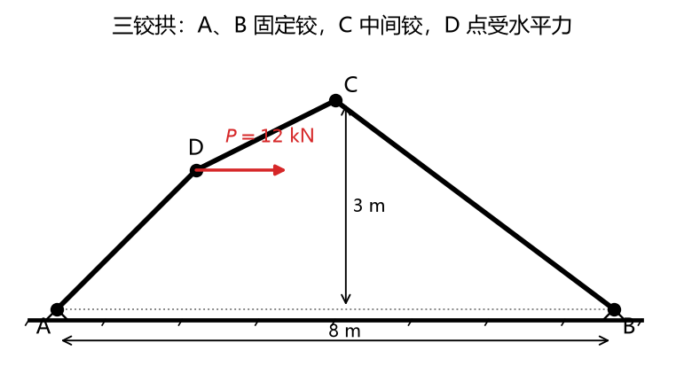
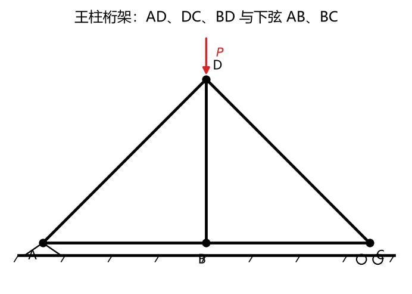
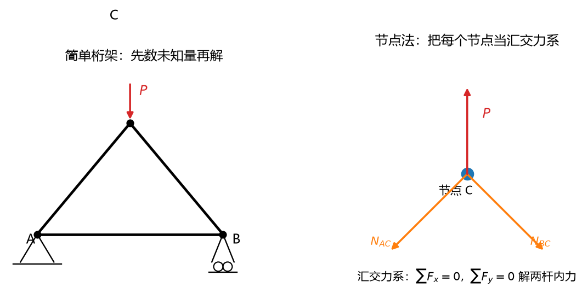
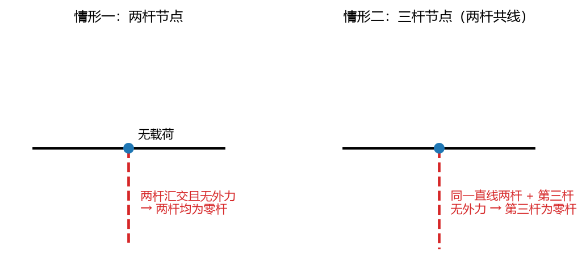

# 第 03 讲：平面力系的平衡——方程、物体系与桁架

> 前置：第 01 讲（受力图）、第 02 讲（主矢主矩、力矩计算、分布载荷等效）｜ 预计投入：4–5 小时（本讲是静力学解题主战场，例题多）
> 本讲回答什么问题："不动"的数学条件怎么写成**能解出未知量的方程**？多物体的系统怎么拆着解？怎么提前判断一道题"能不能解"？桁架的杆到底受多大力？

> **本讲目标（学完你能）：**
> 1. 对单个刚体（含固定端、分布载荷），能用合适的平衡方程形式（基本式/二矩式/三矩式）解出全部未知量；
> 2. 对物体系（三铰拱式结构），能判断静定/静不定，能制定"先整体后拆开"的解题路线并全程解出（含中间铰相互作用力）；
> 3. 对平面简单桁架，能用零杆判据先扫一遍，再用节点法或截面法求出指定杆（或全部杆）的内力。
>
> 目标达成 = 文末"掌握度自测"全打勾。

> **怎么学这一讲：** 三件套开场（这讲结束时你能解什么）→ 学方程的三种形式与选择技巧 → 静定判断（先判能不能解，再动笔）→ 物体系战术 → 桁架专场 → 作业。本讲例题的数值结论有归档脚本可复跑（`scripts/lec03-01_truss_solver.py`，见 §5）。

---

## 0. 开场：从判据到方程，从方程到数字

第 02 讲结尾你手里有判据：**平衡 ⇔ 主矢为零且主矩为零**。这句话是"哲学"，本讲把它翻译成"工程"——投影方程和力矩方程，然后**解出数字**。

这讲结束时你能解的三样东西，先看清单：

1. **悬臂梁**（L02 例 3 预演过未知量结构的那根）：解出固定端三个未知量的数值——$F_{Ax} = -5.20$ kN、$F_{Ay} = 27$ kN、$M_A = +45$ kN·m（§1 例 1 兑现，"预演结果"和"解出结果"将逐位对上）；
2. **三铰拱**（L01 画过受力图的那座）：A、B 支座反力 + C 铰相互作用力，全部解出（§3 例 2）；
3. **桁架**：每根杆是拉是压、拉压多少，一刀一刀剖出来（§4 例 3）。

从"画图"（L01）到"化简"（L02）到"**求解**"（本讲），静力学的三部曲在本讲合龙。之后 L04 把战场扩到空间，L05 加上摩擦——但平面的、光滑的、刚体的平衡问题，**本讲之后你就全副武装了**。

---

## 1. 平衡方程：一种判据，三种写法

### 1.1 基本式：判据的直接翻译

平衡判据"主矢为零（两个分量方程）+ 主矩为零（一个方程）"翻译过来：

$$\boxed{\;\sum F_x = 0, \qquad \sum F_y = 0, \qquad \sum M_O = 0\;}$$

（$O$ 为任选矩心。）**三个独立方程，解三个未知量**——这就是受力图上数未知量的意义（L01 §5.2 第 4 步）：未知量 3 个，恰好静定；超过 3 个，单靠这一个刚体解不动（§2）。

用的时候有三件事必须做在前面，一件是纪律、两件是技巧：

**纪律**：动笔前声明坐标系和转向正约定（逆时针正，全课程统一）——L02 的规矩延续，符号全靠它。

**技巧一（投影轴任选）**：投影轴**不必**水平竖直。两个投影轴也不必互相垂直（只要不平行）。常用玩法：把一根轴**沿某个未知力的方向**设——垂直它的另一根轴投影时，这个未知力自动不出场；或者对斜面问题直接沿斜面/法向投影，把"斜"的几何消耗在设轴上而不是每个力上。

**技巧二（矩心任选）**：**把矩心放在两个未知力的交点上**——那两个未知力对它的矩全为零，矩方程里只剩第三个未知量，一步解出。这是平衡方程相对"纯投影"的最大红利（L02 §1.1 说过：矩心是分析视角，选谁你说了算）。下面例 1 立刻演示。

### 1.2 二矩式与三矩式：投影方程可以换成矩方程

投影方程不是只能投影——**一个投影方程可以换成另一个矩方程**，得到两种变体：

**二矩式**：
$$\sum M_A = 0,\quad \sum M_B = 0,\quad \sum F_x = 0 \qquad (\text{附加条件：}A、B \text{ 两矩心的连线不垂直于 } x \text{ 轴})$$

**三矩式**：
$$\sum M_A = 0,\quad \sum M_B = 0,\quad \sum M_C = 0 \qquad (\text{附加条件：}A、B、C \text{ 三矩心不共线})$$

**为什么可以换**：直觉版论证——力系平衡意味着"怎么问都答零"：问总推动（投影），答零；问绕任一点的转动趋势（矩），答零。所以拿任何一个"问法"凑够三个互相独立的问题就行，投影和矩都只是问法。

**为什么附加条件必须满足**（考试爱考这个"为什么"）：反证法——找"漏网力系"。设想一个合力非零的单力力系，它显然不平衡；看它能不能同时骗过三个方程。

- **三矩式**：若三矩心 $A、B、C$ 共线，取合力作用线**恰好沿这条公共线**——它过三个矩心，对 $A、B、C$ 的矩全为零，三个矩方程全被它骗过，而力系并不平衡。
- **二矩式**：若 $AB$ 连线**垂直**于投影轴 $x$，取合力沿 $AB$ 连线——它过 A、B 两矩心（两个矩方程被骗过），且垂直于 $x$ 轴（$x$ 投影为零，投影方程也被骗过）——三关全过，不平衡。

附加条件的本质：**堵住"合力沿特殊直线漏网"的口子**。矩心错开摆（不共线/连线不垂直投影轴）之后，任何一条直线都无法同时满足所有"骗术条件"，漏网线不存在，方程组就与平衡真正等价。

工程上矩方程比投影方程好用（矩心可挑），所以二矩式/三矩式是实战主力。**记附加条件**：二矩式——矩心连线不垂直于投影轴；三矩式——三矩心不共线。

**理解层次：两种形式要会用；附加条件的反例逻辑要能推导。**

### 1.3 退化力系：方程数跟着力系"降维"

不是所有力系都给 3 个独立方程——**力系形态特殊，方程数缩水**：

| 力系形态 | 独立方程数 | 方程形式 | 为什么少了 |
| --- | --- | --- | --- |
| 平面任意力系 | 3 | 基本式/二矩/三矩 | —— |
| 平面汇交力系（所有力过一点） | 2 | $\sum F_x = 0, \sum F_y = 0$ | 对汇交点取矩自动为零，矩方程**恒成立**，不提供信息 |
| 平面平行力系（所有力平行） | 2 | $\sum F = 0$（沿力方向投影）$+ \sum M_O = 0$ | 垂直力方向的投影方程恒为零，无信息 |
| 平面力偶系 | 1 | $\sum M = 0$ | 力偶主矢恒为零 |

**"少了"不是坏事，是信息**：遇到汇交力系（桁架节点！§4），你知道只有 2 个方程、只能解 2 个未知量——节点法"每次挑未知量 ≤ 2 的节点"的规则就是从这来的。

### 1.4 "独立方程"与"校验器"

你能列的方程**多于**独立方程数：一个悬臂梁可以列 $\sum F_x$、$\sum F_y$、对 A 取矩、对梁中点取矩、对 B 取矩……列一打。但**独立**的只有 3 个——其余全是这三个的线性组合，**自动满足**。

这带来一个免费福利：**解完 3 个未知量后，拿一个"没用过的方程"代入验算**——它应该自动成立。如果验算失败，说明前面某一步错了。考场自检神器，成本一行字。§5 的数值脚本干的就是这件事的自动化版本（解方程组后算残差）。

### 例 1：悬臂梁——L02 例 3 的清单兑现

**题目**：L02 例 3 的悬臂梁：A 端固定，跨 3 m，全跨均布 $q = 8$ kN/m 向下，B 端斜向下 30° 集中力 $P = 6$ kN（分量 $P_x = 5.20$ kN 向右、$P_y = 3$ kN 向下）。解固定端三个未知量。

**解**（受力图 L01/L02 都画过了，直接列方程）：

- 均布载荷等效（L02 §7.2）：$F_q = 24$ kN ↓，作用于 $x = 1.5$ m；
- $\sum F_x = 0$：$F_{Ax} + 5.20 = 0 \Rightarrow F_{Ax} = -5.20$ kN（负号=实际向左）；
- $\sum F_y = 0$：$F_{Ay} - 24 - 3 = 0 \Rightarrow F_{Ay} = 27$ kN（向上）；
- $\sum M_A = 0$：$M_A - 24 \times 1.5 - 3 \times 3 = 0 \Rightarrow M_A = 36 + 9 = 45$ kN·m（逆时针）。

**与 L02 例 3 的"预演清单"逐位对上**：当时把外载向 A 简化得主矢 $(5.20, -27)$、主矩 $-45$——固定端反力就是它的**镜像**（等值反向），因为平衡就是"反力把外载的简化结果全部吃掉"。**验证**（校验器）：列一个没用过的方程——对 B 取矩：$-M_A + F_{Ay} \times 3 - 24 \times 1.5 = -45 + 81 - 36 = 0$ ✓ 自动成立，前手无误。

---

## 2. 静定与静不定：先判能不能解，再动笔

### 2.1 判据

$$\text{静定（可解）} \iff \text{未知量个数} \le \text{独立方程个数}；\qquad \text{静不定（超静定）} \iff \text{未知量个数} > \text{独立方程个数}$$

静不定的**次数** = 未知量数 − 独立方程数（多几个未知量，就"几次静不定"）。

关键理解：**静不定不是"无解"，是"刚体力学解不出"**。多出来的未知量并不是不存在——真实的结构里它们有确定的值，只是计算它们的**信息不在刚体平衡里**，而在**变形**里（杆被拉长多少、梁弯多少，变形协调条件补充方程）。那是材料力学、结构力学的地盘。本课程的立场：识别出静不定，说清去向，不硬解。一句话记：**约束太强，刚体平衡方程不够用，得问变形要方程。**

### 2.2 物体系的汇总：每个构件 3 个

物体系由 $n$ 个构件组成：**每个**构件取分离体都有 3 个独立方程（若它受汇交力系则 2 个），所以总数**最多** $3n$。方程的"原料"要拆开才能全部拿到——整体图只有 3 个（整体是一个"大刚体"）。于是物体系的判断流程：

1. **数未知量**：外约束（对照 L01 §3.7 约束表数）+ 内部铰的相互作用力（每个中间铰贡献 2 个未知量——两个分量，两图共用一套）；
2. **数方程**：$3 \times$ 构件数（有汇交/二力构件的按退化数）；
3. 比较：小→静定；大→静不定（次数=差值）。

**例**：三铰拱（两个半拱）：未知量 = A 两分量 + B 两分量 + C 铰两分量 = 6；方程 = 3 + 3 = 6（两个半拱都不是二力构件时，各 3 个）→ **恰好静定**。若把 B 也换成固定端（+1 个反力偶）→ 7 > 6，一次静不定。

### 2.3 为什么"恰好静定"值得单独确认

判断是**战略动作**：静定的题才谈"解出全部"；静不定的题，考试要么只问"判断"，要么问"用整体方程能解出的那一部分"（静不定结构仍有 3n 个方程成立，只是不够解全部未知量——能解几个解几个，加上"可以判断某方向反力"这类题）。先判后解，不会一头扎进解不动的泥潭。

---

## 3. 物体系平衡的战术

### 3.1 总原则：哪个图的未知量 ≤ 方程数，先解哪个

物体系解题是**选图的艺术**：

- **整体图**：未知量通常少（内部铰不暴露）——3 个方程，若未知量 ≤ 3（或能部分消掉），先从整体下手；
- **拆开图**：暴露中间铰（每铰 +2 未知量），但能解内部力；
- **混合战术**（最常见）：整体先解出部分外反力 → 拆开，用已解的量当已知，攻剩下的。

**典型套路**（三铰拱类，例 2 全程演示）：整体对 A 取矩 → 解出 B 的竖直分量 → 拆出二力构件/局部 → 内外夹攻全解。

### 3.2 中间铰的成对力：符号约定一次说清

拆开后，中间铰 C 的相互作用力在两张图上**必须画成等值反向**（作用反作用，L01 §2.4）。代数上最顺手的约定：**两图的分量假定方向设成相反**（比如 AC 图上 $F_{Cx}$ 设向右、BC 图上 $F_{Cx}'$ 设向左）——这样解出来两图的值**符号相同**（都正或都负，直接互抄）；若两图同向假定，则解出的值必互为相反数。两种约定都对，**关键是心里锁定一种并全程一致**。考试丢分重灾区之一就是画图时"反向假定"、抄数时按"同向"抄——差一个负号，全盘符号翻转。

### 3.3 载荷加在中间铰上：销钉归属

一个经典边界：集中力 $P$ 恰好作用在中间铰 C 处（挂在销钉上）。销钉算谁的？

**答案：算它自己**。规范做法：把销钉 C 当独立小对象——它受：外载 $P$、AC 半拱经孔给的力、BC 半拱经孔给的力（两构件对销钉各有一对作用力）。拆开画图时三个分离体各画各的（AC 图：销钉给 AC 的力；BC 图：销钉给 BC 的力；销钉图：外载 + 两个构件给销钉的力），作用反作用链逐对闭合。**常见简化**（题目允许时）：把铰上载荷归到其中一侧构件（连销钉一起归），另一侧的 C 力按无载铰处理——结果一样，但要**声明归了哪侧**，且两图的 C 力此时是"销钉+归侧构件"对"另一侧"的作用。另外注意：销钉独立时，全系统多一个分离体（3 个方程）但不多未知量（销钉上无新约束）——未知量与方程数目仍然吻合。

> **理解层次：销钉归属要会用**（考试小题常客）；简化的"归侧法"要知道声明义务。

### 例 2：三铰拱全解（物体系战术全流程）

**题目**：三铰拱：A(0,0)、B(8,0) 为固定铰支座，C(4,3) 为顶部中间铰。半拱 AC 的 D(2,2) 点受水平向右集中力 $P = 12$ kN。不计自重。求：A、B 支座反力，及 C 铰相互作用力。



**图 L03-1**：例 2 的三铰拱：A(0,0)、B(8,0) 固定铰，C(4,3) 中间铰，D(2,2) 受水平向右的 $P=12$ kN；BC 段两端铰、无外载，是二力构件。


**第 0 步（静定判断，§2.2）**：未知量 6（A2+B2+C2），方程 6（两半拱各 3，AC 受三力非汇交、BC 是二力构件但方程照列）→ 恰好静定，可全解。

**第 1 步（扫二力构件，L01 的规矩）**：BC 不受载、不计自重 → **二力构件**，B、C 处力沿 BC 铰心连线。这条信息马上要用。

**第 2 步（整体图，部分解）**：整体受 P + A(2 未知) + B(2 未知)——4 未知量 3 方程，解不全，但**能部分解**：

- 对 A 取矩（消掉 A 的两个分量）：$M_A(P) + M_A(F_B) = 0$。
  $M_A(P) = xF_y - yF_x = 2 \times 0 - 2 \times 12 = -24$ kN·m；
  $F_B$ 用二力构件信息直接定方向：沿 BC 连线，设 $F_B = t \cdot \frac{(-4,\ 3)}{5}$（$t>0$ 表示 B 处反力指向左上，指向是假定）：$M_A(F_B) = 8 \cdot \frac{3t}{5} - 0 = \frac{24t}{5}$；
  $\Rightarrow -24 + \frac{24t}{5} = 0 \Rightarrow t = 5$，即 $\mathbf{F}_B = (-4,\ 3)$ kN。

- $\sum F_y = 0$：$F_{Ay} + 3 + 0 = 0 \Rightarrow F_{Ay} = -3$ kN（负号=实际向下）；
- $\sum F_x = 0$：$F_{Ax} - 4 + 12 = 0 \Rightarrow F_{Ax} = -8$ kN（实际向左）。

**第 3 步（C 处力，二力构件的"传力"性质）**：BC 是二力构件，受 B 支座的 $(-4,3)$ 和 AC 经销钉给的力 $-\mathbf{F}_C$（设 $\mathbf{F}_C$ 为 BC 给 AC 的力）。二力平衡：$-\mathbf{F}_C + (-4,3) = 0 \Rightarrow \mathbf{F}_C = (-4,\ 3)$ kN——**恰好等于支座 B 的反力**。这不是巧合：**二力构件是力的传送带**，一端进什么、另一端原样出什么（等值同向传递，中间不增不减）。工程上叫这类杆"传力杆"。

**第 4 步（闭合校验，校验器上场）**：取半拱 AC 单独验：受 $P = (12,0)$ @ D(2,2) + $\mathbf{F}_A = (-8,-3)$ @ A + $\mathbf{F}_C = (-4,3)$ @ C(4,3)。

- 合力：$(12,0) + (-8,-3) + (-4,3) = (0,0)$ ✓；
- 对 A 取矩：$M_A(P) = -24$；$M_A(F_C) = 4 \times 3 - 3 \times (-4) = 24$；合计 $0$ ✓。

**答**：$\mathbf{F}_A = (-8, -3)$ kN、$\mathbf{F}_B = (-4, 3)$ kN、C 处 BC 给 AC 的力 $= (-4, 3)$ kN。

复盘这套战术的通用骨架：**判静定 → 扫二力构件 → 整体部分解 → 二力构件/拆开内外夹攻 → 校验器闭合**。三铰刚架、人字梯、多跨梁……同一副骨架换皮。

---
## 4. 桁架：二力构件的大规模应用

### 4.1 桁架模型：为什么每根杆都是二力杆

**桁架**：许多直杆两端铰接、拼成三角形骨架的结构（桥梁大梁、起重机臂、屋顶架——L01 §3.5 预告过的）。**平面简单桁架**从基础三角形出发、每次加两根杆+一个节点逐格扩展（保证几何不变且静定）。

桁架的计算模型建立在四条理想化上：

1. 杆是直的；
2. 两端光滑铰接；
3. **载荷与支座反力只作用在节点上**（杆中间不挂东西）；
4. 杆自重不计（或已分摊到节点）。

这四条合起来的直接后果：**每根杆只在两端受力**（两端铰给的力）+ 不受其他力 → 每根杆都是**二力构件**（L01 §4 的判据逐条通过）→ 杆内力**沿杆轴线**，非拉即压。于是"求桁架内力"= 对每根杆问一个数：拉多少/压多少。

**符号约定（全课程统一）**：杆内力**以拉为正**。画在节点上时，拉力表现为**背离节点**（杆拽着节点），压力表现为**指向节点**（杆顶着节点）。解出正值=拉杆，负值=压杆。

### 4.2 桁架的静定判据：$m + 3 = 2n$

节点数 $n$，杆数 $m$。每个节点是**汇交力系**（所有杆力过节点）——每节点 2 个独立方程（§1.3），共 $2n$ 个；未知量 = $m$ 根杆内力 + 3 个支座反力（静定支座：一个固定铰 2 + 一个滚动 1）。于是：

$$\text{静定} \iff m + 3 = 2n$$

简单桁架逐格扩展时每加两杆加一节点，正好维持 $m = 2n - 3$ ——结构天然数目吻合。判断顺序建议：先数节点杆件验 $m+3=2n$，再验支座是不是"2+1"标准配置。

### 4.3 零杆：先扫一遍再动手

**零杆**：当前载荷工况下内力为零的杆。三条判据（都是"对某个节点列平衡方程看谁是孤儿"的直接推论）：

| 判据 | 构型 | 结论 |
| --- | --- | --- |
| 一 | **两杆**节点，无外载 | 两杆皆零杆 |
| 二 | **三杆**节点，无外载，其中两杆共线 | 第三杆（不共线那根）零杆 |
| 三 | **两杆**节点，外载沿其中一杆的方向 | 另一杆零杆 |

三条判据的样子各配一个小图（心里过一遍判据为什么成立：两杆节点无载 → 汇交两力平衡必共线，而两杆若不共线只能都为零——就是 L01 二力构件的逆用）。

**两个必须建立的正确认识**：

1. **零杆不是废杆**。它只是**当前工况**下不受力；载荷一变（换个位置/方向），它立刻可能受力（作业题 4 用同一个桁架换载荷点亲测）。它的工程作用：保住结构在其他工况下的几何不变性。**不能拆**。
2. **零杆有两条发现途径**：判据（结构构型一秒识破）和解出零（列方程算出来正好为零，作业题 5 的普腊桁架就是判据看不出来、方程解出零的例子）。判据是"白捡的便宜"，方程是"保底的真相"。

### 4.4 节点法：把桁架拆成一串汇交力系

**操作**：逐个取节点为分离体（受该节点上的外载 + 相连各杆的内力），列汇交力系两个投影方程。**铁律：每次挑未知量 ≤ 2 的节点**（方程只有 2 个，§1.3）。

通常的顺序策略：支座节点（反力已知或部分已知后）→ 沿结构一路推进，每个节点只引入 ≤ 2 个新未知量。求全部内力用节点法通吃。

### 4.5 截面法：一刀只求你想要的那根

**操作**：想象一刀把桁架**切开**（切口最多过 3 根杆），取一侧为分离体——受该侧的外载、支反力、以及**被切断各杆暴露出来的内力**（各沿杆线）。对这块"刚片"列 3 个方程（现在是任意力系，3 个方程）。

**核心技巧（还是矩心！）**：切断 3 根杆时，**矩心放在其中两根杆的交点**——这两根杆的矩全为零，矩方程只剩第三根杆的未知量，一步解出。求指定的一根杆，截面法经常一刀直达，不用像节点法那样逐格推进。

**截面法最容易出错的第一步**：切开之后，**清点分离体**——这一刀把结构分成了哪两块？切下来的这块上有哪几个节点、哪些外载、哪个支反力？漏清点（漏一个节点、漏一侧的外载荷）是截面法第一大事故（本讲常见错误清单 #6，也是数值脚本 §5 里"残差校验"替你把关的事——机器不会漏，人会）。

### 4.6 节点法 vs 截面法：怎么选

- 求**全部**杆力 → 节点法（顺序推进，无一遗漏）；
- 求**个别**杆力（尤其离支座远的）→ 截面法（一刀直达，免走全程）；
- 大题常**联合**：截面法先撕开一个口子解出关键杆，再用节点法补周围。

### 例 3：单柱桁架全程（节点法主场）

**题目**：单柱（king post）桁架：下弦 A(0,0)、B(2,0)、C(4,0)，顶点 D(2,1.5)。杆：AB、BC（下弦）、AD、CD（斜杆）、BD（中央竖杆）。A 固定铰支座、C 滚动支座。D 节点受竖直向下集中力 $P = 12$ kN。求：支反力与全部杆的内力。



**图 L03-2**：王柱桁架：A 固定铰、C 滚动支座、B 纯节点；P 作用于顶节点 D。


**第 0 步（静定）**：$m + 3 = 5 + 3 = 8 = 2 \times 4 = 2n$ ✓ 静定，可全解。

**第 1 步（零杆扫描）**：看 B 节点——三杆（AB、BD、BC），**无外载**，AB 与 BC **共线**（都沿 x 轴）→ 判据二：**BD 是零杆**。旁证（对称性论证）：结构与载荷都关于 BD 所在的竖直线对称；BD 若受拉，镜像后它又该受压——一根杆不能既拉又压，只能为零。两条独立路都指向 $N_{BD} = 0$。扫描成果：这一杆不用解，白捡。

**第 2 步（整体求反力）**：对称载荷居中 → 两支座均摊：

- $\sum M_A = 0$：$F_C \times 4 - 12 \times 2 = 0 \Rightarrow F_C = 6$ kN（向上）；
- $\sum F_y = 0$：$F_{Ay} + 6 - 12 = 0 \Rightarrow F_{Ay} = 6$ kN；$\sum F_x = 0 \Rightarrow F_{Ax} = 0$。

**第 3 步（节点法，从 A 开始）**：节点 A 受：支反力 $(0,6)$ + AB 杆力（沿 x，设拉 $N_1$，背离 A 指向 B）+ AD 杆力（沿 A→D 方向 $(0.8, 0.6)$，设拉 $N_2$）：

- $\sum F_y$：$6 + 0.6 N_2 = 0 \Rightarrow N_2 = -10$ kN（**压**）；
- $\sum F_x$：$N_1 + 0.8 \times (-10) = 0 \Rightarrow N_1 = 8$ kN（**拉**）。

**第 4 步（节点 D）**：受 $P = (0,-12)$ + DA 杆力（$N_2=-10$ 压 → 指向 D，沿 A→D：$10\times(0.8,0.6) = (8,6)$）+ DB（零杆，无力）+ DC 杆力（沿 D→C 方向 $(0.8,-0.6)$，设拉 $N_4$）：

- $\sum F_x$：$8 + 0.8 N_4 = 0 \Rightarrow N_4 = -10$ kN（**压**）；
- $\sum F_y$：$6 - 12 - 0.6(-10) = 0$ ✓（自动满足——好消息，前手无误）。

**第 5 步（节点 C 校验）**：受支反 $(0,6)$ + CD（压 10 → 指向 C，沿 D→C：$(8,-6)$）+ CB（拉 $N_5$ 背离 C 指向 B）：$\sum F_x$：$8 - N_5 = 0 \Rightarrow N_5 = 8$ kN（拉，与 AB 对称 ✓）；$\sum F_y$：$-6 + 6 = 0$ ✓。

**结果总表**：

| 杆 | 内力 (kN) | 状态 |
| --- | --- | --- |
| AB、BC（下弦） | $+8$ | 拉 |
| AD、CD（斜杆） | $-10$ | 压 |
| BD（中央竖杆） | $0$ | 零杆（判据二+对称性+节点 D 方程三重确认） |

（支反力 $F_A = (0,6)$、$F_C = (0,6)$ kN。）全部数字由 §5 归档脚本复核（Exp 1）。

---



**图 L03-3**：桁架的节点法：取一个节点为分离体，所有杆力都汇交于该点，两个投影方程解两个未知杆力。左图先数未知量（三根杆、两个支座反力），右图是节点 C 的汇交力系。



**图 L03-4**：零杆的两条判别：只有两杆汇交且节点无外力，两杆都是零杆；三杆汇交且其中两杆共线、节点无外力，第三杆是零杆。先用这两条删掉零杆，再解剩下的。

## 5. 数值验证：桁架求解器

本讲数值实验升级为一个**通用桁架求解器**：输入节点坐标、杆表、支座、节点载荷，自动组装每节点两个投影方程（$2n$ 个方程），解线性方程组（杆内力 + 支反力），最后算**平衡残差**（把解代回方程组，应近零——§1.4"校验器"的自动化）。脚本 `scripts/lec03-01_truss_solver.py`（**规模纪律：目标 < 1 秒，numpy 线性代数**）：

| 实验 | 验证什么 | 设计 |
| --- | --- | --- |
| 1 | 例 3 手算对照 | 单柱桁架居中载荷：脚本解 vs 手算 $N = (8, -10, 0, -10, 8)$ |
| 2 | 零杆的工况相关性 | 同一桁架，载荷改挂在 B 节点：BD 从零杆变受力杆 |
| 3 | 大一点的桁架 + 残差 | 普腊桁架（5 节点 7 杆）求解，验证"解出零"型零杆与平衡残差 |

**实测输出**（2026-09-24 实跑原文）：

```
================================================================
L03 truss solver verification
================================================================
[Exp 1] king-post truss, P=12 kN at D (textbook example)
  supports: F_A = (0.000, 6.000) kN, F_C = 6.000 kN
  member forces (tension+): AB=+8.000  AD=-10.000  BD=+0.000
                          CD=-10.000  BC=+8.000
  matches hand calculation: PASS
[Exp 2] same truss, P=12 kN moved to node B
  member forces: AB=+8.000  AD=-10.000  BD=+12.000
                          CD=-10.000  BC=+8.000
  BD is no longer zero (was 0, now +12.000 kN): zero-member is load-case-dependent
  check vs hand (homework 4): PASS
[Exp 3] Pratt truss, D and E each loaded 10 kN downward
  F_A = (0.000, 10.000), F_C = 10.000
  AB=+10.000  BC=+10.000  DE=-10.000  AD=-14.142  BD=-0.000
  BE=+0.000   CE=-14.142
  equilibrium residual norm = 0.0e+00  (machine precision)
  BD and BE are 'solved-to-zero' members (no visual rule applies)
  check vs hand (homework 5): PASS
OVERALL: ALL PASS
```

（Exp 3 的 `BD=-0.000` 是浮点负零——零就是零，打印格式带了符号位。）

**一次诚实的修正（数值实验版的"我说过头了"）**：这个脚本初版跑出来**支反力符号全反**（$F_A = (0,-6)$，手算是 $(0,+6)$）、杆力却全对——首跑 FAIL。定位过程本身就是一堂符号纪律课：平衡方程是"Σ杆力 + 支反力 + 外载 = 0"，反力要**带正号**进方程左侧；初版组装时杆区系数经过两次取负恰好自洽（杆力间的相对关系全对），支反力区只取了一次负号——于是反力单独翻号、杆力浑然不觉。这类"一部分对、一部分错"的符号 bug 在手算里同样高发（中间铰两图符号约定不一致正是它的亲戚，§3.2），机器替我们把 bug 拧了出来：改三个系数的正负，重跑 ALL PASS。教训与本讲主题严丝合缝——**符号约定必须一次声明、全程一致，并且永远留一个校验器**。

三个值得读的点：

1. **Exp 1**：手算五杆内力与求解器逐位一致——你的手算路线和机器的"一把梭线性方程组"殊途同归（这正是静定性的含义：方程够、解唯一）。
2. **Exp 2**：载荷从 D 挪到 B，BD 杆从 0 变成 $+12$ kN（拉）——**零杆是工况的函数**（作业题 4 让你手算同一工况对答案）。其余杆居然不变：想想为什么（载荷挪到下弦节点 B 后，传力路径没变——B 的载荷直接由 AB、BC、BD 分掉，斜杆区照旧对称）。
3. **Exp 3**：残差精确为零——解代回方程组**精确成立**，"校验器"零成本复现。BD、BE 是"解出零"型零杆（节点构型上判据一条都不适用——B 节点是四杆节点），只能靠方程揭示。

---

## 6. 常见错误清单（对答案，校准感觉）

> 本节零新知识，逐条对应正文小节。

| # | 错误 | 为什么错 | 锚定 |
| --- | --- | --- | --- |
| 1 | 二矩式/三矩式的附加条件不检查就开用 | 矩心摆错位置，方程组与平衡不等价，"漏网合力"骗过三关 | §1.2 |
| 2 | 三个方程对不上三个未知量（多未知硬解） | 单刚体只能解 3 个；先判静定再动笔 | §1.1/§2 |
| 3 | 中间铰两图的成对力"各画各的"（数值不等值反向） | 作用反作用必须成对等值反向；符号约定要全程一致 | §3.2 |
| 4 | 铰上载荷随手归侧、两图口径混乱 | 归侧必须声明；两种口径的"C 处力"含义不同（含不含该载荷） | §3.3 |
| 5 | 桁架杆内力方向画错（拉压不分） | 约定拉为正、拉力背离节点；解出负=压 | §4.1 |
| 6 | 截面法分离体清点不全（漏节点/漏该侧外载） | 一刀切开先清点"这块上有谁"，再列方程 | §4.5 |
| 7 | 零杆直接从图上"拆掉" | 零杆保几何不变性，是工况相关结论 | §4.3 |
| 8 | 节点法从 3 个未知量的节点起步 | 汇交力系只有 2 个方程——永远从 ≤2 未知的节点进 | §4.4 |
| 9 | 静不定题硬列刚体方程"解出"答案 | 超出的未知量刚体力学无解；硬解必引入隐藏错误假设 | §2.1 |
| 10 | 解完不校验 | 一个没用过的方程白捡一道保险（考场零成本） | §1.4 |

## 7. 本讲小结（一页骨架）

- **方程三形式**：基本式 $\sum F_x = \sum F_y = \sum M_O = 0$；二矩式（矩心连线不垂直投影轴）；三矩式（三矩心不共线）。**附加条件=堵漏网合力**。
- **退化力系**：汇交 2 个、平行 2 个、力偶 1 个独立方程。
- **投影轴任选、矩心任选**：轴沿未知力设（另一轴投影它自动消失）；**矩心放未知力交点**（它们的矩自动消失）——平衡方程的全部红利。
- **独立方程之外的方程 = 校验器**：解完拿没用过的方程验算。
- **静定判据**：未知量 ≤ 独立方程；物体系最多 $3n$；静不定=刚体平衡方程不够，去向是变形协调（材料力学/结构力学）。
- **物体系战术骨架**：判静定 → 扫二力构件 → 整体部分解（矩心消未知）→ 拆开内外夹攻 → 校验器闭合。二力构件=传力杆。销钉归属：铰上载荷规范法把销钉当独立分离体（汇交、2 方程），简化法归侧必须声明。
- **桁架**：$m + 3 = 2n$ 静定；零杆三判据（白捡）+ 解出零（保底）；节点法（≤2 未知量推进、求全部）、截面法（切 ≤3 杆、矩心放两杆交点、求个别；第一件事清点分离体）。
- **下一讲**：力系升到三维——空间力系的投影、力对轴之矩、空间平衡方程、重心。

## 8. 掌握度自测（行为化清单，全部打勾才算讲过）

- [ ] 我能默写三种方程形式及各自的附加条件，并能说出附加条件防的是什么
- [ ] 给我一道三个未知量的平衡题，我默认先想"矩心放哪"而不是埋头投影
- [ ] 我能数出汇交/平行/力偶力系的独立方程数并说清少的原因
- [ ] 我能对一个物体系完成静定判断（含中间铰的 2 未知量计算）
- [ ] 我能复述例 2 的战术骨架并独立重做一遍
- [ ] 我能说清销钉归属两种做法的差别和声明义务
- [ ] 给一个桁架，我先扫零杆判据、验 $m+3=2n$，再选节点法/截面法
- [ ] 我能说出零杆为什么不能拆、以及它的工况相关性
- [ ] 解完任何一道题，我至少用一个没用过的方程做过校验

## 9. 作业（先独立做，再看参考答案——答案只用本讲内容）

**题 1（判断，每小题答"对/错"+一句理由）**
(a) 平面任意力系平衡方程只有一种列法：$\sum F_x = \sum F_y = \sum M = 0$。
(b) 一根悬臂梁固定端有 3 个未知量，是静定问题。
(c) 两个构件用固定端+固定端+中间铰连接的系统（8 个未知量、6 个独立方程）是静定的。
(d) 桁架里的零杆可以从结构中拆除而不影响本工况安全。
(e) 节点法解题时，第一个节点必须选支座节点。

**参考答案：**
(a) **错**。还有二矩式、三矩式（各带附加条件）——形式不唯一，独立方程数才唯一（3）。
(b) **对**。3 个未知量（$F_x, F_y, M$）对 3 个独立方程，恰好静定（例 1 实解）。
(c) **错**。$8 > 6$，两次静不定——需要两个变形协调条件（材料力学的事）。
(d) **错**。零杆只是**本工况**不受力；工况一变它可能立刻受力（Exp 2：BD 从 0 变 +12 kN）。拆了它，新工况下结构塌。
(e) **错**。只要求"未知量 ≤ 2 的节点"先做——支座反力已知后非支座节点照样起步；反之支座反力未知时支座节点反而动不了。

**题 2（单构件，L01 作业题 3 的续集）**外伸梁：A(0,0) 固定铰支座，B(4,0) 滚动支座（支承面水平），梁外伸至 C(6,0)。$x\in[0,4]$ 均布载荷 $q = 5$ kN/m 向下，外伸端 C 受集中力 $P = 10$ kN、与水平成 30° 斜向下。解三个支反力。

**参考答案：**
均布等效：$F_q = 20$ kN ↓ @ $x = 2$ m；P 分量：$(10\cos 30°,\ -10\sin 30°) = (8.66,\ -5)$ kN。
- $\sum M_A = 0$：$4 F_B - 20 \times 2 - 5 \times 6 = 0$（P 对 A 之矩只算竖直分量：$6 \times 5 = 30$；水平分量沿梁轴过 A 线）$\Rightarrow F_B = 17.5$ kN（向上）；
- $\sum F_y = 0$：$F_{Ay} + 17.5 - 20 - 5 = 0 \Rightarrow F_{Ay} = 7.5$ kN（向上）；
- $\sum F_x = 0$：$F_{Ax} + 8.66 = 0 \Rightarrow F_{Ax} = -8.66$ kN（实际向左）。
校验（对 B 取矩，§1.4）：$-F_{Ay}\times 4 + 20 \times 2 - 5 \times 2 = -30 + 40 - 10 = 0$ ✓。

**题 3（物体系）**三铰刚架：A(0,0)、B(6,0) 固定铰支座，C(3,2) 顶部中间铰。左半架 AC 的 D(1,1) 处受水平向右 $P_1 = 8$ kN；右半架 BC 的 E(4,1) 处受竖直向下 $P_2 = 16$ kN。求 A、B 支反力与 C 铰相互作用力。

**参考答案：**
静定判断：未知量 6、方程 6 ✓。两半架都受载，**都不是**二力构件——老实走标准战术。
- 整体对 A 取矩：$M_A(P_1) = -1 \times 8 = -8$；$M_A(P_2) = 4 \times (-16) = -64$；$\Rightarrow 6 F_{By} = 72 \Rightarrow F_{By} = 12$ kN（向上）；
- 整体 $\sum F_y$：$F_{Ay} + 12 - 16 = 0 \Rightarrow F_{Ay} = 4$ kN；
- 拆左半架 AC（含 $P_1$、$F_A$、C 处销钉给的力 $F_C$，分量反向假定口径从 AC 图取）：$\sum F_y$：$4 + F_{Cy} = 0 \Rightarrow F_{Cy} = -4$；$\sum M_A$：$-8 + (3 F_{Cy} - 2 F_{Cx}) = 0 \Rightarrow 3(-4) - 2F_{Cx} = 8 \Rightarrow F_{Cx} = -10$；
- $\sum F_x$（AC）：$F_{Ax} + 8 - 10 = 0 \Rightarrow F_{Ax} = 2$ kN；
- 右半架 BC 校验：受 $P_2$ + $F_B$ + C 处反作用 $(10, 4)$：$\sum F_x$：$F_{Bx} + 10 = 0 \Rightarrow F_{Bx} = -10$；$\sum F_y$：$12 + 4 - 16 = 0$ ✓；对 B 取矩：$P_2$ 贡献 $(−2)(−16) − 1×0 = 32$，C 力贡献 $(−3)(4) − 2(10) = -32$，合计 $0$ ✓。
**答**：$F_A = (2,\ 4)$ kN、$F_B = (-10,\ 12)$ kN、C 处（销钉给 AC 的）$= (-10,\ -4)$ kN。

**题 4（桁架节点法+零杆工况）**例 3 的单柱桁架（几何、支座全同），载荷改为：B 节点受竖直向下 $P = 12$ kN（D 节点无载荷）。求全部杆内力与支反力，并对照例 3 说明哪些杆变了。

**参考答案：**
先扫零杆：D 节点现在三杆（AD、BD、CD）无外载——AD 与 CD 不共线、无共线对 → 判据用不上。B 节点三杆有外载 → 判据二失效。本题没有"白捡"的零杆，全靠方程。
- 整体：$\sum M_A$：$4 F_C = 12 \times 2 \Rightarrow F_C = 6$ kN；$F_{Ay} = 6$ kN；$F_{Ax} = 0$；
- 节点 A：$\sum F_y$：$6 + 0.6 N_{AD} = 0 \Rightarrow N_{AD} = -10$（压）；$\sum F_x$：$N_{AB} = 0.8 \times 10 = 8$（拉）；
- 节点 B：受 $P = (0,-12)$ + BA（拉 8 → 背离 B 指向 A：$(-8, 0)$）+ BD（设拉 $N_{BD}$，沿 B→D 方向 $(0,1)$ 背离 B）+ BC（设拉 $N_{BC}$ 沿 $(1,0)$）：$\sum F_y$：$N_{BD} - 12 = 0 \Rightarrow N_{BD} = 12$（**拉**）；$\sum F_x$：$-8 + N_{BC} = 0 \Rightarrow N_{BC} = 8$（拉）；
- 节点 D 校验：AD 压 10 指向 D（$(8,6)$）+ BD 拉 12 背离 D 指向 B（$(0,-12)$）+ CD 设拉：$\sum F_x$：$8 + 0.8 N_{CD} = 0 \Rightarrow N_{CD} = -10$（压）✓；$\sum F_y$：$6 - 12 - 0.6(-10) = 0$ ✓。
**对照例 3**：AB、BC、AD、CD 四杆**纹丝不动**（仍 $+8/-10$——载荷挪到下弦 B 后传力路径未变），唯独 BD 从零杆变成 $+12$ kN 拉杆。零杆的"工况相关性"手算亲证（脚本 Exp 2 同数）。

**题 5（桁架截面法）**普腊桁架：下弦 A(0,0)、B(4,0)、C(8,0)，上弦 D(2,2)、E(6,2)；杆：AB、BC、DE、AD、BD、BE、CE；A 固定铰、C 滚动支座；D、E 节点各受竖直向下 10 kN。(a) 求支反力；(b) 用截面法求上弦 DE 的内力；(c) 用节点法求 BD、BE。

**参考答案：**
(a) 对称：$F_A = (0, 10)$、$F_C = 10$ kN。
(b) 竖直截面过 $x = 3$（切断 AB、BD、DE 三杆），**清点左侧分离体**：A 节点 + D 节点 + 杆 AD + 三根切断杆的切口。其上外力：$F_A = (0,10)$ @ A、$P_D = (0,-10)$ @ D（D 节点在左侧！别漏）。矩心取 B(4,0)（= AB 与 BD 两杆的交点，两未知力矩自动为零）：
$\sum M_B = 0$：$M_B(F_A) = -4 \times 10 = -40$；$M_B(P_D) = (-2)(-10) - 2 \times 0 = +20$；DE 切口力（设拉 $N_{DE}$，沿 $+x$ 作用于切口 (3,2)）：$M_B = -(2)(N_{DE})$。合计：$-40 + 20 - 2 N_{DE} = 0 \Rightarrow N_{DE} = -10$ kN（**压**）。
(c) 节点法两步走：先节点 A（受 $F_A = (0,10)$、AB 设拉、AD 设拉沿 $(0.707,\ 0.707)$）：$\sum F_y$：$10 + 0.707\,N_{AD} = 0 \Rightarrow N_{AD} = -14.14$ kN（压）；$\sum F_x$：$N_{AB} = -0.707\,N_{AD} = +10$ kN（拉）。再节点 D（受 $P_D = (0,-10)$、AD 的压力指向 D 即 $(10,\ 10)$、(b) 已得的 DE 压力指向 D 即 $(-10,\ 0)$、BD 设拉 $N_{BD}$ 沿 D→B $(0.707,\ -0.707)$）：$\sum F_y$：$-10 + 10 - 0.707\,N_{BD} = 0 \Rightarrow N_{BD} = 0$。由结构与载荷的双对称，镜像得 $N_{BE} = 0$。
**注意**：B 节点连着 AB、BC、BD、BE **四根**杆——零杆三判据（都是两杆/三杆构型）一条都不适用，所以这两个零杆是**"解出零"型**（判据看不出来、方程才算得出来；§5 脚本 Exp 3 同数验证）。
**答**：$N_{DE} = -10$ kN（压）、$N_{BD} = N_{BE} = 0$（解出零型零杆）。整桁架全解见 §5 脚本 Exp 3（含 AD、CE = $-14.14$ kN 压、AB、BC = $+10$ kN 拉）。

**题 6（静定判断）**判断下列结构的静定性（答"静定/几次静不定"+理由）：
(a) 悬臂梁（固定端）自由端受集中力；
(b) 简支梁（固定铰+滚动铰）跨中再加一个滚动支座；
(c) 两构件由一个中间铰连接、两端各一个固定铰支座（三铰拱式）；
(d) 两构件两端都是固定端、中间再铰接。

**参考答案：**
(a) **静定**：3 未知量（固定端）= 3 方程。
(b) **一次静不定**：固定铰 2 + 滚动 1 + 滚动 1 = 4 > 3（三个竖向约束抢着托一根梁，刚体力学分不清谁出多少——变形才分得清）。
(c) **静定**：6 = 3×2（例 2 实解验证）。
(d) **两次静不定**：两端固定端各 3 + 中间铰 2 = 8 > 6。

**题 7（销钉归属，压轴）**对称三铰拱：A(0,0)、B(4,0) 固定铰支座，C(2,1.5) 顶部中间铰，**C 铰上挂竖直向下集中力 $P = 12$ kN**。不计自重。用规范法（销钉独立）求 A、B 反力与 C 处相互作用；再用归侧法（载荷归 AC）复核，并说清两种口径下"C 处力"的差别。

**参考答案：**
**规范法**（销钉独立）：分离体 = AC、BC、销钉 C（销钉受三力：$P$ + 两构件经孔给的力——汇交力系，2 个独立方程）。汇总：未知 8（A2+B2+销钉两对力各 2），方程 3+3+2 = 8 ✓ 静定。
由对称性设销钉受 AC 侧 $(a, b)$、BC 侧（镜像）$(-a, b)$：销钉 $\sum F_y$：$2b - 12 = 0 \Rightarrow b = 6$。拆 AC：受 $F_A$ + 销钉给 AC 的 $(-a, -b)$ @ C：$\sum M_A$：$2(-b) - 1.5(-a) = 0 \Rightarrow 1.5 a = 2 b = 12 \Rightarrow a = 8$。$\Rightarrow F_{Ax} = a = 8$、$F_{Ay} = b = 6$。BC 镜像：$F_B = (-8, 6)$。
**归侧法**（P 归 AC，销钉随 AC）：BC 无载二力构件，力沿 BC 线（方向 $(-0.8, 0.6)$）；整体对 A 取矩：$-12 \times 2 + 4 \times 0.6 t = 0 \Rightarrow t = 10 \Rightarrow F_B = (-8, 6)$ ✓；AC'（含 P）$\sum F_x$：$F_{Ax} - 8 = 0 \Rightarrow F_{Ax} = 8$ ✓，$\sum F_y$：$F_{Ay} + 6 - 12 = 0 \Rightarrow F_{Ay} = 6$ ✓。
**口径差别**：规范法的"C 处力"指销钉给 AC 的力 $(-8, -6)$ kN（P 不在 AC 身上）；归侧法的"C 处力"是"销钉+BC 合体"给 AC 的力 $(-8, 6)$ kN（P 已随 AC）。**两个数都对，但含义不同**——差的那 12 kN 正是挂载 P。这就是 §3.3 说的"声明归了哪侧"的义务：不声明，两份答案对不上。

---

> **下一讲预告**：L04 空间力系与重心——力的二次投影、力对轴之矩、力螺旋（L02 埋的钩子兑现）、空间平衡方程与组合形体重心。平面的直觉带上三维的坐标，静力学最后一块版图。
