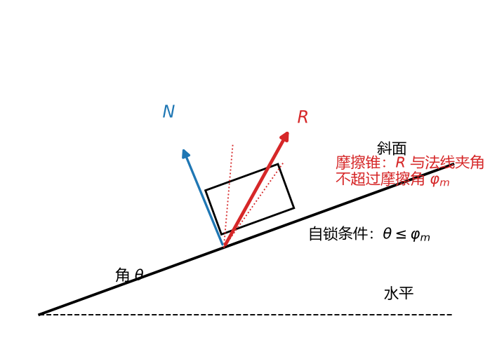
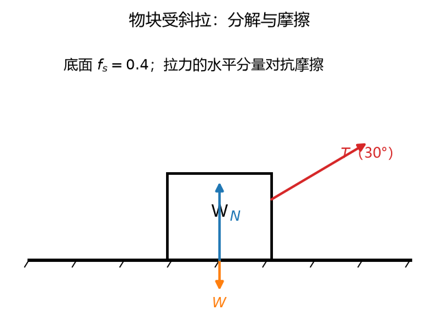
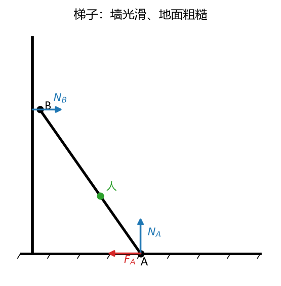
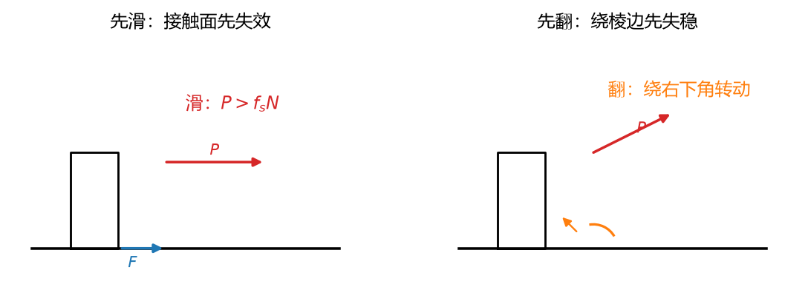

# 第 05 讲：摩擦——静力学的收官战

> 前置：第 01–04 讲（静力学全套）｜ 预计投入：3–4 小时
> 本讲回答什么问题：把"光滑"的假设撤掉之后，前面那套平衡方法还剩多少、要多什么手续？为什么摩擦题的答案常常是"一个范围"而不是一个数？螺纹千斤顶顶着重物为什么不自己松？箱子推着推着——先滑还是先翻？

> **本讲目标（学完你能）：**
> 1. 对有摩擦的平衡问题，能正确处理静摩擦的"三态"（未达临界/临界/滑动），用临界法解出平衡范围；
> 2. 能用摩擦角判自锁（含斜面与螺纹），能说清它和"力的大小判据"的等价关系；
> 3. 能判定"先滑还是先翻"，能把摩擦嵌进物体系（梯子类压轴题）全解。
>
> 目标达成 = 文末"掌握度自测"全打勾。

> **怎么学这一讲：** 摩擦不推翻前面任何东西——受力图、平衡方程、静定判断原样运转；真正的新东西只有一件：**摩擦力是一个"范围量"**（不等式约束），它让解从"一个点"变成"一个区间"。先认识这个新角色（§1），学它的几何画像（摩擦角与自锁，§2），然后把平衡方法升级出"范围解"（§3，三道例题），最后处理翻倒赛跑（§4）。数值实验归档 `scripts/lec05-01_verify_friction.py`（§5）。

---

## 0. 开场：撤掉一个假设，多出一门学问

前四讲我们反复用"光滑"这个假设：接触面只有法向反力（L01 §3.2）。**真实表面没有光滑的**——放大看都是山峰山谷，两个面相对滑动时峰谷互相勾着，宏观上表现为**摩擦力**：接触面切向上的反力。

撤掉这个假设的后果，按冲击力排序：

1. **受力图多一个分量**：粗糙接触面的全反力 = 法向分量 $\mathbf{F}_N$ + 切向分量 $\mathbf{F}$（摩擦）——画图时分开画两个（§1）；
2. **约束从"定值"变"范围"**：法向反力是解出唯一值的被动量；静摩擦是一个**不超过上限 $fF_N$ 的自适应量**——这直接改变了"解"的形态（§1/§3）；
3. **多出一套几何语言**：摩擦角、自锁——角度条件替代大小条件（§2）；
4. **多出一类赛跑题**：滑动与翻倒谁先发生（§4）。

好消息是：平衡方程一个都不用改。坏消息是：不改的部分你都会了，改的部分全是本讲的内容。开始。

---

## 1. 静滑动摩擦：三态与库仑定律

### 1.1 三态：一个被动的"自适应力"

设物块静止在粗糙水平面上，受水平拉力 $\mathbf{P}$ 逐渐增大。接触面的切向反力（摩擦力）$\mathbf{F}$ 经历三个状态：

| 状态 | 摩擦力大小 | 性质 |
| --- | --- | --- |
| **静摩擦**（未滑动） | $F < F_{\max}$，**随 P 自适应**（P 多大它多大） | 被动力，恰好维持平衡；上限内的任意值都有可能 |
| **临界状态**（将滑未滑） | $F = F_{\max} = f_s F_N$ | 库仑静摩擦定律 |
| **动摩擦**（已滑动） | $F = f_k F_N$，方向与**相对滑动方向**相反 | 略小于静摩擦上限（$f_k \lesssim f_s$），工程常近似取 $f_k = f_s$ |

**库仑摩擦定律**（静摩擦上限）：$F_{\max} = f_s F_N$——与正压力成正比，**与接触面积无关**（这个"无关"反直觉但被实验支持：宏观干摩擦来自表面微峰的剪切，真实接触面积已随正压力自动调整）。$f_s$、$f_k$ 分别叫静、动摩擦系数，无量纲，由材料副与表面状态决定。量级感：钢-钢（润滑）约 0.1–0.15、干钢-钢约 0.15–0.3、木-木约 0.4–0.6、橡胶-混凝土约 0.7–1.0。

**本讲最重要的认知转变**：前四讲所有约束力都解出**唯一值**；静摩擦给的是**不等式约束** $|F| \le f_s F_N$。所以摩擦题的答案经常不是"力等于多少"而是"力在什么范围内平衡成立"——解从**点**变**区间**（§3 专门处理）。

**适用边界**（如实声明）：库仑定律是**干摩擦**（无润滑液膜）的宏观近似，适用范围是普通工程条件；极光滑表面、极高速、或有润滑剂时另有定律（流体润滑是摩擦学的事）。本课程全程库仑模型。

### 1.2 摩擦力的方向：跟"趋势"走，不跟直觉走

静摩擦方向 = **与相对滑动趋势相反**。注意不是"与运动方向相反"——静止的物体没有运动，只有趋势。

**趋势判定法**（实用）：假想接触面突然变光滑（$f=0$），物块会往哪边滑？——摩擦就往**反**方向给。例：斜面上的物块，假想光滑则往下滑，摩擦沿斜面向上。

**方向不确定时**：与 L01 分量纪律完全一致——**任意假定一个方向画上图，解方程，负号 = 实际方向相反**。推力可正可反的题（比如双向推）更要如此，别在图上反复擦改浪费时间。

> **理解层次：三态与库仑定律要会用；"范围量"认知要建立直觉；方向判定要会用。**

---

## 2. 摩擦角与自锁：几何语言

### 2.1 全反力与摩擦角

把接触面的两个分量合成一个**全反力** $\mathbf{F}_R = \mathbf{F}_N + \mathbf{F}$（法向+切向）。它与接触面**法线**的夹角 $\varphi$ 满足：

$$\tan\varphi = \frac{F}{F_N}$$



**图 L05-1**：全反力 $R$ 与法线的夹角 $\varphi$ 随切向摩擦增大而增大，但被摩擦角 $\varphi_m$ 封顶。当斜面角 $\theta \le \varphi_m$ 时，无论主动力多大都推不动（自锁）——图上的摩擦锥就是全反力所有可能方向的范围。

静摩擦未达临界时 $F$ 可在 $[0, f_sF_N]$ 内任意取 → $\varphi$ 可在 $[0, \varphi_m]$ 内任意取，其中

$$\tan\varphi_m = f_s \qquad (\text{临界时的最大角，叫}\textbf{摩擦角})$$

几何图像：**全反力的方向被锁在法线两侧 $\varphi_m$ 的范围内**——空间接触则是一个以法线为轴、半锥角 $\varphi_m$ 的**摩擦锥**，全反力只能在锥内取向。这是"摩擦给角度上限"的画像，后面全部判据都从这张图来。

### 2.2 自锁：角度锁死的强平衡

**自锁**：不论主动力（载荷）**多大**，物体都能保持平衡——只要主动力的合力方向落在摩擦锥内。

为什么：主动力合力 $\mathbf{P}$（过接触点）与全反力 $\mathbf{F}_R$ 二力平衡（L01 §2.1：等值反向共线）。$\mathbf{P}$ 的方向若与法线夹角 $\theta \le \varphi_m$，那么锥内总能取到一个方向恰好与 $\mathbf{P}$ 共线相反的全反力——**无论 P 多大都配得上**。反过来 $\theta > \varphi_m$ 时，P 增大到一定值就超出了全反力能到达的方向范围——必滑。

一句话：**力的大小 P 不出现在判据里**——自锁是纯几何（方向）条件，这就是"角度条件替代大小条件"的等价性来源（数值验证见 §5 实验 1：$|\mathbf{F}_{req}| \le fN \iff \tan\alpha \le f$，两套口径逐组等价）。

**斜面自锁**（最常用形态）：物块只受重力（主动力=竖直向下），斜面倾角 $\alpha$ 即重力与法线的夹角：

$$\text{自锁} \iff \alpha \le \varphi_m \iff \tan\alpha \le f_s$$

### 2.3 螺纹自锁：千斤顶为什么不松

螺旋可以展开成**卷在圆柱上的斜面**（把一圈螺纹"剥"下来铺平：底边长 $2\pi r$、升高为导程 $h$），螺纹的**升角** $\psi$ 就是这个等效斜面的倾角（$\tan\psi = h/2\pi r$）。

千斤顶顶着重物时，重物压在螺纹斜面上（主动力=沿轴的压力）——**斜面自锁条件直接移植**：升角 $\psi \le \varphi_m$（$\tan\psi \le f$）则顶多重的车也稳住不松；设计千斤顶时故意把升角做小（细牙螺纹）来保证自锁。反过来，要"拧得动"，主动力还得克服锥外的方向——这就是"拧螺母要用力、松手它不退"的力学依据。

**理解层次：摩擦角与自锁判据要会用（斜面、螺纹两形态）；等价性要能论证（二力平衡+锥内取向）。**

---

## 3. 考虑摩擦的平衡问题：解从点变区间

### 3.1 方法论：老流程 + 两条新纪律

解题流程与 L03 **完全同构**（取分离体→画受力图→数未知量→列方程→解），新增两条：

**纪律一**：摩擦力方向不确定时任意假定 + 负号判读（§1.2，L01 纪律的继承）。

**纪律二**：静摩擦是范围量。两种处理手法：

- **临界法**：假设"即将向某侧滑动"，令 $F = f_s F_N$（方向按该侧趋势的反向），解方程组——得到的是平衡范围的**端点**（临界值）。向哪侧滑各做一次，两个端点夹出区间。
- **验证法**（解不定方向问题时）：先假定 $F$ 任意方向解出 $F$ 与 $N$，再验 $|F| \le f_s N$ 是否成立——成立则平衡，不成立则滑动。

**一个必须先说清的陷阱**：不要一上来就写 $F = fN$！静摩擦**未到临界时不等于** $fN$（它是自适应量，$F = $ 维持平衡所需的值）。$F = fN$ 只在**临界状态**成立。见摩擦就代 $fN$ 是本讲第一大扣分点（§7 错误清单 #1）。

### 3.2 例 1：斜面——判据的三种说法

**题目**：物块重 $W = 100$ N 置于倾角 $\alpha = 20°$ 的粗糙斜面上，$f_s = 0.4$。判断是否自锁，并求此时实际的摩擦力与法向反力。

**解**：

- **角度判据**：$\tan 20° = 0.364 < 0.4 = f_s$ → **自锁**（无任何外力也不滑）。
- **力的大小判据**（等价口径）：维持平衡所需 $F_{req} = W\sin\alpha = 34.2$ N（沿斜面向上），$F_N = W\cos\alpha = 94.0$ N，上限 $f_s F_N = 37.6$ N。$34.2 < 37.6$ ✓ 平衡成立。
- 实际摩擦力就是**所需值** 34.2 N（自适应），**不是** 37.6 N（那是上限，只在临界时到达）。

两种说法、一个结论——角度口径（0.364 vs 0.4）与大小口径（34.2 vs 37.6）在数学上同源（都除以了 $\cos\alpha$），§5 实验 1 用随机数据逐组验证这个等价性。

### 3.3 例 2：平衡范围——解是一个区间

**题目**：物块重 $W = 100$ N 置于粗糙水平面（$f_s = 0.4$），受与水平成 $30°$ 角向上的斜拉力 $T$。求保持平衡的 $T$ 范围。



**图 L05-2**：物块受斜拉：拉力分解为水平与竖直分量；水平分量对抗摩擦，竖直分量改变法向力。


**解**（设摩擦 $F$ 沿水平、拉力分量拉着物块**趋势向右**，摩擦向左为假定正方向）：

- $\sum F_y = 0$：$F_N + T\sin 30° - W = 0 \Rightarrow F_N = 100 - 0.5T$（**注意 N 随 T 减小**——斜拉力把物块往上提，压地变轻）；
- $\sum F_x = 0$：$T\cos 30° - F = 0 \Rightarrow F = 0.866T$；
- 平衡条件 $F \le f_s F_N$：$0.866T \le 0.4(100 - 0.5T) \Rightarrow 1.066T \le 40 \Rightarrow T \le 37.5$ N。

**答**：平衡范围 $0 \le T \le 37.5$ N。（上端 37.5 N 即"将滑"临界；下端 $T=0$ 自然静止。附送一个观察：$T$ 大到 200 N 时 $F_N = 0$——但早在 37.5 N 就滑了，滑先于"离地"。）

### 3.4 例 3：梯子——摩擦+物体系的压轴

**题目**：梯子 AB 长 $L$，下端 A 搁在粗糙地面（摩擦系数 $f_s$），上端 B 靠**光滑**墙，与地面成 $60°$ 角。梯重不计，人重 $P = 600$ N 站在梯上距 A 为 $s$ 处。$f_s = 0.5$。求人最多能爬多高（$s/L$ 上限）。



**图 L05-3**：梯子：墙光滑（只有水平法向力），地面粗糙（法向力 + 摩擦）。人距 A 的距离决定各处反力。


**解**（静定：梯受四力 $N_B$、$N_A$、$F_A$、$P$，未知量 3——$N_B, N_A, F_A$，3 方程 ✓）：

- $\sum F_y = 0$：$N_A = P = 600$ N（墙光滑无竖直分量）；
- $\sum F_x = 0$：$F_A = N_B$；
- $\sum M_A = 0$（人对 A 之力臂 $s\cos 60°$、$N_B$ 之力臂 $L\sin 60°$）：$N_B \cdot L\sin 60° = P \cdot s\cos 60° \Rightarrow N_B = P\,\dfrac{s}{L}\,\dfrac{\cos 60°}{\sin 60°} = P\,\dfrac{s}{L}\cdot\dfrac{1}{\sqrt{3}}$；
- 平衡条件（摩擦）：$F_A \le f_s N_A \Rightarrow P\dfrac{s}{L}\dfrac{1}{\sqrt{3}} \le f_s P \Rightarrow \dfrac{s}{L} \le \sqrt{3}\, f_s$。

代入 $f_s = 0.5$：$s/L \le 0.866$——**人最多爬到梯长的 86.6% 处**，再高梯脚就滑。

**两个值得看的细节**：① 答案里 $P$ 消掉了——人多重都只爬到同一比例（重的轻的同命，自锁式几何条件在物体系里的再现）；② $f_s$ 换 0.4（打蜡地面），上限降到 0.693——梯子安全对地面状态极度敏感，工程上"梯子脚必须防滑"写进安全规程的力学依据。

---

## 4. 翻倒与滑动的赛跑



**图 L05-4**：先滑还是先翻：滑由接触面先失效决定（推力超过最大静摩擦），翻由绕棱边转动力矩超过稳定力矩决定。两种失效对应两个不同的临界条件，题目问哪个就先算哪个。

### 4.1 两条出局线

粗糙地面上的箱柜受逐渐增大的水平推力 $P$（作用在高度 $d$ 处），有两种"出局方式"：

**滑动的门槛**：$P$ 超过摩擦上限——

$$P_{slide} = f_s W \qquad (W \text{ 为重量})$$

**翻倒的门槛**：推力矩把重心"抬"过前缘支点。对**前缘（即将翘起的支点）**取矩：翻倒临界时法向反力全部集中在前缘（后缘即将离地、$N_{后}=0$），重力矩（稳定）$W\cdot\frac{w}{2}$（$w$ 为底宽，重心在底面中央）对上推力矩（倾覆）$P\cdot d$：

$$P_{tip} = \frac{W\,w/2}{d}$$

**谁先出局看谁门槛低**——判据一比：

$$\boxed{\;\text{先滑} \iff f_s < \frac{w}{2d}\;（\text{即 } P_{slide} < P_{tip}\text{）；}\quad \text{先翻} \iff f_s > \frac{w}{2d}\;}$$

**读出物理**：$\frac{w}{2d}$ 是"几何抗翻比"（矮胖箱大、高瘦柜小）——**矮胖的难翻（滑先出局）；地面越糙（$f_s$ 大）越把"滑"堵住、逼出"翻"**。搬家推衣柜：打蜡地板上柜子稳稳滑走（滑先），粗糙水泥地上同一个人推同一柜子却把它推翘了（翻先）——不是你力气变大，是出局线换了。

### 4.2 例 4：先滑还是先翻

**题目**：矩形柜 $W = 200$ N，底宽 $w = 0.5$ m，重心在半高（0.5 m）。水平推力 $P$ 作用在 $d = 0.8$ m 高处。(a) $f_s = 0.35$；(b) $f_s = 0.25$。分别判断柜子先滑还是先翻，并给出临界推力。

**解**：几何抗翻比 $\dfrac{w}{2d} = \dfrac{0.25}{0.8} = 0.3125$。

(a) $f_s = 0.35 > 0.3125$ → **先翻**。两条门槛：$P_{slide} = 0.35\times 200 = 70$ N；$P_{tip} = \dfrac{200\times 0.25}{0.8} = 62.5$ N——翻倒线（62.5 N）先到 ✓。推力过 62.5 N 时柜子后缘离地翘起（此时滑移条件根本不用再查——**出局事件已发生**）。

(b) $f_s = 0.25 < 0.3125$ → **先滑**。$P_{slide} = 50$ N $<$ $P_{tip} = 62.5$ N——推力过 50 N 时柜底滑移。

**同一柜子、同一推法，地面摩擦系数决定出局方式**——§4.1 的判据一行分流。参数扫描见 §5 实验 3（$f_s$ 从 0.1 扫到 0.6，出局方式在 0.3125 处切换，数值交点与解析判据吻合）。

---

## 5. 数值验证：摩擦判据的可复跑检验

脚本 `scripts/lec05-01_verify_friction.py`（**规模纪律：目标 < 1 秒，纯 numpy**）：

| 实验 | 验证什么 | 设计 |
| --- | --- | --- |
| 1 | 斜面自锁两套判据等价：$\|F_{req}\| \le fN \iff \tan\alpha \le f$ | 随机 $(f, \alpha)$ 2000 组，两判定逐组对照（同真同假） |
| 2 | 例 2 平衡范围：数值扫描 vs 解析端点 | $T$ 从 0 到 60 N 步进 0.5，逐点验平衡条件，数值临界对照解析 37.5 N |
| 3 | 例 4 出局赛跑：分界点 | $f_s$ 从 0.10 到 0.60 步进 0.01，逐点比 $P_{slide}$ 与 $P_{tip}$，找切换点对照解析 $w/(2d) = 0.3125$ |

**实测输出**（2026-09-24 实跑原文）：

```
================================================================
L05 friction verification
================================================================
[Exp 1] incline self-locking: |F_req| <= f N  vs  tan(alpha) <= f
  random pairs: 2000, mismatches: 0  PASS (two criteria equivalent)
[Exp 2] equilibrium range of oblique pull (example 2)
  numeric upper bound (step 0.5 N): T <= 37.5 N
  analytic: T <= fW/(cos30 + f sin30) = 37.523 N
  diff = 0.023 N (within step size)  PASS
[Exp 3] slide-vs-tip race (example 4, w/(2d) = 0.3125)
  switch at f_s = 0.31 (grid 0.01)  [slide below, tip above]
  analytic boundary f_s = 0.3125  PASS (diff within grid step)
OVERALL: ALL PASS
```

三个读点：① 两套自锁判据 2000 组随机**零失配**——角度口径和大小口径真的是同一句话的两种说法；② 数值扫描的临界端点与解析值之差小于步长（扫描分辨率）；③ 出局方式切换点与解析分界 $f_s = w/(2d)$ 在网格精度内一致——判据不是背出来的，是扫出来的。

---

## 6. 常见错误清单（对答案，校准感觉）

> 本节零新知识，逐条对应正文小节。

| # | 错误 | 为什么错 | 锚定 |
| --- | --- | --- | --- |
| 1 | 见摩擦就代 $F = fN$ | 静摩擦是自适应范围量，只有**临界**时才等于上限 | §1.1/§3.1 |
| 2 | 摩擦方向凭"物体要往哪动"直觉硬定 | 静止物体看**滑动趋势**（假想光滑法），或干脆假定+负号判读 | §1.2 |
| 3 | 静、动摩擦系数混用 | $f_s \ge f_k$，判"会不会滑"用 $f_s$，已滑后算摩擦用 $f_k$ | §1.1 |
| 4 | 自锁判据写成 $\alpha \le f_s$ | 是 $\tan\alpha \le f_s$（角 vs 正切）——差一个 arctan | §2.2 |
| 5 | 斜拉/斜推题把 $F_N$ 当定值 | $F_N = W \mp T\sin\theta$ 随 $T$ 变（斜拉减、斜压加） | 例 2 |
| 6 | 翻倒判据力臂配错 | 倾覆臂是推力高度 $d$、稳定臂是半底宽 $w/2$ | §4.1 |
| 7 | 梯子题把光滑墙画成两分量反力 | 墙光滑只给法向（垂直墙=水平）——一个未知量 | 例 3 |
| 8 | 平衡范围只算一端 | 两个临界方向各算一次夹出区间；本讲例 2 下端是 0（自然静止），但推力可反向的题两端都是临界 | §3.1 |
| 9 | 全反力画到摩擦锥外 | 全反力与法线夹角被锁在 $\varphi_m = \arctan f_s$ 内 | §2.1 |
| 10 | 螺纹升角与自锁条件配反 | 自锁要求**升角** $\le$ **摩擦角**（升角小=细牙=自锁） | §2.3 |

## 7. 本讲小结（一页骨架）

- **三态**：静摩擦（自适应，$F < f_sN$）/ 临界（$F = f_sN$）/ 动摩擦（$F = f_kN$，随相对滑动反向）。库仑定律：上限与正压力成正比、与接触面积无关（干摩擦宏观近似）。
- **方向**：与滑动**趋势**相反；趋势 = 假想光滑时的滑动方向；不确定就假定+负号判读。
- **解的形态变了**：约束多了一个不等式——答案从"点"变"区间"（临界法两端各算一次）。
- **摩擦角与自锁**：$\tan\varphi_m = f_s$；主动力合力落在锥内 ⇒ 任意大小都平衡（自锁=纯方向条件）；斜面自锁 $\tan\alpha \le f_s$；螺纹自锁（升角 ≤ 摩擦角，千斤顶原理）。
- **梯子类（摩擦+物体系）**：平衡方程照旧+摩擦不等式收尾；结构参数消去载荷大小是常态（自锁式结果）。
- **先滑 vs 先翻**：$f_s \lesseqgtr \dfrac{w}{2d}$——矮胖难翻、地糙逼翻；两条门槛 $P_{slide} = fW$、$P_{tip} = W\dfrac{w/2}{d}$ 谁低谁先出局。
- **静力学收官**：受力图（L01）→ 简化（L02）→ 平衡（L03）→ 空间（L04）→ 摩擦（本讲）——刚体的"不动"问题，全套装备齐了。下一讲运动学：**描述运动，不问原因**。

## 8. 掌握度自测（行为化清单，全部打勾才算讲过）

- [ ] 我能复述静摩擦三态，并说出"未到临界时 $F$ 等于什么"（等于所需值，不是 $fN$）
- [ ] 给我一个静摩擦方向不明的题，我会假定方向+负号判读，而不是反复擦图
- [ ] 我能默写摩擦角公式并画出自锁的"锥内取向"论证（二力平衡）
- [ ] 斜面题我能同时用角度口径和大小口径判定并知道它们等价
- [ ] 平衡范围题我会两端各临界一次，且没忘记 $F_N$ 可能随主动力变化
- [ ] 我能推出梯子的 $s/L \le f\tan\alpha$ 并解释"为什么人多重答案一样"
- [ ] 给我先滑先翻题，我先算几何抗翻比 $w/(2d)$ 再和 $f_s$ 比，不硬算两个门槛
- [ ] 我能讲清螺纹自锁的"展开成斜面"逻辑

## 9. 作业（先独立做，再看参考答案——答案只用本讲内容）

**题 1（判断，每小题答"对/错"+一句理由）**
(a) 静止物体受到的摩擦力一定等于 $f_s N$。
(b) 摩擦系数越大，越容易翻倒（其他条件不变，粗糙地面上推箱）。
(c) 自锁条件下，主动力增大到无穷大物体也不动。
(d) 动摩擦系数一般小于静摩擦系数。
(e) 斜面自锁条件是倾角小于摩擦角。

**参考答案：**
(a) **错**。只有临界（将滑）时等于上限；未临界时等于维持平衡所需值（例 1：34.2 N < 上限 37.6 N）。
(b) **对**。$f_s > w/(2d)$ 时翻倒线更低（先翻）——地糙堵滑逼翻（§4.1）。
(c) **对**。自锁的判据里没有主动力大小（锥内取向总能配上，§2.2）。
(d) **对**。$f_k \lesssim f_s$（工程常近似相等）。
(e) **对**。$\alpha \le \varphi_m$，与 $\tan\alpha \le f_s$ 等价（注意 (e) 说"角小于角"，不是"角小于 f"）。

**题 2（斜面）**物块重 200 N 在倾角 25° 的粗糙斜面上静止，$f_s = 0.45$。判断是否自锁；求实际摩擦力与法向反力；若把斜面倾角升到 25° 不变、$f_s$ 降到 0.4 呢？

**参考答案：**
$\tan 25° = 0.466 > 0.45$ → **不自锁**（$f_s$ 换 0.4 后 $0.466 > 0.4$ 同样不自锁——这问是防"顺手算 $\alpha < \varphi_m$ 就完事"的验算训练）。
不自锁时维持平衡所需 $F = 200\sin 25° = 84.5$ N，$N = 200\cos 25° = 181.3$ N，上限 $= 0.45 \times 181.3 = 81.6$ N：$84.5 > 81.6$ → **实际状态是滑动**（已出平衡区，进入动摩擦），题给的"静止"与数据矛盾——此时正确回答是指出矛盾（这种"数据自相矛盾"题在考卷上真实存在，考的就是三态判断）。

**题 3（平衡范围，斜压）**物块重 $W = 200$ N 在粗糙水平面（$f_s = 0.5$），受与水平成 $20°$ 角**斜向下**的推力 $P$。求平衡范围。

**参考答案：**
$\sum F_y$：$N = 200 + P\sin 20°$（**斜压使 $N$ 增大**——与例 2 斜拉相反）；
$\sum F_x$：$F = P\cos 20°$；
平衡：$P\cos 20° \le 0.5(200 + P\sin 20°) \Rightarrow P(0.9397 - 0.5\times 0.342) \le 100 \Rightarrow 0.7687P \le 100 \Rightarrow P \le 130.1$ N。
**答**：$0 \le P \le 130$ N。（对比例 2：同样 $f$ 与 $W$ 下，斜压比斜拉能扛更大主动力——往下压增大了 $N$，摩擦上限水涨船高。这就是"往车轮下垫楔块"的力学：楔的斜面把载荷转化为法向压力。）

**题 4（梯子，反直觉）**例 3 的梯子（$f_s = 0.5$，墙光滑，梯重不计），人要爬到**梯顶**（$s/L = 1$）。求梯子与地面必须保持的最小夹角 $\alpha$。

**参考答案：**
例 3 的通用结果 $s/L \le f_s\tan\alpha$（推导同例 3，把 60° 换成一般角 $\alpha$：$N_B = P\dfrac{s}{L}\cot\alpha$，$F_A \le f_s P$）。
要求 $1 \le 0.5\tan\alpha \Rightarrow \tan\alpha \ge 2 \Rightarrow \alpha \ge 63.4°$。
**答**：至少 63.4°。**反直觉处**：梯子越**陡**越防滑（$\tan\alpha$ 大，同样爬升比例下 $N_B$ 需求小）——平缓的梯子反而先滑。工程权衡：太陡人上手吃力（人的受力恶化），所以实际梯取 65°–75° 的折中区间。

**题 5（先滑先翻）**文件柜 $W = 400$ N，底宽 $w = 0.8$ m，重心在半高。水平推力作用在 $d = 0.5$ m 高处，$f_s = 0.3$。判断先滑还是先翻，并求出出局时的推力。

**参考答案：**
几何抗翻比 $\dfrac{w}{2d} = \dfrac{0.4}{0.5} = 0.8 > f_s = 0.3$ → **先滑**。
门槛：$P_{slide} = 0.3\times 400 = 120$ N（$P_{tip} = 400\times 0.4/0.5 = 320$ N，远未到）。
**答**：推力达 120 N 时柜底滑移（此刻后缘还稳稳压地——翻倒线差得远）。

**题 6（双向推+翻倒联合检查）**物块重 100 N，底宽 0.4 m，重心在半高，粗糙地面 $f_s = 0.5$。水平推力 $P$ 可以向左也可以向右（作用高度 $d = 0.3$ m）。求平衡的 $P$ 范围，并检查这个范围内是否始终不翻。

**参考答案：**
滑向两侧对称：$|P| \le f_s W = 50$ N → 范围 $-50 \le P \le 50$ N（向右推正、向左负）。
翻倒检查：几何抗翻比 $\dfrac{w}{2d} = \dfrac{0.2}{0.3} = 0.667 > f_s = 0.5$ → **先滑先出局**——翻倒门槛 $P_{tip} = 100\times 0.2/0.3 = 66.7$ N 高于滑移线 50 N。滑动先到，翻倒在平衡范围内（$|P|\le 50 < 66.7$）**始终不会发生** ✓。
**答**：$-50 \le P \le 50$ N，全程不翻。

**题 7（螺纹自锁）**螺旋千斤顶：螺纹中径 $d = 40$ mm，导程（一圈升高的距离）$h = 10$ mm，螺纹副摩擦系数 $f = 0.1$。判断能否自锁；若不能，提出一种改进方向。

**参考答案：**
升角：$\tan\psi = \dfrac{h}{\pi d} = \dfrac{10}{\pi \times 40} = 0.0796$；
摩擦角：$\varphi_m = \arctan 0.1 \Rightarrow \tan\varphi_m = 0.1$。
$\tan\psi = 0.0796 < 0.1 = f$ → **自锁** ✓（顶多重的车都不松）。
改进方向（若不自锁）：**减小升角**（换细牙螺纹：$h$ 更小、$\tan\psi$ 更小）或增大 $f$（改善螺纹副表面/材质）。螺纹中径也可增大（$\tan\psi = h/\pi d$，$d$ 大则升角小）——重型千斤顶用大直径多头细牙就是这套做法。

---

> **下一讲预告**：静力学全篇收官，进入**运动学**——L06 点的运动学：怎么描述一个点的运动（方程、速度、加速度），为什么转弯的"猛"要用切向/法向两个方向来计算。
