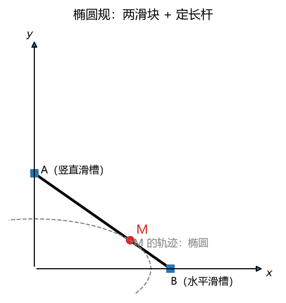
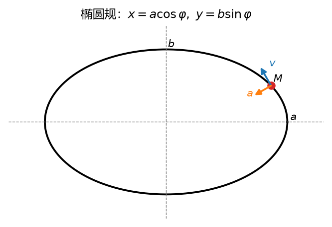
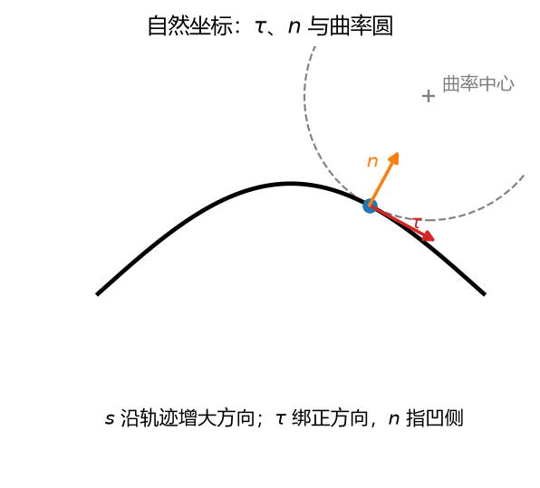

# 第 06 讲：点的运动学——三种描述方法

> 前置：第 01–05 讲（静力学全套——本讲起暂时"忘掉"力）；数学：微积分学过但不熟没关系，本讲用到哪补到哪 ｜ 预计投入：3–4 小时（正文 + 作业）
> 本讲回答什么问题：怎么把"一个点在平面里的运动"说完整？"提速猛"和"转弯猛"怎么分开度量？三套描述方法各在什么时候用？

> **本讲目标（学完你能）：**
> 1. 给定运动方程（直角坐标或弧坐标形式），能算出任意时刻的速度、加速度（大小 + 方向）；
> 2. 能把加速度分解为切向与法向两块（含曲率半径的计算），并说清两块各管什么；
> 3. 能解逆向问题（已知加速度反推运动，含初始条件），能按场景选对三套方法之一。
>
> 目标达成 = 文末"掌握度自测"全打勾。

> **怎么学这一讲：** 先看成品（椭圆规上一个点的全套分析）→ 补数学工具（导数，它在全课程第一次真正登场）→ 三套方法依次上手（矢量总纲 → 直角坐标 → 自然法）→ 切向/法向分解 → 逆向问题 → 数值验证 → 作业。本讲数值结论有归档脚本可复跑（`scripts/lec06-01_verify_point_kinematics.py`，见 §7）。

## 0. 开场：一个会画椭圆的点

先说一件大事：**从本讲起换篇了**。前五讲是静力学——研究"东西为什么不动"，方法是受力图和平衡方程。接下来四讲是**运动学**——只描述"东西怎么动"，**不问为什么**。力去哪了？被我们刻意搁置了：先把"描述运动的语言"练熟，等 L10 牛顿第二定律登场时，"力"和"运动描述"两边都是现成的，一对接就是动力学。这是课程设计上的分批交货，不是物理上力不存在。

运动学的最小作战单位是**一个点**（质点、或刚体上被盯住的一个具体位置）。本讲把"一个点的运动"彻底说清楚。

### 0.1 成品：椭圆规上的 M 点

看这个装置——**椭圆规**（绘图仪器，L01 的滑槽约束在这里复活）：



**图 L06-1**：椭圆规：A 在竖直滑槽、B 在水平滑槽，定长杆 AB 上的 M 点轨迹为椭圆。


一根长 $L = 0.32$ m 的杆，两端 A、B 分别被竖直滑槽和水平滑槽约束；摇动杆件，杆上距 B 端 $0.12$ m 的定点 M 就扫出一个椭圆。设杆与 x 轴的夹角为 $\varphi$（希腊字母，读"斐"），匀速摇动使 $\varphi = \omega t$，其中 $\omega = 3$ rad/s（rad 是弧度，高中数学的弧度制单位，一整圈 $= 2\pi$ rad；希腊字母 omega，读"欧米伽"——每秒转过的角度值，L07 正式定义这个量，本讲先当"摇杆转速"用）。

**本讲学完，你能对 M 点交出这样一张完整的分析卡片**（$\varphi = 30°$ 即 $t = \pi/18 \approx 0.175$ s 时刻；下面每个数怎么来的、什么意思，就是本讲全程）：

| 量 | 数值 | 一句话含义 |
| --- | --- | --- |
| 位置 $M$ | $(0.173,\ 0.060)$ m | 在椭圆 $\dfrac{x^2}{0.20^2} + \dfrac{y^2}{0.12^2} = 1$ 上 |
| 速度 $\mathbf{v}$ | $(-0.300,\ 0.312)$ m/s，大小 $0.433$ m/s | 沿轨迹切线、指向前进侧 |
| 加速度 $\mathbf{a}$ | $(-1.559,\ -0.540)$ m/s²，大小 $1.650$ m/s² | **不沿切线**——指向椭圆中心 |
| 切向加速度 $a_t$ | $+0.692$ m/s² | 此刻**在提速**（速率在变） |
| 法向加速度 $a_n$ | $1.498$ m/s² | 此刻**在拐弯**（方向在变），指向凹侧 |
| 曲率半径 $\rho$ | $0.125$ m | 该处轨迹"弯得相当于多大半径的圆" |

最后三行就是本讲的主菜：高中物理只会说"加速度"，把"提速猛"（$a_t$）和"转弯猛"（$a_n$）混在一个数里；工程里这两个概念必须分开——弯道限速看的是 $a_n$，刹车距离看的是 $a_t$。

### 0.2 本讲路线

1. **§1 矢量法**（总纲）：位矢、速度、加速度的严格定义——顺带把**导数**这个数学工具现场补齐（全课程第一次真用它）；
2. **§2 直角坐标法**：落地成 $x(t), y(t)$ 两个分量方程，最通用的算法语言；
3. **§3 自然法**：轨迹已知时最省事的语言（弧坐标），顺带补**曲率半径**；
4. **§4 切向/法向分解**：主菜——提速猛与转弯猛的分离关系；
5. **§5 逆向问题**：已知加速度反推运动（高中匀变速公式的来历与推广）；
6. **§6 三法怎么选** + §7 数值验证 + 作业。



**图 L06-2**：椭圆规的轨迹：$x=a\cos\varphi,\ y=b\sin\varphi$。速度沿轨迹切线，加速度一般指向凹侧——这张图提醒你，曲线的速度方向时刻在变，不能拿位移方向当速度方向。

## 1. 矢量法：位矢、速度、加速度（总纲）

### 1.1 先立个规矩：参考系

描述运动之前必须先声明：**你站在哪、拿什么当"不动"的基准**。这套基准（一个固连在某物体上的坐标系 + 一个钟）叫**参考系**。同一辆行驶的火车，地面参考系看它在动、车厢参考系看它不动——没有参考系的"动/不动"没有意义。本课程主线默认取**固连于地面的静止参考系**（"地面系"）；"换个参考系看会怎样"是 L08 的主题，届时再展开。

在参考系里取定直角坐标系 $Oxy$ 后，点 M 在任一时刻 $t$ 的位置用**位矢**（也叫矢径）描述：

$$\mathbf{r}(t) = x(t)\,\mathbf{i} + y(t)\,\mathbf{j}$$

$\mathbf{i}, \mathbf{j}$ 是沿 $x, y$ 轴的单位矢量（长度为 1、只标方向的箭头——L04 右手定则里见过的 $\mathbf{i}, \mathbf{j}, \mathbf{k}$ 就是它们仨）。位矢的"尾巴"固定在原点 O，"箭头"指住 M 点——M 动，箭头跟着转、跟着伸缩。**运动方程**就是函数 $\mathbf{r}(t)$（或等价的 $x(t), y(t)$ 这一对）；点走过的几何曲线叫**轨迹**。

### 1.2 【现场补数学】导数：度量"变化快慢"的机器

高中学匀速：$v = \Delta x / \Delta t$。但真实运动快慢随时在变（椭圆规的 M 点一会儿快一会儿慢），怎么办？分小段：取一个很短的时间段 $\Delta t$，位移为 $\Delta \mathbf{r}$，**平均速度** $\mathbf{v}^* = \Delta \mathbf{r}/\Delta t$。$\Delta t$ 取得越短，平均速度越贴近那一瞬的真实快慢。让 $\Delta t \to 0$（无限细分下去），平均速度的**极限**就是**瞬时速度**。这个"函数值的瞬时变化率"操作就是**导数**：

$$f'(t) = \frac{\mathrm{d}f}{\mathrm{d}t} = \lim_{\Delta t \to 0} \frac{f(t+\Delta t) - f(t)}{\Delta t}$$

读作"f 对 t 的导数"。几何上，导数是图像在该点的**切线斜率**——斜率陡 = 变化快。记号 $\mathrm{d}f/\mathrm{d}t$ 不是除法，但它的行为确实像"微小增量之比"（工程里就这么放心用）。导数还能再求导：$f''(t) = \mathrm{d}^2 f/\mathrm{d}t^2$，变化率的变化率。

本课程的最小导数表（够全程用，出现新函数再现场补）：

| 函数 | 导数 |
| --- | --- |
| 常数 $C$ | $0$ |
| $t^n$ | $n\,t^{n-1}$ |
| $\sin t$ | $\cos t$ |
| $\cos t$ | $-\sin t$ |
| $f + g$ | $f' + g'$（和差逐项求） |
| $f \cdot g$ | $f'g + fg'$（乘积法则） |
| **链式法则**：$f(g(t))$ | $f'(g)\cdot g'(t)$（外层导数 × 内层变化率） |

链式法则本讲马上要用，先热个身：$\sin(\omega t)$ 对 $t$ 求导——外层是 sin（导数 cos），内层 $\omega t$ 变化率是 $\omega$：$(\sin \omega t)' = \omega \cos \omega t$。直觉：内量每秒走 $\omega$ 步，外函数每步涨 $\cos$，合起来每秒涨 $\omega\cos$。

（你的微积分课大概率见过这些。这里的任务不是重上一遍，而是让它们在物理场景里活起来——接下来每一讲都在用它们，用到第三讲你想不熟都难。）

### 1.3 速度：位矢的导数

$$\boxed{\;\mathbf{v} = \frac{\mathrm{d}\mathbf{r}}{\mathrm{d}t}\;}$$

- **大小**（速率，记 $v = |\mathbf{v}|$，注意与矢量 $\mathbf{v}$ 用同一字母、靠加粗与否区分——印刷惯例，本课程全书沿用）；
- **方向**：沿轨迹**切线**、指向前进一侧。原因：$\Delta \mathbf{r}$ 沿割线方向，$\Delta t \to 0$ 时割线转为切线。

### 1.4 加速度：速度的导数（一处大直觉升级）

$$\boxed{\;\mathbf{a} = \frac{\mathrm{d}\mathbf{v}}{\mathrm{d}t} = \frac{\mathrm{d}^2\mathbf{r}}{\mathrm{d}t^2}\;}$$

**直觉升级点**：直线运动里 $\mathbf{a}$ 沿轨迹方向——高中经验只有这一种。曲线运动里 $\mathbf{v}$ 的**方向**也在变，"方向变化"同样贡献加速度。画速度矢量的平移图（把各时刻 $\mathbf{v}$ 的尾巴搬到同一点）：$\Delta \mathbf{v} = \mathbf{v}(t+\Delta t) - \mathbf{v}(t)$ 一般斜着指——它分解出沿切线的一块（快慢变了）和垂直切线指向凹侧的一块（方向变了）。结论先行：**曲线运动的加速度一般不沿切线，偏向轨迹凹侧**；关系怎么记，§4 拆开算。

**矢量求导的落地规则**：直角坐标系里 $\mathbf{i}, \mathbf{j}$ 方向不变，所以矢量求导 = **分量各自求导**（$\mathbf{i}$ 是常数，$x\mathbf{i}$ 的导数就是 $x'\mathbf{i}$）：

$$\mathbf{r} = x\,\mathbf{i} + y\,\mathbf{j} \;\Rightarrow\; \mathbf{v} = \dot{x}\,\mathbf{i} + \dot{y}\,\mathbf{j} \;\Rightarrow\; \mathbf{a} = \ddot{x}\,\mathbf{i} + \ddot{y}\,\mathbf{j}$$

（物理惯例：时间导数加点，$\dot{x} = \mathrm{d}x/\mathrm{d}t$、$\ddot{x} = \mathrm{d}^2 x/\mathrm{d}t^2$。）

矢量法把定义说得最干净，是**总纲**；但直接拿它算数不方便（位矢大小方向都在变）。落地成两套具体语言——直角坐标法（§2）和自然法（§3）——都是总纲在特定坐标下的展开。

## 2. 直角坐标法：分量语言

### 2.1 运动方程与轨迹方程

$$x = x(t), \qquad y = y(t)$$

两个标量函数就是运动的完整档案。**轨迹方程**：消去 $t$ 得 $y = f(x)$ 或 $F(x,y) = 0$。

**一个必须防的坑**：消 $t$ 会丢信息。例如 $x = t^2,\ y = t$：消去 $t$ 得 $y^2 = x$——但原运动只走 $y \ge 0$ 的上半支（$t$ 平方恒非负）。**轨迹方程必须连定义域一起写**，否则图形多画一半。

### 2.2 速度与加速度分量

对运动方程求导（§1.4 的分量规则）：

$$v_x = \dot{x},\quad v_y = \dot{y}; \qquad v = \sqrt{\dot{x}^2 + \dot{y}^2},\quad \text{方向角 } \theta_v = \arctan\frac{v_y}{v_x}\ (\text{按象限定})$$

$$a_x = \ddot{x},\quad a_y = \ddot{y}; \qquad a = \sqrt{\ddot{x}^2 + \ddot{y}^2}$$

（方向角按 $(v_x, v_y)$ 所在象限取；第二、三象限时记得加 $180°$。）

### 2.3 例 1：椭圆规 M 点——开场成品全程复算

**题目**：椭圆规如图 §0.1：杆长 $L = 0.32$ m，B 端在水平滑槽、A 端在竖直滑槽，杆与 x 轴夹角 $\varphi = \omega t$，$\omega = 3$ rad/s。M 是杆上距 B 端 $0.12$ m 的定点。求：M 的运动方程、轨迹方程；$\varphi = 30°$ 时的速度、加速度（大小方向）。

**第 1 步：运动方程（从几何约束推）**。B 在 x 轴上滑动、A 在 y 轴上滑动，杆张角 $\varphi$：

$$B = (L\cos\varphi,\ 0), \qquad A = (0,\ L\sin\varphi)$$

M 在杆上、距 B 为 $0.12$ m——从 B 沿杆向 A 走，方向单位矢量为 $(-\cos\varphi,\ \sin\varphi)$（这就是 L01 的滑槽约束+杆上定点，纯几何，没有新东西）：

$$M = B + 0.12\,(-\cos\varphi,\ \sin\varphi) = (0.20\cos\varphi,\ 0.12\sin\varphi)$$

记 $a = 0.20$ m（M 到 A 的距离，注意：这里 $a, b$ 是几何尺寸记号，与加速度无关——加速度用 $\mathbf{a}$ 加粗）、$b = 0.12$ m。代入 $\varphi = \omega t$：

$$\boxed{\;x = a\cos\omega t, \qquad y = b\sin\omega t\;}$$

**第 2 步：轨迹方程**。$\cos\varphi = x/a,\ \sin\varphi = y/b$，平方相加（$\sin^2 + \cos^2 = 1$）：

$$\frac{x^2}{a^2} + \frac{y^2}{b^2} = 1 \quad (0 \le x \le a \text{ 随 } t \text{ 往返，不丢})$$

椭圆，半轴 $0.20 \times 0.12$ m。M 画椭圆，这就是椭圆规名字的来历。

**第 3 步：速度**。对运动方程求导（链式法则，内层 $\omega t$ 的变化率是 $\omega$）：

$$\mathbf{v} = (-a\omega\sin\omega t,\ \ b\omega\cos\omega t) = (-0.60\sin 3t,\ \ 0.36\cos 3t)\ \text{m/s}$$

$\varphi = 30°$（$\sin\varphi = 0.5,\ \cos\varphi = 0.866$）：

$$\mathbf{v} = (-0.300,\ 0.312)\ \text{m/s}, \qquad v = \sqrt{0.090 + 0.0972} = \sqrt{0.1872} = 0.433\ \text{m/s}$$

**第 4 步：加速度**。再求导一次：

$$\mathbf{a} = (-a\omega^2\cos\omega t,\ \ -b\omega^2\sin\omega t) = (-1.80\cos 3t,\ \ -1.08\sin 3t)\ \text{m/s}^2$$

$\varphi = 30°$：

$$\mathbf{a} = (-1.559,\ -0.540)\ \text{m/s}^2, \qquad a = \sqrt{2.430 + 0.292} = 1.650\ \text{m/s}^2$$

**一个漂亮的副产品**：把 $\mathbf{a}$ 与 M 的坐标 $(x, y) = (a\cos\omega t,\ b\sin\omega t)$ 放一起看：

$$\mathbf{a} = -\omega^2 (x,\ y) = -\omega^2\,\mathbf{r}$$

**加速度恒指向椭圆中心**，大小 $= \omega^2 \cdot$（M 到中心的距离）——与开场卡片一致。匀速圆周运动的"向心加速度"是它的特例（$a = b = R$ 时 $|\mathbf{a}| = \omega^2 R = v^2/R$，高中公式自动掉出来）。但注意 $\mathbf{a}$ 指向中心 ≠ $\mathbf{a}$ 垂直于速度——M 此刻在椭圆上非顶点处，速率正在变，加速度有沿切线的分量。**它到底分多少给"提速"、多少给"拐弯"**——直角坐标的关系回答不了这个问题，§4 自然法来拆。

### 2.4 正向问题的标准流程卡

"已知运动方程求速度、加速度"叫**正向问题**（求导方向），流程四步：

$$\text{方程 } x(t), y(t) \;\xrightarrow{\text{消 } t}\; \text{轨迹（带定义域）} \;\xrightarrow{\text{求导}}\; \mathbf{v} \;\xrightarrow{\text{再求导}}\; \mathbf{a} \;\xrightarrow{\text{合成}}\; \text{大小 + 方向}$$

**理解层次**：流程本身**要会用**；导数表内函数的求导**要能推导**（至少链式法则要亲手推过两次）。

## 3. 自然法：沿轨迹量路程的语言

### 3.1 为什么需要第三套：轨迹已知时，位置只需要一个数

火车报位置说"距北京 300 km"，不说经纬度——**轨道是既定的**，沿轨道量一个数就够。这正是工程里大量机构的情形：点被约束在既定轨道/导轨上跑。

做法：在已知轨迹上任选一点为**原点**、指定一个绕行方向为**正方向**，点 M 的位置用**弧坐标** $s(t)$ 描述——从原点沿轨迹量到 M 的路程，顺正方向量为正、反着量为负。$s$ 是带符号的单个标量（和直角坐标的 $x$ 一样可正可负；区别在于：$x$ 沿直线量、$s$ 沿曲线量，且 $s$ 的"原点/正方向"是**你选的**，换了原点 $s$ 平移一个常数）。

**速率**：

$$v = \frac{\mathrm{d}s}{\mathrm{d}t}$$

这是**代数量**：$v > 0$ 沿正方向跑，$v < 0$ 沿反方向跑（速度矢量见 §3.3）。**速度矢量**大小就是 $|v|$，方向沿切线——所以"速率 = 弧坐标的导数"这一行，其实完整包含了大小与方向两半信息。

### 3.2 自然轴系：τ、n、b

沿轨迹每个点当场搭一个局部坐标系（**自然轴系**）：

- **$\boldsymbol{\tau}$**（希腊字母 tau，读"套"）：**切向单位矢量**，沿轨迹切线、指向 $s$ 增大的方向。注意：$\boldsymbol{\tau}$ 绑定的是**轨迹的正方向**，不随运动方向掉头——点反着跑（$v<0$）时 $\boldsymbol{\tau}$ 不变，是速度矢量跟着 $v$ 变号（§3.3 的书写纪律）；
- **$\mathbf{n}$**（主法线单位矢量）：垂直 $\boldsymbol{\tau}$、指向轨迹**凹侧**（弯曲中心那一侧——轨迹每点只有一个凹侧，$\mathbf{n}$ 无歧义）；
- **$\mathbf{b}$**（副法线单位矢量）：$\mathbf{b} = \boldsymbol{\tau} \times \mathbf{n}$（叉乘 L04 已教），垂直轨迹平面。平面运动里 $\mathbf{b}$ 恒垂直纸面，本课程基本只当"第三根轴存在"的占位。

### 3.3 速度矢量的自然法表达

$$\boxed{\;\mathbf{v} = v\,\boldsymbol{\tau} = \frac{\mathrm{d}s}{\mathrm{d}t}\,\boldsymbol{\tau}\;}$$

$v$ 带符号、$\boldsymbol{\tau}$ 指向 s 正方向：$v>0$ 时速度沿 $\boldsymbol{\tau}$；$v<0$ 时 $v\boldsymbol{\tau}$ 自动指向反方向。一套符号规则处理双向运动，不用换图。

### 3.4 【现场补数学】曲率与曲率半径

轨迹各处弯得急缓不一。**曲率** $\kappa$（希腊字母 kappa，读"卡帕"）度量"方向随路程转得多快"：走 $\Delta s$ 的路、行进方向转了 $\Delta\theta$ 角，

$$\kappa = \left|\frac{\mathrm{d}\theta}{\mathrm{d}s}\right|, \qquad \rho = \frac{1}{\kappa}\ (\text{曲率半径，希腊字母 rho，读"柔"})$$

$\rho$ 的直觉：**该处轨迹"弯得相当于多大半径的圆"**——急弯 $\rho$ 小、缓弯 $\rho$ 大、直线 $\rho = \infty$（方向根本不转，$\kappa = 0$）。圆周各处弯度一样：走一圈 $2\pi R$ 的路转 $2\pi$ 的角，$\kappa = 1/R$，故 $\rho = R$。

**两个实用公式**（考试干活用）：

平面曲线 $y = f(x)$ 在 $(x, y)$ 处：

$$\rho = \frac{\left(1 + y'^2\right)^{3/2}}{|y''|}$$

推导只要三行（思路值得过一遍）：切线方向角 $\theta = \arctan y'$，对 $x$ 求导得 $\mathrm{d}\theta/\mathrm{d}x = y''/(1+y'^2)$；而一小段弧长 $\mathrm{d}s = \sqrt{1 + y'^2}\,\mathrm{d}x$（勾股：水平走 $\mathrm{d}x$、竖直走 $y'\mathrm{d}x$）；两式相除取绝对值即得。

参数曲线 $(x(t), y(t))$：

$$\rho = \frac{\left(\dot{x}^2 + \dot{y}^2\right)^{3/2}}{|\dot{x}\ddot{y} - \dot{y}\ddot{x}|}$$

（把 $y(x)$ 写成参数形式重做上面三行推导的结果；**要会用**，推导可略。）

**例 2**：抛物线 $y = x^2/40$ 在 $x = 4$ m 处：$y' = x/20 = 0.2$、$y'' = 0.05$，

$$\rho = \frac{(1 + 0.04)^{3/2}}{0.05} = \frac{1.0606}{0.05} = 21.2\ \text{m}$$

参数式验算（把曲线写成 $r(x) = (x,\ x^2/40)$，"参数"是 $x$：$\dot x = 1,\ \dot y = 0.2,\ \ddot y = 0.05,\ \ddot x = 0$）：$\rho = (1.04)^{3/2}/|1 \times 0.05 - 0.2 \times 0| = 21.2$ m ✓ 两公式对同一处给出同一个数。

**下一讲**：位置、速度、曲率都齐了，本讲主菜——把加速度拆成"提速"与"拐弯"两个分量。



**图 L06-3**：自然坐标的三个方向：$\tau$ 沿轨迹正方向、$n$ 指向曲率中心、曲率圆给出瞬时转弯半径。切向加速度管快慢变化，法向加速度 $v^2/\rho$ 管方向变化。

## 4. 切向加速度与法向加速度：主菜

### 4.1 推导：把 a 投到 τ 和 n 上

出发点是 §3.3 的速度表达式 $\mathbf{v} = v\,\boldsymbol{\tau}$（$v = \mathrm{d}s/\mathrm{d}t$ 带符号，$\boldsymbol{\tau}$ 绑定 s 正方向）。对时间求导（乘积法则）：

$$\mathbf{a} = \frac{\mathrm{d}}{\mathrm{d}t}\left(v\,\boldsymbol{\tau}\right) = \underbrace{\frac{\mathrm{d}v}{\mathrm{d}t}\,\boldsymbol{\tau}}_{\text{速率在变}} \;+\; \underbrace{v\,\frac{\mathrm{d}\boldsymbol{\tau}}{\mathrm{d}t}}_{\text{方向在变}}$$

第一项干净利落：$a_t\,\boldsymbol{\tau}$，$a_t = \mathrm{d}v/\mathrm{d}t$ 就是**速率的变化率**（代数量，可负——负号=在减速）。

第二项的关键是 $\mathrm{d}\boldsymbol{\tau}/\mathrm{d}t$：$\boldsymbol{\tau}$ 是单位矢量，长度恒 1，只有**方向**能变。设切线方向角为 $\theta$，则 $\boldsymbol{\tau} = (\cos\theta, \sin\theta)$，求导：

$$\frac{\mathrm{d}\boldsymbol{\tau}}{\mathrm{d}t} = \dot{\theta}\,(-\sin\theta,\ \cos\theta) = \dot{\theta}\,\mathbf{n}$$

（$(-\sin\theta, \cos\theta)$ 是 $\boldsymbol{\tau}$ 逆时针转 $90°$ 的方向；沿轨迹正向走、切线向凹侧转，所以这个方向正是 $\mathbf{n}$。）再对 $\dot\theta$ 用**链式法则**换到路程（§1.2 的老朋友）：

$$\dot{\theta} = \frac{\mathrm{d}\theta}{\mathrm{d}t} = \frac{\mathrm{d}\theta}{\mathrm{d}s}\cdot\frac{\mathrm{d}s}{\mathrm{d}t} = \kappa\,v = \frac{v}{\rho}$$

于是 $\mathrm{d}\boldsymbol{\tau}/\mathrm{d}t = (v/\rho)\,\mathbf{n}$，代回去：

$$\boxed{\;\mathbf{a} = a_t\,\boldsymbol{\tau} + a_n\,\mathbf{n}, \qquad a_t = \frac{\mathrm{d}v}{\mathrm{d}t}, \qquad a_n = \frac{v^2}{\rho}\;}$$

注意 $v^2$ 把符号平方掉了：无论正向跑还是反向跑，$a_n \ge 0$ 恒成立、恒指向**凹侧**——"拐弯总往弯心那边拽"，与行进方向无关，符号规则自洽。

### 4.2 分工：提速猛 vs 转弯猛

| $a_t$（沿切线，可正可负） | $a_n$（指向凹侧，恒非负） | |
| --- | --- | --- |
| **管快慢变化**：速率每秒变多少 | **管方向变化**：轨迹弯多急 × 速率多快 | |
| 刹车距离、加速性能看它 | 弯道限速、离心甩货看它 | 工程判据 |

各运动形态的关系：

| 运动 | $a_t$ | $a_n$ | 全加速度 $a = \sqrt{a_t^2 + a_n^2}$ |
| --- | --- | --- | --- |
| 匀速直线 | $0$ | $0$（$\rho=\infty$） | $0$ |
| 变速直线 | $\neq 0$ | $0$（$\rho=\infty$） | $= |a_t|$ |
| 匀速圆周 | $0$ | $v^2/R$ | $= v^2/R$（高中向心加速度） |
| 变速圆周 | $\neq 0$ | $v^2/R$ | 两块合成 |
| 一般变速曲线 | $\neq 0$ | $v^2/\rho$ | 两块合成 |

高中"向心加速度"和"切向加速度"从此不再是一堆特例公式，而是同一张关系的两栏。

**弯道限速的物理直觉**（力是 L10 的事，这里只给一句话预告）：拐弯的"钱"（$a_n$）要由轮胎摩擦出，上限给定后 $v_{\max} = \sqrt{a_{n,\max}\,\rho}$——急弯（$\rho$ 小）限速低、缓弯限速高。你早就见过限速牌，现在你知道牌子上那个数由什么决定。

### 4.3 例 3：直角坐标 ↔ 自然法的换算三件套

多数题目给的是直角坐标数据（$x(t), y(t)$ 好列），要的却是"提速/拐弯"计算（自然法好读）。两套语言之间的**翻译官**是三个公式：

$$\boxed{\;a_t = \frac{\mathbf{a}\cdot\mathbf{v}}{v}, \qquad a_n = \sqrt{a^2 - a_t^2}, \qquad \rho = \frac{v^2}{a_n}\;}$$

（$\mathbf{a}\cdot\mathbf{v}$ 是**点积**——两个矢量对应分量相乘再相加，如 $(1,2)\cdot(3,4) = 1\times3 + 2\times4 = 11$；几何意义是"一个矢量在另一个方向上的投影 × 那个矢量的长度"，所以 $\mathbf{a}\cdot\mathbf{v}/v$ = 加速度在速度方向上的投影 = 切向分量。第二个公式用勾股：$\boldsymbol{\tau} \perp \mathbf{n}$。第三个是 $a_n = v^2/\rho$ 反解。）

**拿来算椭圆规**（§0 卡片的最后三行，数据来自例 1 的 $\varphi = 30°$）：

$$\mathbf{a}\cdot\mathbf{v} = (-1.559)(-0.300) + (-0.540)(0.312) = 0.4677 - 0.1685 = 0.2993\ \text{m}^2/\text{s}^3$$

$$a_t = \frac{0.2993}{0.4327} = +0.692\ \text{m/s}^2\ (\text{正：正在提速})$$

$$a_n = \sqrt{1.650^2 - 0.692^2} = \sqrt{2.2436} = 1.498\ \text{m/s}^2, \qquad \rho = \frac{0.4327^2}{1.498} = 0.125\ \text{m}$$

**双法闭环验证**：把 $\rho = 0.125$ m 与椭圆的曲率半径公式 $\rho = \dfrac{\left(a^2\sin^2\varphi + b^2\cos^2\varphi\right)^{3/2}}{ab}$ 核对：$\varphi=30°$ 时 $a^2\sin^2\varphi + b^2\cos^2\varphi = 0.0100 + 0.0108 = 0.0208$，$(0.0208)^{3/2}/0.024 = 0.125$ m ✓——速度关系（运动学）和几何关系（轨迹形状）算出同一个曲率半径，两条路互验，这正是工程数值校验的标准姿势。

**下一讲**：到这里"已知方程 → 全套分析"的正向流水线齐了。反过来——已知加速度，怎么把运动方程找回来？

## 5. 逆向问题：已知加速度求运动

### 5.1 【现场补数学】积分：求导的逆运算

正向是求导，逆向就是**积分**：找一个函数 $F$，使 $F' = f$，记 $F = \int f\,\mathrm{d}t$。由于常数求导为零，积分结果带一个待定常数 $C$——**初始条件负责钉死它**（知道 $t=0$ 时刻的值，$C$ 就定了）。例如 $\int 5\,\mathrm{d}t = 5t + C$；若已知 $t=0$ 时速度为 $3$，则 $C=3$。

含未知函数导数的方程叫**微分方程**（白话：带"某函数的变化率"的方程），"解方程"从找数变成**找函数**。动力学（L10 起）大量产出微分方程，本讲先拿两个最简单的练手。

### 5.2 匀变速：高中三公式的来历与推广

**直线、加速度恒为 $a_0$**。第一次积分（$\mathrm{d}v/\mathrm{d}t = a_0$）：$v = v_0 + a_0 t$；第二次积分（$\mathrm{d}x/\mathrm{d}t = v_0 + a_0 t$）：$x = x_0 + v_0 t + \tfrac{1}{2}a_0 t^2$；两式消 $t$：$v^2 = v_0^2 + 2a_0(x - x_0)$。

高中三个公式不是要背的圣旨，是**两次积分**的自然产出——来历清楚后想忘都难。

**推广到曲线**（自然法搬运）：把 $x$ 换成弧坐标 $s$、加速度换成切向分量 $a_t$，公式逐字成立：

$$v = v_0 + a_t t, \qquad s = s_0 + v_0 t + \frac{1}{2}a_t t^2, \qquad v^2 = v_0^2 + 2a_t (s - s_0)$$

**术语警报**：这套公式说的是"**匀变速曲线运动**"= $a_t$ 为常数，**不是**总加速度 $\mathbf{a}$ 恒定！法向分量 $a_n = v^2/\rho$ 沿轨迹一直在变（$\rho$ 变、$v$ 变），它根本不进这套公式——$a_n$ 只管拐弯，一动速率就出局。反例自检：抛体运动 $\mathbf{a} = \mathbf{g}$ 恒定，但在弧坐标视角下 $a_t$ 随位置变（重力在切线上的投影时大时小），**不能**套匀变速三式于弧坐标——它得用直角坐标处理（分量各自匀变速，作业里有）。

### 5.3 例 4：变减速刹车——链式换元让时间退场

**题目**：列车直线进站，制动规律 $a = -0.1\,v$（$a$ 单位 m/s²，$v$ 单位 m/s；阻力随速度线性衰减），$v_0 = 20$ m/s。问：速度降到 $5$ m/s 时走过多远？

**卡点**：加速度不是常数也不是时间的显函数——5.2 的公式用不上，直接对 $t$ 积分也下不了手。**技巧：链式换元**，把"对时间的导数"改写成"对路程的导数"：

$$\frac{\mathrm{d}v}{\mathrm{d}t} = \frac{\mathrm{d}v}{\mathrm{d}s}\cdot\frac{\mathrm{d}s}{\mathrm{d}t} = v\,\frac{\mathrm{d}v}{\mathrm{d}s}$$

（这就是 $\mathrm{d}v/\mathrm{d}\theta$ 换元的老套路：多套一层链式法则，让中间变量换成你要的那个。）代入 $a = v\,\mathrm{d}v/\mathrm{d}s$：

$$-0.1\,v = v\,\frac{\mathrm{d}v}{\mathrm{d}s} \;\Rightarrow\; \frac{\mathrm{d}v}{\mathrm{d}s} = -0.1 \;\Rightarrow\; v = v_0 - 0.1\,(s - s_0)$$

速度每走一米掉 $0.1$ m/s，线性！降到 $5$ m/s：

$$s - s_0 = \frac{20 - 5}{0.1} = \boxed{150\ \text{m}}$$

**时间域对照**（两域闭环）：$\mathrm{d}v/\mathrm{d}t = -0.1v$ 是"衰减方程"，猜解 $v = 20\,e^{-0.1t}$（求导验证：$-0.1 \times 20e^{-0.1t}$ ✓）。位置积分 $s = \int_0^t v\,\mathrm{d}t = 200(1 - e^{-0.1t})$；$v = 5$ 时 $e^{-0.1t} = 0.25$，$s = 200 \times 0.75 = 150$ m ✓。

顺带把**分离变量法**补上（"移乘作除"）：$\mathrm{d}v/\mathrm{d}t = f(v)$ 型方程，把 $f(v)$ 除到左边、$\mathrm{d}t$ 乘到右边，两边各自积分：$\mathrm{d}v/f(v) = \mathrm{d}t$。本例 $\mathrm{d}v/v = -0.1\,\mathrm{d}t$ → $\ln v = -0.1t + C$ → $v = v_0 e^{-0.1t}$，与猜解一致。这是 L10 动力学的常客，先在运动学里混个脸熟。

## 6. 三法汇总：怎么选

三套方法描述**同一个运动**，区别只在"计算的坐标"——选择标准是题目给什么、要什么：

| 场景 | 首选 | 理由 |
| --- | --- | --- |
| 轨迹未知（自由点：抛体、自由飞行） | 直角坐标 | 分量方程各自独立，好积好算 |
| 轨迹已知（点沿轨道/导轨/既定曲线跑） | 自然法 | 一个数 $s$ 定位置；$a_t, a_n$ 直接可读 |
| 已知 $a$ 与 $v$、$s$ 的关系（刹车类） | 自然法 + 链式换元 | $v\,\mathrm{d}v/\mathrm{d}s$ 让时间退场 |
| 要坐标无关的一般定义/理论推导 | 矢量法 | 表述最干净（如 §1 的定义、L08 的定理推导） |

**答案互验**是工程习惯：直角坐标和自然法算同一个量（例 3 的 $\rho$ 双法闭环），两个独立来源对上数，才签字。

**柱坐标/球坐标**（认识即可）：柱坐标 = 平面极坐标 $(r, \varphi)$ 加高度 $z$（在圆柱面上定位的自然语言）；球坐标再加一个方位角（经纬度 + 地心距）。它们在轴对称问题里顺手，本课程主线不用——出现时会现场说明，现在只需知道"有这么个坐标家族"。

本讲新记号总览（后续各讲沿用，读音现在给齐）：

| 符号 | 读音 | 是什么 |
| --- | --- | --- |
| $\mathbf{r}$ | — | 位矢（矢径），原点指向动点 |
| $\mathbf{v}$ / $v$ | — | 速度矢量 / 速率（$v = |\mathbf{v}| = |\dot{s}|$，靠加粗区分） |
| $\mathbf{a}$ / $a$ | — | 加速度矢量 / 其大小 |
| $s$ | — | 弧坐标（沿轨迹量，带符号） |
| $\boldsymbol{\tau}$ | "套" | 切向单位矢量（绑 $s$ 正方向） |
| $\mathbf{n}$ | — | 主法线单位矢量（指凹侧） |
| $\mathbf{b}$ | — | 副法线单位矢量（$\boldsymbol{\tau}\times\mathbf{n}$） |
| $\kappa$ / $\rho$ | "卡帕" / "柔" | 曲率 / 曲率半径（$\rho = 1/\kappa$） |
| $a_t$ / $a_n$ | — | 切向 / 法向加速度 |
| $\omega$ / $\varphi$ | "欧米伽" / "斐" | 角速率 / 转角（L07 正式定义） |
| $\dot{x}, \ddot{x}$ | "x 点" | 对时间的一阶/二阶导数 |

## 7. 数值验证：点运动学的可复跑检验

脚本 `scripts/lec06-01_verify_point_kinematics.py`（**规模纪律：目标 < 1 秒，纯 numpy**）。先补题 7（作业）要用的两件数值工具：**中心差分**——导数的数值替身，$f'(t) \approx \dfrac{f(t+h) - f(t-h)}{2h}$（取前后各一小步的平均斜率；精度写 $O(h^2)$，读作"误差与 $h$ 的平方同阶"——$h$ 缩小 10 倍、误差缩小 100 倍，$h = 10^{-5}$ 时误差约 $10^{-10}$ 量级）；**欧拉法**——微分方程的最简数值积分：把时间切成小步 $\mathrm{d}t$，每步内把变化率当作常数、一步步往前推（$y_{k+1} = y_k + \dot{y}\,\mathrm{d}t$，精度 $O(\mathrm{d}t)$ 一阶）。

| 实验 | 验证什么 | 设计 |
| --- | --- | --- |
| 1 | 例 1 例 3 椭圆规全套：解析导数 vs 中心差分；$a_t, a_n, \rho$ vs 换算三件套+椭圆公式 | 定点 $t = \pi/18$ s，$h = 10^{-4}$ |
| 2 | $a_t$ 两法（$\mathrm{d}v/\mathrm{d}t$ vs 投影 $\mathbf{a}\cdot\mathbf{v}/v$）、$a_n$ 两法（$v^2/\rho$ vs 勾股）恒等 | 500 组随机参数曲线 |
| 3 | 链式换元 $v\,\mathrm{d}v/\mathrm{d}s = \mathrm{d}v/\mathrm{d}t$ | 500 组随机曲线，弧长数值累加 + 差分 |
| 4 | 例 4 刹车：数值积分 vs 解析 150 m | 欧拉法 $\mathrm{d}t = 10^{-4}$ s，双域核对 |
| 5 | 例 2 抛物线 $\rho$ 两公式对照 | $x = 4$ m 处 |

**实测输出**（2026-09-24 实跑原文）：

```
================================================================
L06 point kinematics verification
================================================================
[Exp 1] trammel point at phi=30deg (t=pi/18): analytic vs central diff
  v = (-0.300000, 0.311769) m/s, |v| = 0.432666 m/s
  a = (-1.558846, -0.540000) m/s^2, |a| = 1.649727 m/s^2
  a_t = 0.691754 m/s^2 (accelerating), a_n = 1.497691 m/s^2
  rho = v^2/a_n = 0.124992 m
  central-diff max component error = 4.5e-08  PASS
  rho via ellipse formula = 0.124992 m  PASS (dual-track closure)
  hand-card numbers (0.433/1.650/0.692/1.498/0.125): PASS
[Exp 2] a_t & a_n via two routes, 500 random parametric curves
  a_t: |v| central-diff vs (a.v)/v: max diff = 1.4e-07  PASS
  a_n: v^2/rho vs sqrt(|a|^2 - a_t^2): max diff = 3.6e-13  PASS
[Exp 3] chain rule v dv/ds = dv/dt, 500 random curves
  max |v dv/ds - dv/dt| = 6.8e-06  PASS (finite-diff resolution)
[Exp 4] braking a = -0.1 v, v0 = 20, target v = 5
  Euler (dt=1e-04): s = 149.9994 m (t = 13.8629 s), analytic: 150.0000 m  PASS
  time-domain: v(13.863) = 5.0000 m/s (formula 20*exp(-0.1t))  PASS
[Exp 5] parabola y = x^2/40 at x = 4 m: rho
  y-formula: 21.212 m, parametric: 21.212 m  PASS
OVERALL: ALL PASS
```

**一个诚实的修正（脚本初版真实错误记录）**：实验 3 初版用**前向差分**（一阶精度 $O(\mathrm{d}t)$）算 $\mathrm{d}v/\mathrm{d}s$，首跑 **FAIL**（1.3e-04 超过 1e-4 阈值）；换成中心差分（$O(\mathrm{d}t^2)$）后竟然还 FAIL（6.8e-04）——诊断发现是 500 组随机曲线里**个别病态样本**（速率贴近 0.3 下界时，速率函数的高阶导数很大，差分截断误差被放大）主导了 max 统计；网格加密 10 倍（$\mathrm{d}t$ 从 $10^{-3}$ 到 $10^{-4}$）后误差精确压低 100 倍到 6.8e-06，PASS——$O(\mathrm{d}t^2)$ 的量纲规律得到实证。教训：**数值验证 FAIL 时，先怀疑自己的数值方法精度，再怀疑理论**——链式换元本身是恒等式，它从来没错，错的是我的差分格式。

（随机实验的浮点数值以本机实跑为准，脚本种子固定可复现。）三个读点：① 讲义手算卡片与解析/差分/椭圆公式**三方逐位对上**；② $a_n$ 的"曲率公式算法"与"勾股算法"在 500 组随机曲线上恒等到浮点舍入的噪声水平（3.6e-13——双精度运算累积出的"误差地板"，再无方法误差可言）——换算三件套不是巧凑，是数学恒等式；③ 刹车题欧拉积分与解析解差 $0.6$ mm——150 m 的尺度上数值方法可信。

## 8. 常见错误清单（对答案，校准感觉）

> 本节零新知识，逐条对应正文小节。

| # | 错误 | 为什么错 | 锚定 |
| --- | --- | --- | --- |
| 1 | "速度为零 ⇒ 加速度为零" | 竖直上抛最高点 $v=0$、$a=g$ 满量；速度的零点与变化率的零点是两回事 | §1.4 |
| 2 | "匀速运动 ⇒ $a=0$" | 匀速圆周 $a_t=0$ 但 $a_n=v^2/R$；方向变化也吃加速度 | §4.2 |
| 3 | $a_t$ 直接取 $\|\mathbf{a}\|$ | 那是全加速度；切向分量还要投影（$\mathbf{a}\cdot\mathbf{v}/v$） | §4.3 |
| 4 | $a_n = v^2/\rho$ 里把 $v$ 代分量 | 必须是**速率**（标量），分量进去量纲都不对 | §4.1 |
| 5 | 点反向跑时把 $\boldsymbol{\tau}$ 掉头 | $\boldsymbol{\tau}$ 绑 $s$ 正方向；$v<0$ 由带符号的 $v$ 表达 | §3.2/§3.3 |
| 6 | 消 $t$ 得轨迹后不写定义域 | $x=t^2, y=t$ 只走 $y^2=x$ 的上半支 | §2.1 |
| 7 | 逆向问题不查初始条件 | 积分常数由初值钉死；漏了就解出一族"对的之一" | §5.1 |
| 8 | "匀变速曲线运动"当 $\mathbf{a}$ 恒定 | 定义是 $a_t$ 恒定；$\mathbf{a}$ 恒定的抛体在弧坐标下 $a_t$ 是变量 | §5.2 |
| 9 | 把 $v\,\mathrm{d}v/\mathrm{d}s$ 写成 $v\,\mathrm{d}v/\mathrm{d}t$ | 换元换的是分母变量；$\mathrm{d}v/\mathrm{d}t$ 本身就是 $a_t$ | §5.3 |
| 10 | 印刷/手写不分粗细，速率速度混读 | $\mathbf{v}$ 是矢量、$v$ 是速率；考试扣的就是这种细节 | §1.3 |

## 9. 本讲小结（一页骨架）

- **三件套**：$\mathbf{r}(t)$（位矢/运动方程）→ $\mathbf{v} = \dot{\mathbf{r}}$（速度，沿切线指前进侧）→ $\mathbf{a} = \ddot{\mathbf{r}}$（加速度，一般**不沿切线**、偏凹侧）。导数=变化率的机器（现场补齐：导数表 + 链式法则 + 分量求导）。
- **三法**：矢量法（总纲）；直角坐标法（分量语言，轨迹未知时的主力）；自然法（弧坐标语言，轨迹已知时最省）。三法=同一运动的三套计算，可互验。
- **自然法计算**：$s$ 沿轨迹带符号；$\boldsymbol{\tau}$ 绑正方向、$\mathbf{n}$ 指凹侧、$\mathbf{b} = \boldsymbol{\tau}\times\mathbf{n}$；$\mathbf{v} = \dot{s}\,\boldsymbol{\tau}$。
- **分解（主菜）**：$\mathbf{a} = a_t\boldsymbol{\tau} + a_n\mathbf{n}$；$a_t = \mathrm{d}v/\mathrm{d}t$ 管**快慢变化**，$a_n = v^2/\rho \ge 0$ 管**方向变化**；$a = \sqrt{a_t^2 + a_n^2}$。
- **换算三件套**（直角坐标→自然法的翻译官）：$a_t = \mathbf{a}\cdot\mathbf{v}/v$、$a_n = \sqrt{a^2 - a_t^2}$、$\rho = v^2/a_n$。
- **曲率半径**：$\rho = (1+y'^2)^{3/2}/|y''|$（函数式）或 $|\dot{\mathbf{r}}|^3/|\dot x\ddot y - \dot y \ddot x|$（参数式）；直线 $\infty$、圆 $R$。
- **逆向问题**：积分 = 求导的逆，初始条件钉常数；匀变速三式 = 两次积分（曲线版条件是 $a_t$ 恒定）；$v\,\mathrm{d}v/\mathrm{d}s = a_t$ 换元让时间退场；分离变量"移乘作除"。
- **下一讲**：一个点描述利索了，一整块刚体（无数个绑在一起的点）怎么办？——L08 之前，先处理刚体最简单的两种整体运动：平移和定轴转动（L07）。

## 10. 掌握度自测（行为化清单，全部打勾才算讲过）

- [ ] 我能不看书写出 $\mathbf{v} = \dot{\mathbf{r}}$、$\mathbf{a} = \ddot{\mathbf{r}}$，并用一句话说清导数在算什么
- [ ] 给 $x(t), y(t)$，我能跑完"消 $t$（带定义域）→ 求导 → 再求导 → 合成"四步流水线
- [ ] 我能说清 $\boldsymbol{\tau}$ 为什么不随运动方向掉头、$v<0$ 时速度矢量怎么表达
- [ ] 我能复现 $\mathbf{a} = a_t\boldsymbol{\tau} + a_n\mathbf{n}$ 的推导（含 $\dot{\boldsymbol{\tau}} = (v/\rho)\mathbf{n}$ 那步链式换元）
- [ ] 给直角坐标数据，我能用换算三件套算出 $a_t, a_n, \rho$
- [ ] 我能解释"匀变速曲线运动"的条件为什么是 $a_t$ 恒定而 $a_n$ 为什么不进三公式
- [ ] 刹车型（$a$ 是 $v$ 的函数）题目我会用 $v\,\mathrm{d}v/\mathrm{d}s$ 让时间退场
- [ ] 拿到新题我能先做方法选择（轨迹未知/已知/给 $a$–$v$ 关系三种场景对号）

## 11. 作业（先独立做，再看参考答案——答案只用本讲内容）

**题 1（判断，每小题答"对/错" + 一句理由）**
(a) 某时刻速度为零，则该时刻加速度必为零。
(b) 点作匀速率运动，则加速度必为零。
(c) $a_t = 0$ 的运动必是匀速率运动。
(d) $a_n = 0$ 的运动必是直线运动。
(e) 曲线运动中加速度可以沿轨迹切线方向。

**参考答案：**
(a) **错**。竖直上抛最高点 $v = 0$、$a = g$ 满量——速度的零点与变化率的零点无关（§1.4）。
(b) **错**。匀速圆周 $a_t = 0$ 但 $a_n = v^2/R \neq 0$；"匀速率"只锁了快慢，没锁方向（§4.2）。
(c) **对**。$a_t = \mathrm{d}v/\mathrm{d}t = 0$ 即速率不变（可以弯着走，如匀速圆周）。
(d) **对**。$a_n = v^2/\rho = 0$（$v \neq 0$）要求 $\rho = \infty$，轨迹不弯即直线；速度恒为零的退化情形（点根本没动）另说。
(e) **对**。只要该处恰逢 $a_n = 0$（直线段）或 $v = 0$（速率归零瞬间，如回折点——单摆端点即例）；一般位置不沿切线（§1.4）。

**题 2** 椭圆规改参数：$a = 0.25$ m、$b = 0.15$ m、$\omega = 2$ rad/s。求 $\varphi = 60°$ 时 M 点的速度、加速度（分量 + 大小）、$a_t$、$a_n$、$\rho$，并用椭圆曲率半径公式验算 $\rho$。

**参考答案：**
$v = (-a\omega\sin\varphi,\ b\omega\cos\varphi) = (-0.433,\ 0.150)$ m/s，$v = \sqrt{0.1875 + 0.0225} = \sqrt{0.21} = 0.458$ m/s；
$\mathbf{a} = (-a\omega^2\cos\varphi,\ -b\omega^2\sin\varphi) = (-0.500,\ -0.520)$ m/s²，$a = \sqrt{0.25 + 0.27} = 0.721$ m/s²；
$\mathbf{a}\cdot\mathbf{v} = 0.2165 - 0.0779 = 0.1386$ m²/s³，$a_t = 0.1386/0.458 = 0.302$ m/s²（正：在提速）；
$a_n = \sqrt{0.52 - 0.0914} = 0.655$ m/s²；$\rho = v^2/a_n = 0.21/0.655 = 0.321$ m。
椭圆公式验算：$a^2\sin^2\varphi + b^2\cos^2\varphi = 0.046875 + 0.005625 = 0.0525$，$\rho = 0.0525^{3/2}/(ab) = 0.01203/0.0375 = 0.321$ m ✓ 双法闭环。

**题 3** 点以匀速率 $v = 4$ m/s 沿抛物线 $y = x^2/20$ 运动（$x$ 增大方向）。求 $x = 10$ m 处加速度的大小与方向。

**参考答案：**
匀速率 ⇒ $a_t = 0$ ⇒ 全部加速度是法向：$a = a_n = v^2/\rho$。
$y' = x/10 = 1$，$y'' = 0.1$；$\rho = (1+1)^{3/2}/0.1 = 2.8284/0.1 = 28.28$ m。
$a = 16/28.28 = 0.566$ m/s²。方向：沿主法线 $\mathbf{n}$ 指凹侧——$x=10$ 处切向沿 $(1, 1)/\sqrt{2}$，抛物线开口向上（凹侧在上），$\mathbf{n} = (-1, 1)/\sqrt{2}$，即**左上方 45°、垂直于轨迹**。

**题 4** 点的运动方程 $x = 2t$，$y = t^2/4$（$x, y$ 单位 m，$t$ 单位 s）。求：(a) 轨迹方程（含定义域）；(b) $t = 2$ s 时的速度、加速度；(c) 该时刻的 $a_t$、$a_n$、$\rho$（用参数曲率公式验算 $\rho$）。

**参考答案：**
(a) $t = x/2$ 代入：$y = x^2/16$，$x \in (-\infty, \infty)$（$t$ 任意实数）。
(b) $\dot x = 2$，$\dot y = t/2 = 1$；$\mathbf{v} = (2,\ 1)$ m/s，$v = \sqrt 5 = 2.236$ m/s。$\ddot x = 0$，$\ddot y = 1/2$；$\mathbf{a} = (0,\ 0.5)$ m/s²，$a = 0.5$ m/s²。
(c) $\mathbf{a}\cdot\mathbf{v} = 0.5$；$a_t = 0.5/\sqrt{5} = 0.224$ m/s²。$a_n = \sqrt{0.25 - 0.05} = \sqrt{0.2} = 0.447$ m/s²。$\rho = v^2/a_n = 5/0.447 = 11.18$ m。
参数公式验算：$\rho = (\dot x^2 + \dot y^2)^{3/2}/|\dot x \ddot y - \dot y \ddot x| = 5^{3/2}/|2\times0.5 - 1\times0| = 11.18/1 = 11.18$ m ✓。

**题 5** 直线运动点受变阻力，$a = -k v$，$k = 0.02$ /s，$v_0 = 30$ m/s。求：(a) $v(t)$；(b) 速度减半所需时间；(c) $v$ 与路程 $s$ 的关系式，及速度减半时走过的路程。

**参考答案：**
(a) 分离变量：$\mathrm{d}v/v = -k\,\mathrm{d}t$ → $\ln v = -kt + C$，$v(0) = v_0$ 钉常数：$v = 30\,e^{-0.02t}$ m/s。
(b) $v = 15$：$e^{-0.02t} = 0.5$ → $t = \ln 2/0.02 = 34.7$ s。
(c) 链式换元：$v\,\mathrm{d}v/\mathrm{d}s = -kv$ → $\mathrm{d}v/\mathrm{d}s = -0.02$ → $v = 30 - 0.02\,s$（取 $s_0 = 0$）。减半时 $s = 15/0.02 = 750$ m。
（自洽检查：由 (a) 积分 $\int_0^{34.7} 30e^{-0.02t}\mathrm{d}t = 1500(1 - 0.5) = 750$ m ✓ 两域核对。）

**题 6** 点沿半径 $R = 0.5$ m 的圆周运动，转角 $\varphi = 2t^2$ rad（$t$ 单位 s，沿 $\varphi$ 增大方向）。求 $t = 1$ s 与 $t = 2$ s 时的速率、$a_t$、$a_n$、全加速度大小，并说一句 $a_n$ 增长为什么远快于 $a_t$。

**参考答案：**
弧坐标 $s = R\varphi = t^2$ m；速率 $v = \dot s = 2t$ m/s；$a_t = \ddot s = 2$ m/s²（常数）。
$t = 1$ s：$v = 2$ m/s，$a_n = v^2/R = 4/0.5 = 8$ m/s²，$a = \sqrt{2^2 + 8^2} = \sqrt{68} = 8.25$ m/s²。
$t = 2$ s：$v = 4$ m/s，$a_n = 16/0.5 = 32$ m/s²，$a = \sqrt{2^2 + 32^2} = 32.1$ m/s²。
一句话：$a_t$ 恒定而 $a_n = v^2/R$ 顶着速率**平方**涨——时间翻倍、速率翻倍、法向加速度翻**四**倍。

**题 7（代码题）** 用中心差分（§7 的公式，$h = 10^{-5}$）数值复算题 4 在 $t = 2$ s 的 $v, a, a_t, a_n, \rho$，与手算对照。参考骨架（补全后运行）：

```python
import numpy as np

def motion(t):
    return np.array([2.0 * t, t * t / 4.0])

def deriv(f, t, h=1e-5):          # 中心差分求导
    return (f(t + h) - f(t - h)) / (2.0 * h)

t = 2.0
v = deriv(motion, t)                    # 一阶导（速度）
a = deriv(lambda s: deriv(motion, s), t)  # 对一阶导再差分（加速度）
speed = np.sqrt(v @ v)                  # @ 是 numpy 的点积运算符: v@v = v.x^2 + v.y^2
a_t = (a @ v) / speed
a_n = np.sqrt(a @ a - a_t * a_t)
rho = speed * speed / a_n
print("v =", v, " speed =", round(speed, 4))
print("a =", a, " a_t =", round(a_t, 4), " a_n =", round(a_n, 4))
print("rho =", round(rho, 4))
```

**参考答案：** 运行输出（差分误差 $10^{-10}$ 量级）：`v = [2. 1.]`、`speed = 2.2361`、`a = [0. 0.5]`、`a_t = 0.2236`、`a_n = 0.4472`、`rho = 11.1803`——与题 4 手算逐项一致。验证要点：二阶导用"对差分再差分"实现（$a$ 的数值误差约 $10^{-10}$，不影响 4 位小数）。
