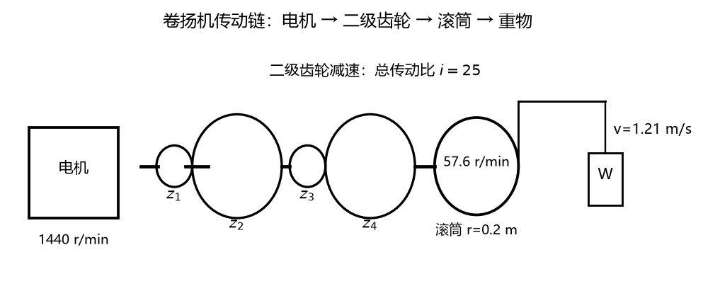
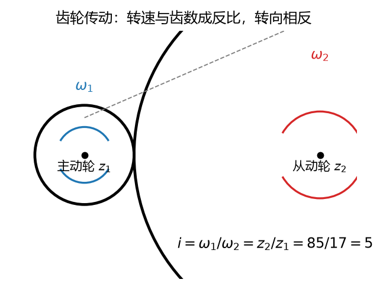
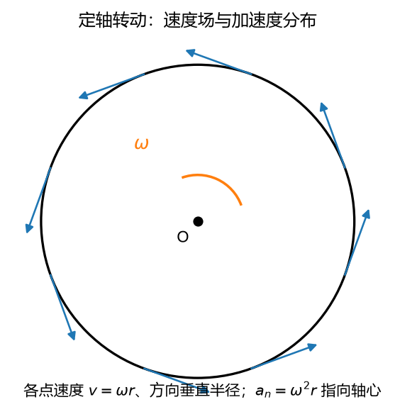

# 第 07 讲：刚体的平移与定轴转动

> 前置：第 06 讲（点的运动学三法——本讲全程调用）+ 第 01 讲（刚体）+ 第 04 讲（叉乘）｜ 预计投入：3–4 小时（正文 + 作业）
> 本讲回答什么问题：一整块刚体（无数个绑在一起的点）的运动怎么**降维**描述？平移和定轴转动凭什么"一个点/一个角"就够？齿轮、皮带传动怎么算？

> **本讲目标（学完你能）：**
> 1. 给定定轴转动的 $\varphi(t)$（或铭牌转速），能算角速度、角加速度，以及刚体上**任意一点**的速度、加速度（大小 + 方向，含切向/法向分解）；
> 2. 能算多级齿轮/皮带传动的传动比与各轴转速，一直算到末端线速度（滚筒绳速这类组合）；
> 3. 能用矢量式 $\mathbf{v} = \boldsymbol{\omega}\times\mathbf{r}$、$\mathbf{a} = \boldsymbol{\alpha}\times\mathbf{r} + \boldsymbol{\omega}\times(\boldsymbol{\omega}\times\mathbf{r})$ 求点的速度加速度（斜着放的转轴也能算），并能说清它与标量式的对应关系。
>
> 目标达成 = 文末"掌握度自测"全打勾。

> **怎么学这一讲：** 先看成品（一台卷扬机的全链传动清单）→ 学两种"降维"运动（平移 = 研究一个点；定轴转动 = 研究一个角）→ 把角量换算成任意点的速度加速度 → 传动比 → 角量升格为矢量（叉乘公式）→ 数值验证 → 作业。本讲数值结论有归档脚本可复跑（`scripts/lec07-01_verify_rigid_body_rotation.py`，见 §5）。

## 0. 开场：一台卷扬机的全链计算

L06 结尾留的钩子：一个点的运动会算了，**一整块刚体**（无数个绑死的点）怎么办？逐点套 L06 显然不现实——好消息是：刚体"不变形"这个约束（L01 的定义）把无数个点的自由度**锁死成极少几个整体参数**。本讲处理其中最重要的两种：

- **平移**：整块刚体一起挪 → 只需研究**一个点**；
- **定轴转动**：整块刚体绕一根固定轴转 → 只需研究**一个角**。

一般"又平又转"的运动是 L09 的主题，但它的零件全在这两块里。

### 0.1 成品：建筑工地的卷扬机



**图 L07-1**：卷扬机传动链：电机 1440 r/min → 二级齿轮（i=25）→ 滚筒 57.6 r/min → 重物 1.21 m/s。


电机（铭牌转速 1440 r/min——r/min 读"转每分"，每分钟转的圈数，§2.2 给它与 rad/s 的换算）带动二级减速器（z 记齿轮的**齿数**：小齿轮 z1=17 啮合大齿轮 z2=85；轴 II 上再同轴挂 z3=17 啮合 z4=85），末端大齿轮带滚筒（半径 0.2 m）转，钢绳提升重物。卡片里的 $\omega$（角速度）、$\alpha$（角加速度）是本讲两个核心量，§2 正式定义。设计要求：**5 秒匀速刹车**能让满载下降的重物停下。

**本讲学完，你能算出并解释这张清单的每一行**：

| 环节 | 量 | 数值 |
| --- | --- | --- |
| 电机端（§2） | 启动 4 s 匀加速到 1440 r/min | $\alpha = 37.7$ rad/s²，转过 48.0 圈 |
| 传动（§3） | 总传动比 | $i = \dfrac{85}{17}\times\dfrac{85}{17} = 25$ |
| 滚筒端（§2/§3） | 转速 / 角速度 | 57.6 r/min，$\omega = 6.03$ rad/s |
| 滚筒边缘点（§3） | 速度 / 法向加速度 | $v = 1.21$ m/s，$a_n = 7.28$ m/s² |
| 重物（§1） | 上升速度（**平移**） | 1.21 m/s——刚体上所有点同此值 |
| 刹车 5 s（§2/§3） | 角加速度 / 滚筒圈数 / 重物再走 | $\alpha = -1.21$ rad/s²，2.4 圈，3.02 m |

最后一行的 3.02 m 是安全设计参数（重物在刹车期间还会下滑多远）——每个数怎么来、各环节谁管谁，就是本讲全程。

### 0.2 路线

§1 平移（降维第一式：一个点）→ §2 定轴转动的描述（降维第二式：一个角；φ/ω/α 与 L06 的 x/v/a 平行对照）→ §3 转动刚体上各点的速度、加速度 + 传动比 → §4 角量升格为矢量（叉乘公式）→ §5 数值验证 → 作业。

## 1. 刚体平移：降维第一式

### 1.1 定义：直线段方向不变，而不是走直线

**平移**（translation）：刚体运动中，**体内任一直线段的方向保持不变**（等价说法：任意两点的连线始终与初始位置平行）。

**最容易犯的直觉错误**：把"平移"当成"走直线"。看两个反例——

- **振荡送料筛**：筛箱吊在几根**平行连杆**上，摆动时箱体上每点都走圆弧，但箱体**不转动**（任意两点的连线始终保持水平）——这是平移，轨迹却是圆弧；
- **蒸汽机车的平行连杆**：连在两侧动轮上的水平杆，杆上每点都画圆，杆本身却始终平移。

判定看的是**"有没有转"**（线段方向变不变），不是**"走什么线"**（轨迹形状）。筛体走圆弧、不转 → 平移；风扇叶走圆弧、转 → 不是平移。

### 1.2 定理：平移刚体上各点轨迹相同、速度加速度相同

**三行证明**。取体内任意两点 A、B。平移定义保证连线 AB 方向不变，刚体保证长度不变，所以 $\overrightarrow{AB} = \mathbf{c}$ 是**常矢量**。于是

$$\mathbf{r}_B(t) = \mathbf{r}_A(t) + \mathbf{c} \;\xrightarrow{\text{求导}}\; \mathbf{v}_B = \mathbf{v}_A \;\xrightarrow{\text{再求导}}\; \mathbf{a}_B = \mathbf{a}_A$$

每一时刻，两点的速度矢量、加速度矢量**完全相同**；轨迹互为平移复制（形状全同）。

**降维结算**：平移刚体的运动学 = **一个代表点**的运动学——L06 全套（三法、切向/法向分解）原封不动拿来就用。卷扬机的重物、钢绳上各点：全部同速 1.21 m/s、同减速，研究一个点就够。

## 2. 刚体定轴转动：降维第二式

### 2.1 定义与描述：一个角定全局

**定轴转动**：刚体运动中**体内有一条直线保持不动**（转轴），其余各点绕这条线转圈。

为什么"一个角"就够？轴以外的每个点都在**自己的圆周上**跑（圆心在轴上、圆面垂直于轴——圆的半径就是点到轴的垂直距离）。关键是：刚体不变形，把所有点半径之间的夹角**焊死**了——所以整块刚体只有一个共享的角位置。描述方法：

- 转轴的位置（在哪、指向哪）；
- **转动方程** $\varphi(t)$：从固定参考平面（过轴）量到刚体上某一动平面（过轴）的张角，逆时针为正（视角沿轴看）。

### 2.2 角速度与角加速度（与 L06 的平行对照）

$$\omega = \frac{\mathrm{d}\varphi}{\mathrm{d}t}\ (\text{rad/s}), \qquad \alpha = \frac{\mathrm{d}\omega}{\mathrm{d}t} = \frac{\mathrm{d}^2\varphi}{\mathrm{d}t^2}\ (\text{rad/s}^2)$$

$\omega$（读"欧米伽"）、$\alpha$（希腊字母，读"阿尔法"）。**工程铭牌用 r/min（转/分），物理用 rad/s，必须会换**：

$$\omega = \frac{2\pi n}{60}\ \text{rad/s} \quad (n\ \text{单位 r/min})$$

例：$n = 1440$ r/min → $\omega = 1440\times 2\pi/60 = 150.8$ rad/s（记 $\omega \approx n/9.55$ 可速算）。

弧度本身无量纲（弧长/半径，长度除以长度），所以 rad/s 严格说就是 1/s——rad 只是为了让读者一眼看出"这是角量"。

**与 L06 的平行对照表**（同一套微积分，换一套字母——这张表把 §2 的所有公式一次讲完）：

| 点的直线运动（L06） | 刚体定轴转动（本讲） | 关系 |
| --- | --- | --- |
| 坐标 $x$ | 转角 $\varphi$ | 位置参数 |
| 速度 $v = \dot{x}$ | 角速度 $\omega = \dot{\varphi}$ | 一阶导 |
| 加速度 $a = \dot{v}$ | 角加速度 $\alpha = \dot{\omega}$ | 二阶导 |
| $v = v_0 + at$ | $\omega = \omega_0 + \alpha t$ | 匀变速三式 |
| $x = x_0 + v_0 t + \frac{1}{2}at^2$ | $\varphi = \varphi_0 + \omega_0 t + \frac{1}{2}\alpha t^2$ | （两次积分） |
| $v^2 = v_0^2 + 2a(x - x_0)$ | $\omega^2 = \omega_0^2 + 2\alpha(\varphi - \varphi_0)$ | 逐字平移 |

**例 2（电机启动）**：电机从静止匀加速启动，4 s 达额定 1440 r/min。求 $\alpha$、期间转过的圈数。

$\omega_{额} = 150.8$ rad/s；$\alpha = 150.8/4 = 37.7$ rad/s²；$\varphi = \frac{1}{2}\alpha t^2 = \frac{1}{2}(37.7)(16) = 301.6$ rad；圈数 $= 301.6/2\pi = 48.0$ 圈。（匀变速三式在角量世界的首次执勤——和 L06 例 4 刹车题同一个套路，$\varphi$ 换 $s$。）



**图 L07-2**：齿轮传动：啮合点线速度相同，所以 $\omega_1 r_1=\omega_2 r_2$，传动比等于齿数反比（$i=z_2/z_1$），两轮转向相反。定轴转动问题里的传动比就是这么来的。

## 3. 转动刚体上各点的速度、加速度：把角量翻译成线量

整体用 φ/ω/α 计算省事，但工程要的是**具体点的**速度加速度（滚筒边缘的绳速、齿轮啮合点的线速）。翻译的钥匙在 L06：**每个点都在做半径 $r$ 的圆周运动**（$r$ = 该点到轴的垂直距离），直接调用 L06 自然法。

### 3.1 速度：v = ωr

该点走圆周，弧坐标 $s = r\varphi$（半径 × 转角 = 弧长），L06 求导：

$$\boxed{\;v = \frac{\mathrm{d}s}{\mathrm{d}t} = r\,\frac{\mathrm{d}\varphi}{\mathrm{d}t} = r\,\omega\;}$$

方向：垂直于半径、指向转向那侧（圆周切线）。

**速度分布图景**：同一时刻 $\omega$ 全轮共享，$v = \omega r$ 沿半径**线性增长**——离轴越远越快，轴心为零（轴上的点不动，正是"定轴"的含义）。任意两点速度之比 = 半径之比。

### 3.2 加速度：a_t = rα（切向）+ a_n = ω²r（法向）

对 $v = r\omega$ 求导（$r$ 不随时间变——点焊死在刚体上）：

$$\boxed{\;a_t = r\,\alpha\ (\text{沿切线}), \qquad a_n = \frac{v^2}{r} = \omega^2 r\ (\text{指向轴})\;}$$

$$a = \sqrt{(r\alpha)^2 + (\omega^2 r)^2} = r\sqrt{\alpha^2 + \omega^4}$$

两块计算与 L06 §4 完全同构：$a_t$ 管转速快慢的变化，$a_n$ 管"转圈这件事本身"的方向变化。**加速度与半径的夹角同一时刻处处相同**：$\tan\theta = a_t/a_n = \alpha/\omega^2$（与 $r$ 无关）——同一根辐条上所有点的加速度指向同一方向，这是转动刚体的标志性图景。

**ω² 的平方增长**值得专门警告（L06 题 6 已预演）：转速翻倍，向心加速度翻**四倍**。1440 r/min 的电机转子（$r$ = 0.05 m 处）$a_n = \omega^2 r = 150.8^2 \times 0.05 \approx 1136$ m/s² ≈ 116 个 g——高速旋转件的离心载荷是设计要害，数字在这里感受一次。

### 3.3 例 3：卷扬机滚筒边缘点（§0 清单第 4 行的兑现）

滚筒 $r = 0.2$ m、匀速段 $n = 57.6$ r/min（$\omega = 6.03$ rad/s）：

匀速段：$v = \omega r = 6.03 \times 0.2 = 1.206$ m/s；$a_t = 0$；$a_n = \omega^2 r = 36.4 \times 0.2 = 7.28$ m/s²（$\approx 0.74$ g，指向轴心）。

**刹车段**（5 s 匀减速停转）：$\alpha = -\omega/t = -6.03/5 = -1.21$ rad/s²；滚筒转角 $\varphi = \omega_0 t + \frac{1}{2}\alpha t^2 = 30.16 - 15.08 = 15.08$ rad $= 2.4$ 圈；钢绳放出长度 $= r\varphi = 3.02$ m——重物（**平移**，§1）同速匀减，再滑 3.02 m 停住。清单第 5、6 行兑现。刹车瞬间边缘点 $a_t = r\alpha = 0.242$ m/s²，远小于 $a_n = 7.28$ m/s²——慢转速下"拐弯分量"压倒"变速分量"（对照例 2 电机端的高速情形，感受量级差异）。

### 3.4 传动比：接触点的翻译官

传动问题的钥匙一句话：**接触条件先把"线量"锁相等，角量跟着换算**。

**齿轮副**：两轮啮合（**节圆**相切——假想两轮是两个摩擦轮贴着**纯滚动**（相切滚动、接触点不打滑）转动的那个圆，半径称节圆半径），啮合点线速度**必须相等**（齿是刚体，互相咬着不能一个快一个慢）：

$$\omega_1 r_1 = \omega_2 r_2 \;\Rightarrow\; \frac{\omega_1}{\omega_2} = \frac{r_2}{r_1} = \frac{z_2}{z_1}$$

（节圆半径与齿数成正比——同样大小的齿，圆周越长齿越多。）定义**传动比** $i = \omega_1/\omega_2 = n_1/n_2 = z_2/z_1$（也等于转速比）。**转向**：外啮合两轮转向相反（两节圆在啮合点反向滚动），内啮合同向。

**皮带轮副**：皮带不打滑 → 皮带线速 = 两轮轮缘线速 → $\omega_1 d_1 = \omega_2 d_2$（用直径更顺手），同式。**转向**：开口皮带（普通直绕一圈）两轮同向，交叉皮带（带拧成 8 字）反向。

**多级传动**：总传动比 = 各级相乘。中间轴上装两个齿轮"接力"：第二个齿轮与第一个大齿轮**同轴同转速**——同轴是传动链的"粘贴点"。

### 3.5 例 4：卷扬机全链（§0 清单第 2、3 行的兑现）

电机 1440 r/min → z1=17 啮合 z2=85（轴 II）→ 轴 II 同轴挂 z3=17 啮合 z4=85（轴 III）→ 滚筒。

第一级：$i_1 = z_2/z_1 = 85/17 = 5$，轴 II 转速 $= 1440/5 = 288$ r/min；
第二级：$i_2 = 5$，轴 III（滚筒）$= 288/5 = 57.6$ r/min；
总传动比 $i = 25$（两级相乘）。滚筒 $\omega = 6.03$ rad/s，绳速 $v = \omega r = 1.206$ m/s。

**为什么需要减速器**：电机做小而快的转动最便宜（1440 r/min 是常见电机的天然档位——50 Hz 电网下四极电机的产物），但工地要的是"粗而慢"的拉力——传动比 25 把转速换算成低速大转矩（转矩 = 转动的力矩，L02 的老概念；力怎么随传动放大是 L14 的事，先记下这个关系）。

**下一讲**：φ/ω/α 的标量式在"轴垂直纸面"的平面情形够用。但转轴斜着放（§4 的空间情形）、以及 L08/L09 的理论推导，需要 ω 拥有方向——把它升格为矢量。



**图 L07-3**：定轴转动的速度场：每点速度 $v=\omega r$、方向垂直半径，大小随半径线性增长；法向加速度 $\omega^2r$ 指向轴心。同一根辐条上各点的加速度方向相同——转动的整体性就体现在这里。

## 4. 角量的矢量表示：ω、α 升格，叉乘公式展开

### 4.1 为什么 ω 要变成矢量

平面问题里，"转向"用一句话（顺时针/逆时针）就说清，标量式 $v = \omega r$ 够用。但两种情形需要 ω **拥有方向**：

1. **转轴斜着放**：空间机构（锥齿轮副——两根相交轴之间的齿轮传动、机器人腕部）的转轴各指一方，速度方向没法靠"顺/逆"口述——需要机器可算的方向计算；
2. **理论推导**：L08 的速度合成定理、L09 的平面运动分解，核心代数就是拿 ω 去叉乘别的矢量——它必须是矢量才能上牌桌。

**升格规则**（定轴转动）：$\boldsymbol{\omega}$ 的大小 $= |\dot\varphi|$，方向**沿转轴**，指向由**右手定则**定（L04 原班人马：四指顺着转向握轴，拇指即 $\boldsymbol{\omega}$ 指向）。$\boldsymbol{\alpha} = \mathrm{d}\boldsymbol{\omega}/\mathrm{d}t$ 同沿轴（定轴转动中方向不变、只有大小正负在变）。约定绑定：**沿 $\boldsymbol{\omega}$ 的反方向看，$\varphi$ 逆时针为正**——角的正方向与矢量指向咬合成一套约定。

两个转动同时发生时（L08/L09 的日常），角速度按**矢量合成**（平行四边形相加）——本讲只立此规则，用熟它要到 L08 科氏加速度处。

### 4.2 速度的矢量式：v = ω×r

$$\boxed{\;\mathbf{v} = \boldsymbol{\omega}\times\mathbf{r}\;}$$

$\mathbf{r}$：从**轴上任一点**指向研究点的矢量。轴上取哪点都行（一行证明：把轴上换点 $\mathbf{r}\to\mathbf{r}+\lambda\mathbf{u}$，则 $\boldsymbol{\omega}\times(\mathbf{r}+\lambda\mathbf{u}) = \boldsymbol{\omega}\times\mathbf{r}$，因为 $\mathbf{u}$ 平行 $\boldsymbol{\omega}$、叉乘为零）——这个"换点自由"让 r 的选取不纠结。

**平面情形核对**（轴沿 $\mathbf{k}$、点 $(x, y, \cdot)$、$\omega > 0$）：

$$\boldsymbol{\omega}\times\mathbf{r} = \omega\,\mathbf{k}\times(x, y, z)\,\mathbf{i,j} = \omega\,(-y,\ x,\ 0)$$

大小 $= \omega\sqrt{x^2+y^2} = \omega r_\perp$（$r_\perp$ = 点到轴的垂直距离）——正是标量式 $v = \omega r$；方向 $(-y, x)/r_\perp$ = 半径逆时针转 $90°$ = 切向指向转向那侧 ✓。**标量式是矢量式的模**，双轨对齐。

**例 5**：转轴沿 $z$、$\omega = 4$ rad/s、$\alpha = -2$ rad/s²（减速中），刚体上点 $P(0.6,\ 0.8,\ 1.2)$ m。求 $\mathbf{v}$。

$$\mathbf{v} = 4\,\mathbf{k}\times(0.6,\ 0.8,\ 1.2) = 4\,(-0.8,\ 0.6,\ 0) = (-3.2,\ 2.4,\ 0)\ \text{m/s}$$

$|\mathbf{v}| = 4\times 1.0 = 4$ m/s（$r_\perp = \sqrt{0.6^2+0.8^2} = 1.0$ m）。**洞察**：$z = 1.2$ 完全没参与速度——叉乘把 $\mathbf{r}$ 的**轴向分量天然剪掉**，只用垂直分量。这是"垂直距离"三个字的代数实现。

### 4.3 加速度的矢量式：α×r + ω×(ω×r)

对 $\mathbf{v} = \boldsymbol{\omega}\times\mathbf{r}$ 求导（乘积法则：$\dot{\boldsymbol{\omega}}\times\mathbf{r} + \boldsymbol{\omega}\times\dot{\mathbf{r}}$，$\dot{\mathbf{r}} = \mathbf{v}$）：

$$\boxed{\;\mathbf{a} = \boldsymbol{\alpha}\times\mathbf{r} + \boldsymbol{\omega}\times(\boldsymbol{\omega}\times\mathbf{r})\;}$$

两块分别读：

- $\boldsymbol{\alpha}\times\mathbf{r}$：与 $\mathbf{v} = \boldsymbol{\omega}\times\mathbf{r}$ 同构（$\boldsymbol{\alpha}$ 换 $\boldsymbol{\omega}$）→ **切向分量**，大小 $\alpha r_\perp$，沿切线（转速在变）；
- $\boldsymbol{\omega}\times(\boldsymbol{\omega}\times\mathbf{r})$：**几何两步读**——内层 $\boldsymbol{\omega}\times\mathbf{r} = \mathbf{v}$（垂直轴的平面内）；外层再被 $\boldsymbol{\omega}$ 叉：垂直于 $\boldsymbol{\omega}$ 且垂直于 $\mathbf{v}$ → **指向轴**（向心）；大小 $\omega\,|\mathbf{v}| = \omega^2 r_\perp$ → **法向分量**。

**代数速算版**（记结论即可）：记 $\mathbf{r}_\perp = \mathbf{r} - (\mathbf{r}\cdot\hat{\mathbf{u}})\hat{\mathbf{u}}$（$\hat{\mathbf{u}}$ 沿轴的单位矢量——$\mathbf{r}$ 剪掉轴向分量后的"垂直半径"），则

$$\boldsymbol{\omega}\times(\boldsymbol{\omega}\times\mathbf{r}) = -\omega^2\,\mathbf{r}_\perp$$

（来源一行带过：三重积公式 $\mathbf{a}\times(\mathbf{b}\times\mathbf{c}) = \mathbf{b}(\mathbf{a}\cdot\mathbf{c}) - \mathbf{c}(\mathbf{a}\cdot\mathbf{b})$ 取 $\mathbf{a}=\mathbf{b}=\hat{\mathbf{u}}$ 即得 $\hat{\mathbf{u}}\times(\hat{\mathbf{u}}\times\mathbf{r}) = -\mathbf{r}_\perp$。口诀不必背，几何两步读已给出同一结论。）于是

$$\mathbf{a} = \boldsymbol{\alpha}\times\mathbf{r} - \omega^2\,\mathbf{r}_\perp, \qquad a = r_\perp\sqrt{\alpha^2 + \omega^4}$$

与 §3.2 的标量式**逐项对上**（$\alpha r_\perp$ ↔ $a_t$；$\omega^2 r_\perp$ ↔ $a_n$）——矢量式是标量式的空间扩展，不是两套学问。

**例 5 续**：同一点 $P(0.6,\ 0.8,\ 1.2)$ 的加速度。

$$\boldsymbol{\alpha}\times\mathbf{r} = -2\,\mathbf{k}\times(0.6,\ 0.8,\ 1.2) = (1.6,\ -1.2,\ 0)\ \text{m/s}^2 \quad (|\cdot| = 2.0 = \alpha r_\perp ✓)$$

$$\boldsymbol{\omega}\times(\boldsymbol{\omega}\times\mathbf{r}) = -\omega^2\,\mathbf{r}_\perp = -16\,(0.6,\ 0.8,\ 0) = (-9.6,\ -12.8,\ 0)\ \text{m/s}^2 \quad (|\cdot| = 16.0 = \omega^2 r_\perp ✓)$$

$$\mathbf{a} = (1.6,\ -1.2,\ 0) + (-9.6,\ -12.8,\ 0) = (-8.0,\ -14.0,\ 0)\ \text{m/s}^2, \qquad |\mathbf{a}| = \sqrt{260} = 16.12\ \text{m/s}^2$$

验算：$r_\perp\sqrt{\alpha^2+\omega^4} = 1.0\times\sqrt{4 + 256} = 16.12$ ✓。

**用法纪律**（防错三条）：①叉乘顺序 $\boldsymbol{\omega}$ 在前，不能换（叉乘反交换，L04）；②先算大小、再判方向，分开核对；③$\boldsymbol{\omega}\times(\boldsymbol{\omega}\times\mathbf{r})$ 是**双重**叉乘——漏一层或错层序都是高发事故。空间斜轴的批量验证交给 §5 脚本实验 3（500 组随机轴全过）。

## 5. 数值验证：刚体转动的可复跑检验

脚本 `scripts/lec07-01_verify_rigid_body_rotation.py`（**规模纪律：目标 < 1 秒，纯 numpy**；中心差分与欧拉法沿用 L06 §7 的两件工具）：

| 实验 | 验证什么 | 设计 |
| --- | --- | --- |
| 1 | 例 2 例 3：电机启动与滚筒刹车（角量匀变速三式） | 解析 vs 欧拉积分（$\mathrm{d}t = 10^{-4}$ s） |
| 2 | 例 4：卷扬机全链传动计算 | 传动比、各轴转速、绳速逐级复算 |
| 3 | 叉乘公式 vs 几何分量（空间斜轴） | 500 组随机轴向 $\hat{\mathbf{u}}$、随机点：$\|\mathbf{v}\| = \omega r_\perp$、$\mathbf{v}\cdot\hat{\mathbf{u}} = 0$、$\boldsymbol{\omega}\times(\boldsymbol{\omega}\times\mathbf{r}) = -\omega^2\mathbf{r}_\perp$、$\|\boldsymbol{\alpha}\times\mathbf{r}\| = \alpha r_\perp$ |
| 4 | 轨迹 → 速度：中心差分 vs 解析 $\boldsymbol{\omega}\times\mathbf{r}$ | 500 组随机 $\varphi(t)$：数值生成转动点的轨迹 $P(t) = R(\varphi(t))\,P_0$，差分求 $\mathbf{v}$，对照解析式 |
| 5 | 平移定理 vs 转动（正反对照） | 平移复制 $\mathbf{r}_A + \mathbf{c}$：两点速度差数学上精确为零（浮点仅噪声级）；转动复制（绕 $z$、$\theta(t)$）：速度明显不同、且 $\|\mathbf{v}_B\|$ 遵守 $\omega r_\perp$ |

**实测输出**（2026-09-24 实跑原文）：

```
================================================================
L07 rigid body rotation verification
================================================================
[Exp 1] motor start (0 -> 1440 rpm in 4 s) & drum brake (5 s)
  motor: alpha = 37.699 rad/s^2, phi(4s) = 301.593 rad = 48.00 turns
  Euler (dt=1e-04): omega(4) = 150.796, phi(4) = 301.600 rad  PASS
  drum brake: alpha = -1.206 rad/s^2, phi(5s) = 15.080 rad = 2.40 turns
  rope payout = r*phi = 3.016 m  PASS
[Exp 2] hoist drive train: 1440 rpm, gears 17/85 x 17/85, drum r=0.2
  shaft II = 288.0 rpm, shaft III = 57.6 rpm, i_total = 25.0
  drum omega = 6.032 rad/s, rope speed = 1.2064 m/s
  matches hand calculation: PASS
[Exp 3] cross-product vs geometric components, 500 random axes
  max | |v| - omega*r_perp | = 3.6e-15  PASS
  max | v . u | = 1.8e-15  PASS (velocity perpendicular to axis)
  max | w x (w x r) + w^2 r_perp | = 2.6e-14  PASS
  max | |alpha x r| - alpha*r_perp | = 1.8e-15  PASS
[Exp 4] trajectory central-diff v vs analytic omega x r, 500 random phi(t)
  max component diff = 1.9e-06  PASS
[Exp 5] translation copy vs rotation copy
  translation copy r_A + c: max |v_B - v_A| = 5.6e-14  PASS (math-exact, float noise)
  rotation copy (theta = 1.5t + 0.4t^2, d_perp = 0.361):
    central-diff v vs analytic omega x r: max diff = 7.2e-07  PASS
    |v_B2(0.999)| = 0.829 vs omega(0.999)*r_perp = 0.829  PASS
    v_B2(0.999) = 0.829 vs v_A(0.999) = 0.778 (differ: translation theorem does NOT apply) PASS
OVERALL: ALL PASS
```

**一个诚实的修正（脚本初版判据三连 bug）**：初版首跑打出三个假 FAIL，全是**判定代码**的错、没有一条是物理的错——①平移复制的速度差判了 `== 0.0`，但浮点加法 $(x_k + c) - (x_{k-1} + c)$ 各自舍入，数学上精确为零的量在浮点上留了 $5.6\times10^{-14}$ 的噪声（教训：**浮点相等永远用容差，不用 `==`**）；②"末点速度对照"用了错位索引——中心差分的最后一格天然落在 $t = 0.999$ 而非 $1.0$，拿它对 $\omega(1.0)$ 当然对不上（教训：**数值差分的"落点时刻"要自己数清楚**）；③最恶劣的一条：末行 `OVERALL: ALL PASS` 是硬编码字符串——**即使上面 FAIL 它也照样喊 ALL PASS**。改成收集全部检查位的真实汇总后，重跑全部通过。这一条给所有"数值验证"提了个醒：**汇总结论必须是算出来的，不是打印出来的**。

（随机实验的浮点数值以本机实跑为准，脚本种子固定可复现。）三个读点：① 讲义清单（$\alpha$、圈数、传动比、绳速、刹车行程）**逐项与解析/数值积分对上**——48.0 圈、2.4 圈、3.02 m 不是拍出来的；② 空间斜轴 500 组随机验证：$\mathbf{v} = \boldsymbol{\omega}\times\mathbf{r}$ 的模**恒等于** $\omega r_\perp$、双重叉乘恒等于 $-\omega^2\mathbf{r}_\perp$（浮点噪声水平）——例 5 的洞察（"轴向分量被剪掉"）是数学恒等式不是巧合；③ 平移复制的两点速度差在浮点噪声水平（$5.6\times10^{-14}$）——数学上精确为零（常矢量在差分中消去），转动复制则相差 0.05——§1 定理与 §3 公式各管各的世界，正反两面都有数。

## 6. 常见错误清单（对答案，校准感觉）

> 本节零新知识，逐条对应正文小节。

| # | 错误 | 为什么错 | 锚定 |
| --- | --- | --- | --- |
| 1 | 把平移当"走直线" | 平移看**线段方向不变**；振荡筛走圆弧也是平移 | §1.1 |
| 2 | 只查一条线段方向不变就判平移 | 定义要求**任意**线段；反例：定轴转动的直径线段方向在变但弦线段可能瞬时平行 | §1.1 |
| 3 | r/min 当 rad/s 直接代 | 差因子 $2\pi/60 \approx 0.1047$；1440 r/min 是 150.8 rad/s 不是 1440 | §2.2 |
| 4 | $v = \omega r$ 里 $r$ 代"到轴上某点距离" | 必须是**垂直距离** $r_\perp$（例 5 的 z 分量不参与） | §3.1/§4.2 |
| 5 | 高速转动低估 $a_n$ | $a_n = \omega^2 r$ 沿转速**平方**涨；1440 r/min、0.05 m 处已 116 g | §3.2 |
| 6 | 传动比记成 $z_1/z_2$ | 主动轮角速度在分子：$i = \omega_1/\omega_2 = z_2/z_1$（大齿轮带小齿轮是增速，i<1） | §3.4 |
| 7 | 皮带转向规则用反 | 开口带同向、交叉带（8 字）反向；齿轮外啮合反向 | §3.4 |
| 8 | $\omega\times r$ 当数量乘、随手交换顺序 | 叉乘反交换；$\boldsymbol{\omega}$ 必须在前 | §4.2 |
| 9 | 加速度只算 $\boldsymbol{\alpha}\times\mathbf{r}$ | 漏掉 $\boldsymbol{\omega}\times(\boldsymbol{\omega}\times\mathbf{r})$ 向心项（匀速转动时它独挑全场） | §4.3 |
| 10 | 多级传动忘"同轴同转速" | z2 与 z3 同轴：轴 II 转速是两级之间唯一的"粘贴点" | §3.4/例 4 |

## 7. 本讲小结（一页骨架）

- **两种降维**：平移 = 研究**一个点**（三行证明：$\mathbf{r}_B = \mathbf{r}_A + \mathbf{c}$ 求导两次，各点速度加速度全同；L06 全套直接调用）；定轴转动 = 研究**一个角**（轴线位置 + $\varphi(t)$；刚体不变形把所有点的角位置焊死成一个）。
- **平移 ≠ 走直线**：判定看"线段方向不变"（振荡筛走圆弧也是平移）。
- **平行对照**：$x\leftrightarrow\varphi$、$v\leftrightarrow\omega$、$a\leftrightarrow\alpha$；匀变速三式逐字平移（两次积分）；$n$（r/min）↔ $\omega$：$\omega = 2\pi n/60$。
- **线量翻译**（每点都在半径 $r_\perp$ 的圆周上，L06 自然法调用）：$v = \omega r_\perp$（沿半径线性分布）、$a_t = \alpha r_\perp$、$a_n = \omega^2 r_\perp$（指轴）、$a = r_\perp\sqrt{\alpha^2+\omega^4}$；同一时刻加速度与半径夹角处处相同（$\tan\theta = \alpha/\omega^2$）；$\omega^2$ 的平方增长是高速旋转件的设计要害。
- **传动**：接触点线速相等 → $i = \omega_1/\omega_2 = z_2/z_1$（齿轮，外啮合反向）$= d_2/d_1$（皮带，开口同向）；多级相乘；同轴 = 粘贴点。
- **矢量式**：$\boldsymbol{\omega}$ 沿轴、右手定则；$\mathbf{v} = \boldsymbol{\omega}\times\mathbf{r}$（$\mathbf{r}$ 从轴上任一点量起，轴向分量被剪掉）；$\mathbf{a} = \boldsymbol{\alpha}\times\mathbf{r} - \omega^2\mathbf{r}_\perp$；标量式 = 矢量式的模，双轨互验。
- **下一讲**：L08 换个参考系看运动（合成运动、科氏加速度——$\boldsymbol{\omega}\times\mathbf{v}$ 型叉乘的高光时刻）；L09 处理"又平又转"的平面运动。

## 8. 掌握度自测（行为化清单，全部打勾才算讲过）

- [ ] 给"筛体走圆弧但箱体不转"，我能判它是平移并给出理由（线段方向不变）
- [ ] 我能三行写出平移定理的证明（常矢量 + 两次求导）
- [ ] 给铭牌转速我能换算 rad/s（含速算 $\omega \approx n/9.55$），并用匀变速三式算启停过程
- [ ] 给 $\varphi(t)$ 与任一点的位置，我能算该点 $v$、$a_t$、$a_n$、$a$（大小 + 方向）
- [ ] 给多级齿轮/皮带传动链，我能逐级写出转速直到末端线速度，并说清"同轴粘贴点"
- [ ] 我能用 $\mathbf{v} = \boldsymbol{\omega}\times\mathbf{r}$ 和 $\mathbf{a} = \boldsymbol{\alpha}\times\mathbf{r} + \boldsymbol{\omega}\times(\boldsymbol{\omega}\times\mathbf{r})$ 算空间情形，并说清 $r_\perp$ 的含义（轴向分量不参与）
- [ ] 我能解释为什么 $v = \omega r$ 只是 $v = \boldsymbol{\omega}\times\mathbf{r}$ 的模
- [ ] 我能背出传动比的接触条件（啮合点/轮缘线速相等）并说明转向规则（外啮合反、开口带同）

## 9. 作业（先独立做，再看参考答案——答案只用本讲内容）

**题 1（判断，每小题答"对/错" + 一句理由）**
(a) 平移刚体上各点在同一瞬时的加速度必相同。
(b) 平移刚体的轨迹必为直线。
(c) 定轴转动刚体上各点速度的大小与到轴的距离成正比。
(d) 定轴转动刚体上各点 $a_n$ 与到轴的距离成正比（同一时刻）。
(e) 同一时刻，转动刚体上各点的全加速度与半径的夹角处处相同。

**参考答案：**
(a) **对**。$\mathbf{r}_B = \mathbf{r}_A + \mathbf{c}$ 求导两次即得（§1.2）；注意限定"同一瞬时"——不同时刻加速度可以变。
(b) **错**。平移看线段方向不变；振荡筛各点走圆弧仍是平移（§1.1）。
(c) **对**。$v = \omega r_\perp$，$\omega$ 全轮共享（§3.1）。
(d) **对**。$a_n = \omega^2 r_\perp$，$\omega$ 同一时刻定值（§3.2）。
(e) **对**。$\tan\theta = a_t/a_n = \alpha/\omega^2$ 与 $r_\perp$ 无关（§3.2）——辐条上加速度指向同一方向。

**题 2** 电机 $n = 1440$ r/min，从静止匀加速启动 4 s 达额定。转子外缘 $r = 0.1$ m。求 $t = 2$ s 时外缘点的 $v$、$a_t$、$a_n$、$a$，并对此量级说一句话。

**参考答案：**
$\omega_{额} = 150.8$ rad/s，$\alpha = 37.7$ rad/s²；$t = 2$ s：$\omega = 75.4$ rad/s。
$v = \omega r = 7.54$ m/s；$a_t = \alpha r = 3.77$ m/s²；$a_n = \omega^2 r = 568.5$ m/s²；$a = \sqrt{3.77^2 + 568.5^2} \approx 568.5$ m/s²。
一句话：转速才到一半，$a_n$ 已约 58 g、把 $a_t$ 完全淹没——$\omega^2$ 的平方增长意味着高速端永远是"拐弯分量"占主导（§3.2 的警告在数字里兑现）。

**题 3** 飞轮 $n_0 = 300$ r/min 匀减速制动，10 s 停。求 $\alpha$ 与停转前转过的圈数。

**参考答案：**
$\omega_0 = 300\times 2\pi/60 = 31.42$ rad/s；$\alpha = -\omega_0/t = -3.14$ rad/s²。
$\varphi = \omega_0 t + \frac{1}{2}\alpha t^2 = 314.16 - 157.08 = 157.08$ rad；圈数 $= 157.08/2\pi = 25.0$ 圈（也可用 $\varphi = \frac{\omega_0 + 0}{2}t$，"平均转速 × 时间"）。

**题 4** 传动链：电机 1440 r/min → 皮带轮 $d_1 = 100$ mm 带动 $d_2 = 300$ mm（开口皮带）→ 同轴齿轮 $z_3 = 20$ 啮合 $z_4 = 60$。求输出轴转速与转向（相对电机）。

**参考答案：**
皮带级：$i_1 = d_2/d_1 = 3$，轴 II $= 1440/3 = 480$ r/min（开口皮带同向）。
齿轮级：$i_2 = z_4/z_3 = 3$，轴 III $= 480/3 = 160$ r/min（外啮合反向）。
输出 160 r/min；转向：同向又被反转一次 → **与电机反向**（两次转向规则的接力——每级的规则逐级用）。

**题 5** 刚体绕定轴转动，$\varphi = 2t^3$（rad，$t$ 单位 s），点 $M$ 到轴距离 $r = 0.5$ m。求 $t = 1$ s 时：$\omega$、$\alpha$、$M$ 的 $v$、$a_t$、$a_n$、$a$。

**参考答案：**
$\omega = \dot\varphi = 6t^2 = 6$ rad/s；$\alpha = \ddot\varphi = 12t = 12$ rad/s²。
$v = \omega r = 3$ m/s；$a_t = \alpha r = 6$ m/s²；$a_n = \omega^2 r = 18$ m/s²；$a = r\sqrt{\alpha^2 + \omega^4} = 0.5\sqrt{144 + 1296} = 0.5\sqrt{1440} = 19.0$ m/s²（验算 $\sqrt{6^2 + 18^2} = \sqrt{360} = 18.97$ ✓）。

**题 6** 转轴沿 $y$ 轴正向，$\omega = 3$ rad/s、$\alpha = 1.5$ rad/s²，刚体上点 $P(0.4,\ 1.0,\ 0.3)$ m。用矢量式求 $\mathbf{v}$、$\mathbf{a}$（分量），再用标量式核对大小。

**参考答案：**
$\mathbf{v} = \omega\,\mathbf{j}\times\mathbf{r} = 3\,\mathbf{j}\times(0.4, 1.0, 0.3) = 3\,(0.3,\ 0,\ -0.4) = (0.9,\ 0,\ -1.2)$ m/s。
$r_\perp$：$\mathbf{r}$ 剪掉 y 分量 $= (0.4, 0, 0.3)$，$r_\perp = 0.5$ m（y 分量 1.0 不参与——例 5 洞察换轴照样成立）。核对：$|\mathbf{v}| = 1.5 = \omega r_\perp = 3\times 0.5$ ✓。
$\boldsymbol{\alpha}\times\mathbf{r} = 1.5\,(0.3,\ 0,\ -0.4) = (0.45,\ 0,\ -0.6)$ m/s²（$|\cdot| = 0.75 = \alpha r_\perp$ ✓）。
$\boldsymbol{\omega}\times(\boldsymbol{\omega}\times\mathbf{r}) = -\omega^2\,\mathbf{r}_\perp = -9(0.4,\ 0,\ 0.3) = (-3.6,\ 0,\ -2.7)$ m/s²（$|\cdot| = 4.5 = \omega^2 r_\perp$ ✓）。
$\mathbf{a} = (0.45 - 3.6,\ 0,\ -0.6 - 2.7) = (-3.15,\ 0,\ -3.3)$ m/s²；$|\mathbf{a}| = 4.56$ m/s²；核对 $r_\perp\sqrt{\alpha^2+\omega^4} = 0.5\sqrt{2.25 + 81} = 4.56$ ✓。

**题 7（代码题）** 用数值积分复算题 5：从 $\alpha(t) = 12t$ 出发，欧拉积分（$\mathrm{d}t = 10^{-4}$ s）恢复 $\omega(1)$、$\varphi(1)$，再算 $M$ 点的 $v$、$a_n$，与题 5 手算对照。参考骨架（补全后运行）：

```python
import numpy as np

r = 0.5
dt = 1e-4
w, phi, t = 0.0, 0.0, 0.0
while t < 1.0 - 1e-12:
    alpha = 12.0 * t          # alpha(t) = phi''(t)
    w += alpha * dt           # omega 累积
    phi += w * dt             # phi 累积
    t += dt
print("Euler:   omega(1) = %.4f  phi(1) = %.4f" % (w, phi))
print("Analytic: omega(1) = 6.0000  phi(1) = 2.0000")
print("point: v = %.4f  a_n = %.4f" % (r * w, w * w * r))
print("hand:   v = 3.0000  a_n = 18.0000")
```

**参考答案：** 运行输出（欧拉一阶精度，$\mathrm{d}t = 10^{-4}$）：`omega(1) ≈ 5.9994`、`phi(1) ≈ 1.9997`、`v ≈ 3.000`、`a_n ≈ 17.996`——与手算差在 $10^{-3}$ 量级（左端点矩形积分的系统性小偏差，$\mathrm{d}t$ 减半误差减半），趋势与量级全对。要点：$a_n$ 对 $\omega$ 的**平方依赖**让积分误差也被平方放大（$\omega$ 差 0.0006 → $a_n$ 差约 0.004）——数值精度在高速端更要紧。
