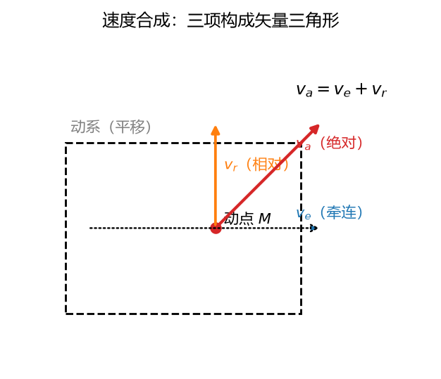
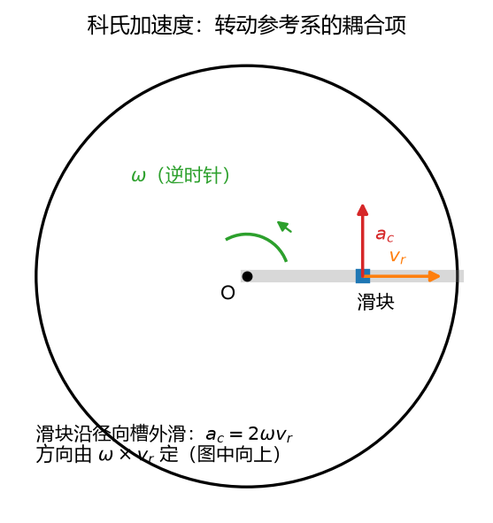

# 第 08 讲：点的合成运动——站在转盘上看世界

> 前置：第 06 讲（点的运动学三法）、第 07 讲（$\boldsymbol{\omega}$ 矢量与 $\mathbf{v} = \boldsymbol{\omega}\times\mathbf{r}$——本讲常备工具）｜ 预计投入：4–5 小时（运动学最烧脑的一讲，例题多，值得慢走）
> 本讲回答什么问题：同一个点的运动，换个参考系看会怎样？"车速 + 相对速度"这个常识哪里对、哪里会**突然不对**？多出来的"科氏加速度"从哪来、为什么偏偏是 2 倍？

> **本讲目标（学完你能）：**
> 1. 给一个"点在运动载体上运动"的问题（车、船、转盘、凸轮、导杆），能选对动点与动参考系、说清绝对/相对/牵连三种运动（含**牵连点**这个最大概念坑）；
> 2. 能用速度合成定理 $\mathbf{v}_a = \mathbf{v}_e + \mathbf{v}_r$ 画矢量图解未知速度（凸轮顶杆、摆动导杆这类考题主战场）；
> 3. 能用加速度合成定理解题：牵连为平移时直接相加；牵连为转动时**不多不少**地加上科氏加速度 $\mathbf{a}_c = 2\boldsymbol{\omega}\times\mathbf{v}_r$，并能判它的方向、说出它的来历。
>
> 目标达成 = 文末"掌握度自测"全打勾。

> **怎么学这一讲：** 先看两个开场场景（车窗雨迹 + 转盘滑块的"怪力"）→ 立正术语（三种运动、牵连点）→ 速度合成（简单但埋着伏笔）→ 加速度合成的"幺蛾子"（科氏登场，本讲高潮）→ 动点动系选取战术 → 数值验证 → 作业。本讲数值结论有归档脚本可复跑（`scripts/lec08-01_verify_composite_motion.py`，见 §6）。

## 0. 开场：车窗雨迹与转盘上的"怪力"

先看两个你**亲身经历过或能秒想象**的场景。

### 0.1 场景 A：车窗上的雨迹（平移的动系）

车以 10 m/s 匀速向东，雨滴对地面以 8 m/s 竖直下落。你坐车里，侧窗上的雨迹是什么方向？

常识立刻回答：雨迹斜着向后拖——因为"雨的速度 + 车的速度"。这话对，但它对得**有条件**（§4 你会看到条件破在哪）。本讲学完你能交出：

| 量 | 数值 |
| --- | --- |
| 雨对车（相对速度 $\mathbf{v}_r$） | 12.8 m/s，向后倾 $51.3°$（与竖直的夹角）——**雨迹的方向** |
| 若车以 2 m/s² 加速，雨对车的加速度 $\mathbf{a}_r$ | 10.0 m/s²，向后偏 $11.6°$（雨迹会越走越斜） |

### 0.2 场景 B：转盘上的滑块（转动的动系——本讲主战场）

转盘绕中心以 $\omega = 2$ rad/s 逆时针匀转，盘面上开一条**径向直槽**，滑块沿槽以 $v_r = 0.5$ m/s 匀速向外滑。滑块滑到 $r = 0.3$ m 的那一刻：

| 量 | 数值 |
| --- | --- |
| 绝对速度 $v_a$（站在地面看） | $0.781$ m/s（$v_e = \omega r = 0.6$ m/s 垂直于槽 $+$ $v_r = 0.5$ m/s 沿槽，勾股合成） |
| 绝对加速度 $a_a$（关键行） | $2.33$ m/s² $=$ 向心 $1.2$ $+$ **凭空多出的 $2.0$**（切向！） |

"凭空多出"的 2.0 m/s²：滑块沿槽匀速外滑（$a_r = 0$）、转盘匀转（牵连点的向心加速度 $\omega^2 r = 1.2$ m/s²）——这两个问题怎么加都加不出切向的 2.0 m/s²。**它就是科氏加速度**，本讲的核心：$\mathbf{a}_c = 2\boldsymbol{\omega}\times\mathbf{v}_r$（此处 $2\times 2\times 0.5 = 2.0$ m/s²，方向沿切向）。它不是幻觉不是"假想力"（假想力是 L11 的说法），是**真实加速度**——地面系的观察者拿 L06 的差分一量，它就在那里。

这一讲的主线就是把这个"多出来的项"讲透：它从哪来（§4.2 一条干净的推导）、怎么判方向、什么时候消失、以及在地球上干过哪些大事（§4.5 河流冲刷右岸、落体偏东）。

### 0.3 路线

§1 术语立正（三种运动 + 牵连点大坑）→ §2 速度合成（简单，但埋着科氏的种子）→ §3 平移动系的加速度（没有幺蛾子的情形）→ §4 转动动系的加速度（科氏登场，高潮）→ §5 动点动系选取战术 → §6 数值验证 → §7–§10 收尾。

## 1. 三种运动：术语先立正

### 1.1 定系与动系：谁在看

本讲永远同时站着**两个观察者**：

- **定参考系**（定系）：约定"不动"的那个（通常地面）；
- **动参考系**（动系）：固连在某个**运动的刚体**上（车厢、转盘、凸轮、导杆）——它就是"站在转盘上看世界"的那双眼睛。

被研究的点叫**动点** M。注意三角关系：动点 M **不固连**在动系上（否则它俩之间没有"相对运动"可谈，§5 的铁律）。

### 1.2 三种运动、三种轨迹

| 术语 | 谁相对谁 | 定系中看到的轨迹 |
| --- | --- | --- |
| **绝对运动** | 动点 M 相对**定系** | 绝对轨迹（地面看到的雨线：竖直） |
| **相对运动** | 动点 M 相对**动系** | 相对轨迹（车里看到的雨迹：斜向后） |
| **牵连运动** | **动系**（这个刚体）相对定系 | ——（这是刚体的运动，不是点的） |

**雨刷例子把三种轨迹一次看全**：雨滴对地面竖直下落（绝对轨迹）；车窗上的湿痕斜向后（相对轨迹）；车相对地面平移（牵连运动）。**同一个雨滴，两种轨迹都真实存在**——轨迹是"点 + 参考系"配对的属性，没有参考系的轨迹问题在 L06 §1.1 就立过规矩。

### 1.3 牵连点：本讲最大的概念坑

**牵连速度** $\mathbf{v}_e$ 的定义最容易望文生义出错，先把错误的答案列出来：

- ✗ "动系**原点**的速度"——错（原点只是动系上的一点）；
- ✗ "动点自己的速度被牵连的那部分"——绕圈子，没定义。

**正确定义**：假想动点此刻被**冻结**——粘死在它当前所占据的动系位置上——动系运动带给**这个位置**的速度，就是 $\mathbf{v}_e$。这个"被粘住"的位置叫**牵连点**。

三个要点，逐个过：

1. **牵连点 ≠ 动点**：动点下一刻还会相对动系挪窝，牵连点是"替身演员"——动系上此刻与动点重合的那个点；
2. **牵连点每个时刻换人**：滑块沿槽外滑，$t$ 时刻牵连点在盘上 $r(t)$ 处、下一时刻在 $r(t+\mathrm{d}t)$ 处——**"牵连"是瞬时的概念**；
3. **算 $\mathbf{v}_e$、$\mathbf{a}_e$ 就是算动系上"某点"的速度加速度**——L07 的公式直接调用：动系固连的刚体平移 → 全体同速（$\mathbf{v}_e = \mathbf{v}_{平移}$，与位置无关）；动系固连的刚体转动 → $\mathbf{v}_e = \boldsymbol{\omega}\times\mathbf{r}$、$\mathbf{a}_e = \boldsymbol{\alpha}\times\mathbf{r} - \omega^2\mathbf{r}_\perp$（$\mathbf{r}$ 从轴量到**牵连点**）。

**转盘滑块实例**（§0.2 场景 B）：$t$ 时刻滑块在 $r = 0.3$ m，牵连点 = 盘上 0.3 m 半径处的那个点，$\mathbf{v}_e = \omega r\,\hat{\mathbf{e}}_\theta = 0.6$ m/s（垂直槽）、$\mathbf{a}_e = -\omega^2 r\,\hat{\mathbf{e}}_r = 1.2$ m/s²（指向轴心）。这里 $\hat{\mathbf{e}}_r$ 是**沿径向朝外**的单位矢量、$\hat{\mathbf{e}}_\theta$ 是沿**切向**（逆时针转向）的单位矢量——转盘问题的天然局部基（与 L06 的 $\boldsymbol{\tau}, \mathbf{n}$ 同族，此处换个名字强调"跟着转角走"）。滑块再外滑，牵连点就换成更外面的点（$v_e$ 更大）——**这正是"牵连点每时刻重取"的计算实现**。

### 1.4 记号表

下标三兄弟全课程统一（后面 L09、L11 继续用）：

| 记号 | 读 | 指什么 |
| --- | --- | --- |
| $\square_a$ | "a"（absolute） | 绝对量（定系观测） |
| $\square_e$ | "e"（**entrainment**，牵连/搬运） | 牵连量（动系贡献的搬运） |
| $\square_r$ | "r"（relative） | 相对量（动系中观测） |



**图 L08-1**：速度合成：绝对速度 = 牵连速度 + 相对速度，三项构成闭合三角形。动系取平移时，牵连速度就是动系上与该点重合那一点的速度。

## 2. 速度合成定理：v_a = v_e + v_r

### 2.1 定理与它的推导（埋一颗种子）

$$\boxed{\;\mathbf{v}_a = \mathbf{v}_e + \mathbf{v}_r\;}$$

**无条件成立**——动系平移、转动、任意运动都行。推导用**位移三角形**：$t$ 时刻动点在 M，与动系上的 M' 点重合。经 $\Delta t$：

- 动系带着 M' 走到 M'₁（位移 $\overrightarrow{MM'_1}$ = **牵连位移**）；
- 动点在动系里又挪了一段（$\overrightarrow{M'_1M_1}$ = **相对位移**）；
- 合成动点的绝对位移 $\overrightarrow{MM_1} = \overrightarrow{MM'_1} + \overrightarrow{M'_1M_1}$。

除以 $\Delta t$、取 $\Delta t \to 0$：三项分别趋于 $\mathbf{v}_a$、$\mathbf{v}_e$、$\mathbf{v}_r$——速度合成得证。

**埋一颗种子**（§4 会发芽）：严格审视刚才的推导，"相对位移 $\overrightarrow{M'_1M_1}$"是在 $\Delta t$ **末**的动系中度量的，而 $t$ 时刻的相对速度应该在 $t$ **时刻**的动系中定义——两者之间差着动系在 $\Delta t$ 内转过的一个小角。这个出入是 $\Delta t$ 的高阶小量，**取极限后速度合成完好无损**；但当你对速度再求一次导数（求加速度）时，高阶小量的导数**不再小**——加速度合成的"幺蛾子"就藏在这里。

### 2.2 例 1：车中看雨（场景 A 兑现）

**题目**：车以 $v_车 = 10$ m/s 匀速向东，雨对地面以 $v_雨 = 8$ m/s 竖直下落。求雨滴对车的速度（车窗雨迹的方向与大小）。

**第 1 步：定三要素**。动点 = 雨滴；动系 = 车厢（平移）；定系 = 地面。
**第 2 步：三种速度**。$\mathbf{v}_a = (0, -8)$（雨对地，竖直）；$\mathbf{v}_e = (10, 0)$（车厢平移，全车同速）；$\mathbf{v}_r = ?$。
**第 3 步：矢量方程**。$\mathbf{v}_r = \mathbf{v}_a - \mathbf{v}_e = (0, -8) - (10, 0) = (-10, -8)$ m/s。

$$|\mathbf{v}_r| = \sqrt{100 + 64} = 12.8\ \text{m/s}，\qquad \theta = \arctan\frac{10}{8} = 51.3°\ (\text{与竖直的夹角，向后倾})$$

雨迹沿 $51.3°$ 斜线向下向后——车速越快、雨迹越平（车窗竖着时雨刷扫的就是这条线）。

### 2.3 例 2：偏心凸轮尖顶顶杆（考题主战场首次亮相）

**题目**：偏心圆凸轮半径 $R = 0.10$ m、偏心距 $e = 0.03$ m（几何中心 C 偏离转心 O），以 $\omega = 4$ rad/s 绕 O 匀速逆时针转。尖顶顶杆沿过 O 的竖直导槽滑动、尖端 A 恒与凸轮轮廓接触。图示位置 OC 水平向右。求该瞬时顶杆的速度。

**第 1 步：选动点动系**（§5 的战术提前用一次）：

- 动点 = **顶杆尖顶 A**（绝对运动最简单：竖直直线）；
- 动系 = **固连凸轮**（牵连运动：绕 O 定轴转动）；
- **为什么反过来不行**（动点选"凸轮上的接触点"）：凸轮上的接触点**每一时刻换人**（轮廓上的点轮流与 A 接触），它的"相对轨迹"无从谈起；而顶杆尖 A 全程在场、它相对凸轮的运动轨迹 = **凸轮轮廓本身**（一条已知的圆曲线，$v_r$ 沿其切线——方向已知！）。这条选取逻辑是凸轮题的命门，§5 展开成通则。

**第 2 步：三种速度方向**。$v_a$：竖直（大小未知）；$v_r$：沿凸轮轮廓在 A 处的切线；$v_e$：$\omega\times\mathbf{r}$，$\mathbf{r} = \overrightarrow{OA}$。

**第 3 步：几何关系**。A 在竖直导槽（$x = 0$）上、又在以 C(0.03, 0) 为心、半径 0.10 的圆上：

$$x_A = 0:\quad (0 - 0.03)^2 + y_A^2 = 0.10^2 \;\Rightarrow\; y_A = \sqrt{0.01 - 0.0009} = 0.0954\ \text{m}$$

$\overrightarrow{OA} = (0,\ 0.0954)$（竖直），$\mathbf{v}_e = \omega\,\mathbf{k}\times\overrightarrow{OA} = 4\,(-0.0954,\ 0) = (-0.382,\ 0)$ m/s（水平向左，量 $= \omega\,OA$）。
轮廓切线：$\overrightarrow{CA} = (-0.03,\ 0.0954)$（法向），切向单位 $\hat{\mathbf{t}} = (0.954,\ 0.3)$。

**第 4 步：矢量方程投影**。$\mathbf{v}_a = (0,\ v_a) = (-0.382,\ 0) + v_r\,(0.954,\ 0.3)$：

$$x:\ 0 = -0.382 + 0.954\,v_r \Rightarrow v_r = 0.40\ \text{m/s}；\qquad y:\ v_a = 0.3 \times 0.40 = 0.12\ \text{m/s}$$

**答**：顶杆以 $0.12$ m/s 上行；相对速度 $v_r = 0.40$ m/s（恰为 $\omega R$——此构型的规律，考试可当验算指纹）。

### 2.4 解题流程卡（速度合成四步）

$$\text{选动点动系（§5）} \to \text{写三种速度的方向（每个都问"谁贡献的"）} \to \text{画速度矢量三角形} \to \text{投影求解（未知量留一个投影轴上）}$$

**理解层次**：流程**要会用**；位移三角形推导**要能看懂**（它的"高阶小量"伏笔在 §4 发芽）。

## 3. 加速度合成（牵连运动为平移）：没有幺蛾子的情形

### 3.1 定理：直接相加

$$\boxed{\;\text{牵连为平移：}\quad \mathbf{a}_a = \mathbf{a}_e + \mathbf{a}_r\;}$$

**为什么此时没有幺蛾子**（调用 L07 平移定理）：动系平移 → 动系上**各点速度加速度全同** → ①牵连点（不论在动系哪个位置重取）的加速度都一样，"每时刻换人"不产生任何计算变化；②$\mathbf{v}_r$ 这个矢量在定系中观测时**方向不被动系扭动**（平移系不转），$\mathrm{d}\mathbf{v}_r/\mathrm{d}t = \mathbf{a}_r$ 干干净净。两个隐患都消除，加速度合成与速度合成同构。

### 3.2 例 3：车中看雨的加速度（场景 A 的下半场）

**题目**：接例 1，车改为以 $a_车 = 2$ m/s² 向东**加速**，雨滴绝对加速度即重力 $\mathbf{g} = (0, -9.8)$ m/s²。求雨滴相对车厢的加速度。

动系平移：$\mathbf{a}_e = (2,\ 0)$（车厢加速度，全体相同）。方程：$\mathbf{a}_r = \mathbf{a}_a - \mathbf{a}_e$：

$$\mathbf{a}_r = (0, -9.8) - (2, 0) = (-2,\ -9.8)\ \text{m/s}^2,\qquad |\mathbf{a}_r| = 10.0\ \text{m/s}^2$$

方向向后偏下、与竖直夹角 $\arctan(2/9.8) = 11.6°$。**雨迹的方向以这个加速度逐渐偏转**——匀速时雨迹角恒定（例 1 的 51.3°），加速时越走越斜。你在车里其实"感觉"过它：急加速时侧窗的水线明显后甩。

## 4. 加速度合成（牵连运动为转动）：科氏加速度登场

### 4.1 先看现象：§0.2 的结果对不上

动系一转动，$\mathbf{v}_e$、$\mathbf{a}_e$ 由 L07 的转动公式给（$\mathbf{v}_e = \boldsymbol{\omega}\times\mathbf{r}$、$\mathbf{a}_e = \boldsymbol{\alpha}\times\mathbf{r} - \omega^2\mathbf{r}_\perp$），$\mathbf{a}_r$ 由相对轨迹的 L06 切法向分解给。把场景 B 的加速度按"平移版公式" $\mathbf{a}_a = \mathbf{a}_e + \mathbf{a}_r$ 加一遍：$1.2$（向心）$+ 0$（匀速滑）$= 1.2$ m/s²，指向轴心——**没有切向分量**。而地面系的差分实测（§6 脚本 Exp 5 复算）是 $2.33$ m/s²、明显偏切向。差的那份切向 $2.0$ m/s² 就是漏记的项。它不神秘，漏记的原因也很清楚——§3 封死的两个隐患在转动系里**全部重新出现**：

1. 牵连点每时刻换人，而且换到的地方运动状态不同（外圈的点转得更快）；
2. 相对速度矢量 $\mathbf{v}_r$ 在定系中观测时，**方向被动系扭着转**。

### 4.2 来历：一条引理 + 两行推导（本讲唯一"要能推导"级内容）

**引理（转动系中的矢量求导）**：矢量 $\mathbf{A}$ 一边随动系转（动系角速度 $\boldsymbol{\omega}$）、其本身又在动系中变化，则定系观测的导数是

$$\left(\frac{\mathrm{d}\mathbf{A}}{\mathrm{d}t}\right)_{\text{定}} = \left(\frac{\mathrm{d}\mathbf{A}}{\mathrm{d}t}\right)_{\text{动}} + \boldsymbol{\omega}\times\mathbf{A}$$

**几何读法**：盯住 $\mathbf{A}$ 的**箭头端点**——端点的运动是两份的合成：端点在动系里自己挪（相对导数）+ 整根矢量随动系刚转（$\boldsymbol{\omega}\times\mathbf{A}$ 把端点甩向转动方向）。这就是 §1.2"复合运动"思想对**矢量端点**的一次复用。（代数验证一行：$\mathbf{A}(t) = R(\theta)\,\mathbf{A}_{动}(t)$，旋转矩阵对时间的导数 $= \dot\theta$ 倍的 90° 旋转即 $\boldsymbol{\omega}\times$——与 L07 旋转矩阵脚本同源，此处不展开。）

**两行推导**。对 $\mathbf{v}_a = \mathbf{v}_e + \mathbf{v}_r$ 两边取**定系**导数：

$$\mathbf{a}_a = \underbrace{\frac{\mathrm{d}\mathbf{v}_e}{\mathrm{d}t}}_{\text{第一项}} + \underbrace{\frac{\mathrm{d}\mathbf{v}_r}{\mathrm{d}t}}_{\text{第二项}}$$

**第二项**（用引理，$\mathbf{A} = \mathbf{v}_r$）：

$$\frac{\mathrm{d}\mathbf{v}_r}{\mathrm{d}t} = \mathbf{a}_r + \boldsymbol{\omega}\times\mathbf{v}_r$$

——第一处 $\boldsymbol{\omega}\times\mathbf{v}_r$ 出现：**相对速度矢量本身被载体带着转**，转动"输运"出来的加速度。

**第一项**（$\mathbf{v}_e = \boldsymbol{\omega}\times\mathbf{r}$，$\mathbf{r}$ 是动点的绝对位矢，用乘积法则）：

$$\frac{\mathrm{d}\mathbf{v}_e}{\mathrm{d}t} = \boldsymbol{\alpha}\times\mathbf{r} + \boldsymbol{\omega}\times\frac{\mathrm{d}\mathbf{r}}{\mathrm{d}t} = \boldsymbol{\alpha}\times\mathbf{r} + \boldsymbol{\omega}\times(\mathbf{v}_e + \mathbf{v}_r) = \underbrace{\left[\boldsymbol{\alpha}\times\mathbf{r} + \boldsymbol{\omega}\times(\boldsymbol{\omega}\times\mathbf{r})\right]}_{=\ \mathbf{a}_e\ (\text{L07 牵连点公式})} + \boldsymbol{\omega}\times\mathbf{v}_r$$

——第二处 $\boldsymbol{\omega}\times\mathbf{v}_r$ 出现：$\mathbf{v}_e = \boldsymbol{\omega}\times\mathbf{r}$ 里的 $\mathbf{r}$ 是**动点**的位矢，它被相对运动推着变大变位，牵连速度因此**多涨一份**。

**合计**（两处 $\boldsymbol{\omega}\times\mathbf{v}_r$，一倍来自"$\mathbf{v}_r$ 被转"、一倍来自"$\mathbf{v}_e$ 里的 $\mathbf{r}$ 被 $\mathbf{v}_r$ 推动"）：

$$\boxed{\;\mathbf{a}_a = \mathbf{a}_e + \mathbf{a}_r + \mathbf{a}_c, \qquad \mathbf{a}_c = 2\,\boldsymbol{\omega}\times\mathbf{v}_r\;}$$

$\mathbf{a}_c$ 叫**科里奥利加速度**（Coriolis，简称科氏加速度；$\boldsymbol{\omega}$ 是**动系**的角速度）。系数 2 从此不再是神秘数字——它是两笔独立计算的合计。这一推导也顺手解释了 §2.1 埋的种子：位移三角形里被极限吃掉的高阶小量，求导一次后长大成人、恰好就是科氏项。

### 4.3 完整定理、各项分工与 a_c 的形态

| 项 | 谁造成 | 怎么算 |
| --- | --- | --- |
| $\mathbf{a}_e$ | 动系运动本身（把动点此刻的位置**搬运**） | L07：平移牵连 $=$ 车厢加速度；转动牵连 $= \boldsymbol{\alpha}\times\mathbf{r} - \omega^2\mathbf{r}_\perp$（r 量到**牵连点**） |
| $\mathbf{a}_r$ | 动点相对动系的运动 | L06：相对轨迹上做切向/法向分解 |
| $\mathbf{a}_c$ | 相对运动与动系转动的**耦合** | $2\boldsymbol{\omega}\times\mathbf{v}_r$——单独的转动或单独的相对运动都**不**产生它 |

**$\mathbf{a}_c$ 的形态**：

$$|\mathbf{a}_c| = 2\,\omega\,v_r\sin\langle\boldsymbol{\omega},\ \mathbf{v}_r\rangle$$

平面问题（$\boldsymbol{\omega}$ 垂直纸面、$\mathbf{v}_r$ 在面内）夹角恒 $90°$：$|\mathbf{a}_c| = 2\omega v_r$，方向**把 $\mathbf{v}_r$ 沿动系转向转 $90°$**（右手定则一挥）。三个消失条件（都是公式形态直接读出）：$\mathbf{v}_r = 0$（动点不相对动系动）；$\boldsymbol{\omega} = 0$（动系平移——§3 的定理自动成为本定理的特例，两套公式统一）；$\mathbf{v}_r \parallel \boldsymbol{\omega}$（叉乘为零，沿转轴的相对运动不产生科氏）。

### 4.4 例 4：转盘滑块全解（开场场景 B 兑现）

**题目**：$\omega = 2$ rad/s 逆时针匀转、滑块沿径向槽以 $v_r = 0.5$ m/s 匀速外滑，求 $r = 0.3$ m 时的 $\mathbf{v}_a$、$\mathbf{a}_a$。

**速度**：$\mathbf{v}_e = \omega r\,\hat{\mathbf{e}}_\theta = 0.6$ m/s（垂直槽，沿转向）、$\mathbf{v}_r = 0.5\,\hat{\mathbf{e}}_r$ m/s：

$$\mathbf{v}_a = 0.5\,\hat{\mathbf{e}}_r + 0.6\,\hat{\mathbf{e}}_\theta,\qquad v_a = \sqrt{0.25 + 0.36} = 0.781\ \text{m/s}\ (\text{与径向夹角 } \arctan\tfrac{0.6}{0.5} = 50.2°)$$

**加速度**（匀转 $\alpha = 0$、匀滑 $a_r = 0$）：

$$\mathbf{a}_e = -\omega^2 r\,\hat{\mathbf{e}}_r = -1.2\,\hat{\mathbf{e}}_r\ \text{m/s}^2\ (\text{向心})，\qquad \mathbf{a}_c = 2\omega v_r\,\hat{\mathbf{e}}_\theta = 2.0\,\hat{\mathbf{e}}_\theta\ \text{m/s}^2\ (\text{切向，沿转向})$$

$$\mathbf{a}_a = -1.2\,\hat{\mathbf{e}}_r + 2.0\,\hat{\mathbf{e}}_\theta,\qquad a_a = \sqrt{1.44 + 4.00} = 2.33\ \text{m/s}^2\ (\text{与径向夹角 } 59.0°)$$

**方向核对**（右手定则）：$\boldsymbol{\omega}$ 出纸（逆时针）、$\mathbf{v}_r$ 径向朝外 → $\boldsymbol{\omega}\times\mathbf{v}_r$ 指向切向正方向 ✓。**两个问题的直觉版**：①滑块外滑，它占据的动系位置转得越来越快（外圈 $v_e$ 大）——切向速度在涨；②径向的速度矢量又被转盘往切向扭——两笔都记在切向，各出 1.0 m/s²，合计 2.0。

### 4.5 物理实例：地球是最大的转盘

地球是个角速度 $\omega_地 = 7.29\times10^{-5}$ rad/s（24 小时一转）的转动动系——我们每个人都是"转盘上的居民"。$\omega$ 极小，但科氏效应是**持续作用**型（小加速度 × 长时间 × 大尺度），三件真事：

1. **北半球河流冲右岸**：河水 $\mathbf{v}_r$ 沿河流动，$\mathbf{a}_c = 2\boldsymbol{\omega}\times\mathbf{v}_r$ 指向**右岸**（北半球沿流向看右侧；南半球左岸）。量级：$v_r = 3$ m/s、纬度 45°（$\omega$ 的有效竖直分量 $\approx 5\times10^{-5}$），$a_c \approx 3\times10^{-4}$ m/s²——瞬时微不足道，但河水永远带着这份朝右岸的压差、长年作用。河流地貌学里"北半球右岸冲刷更明显"是常被引用的经典说法（如实声明：河岸陡峭与否还受水流、地质等主因控制，科氏是持续的**次要**因素——但它方向恒定、从不休息）。
2. **落体偏东**：$\mathbf{v}_r$ 竖直向下 → $\mathbf{a}_c$ 指向**东**。高塔落体（100 m）东偏约 1.5 厘米——量级先记结论，定量推导在 L11 非惯性系（届时科氏以"惯性力"身份回归，同一公式换个计算视角）。
3. **台风逆时针旋转**（北半球）：大气的大尺度流动里，科氏力（L11 的称呼）是核心——热带气旋的旋向是地球自转的直接签名（南半球顺时针）。

**量级感**：实验室转盘 $\omega \sim 2$ rad/s 是地球的约 27000 倍——同样的 $v_r$ 科氏强 4 个数量级。地球效应全靠"时间 × 尺度"攒出来。



**图 L08-2**：科氏加速度 $a_c=2\omega v_r$，方向由 $\omega\times v_r$ 定。图中转盘逆时针转、滑块沿半径外滑，科氏加速度指向侧方——这就是转盘上物块“被甩偏”的真实原因。

## 5. 动点动系的选取：战术手册

合成运动的公式不难，**难在选型**——同一道题动系选错，相对轨迹立即不可知，全盘卡死。三条原则 + 题型图谱：

### 5.1 三条选取原则

1. **动点与动系不得固连在同一刚体上**（铁律）：否则相对运动恒为零，公式退化成 $\mathbf{v}_a = \mathbf{v}_e$，白忙一场。隐蔽违规：把动系建在"与动点一起动的滑块"上；
2. **相对轨迹必须清晰可辨**：动点相对动系的轨迹要一眼能看出形状（沿凸轮轮廓、沿导槽直线、沿绳）——$\mathbf{v}_r$、$\mathbf{a}_r$ 的方向全从它来。看不出相对轨迹的选型是死路；
3. **接触滑移型选"不换人的接触点"**：两个构件持续接触又互相滑移时，动点选**全程在场**的那个接触点（顶杆尖全程顶着凸轮），动系固连**对面**的构件（凸轮）；对面构件上的接触点**轮流换人**（轮廓上的点轮流接触），换人的点当不了动点。

### 5.2 题型图谱

| 题型 | 动点 | 动系 | 相对轨迹 | 备注 |
| --- | --- | --- | --- | --- |
| 尖顶凸轮顶杆 | 顶杆尖 A | 凸轮 | 凸轮轮廓（曲线） | $v_r$ 沿轮廓切线；例 2 |
| 摆动导杆机构 | 曲柄销（滑块铰点） | 导杆 | 沿导杆的直线 | 例 5；牛头刨床的心脏 |
| 转盘 + 滑块 | 滑块 | 转盘 | 径向直槽 | 例 4；科氏最简模型 |
| 起重机吊物 | 吊钩 | 行走小车 | 沿绳竖直 | 平移牵连（§3 型） |
| 通用心法 | **绝对运动最简**的那个点 | **相对轨迹最清晰**的那个系 | —— | 两头凑，两头都要简单 |

### 5.3 例 5：摆动导杆机构（牛头刨床的心脏）

**题目**：曲柄 $OA = 0.2$ m 绕 O 以 $\omega_O = 3$ rad/s 匀速逆时针转；滑块铰接在 A 上、可沿导杆滑动；导杆绕 $O'$ 摆动（$O'$ 在 O 左侧 0.4 m 处）。求曲柄竖直向上（A 在 O 正上方）时导杆的角速度。（这套机构是**牛头刨床**的心脏——刨刀做往复直线切削的机床，往复运动的源头正是摆动导杆。）

**选型**（按图谱）：动点 = 曲柄销 A（绝对运动最简：绕 O 的圆周，$v_a = \omega_O\cdot OA$ 已知）；动系 = 导杆（相对轨迹 = 沿导杆的直线，清晰）；牵连 = 导杆绕 O' 摆动。

**三种速度**：$\mathbf{v}_a = 3\,\mathbf{k}\times(0, 0.2) = (-0.6,\ 0)$ m/s；$\mathbf{v}_e = \omega_{杆}\,\mathbf{k}\times\overrightarrow{O'A}$（$\overrightarrow{O'A} = (0.4,\ 0.2)$、$|O'A| = 0.447$ m）；$\mathbf{v}_r = v_r\,(0.894,\ 0.447)$（沿导杆方向单位矢量）。

**矢量方程投影**：$(-0.6,\ 0) = \omega_{杆}\,(-0.2,\ 0.4) + v_r\,(0.894,\ 0.447)$：

$$y:\ 0 = 0.4\,\omega_{杆} + 0.447\,v_r \Rightarrow v_r = -0.894\,\omega_{杆}$$
$$x:\ -0.6 = -0.2\,\omega_{杆} - 0.8\,\omega_{杆} = -\omega_{杆} \Rightarrow \boxed{\omega_{杆} = 0.6\ \text{rad/s}\ (\text{逆时针})}$$

$v_r = -0.537$ m/s（负号：实际沿导杆**向根部**滑——A 绕 O 转离导杆远端）。**验算指纹**：$x$ 方程化简后 $\omega_{杆}$ 前的系数恰为 $-1$，是本题几何（$O'A$ 方向与 $v_a$ 方向）的巧合，不是通用规律——每个题都要老老实实投影。

## 6. 数值验证：合成运动的可复跑检验

脚本 `scripts/lec08-01_verify_composite_motion.py`（**规模纪律：目标 < 1 秒，纯 numpy**；工具沿用 L06 §7 的中心差分——加速度用的是它的二阶版本，三点公式 $\big(f(t+h) - 2f(t) + f(t-h)\big)/h^2$，同为 $O(h^2)$ 精度）。数值策略：**从轨迹出发**——动系转角 $\theta(t)$ 与相对位置 $\boldsymbol{\rho}(t)$ 都取随机多项式，生成绝对轨迹 $\mathbf{r}(t) = R(\theta(t))\,\boldsymbol{\rho}(t)$，对它差分得"真实"的 $\mathbf{v}_a$、$\mathbf{a}_a$；再用合成公式（$\mathbf{v}_e$、$\mathbf{v}_r$、$\mathbf{a}_e$、$\mathbf{a}_r$、$\mathbf{a}_c$）各算各的，两路核对：

| 实验 | 验证什么 | 设计 |
| --- | --- | --- |
| 1 | 速度合成 $\mathbf{v}_a = \mathbf{v}_e + \mathbf{v}_r$ | 500 组随机 $\theta(t)$、$\boldsymbol{\rho}(t)$，差分 vs 公式 |
| 2 | 加速度合成 $\mathbf{a}_a = \mathbf{a}_e + \mathbf{a}_r + \mathbf{a}_c$；**反面对照**（去掉 $\mathbf{a}_c$ 的差恰为 $\mathbf{a}_c$） | 同上 500 组 |
| 3 | 平移动系：$\mathbf{a}_a = \mathbf{a}_e + \mathbf{a}_r$（$\omega = 0$ 科氏自动消失） | 500 组随机平移 + 相对运动 |
| 4 | 阿基米德螺线：匀转 + 匀速径向滑的绝对轨迹 $r = r_0 + (v_r/\omega)\,\theta$ | 数值轨迹 vs 解析螺线 |
| 5 | 例 4 数字复算（$v_a = 0.781$、$a_c = 2.0$、$a_a = 2.33$） | 差分 vs 公式 vs 手算三方 |

**实测输出**（2026-09-24 实跑原文）：

```
================================================================
L08 composite motion verification
================================================================
[Exp 1] velocity composition, 500 random rotating frames
  max | v_a(diff) - (v_e + v_r) | = 1.2e-09  PASS
[Exp 2] acceleration composition, 500 random rotating frames
  max | a_a(diff) - (a_e + a_r + a_c) | = 1.3e-05  PASS
  counter-test (without a_c): max | a_a - (a_e + a_r) | = 9.377
  max | missing term - a_c | = 1.3e-05  PASS (the gap IS a_c)
[Exp 3] translating frame, 500 random cases
  max | v_a - (v_e + v_r) | = 3.9e-10; max | a_a - (a_e + a_r) | = 1.5e-05  PASS (no Coriolis term)
[Exp 4] Archimedes spiral: drum w=2 rad/s, v_r=0.5 m/s, r0=0.25
  max | r_numeric(theta) - (r0 + v_r/w*theta) | = 4.4e-16  PASS
[Exp 5] turntable slider replay (w=2, v_r=0.5, r=0.3)
  v_a: diff 0.7810 vs formula 0.7810  PASS
  a_c = 2.0 (formula 2.000, radial/tangential split: 1.200 / 2.000)
  a_a: diff 2.332 vs formula 2.332  PASS (hand card 2.33)
OVERALL: ALL PASS
```

**一个诚实的修正（脚本两处 bug，其一与 L07 的教训同型）**：①Exp 3 初版写了一行 `np.cross(0.0, v_r)`（想表达"ω=0 时科氏为零"）——numpy 2.x 不允许零维标量参与叉乘，直接抛异常崩溃；这行本来就是装饰性的（ω=0 时公式恒为零，无需计算），删掉即愈。教训：**别为了"展示"写不做功的代码**。②Exp 3 的容差拍成了 $10^{-8}$，低于自己所用二阶差分方法的分辨率（$O(h^2)\sim 10^{-5}$，与 Exp 2 同格式同量级）——首跑 FAIL 在自己方法的噪声地板上。修成与 Exp 2 一致后通过。这已经是连续第二讲踩"**阈值与数值方法分辨率不匹配**"的坑（L07 的浮点 `==` 与本次同根：**定容差之前先问自己用的什么方法、它的误差量级是多少**）。

三个读点：① 速度/加速度合成在 500 组随机复合运动上**恒等成立**（差分精度内）——公式不是近似；② **反面对照**是本讲最有价值的一行：不加科氏项，差分与公式之差恰等于 $2\boldsymbol{\omega}\times\mathbf{v}_r$（最大达 9.38 m/s² 的缺口）——科氏项**必要且不多不少**；③ 阿基米德螺线的逐位吻合（$4.4\times10^{-16}$）说明"匀转 + 匀速径向滑"的绝对轨迹有解析指纹——例 4 的世界里连轨迹都是可预测的。

## 7. 常见错误清单（对答案，校准感觉）

> 本节零新知识，逐条对应正文小节。

| # | 错误 | 为什么错 | 锚定 |
| --- | --- | --- | --- |
| 1 | $\mathbf{v}_e$ 当"动系原点的速度" | 牵连点是**动点此刻占据的动系位置**，不是原点；转动系上两点速度可以差很远 | §1.3 |
| 2 | 转动牵连忘加 $\mathbf{a}_c$ | 平移版公式只对平移牵连成立；反面对照显示缺口恰为 $2\boldsymbol{\omega}\times\mathbf{v}_r$ | §4.2/§6 |
| 3 | $\mathbf{a}_c$ 方向用"左手"或交换叉乘顺序 | 叉乘反交换；必须 $\boldsymbol{\omega}$ 在前，右手定则 | §4.3 |
| 4 | $\mathbf{a}_c = 2\boldsymbol{\omega}\times\mathbf{v}_r$ 里把 $\mathbf{v}_r$ 代成 $\mathbf{v}_a$ | 耦合的是**相对**速度；绝对速度进去量纲对但物理全错 | §4.2 |
| 5 | 动点动系固连同一刚体 | 相对运动恒为零，公式退化 | §5.1 |
| 6 | 凸轮题动点选"凸轮上的接触点" | 接触点轮流换人，相对轨迹不可知；选全程在场的顶杆尖 | §5.1/例 2 |
| 7 | 不画矢量三角形直接列投影 | 三种速度方向是本讲全部的"几何弹药"，跳过必乱 | §2.4 |
| 8 | 平移牵连也加科氏项 | $\boldsymbol{\omega} = 0$ 时 $\mathbf{a}_c$ 自动为零——不是"不许加"，是加了也白加（好的公式自动退化） | §4.3 |
| 9 | 相对轨迹与绝对轨迹混谈 | 车窗雨迹（相对）≠ 地面雨线（绝对）；轨迹是"点+参考系"配对属性 | §1.2 |
| 10 | 加速度方程沿未知量方向投影 | 投影轴斜设、避开不需要的未知量（L03 的老战术在此复用） | §5.3 |

## 8. 本讲小结（一页骨架）

- **三角关系**：动点（不固连动系）+ 动系（固连运动刚体）+ 定系；三种运动：绝对（对定系）/ 相对（对动系）/ 牵连（**动系刚体**对定系）。
- **牵连点**（最大坑）：动点此刻占据的动系位置——"替身演员"，**每时刻换人**；$\mathbf{v}_e$、$\mathbf{a}_e$ 用 L07 公式算（平移牵连全同、转动牵连 $\boldsymbol{\omega}\times\mathbf{r}$ 系）。
- **速度合成**：$\mathbf{v}_a = \mathbf{v}_e + \mathbf{v}_r$，无条件普适（位移三角形；其中的高阶小量是科氏的种子）。
- **加速度合成**：牵连平移 $\mathbf{a}_a = \mathbf{a}_e + \mathbf{a}_r$（两个隐患被平移消除）；牵连转动 $\mathbf{a}_a = \mathbf{a}_e + \mathbf{a}_r + \mathbf{a}_c$，$\mathbf{a}_c = 2\boldsymbol{\omega}\times\mathbf{v}_r$——系数 2 = 两项独立贡献（$\mathbf{v}_r$ 被转 + $\mathbf{v}_e$ 里的 $\mathbf{r}$ 被推）；$|\mathbf{a}_c| = 2\omega v_r\sin\theta$，三个消失条件（$v_r=0$、$\omega=0$、$\mathbf{v}_r\parallel\boldsymbol{\omega}$）。
- **选型战术**：动点动系不同体；相对轨迹清晰；接触滑移选"不换人的接触点"。题型图谱：凸轮顶杆（动点=尖顶）、导杆机构（动点=曲柄销）、转盘滑块。
- **地球是大转盘**：北半球河流冲右岸、落体偏东（100 m 塔约 1.5 cm）、台风旋向——$\omega$ 极小，靠时间与尺度攒效应。
- **下一讲**：合成思想升级到刚体——**平面运动 = 随基点平移 + 绕基点转动**，速度瞬心法把"又平又转"玩出花（L09）。

## 9. 掌握度自测（行为化清单，全部打勾才算讲过）

- [ ] 我能不看书画出"动点-动系-定系"三角关系，并复述牵连点的"替身演员"定义
- [ ] 转盘滑块题我能算 $\mathbf{v}_e$、$\mathbf{a}_e$，并解释"牵连点每时刻换人"怎么体现在 $r(t)$ 上
- [ ] 给凸轮顶杆题我能按三原则选动点动系，并说清为什么不能反过来选
- [ ] 我能背出两条加速度合成公式及其分界条件（平移/转动牵连）
- [ ] 我能徒手复现科氏的两行推导（引理 + 两处 $\boldsymbol{\omega}\times\mathbf{v}_r$），说出系数 2 的两个问题
- [ ] 给定 $\boldsymbol{\omega}$ 与 $\mathbf{v}_r$ 我能用右手定则立刻判出 $\mathbf{a}_c$ 方向，并说出三个消失条件
- [ ] 我能用 $2\boldsymbol{\omega}\times\mathbf{v}_r$ 解释北半球河流右岸与落体偏东的方向
- [ ] 我知道平移牵连没有科氏的原因（两个隐患被消除），以及"加了也自动为零"这个公式自洽性

## 10. 作业（先独立做，再看参考答案——答案只用本讲内容）

**题 1（判断，每小题答"对/错" + 一句理由）**
(a) 牵连速度就是动参考系原点的速度。
(b) 牵连运动为平移时，$\mathbf{a}_a = \mathbf{a}_e + \mathbf{a}_r$ 成立。
(c) 牵连运动为平移时也可能出现科氏加速度。
(d) 动点相对动系瞬时静止（$v_r = 0$）时科氏加速度为零。
(e) 平面问题中 $\mathbf{v}_r$ 在动系平面内、$\boldsymbol{\omega}$ 垂直该平面，故 $|\mathbf{a}_c| = 2\omega v_r$ 恒成立。

**参考答案：**
(a) **错**。牵连速度是**牵连点**（动点此刻占据的动系位置）的速度；原点只是动系上的一点，转动系上各点速度不同（§1.3）。
(b) **对**。两个隐患（牵连点换人、$\mathbf{v}_r$ 方向被扭）都被平移封死（§3.1）。
(c) **错**。$\boldsymbol{\omega} = 0$ 时 $\mathbf{a}_c = 2\boldsymbol{\omega}\times\mathbf{v}_r$ 自动为零（§4.3 的消失条件之二）。
(d) **对**。消失条件之一：$\mathbf{v}_r = 0$（§4.3）。
(e) **对**。$\boldsymbol{\omega} \perp \mathbf{v}_r$ 夹角 90°，$\sin 90° = 1$（§4.3）。

**题 2** 车以 15 m/s 匀速向东行进，雨对地面以 10 m/s 竖直下落。求雨对车的速度大小与方向，并说一句车速翻倍时雨迹角怎么变。

**参考答案：**
$\mathbf{v}_r = (0, -10) - (15, 0) = (-15, -10)$ m/s；$|\mathbf{v}_r| = \sqrt{225 + 100} = 18.0$ m/s；与竖直夹角 $\arctan(15/10) = 56.3°$（向后倾）。
车速翻倍（30 m/s）：$|\mathbf{v}_r| = \sqrt{900+100} = 31.6$ m/s、夹角 $\arctan(3) = 71.6°$——**车速越快雨迹越平**，极限趋于水平（雨几乎"横着"打在后窗）。

**题 3** 转盘以 $\omega = 3$ rad/s 逆时针匀转，滑块沿径向槽以 $v_r = 0.4$ m/s 匀速外滑。求 $r = 0.2$ m 时的绝对速度（大小、与径向夹角）与绝对加速度（分量与大小）。

**参考答案：**
速度：$v_e = \omega r = 0.6$ m/s（切向）、$v_r = 0.4$ m/s（径向）→ $v_a = \sqrt{0.36 + 0.16} = 0.721$ m/s，与径向夹角 $\arctan(0.6/0.4) = 56.3°$。
加速度：$a_e = \omega^2 r = 1.8$ m/s²（向心，即 $-\hat{\mathbf{e}}_r$）；$a_r = 0$；$a_c = 2\omega v_r = 2.4$ m/s²（切向 $\hat{\mathbf{e}}_\theta$）。
$\mathbf{a}_a = -1.8\,\hat{\mathbf{e}}_r + 2.4\,\hat{\mathbf{e}}_\theta$，$a_a = \sqrt{3.24 + 5.76} = 3.0$ m/s²，与径向夹角 $\arctan(2.4/1.8) = 53.1°$（偏向切向前方）。

**题 4** 偏心凸轮 $R = 0.08$ m、$e = 0.04$ m，$\omega = 5$ rad/s 逆时针匀转，尖顶顶杆沿过转心 O 的竖直导槽滑动。图示位置 OC 水平向右。求顶杆速度与相对速度大小。

**参考答案：**
几何：$x_A = 0$ 在圆 $(x - 0.04)^2 + y^2 = 0.08^2$ 上 → $y_A = \sqrt{0.0064 - 0.0016} = 0.0693$ m；$\overrightarrow{OA} = (0,\ 0.0693)$ 竖直。
$\mathbf{v}_e = 5\,\mathbf{k}\times(0,\ 0.0693) = (-0.346,\ 0)$ m/s。法向 $\overrightarrow{CA} = (-0.04,\ 0.0693)$，切向单位 $(0.0693,\ 0.04)/0.08 = (0.866,\ 0.5)$。
方程 $(0,\ v_a) = (-0.346,\ 0) + v_r\,(0.866,\ 0.5)$：$x$：$v_r = 0.346/0.866 = 0.40$ m/s（$= \omega R$，指纹复现）；$y$：$v_a = 0.5\times 0.40 = 0.20$ m/s（上行）。

**题 5** 摆动导杆机构：$OA = 0.25$ m 绕 O 以 $\omega_O = 2$ rad/s 匀速逆时针转，导杆摆心 $O'$ 在 O 左侧 0.5 m。求 A 在 O 正上方时导杆的角速度与滑块相对导杆的速度。

**参考答案：**
$\mathbf{v}_a = 2\,\mathbf{k}\times(0,\ 0.25) = (-0.5,\ 0)$ m/s；$\overrightarrow{O'A} = (0.5,\ 0.25)$、$|O'A| = 0.559$ m、沿杆单位 $(0.894,\ 0.447)$。
$\mathbf{v}_e = \omega_{杆}\,\mathbf{k}\times(0.5,\ 0.25) = \omega_{杆}\,(-0.25,\ 0.5)$；方程 $(-0.5,\ 0) = \omega_{杆}(-0.25,\ 0.5) + v_r(0.894,\ 0.447)$：
$y$：$0 = 0.5\omega_{杆} + 0.447\,v_r$ → $v_r = -1.118\,\omega_{杆}$；$x$：$-0.5 = -0.25\omega_{杆} - \omega_{杆} = -1.25\,\omega_{杆}$ → $\omega_{杆} = 0.4$ rad/s（逆时针）。
$v_r = -0.447$ m/s（负：沿导杆向根部 O' 滑）。

**题 6（方向判断 + 计算）** (a) 北半球河流向南流，判断科氏加速度指向哪侧岸；(b) 北半球自由落体，判断偏东还是偏西；(c) 转盘 $\omega = 2$ rad/s 逆时针、滑块沿径向槽以 $v_r = 0.5$ m/s 外滑，判 $\mathbf{a}_c$ 方向并算大小。

**参考答案：**
(a) 河向南流（$\mathbf{v}_r$ 指南），$\boldsymbol{\omega}$ 矢量过地心指向北极星方向——在北半球地表处它有**向上的分量**。右手定则：$2\boldsymbol{\omega}\times\mathbf{v}_r$ 指向**西**侧岸（沿流向看的右岸）——南向流的河冲刷**右岸=西岸**。
(b) $\mathbf{v}_r$ 竖直向下，$\boldsymbol{\omega}$ 的有效分量向上 → $2\boldsymbol{\omega}\times\mathbf{v}_r$（上 × 下）指向**东**——落体偏东（南北半球都偏东，赤道处效应最明显）。
(c) $\boldsymbol{\omega}$ 出纸（逆时针）× $\mathbf{v}_r$ 径向朝外 → $\mathbf{a}_c$ 沿**切向、与转向同向**（把 $\mathbf{v}_r$ 沿转向转 90°）；大小 $2\omega v_r = 2\times 2\times 0.5 = 2.0$ m/s²。

**题 7（代码题）** 数值复算题 3：生成滑块的绝对轨迹（转盘匀转 + 径向匀滑，$r$ 从 0.1 m 起），中心差分求 $t$ 对应 $r = 0.2$ m 时刻的 $\mathbf{v}_a$、$\mathbf{a}_a$，与题 3 手算对照。参考骨架（补全后运行）：

```python
import numpy as np

w, vr = 3.0, 0.4                 # rad/s, m/s
r0 = 0.1                          # start radius
t_hit = (0.2 - r0) / vr           # when r = 0.2 m (theta = w*t_hit by then)
def pos(t):
    r = r0 + vr * t
    th = w * t
    return np.array([r * np.cos(th), r * np.sin(th)])
def cdiff(f, t, h=1e-5):
    return (f(t + h) - f(t - h)) / (2.0 * h)
v = cdiff(pos, t_hit)
a = cdiff(lambda s: cdiff(pos, s), t_hit)
speed = np.linalg.norm(v)
print("v =", np.round(v, 4), " speed =", round(speed, 4))
print("a =", np.round(a, 4), " |a| =", round(np.linalg.norm(a), 4))
```

**参考答案：** 运行输出（**世界系**分量；$t_{hit} = 0.25$ s，此时 $\theta = \omega t_{hit} = 0.75$ rad）：`v = [-0.1163, 0.7117]`、`speed = 0.7211`、`a = [-2.9530, 0.5292]`、`|a| = 3.0`。
与题 3 手算核对：**大小逐项一致**（0.721、3.0）。分量看似不同，是因为**两套坐标系计算**：手算给的是径向/切向分量（$v_r = 0.4$、$v_e = 0.6$；向心 $1.8$、科氏 $2.4$），差分给的是世界系分量——径向/切向基被 $\theta = 0.75$ rad 旋走了。核对方法（把差分结果投影回局部基 $\hat{\mathbf{e}}_r = (\cos 0.75, \sin 0.75)$、$\hat{\mathbf{e}}_\theta = (-\sin 0.75, \cos 0.75)$）：

$$\mathbf{v}\cdot\hat{\mathbf{e}}_r = 0.40,\quad \mathbf{v}\cdot\hat{\mathbf{e}}_\theta = 0.60;\qquad \mathbf{a}\cdot\hat{\mathbf{e}}_r = -1.80\ (\text{向心}),\quad \mathbf{a}\cdot\hat{\mathbf{e}}_\theta = 2.40\ (\text{科氏})$$

同一个运动、两种计算——数值验证时永远先问"差分在哪个系里说话"。
