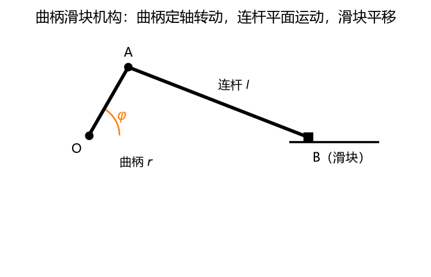
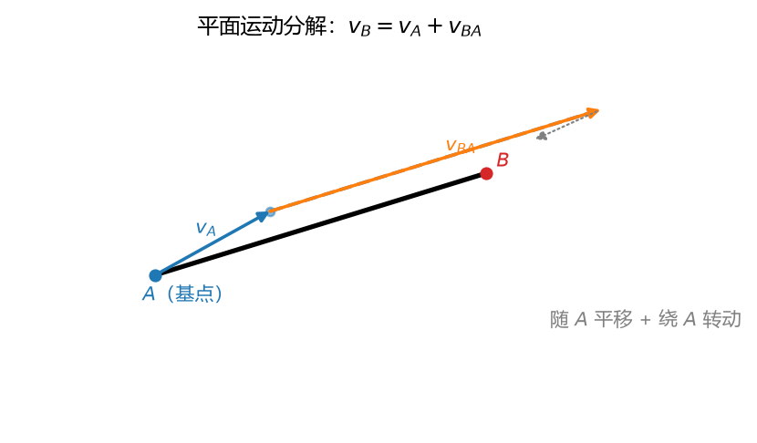
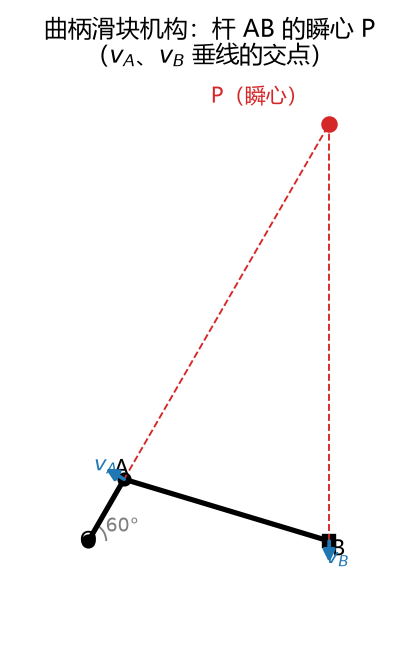
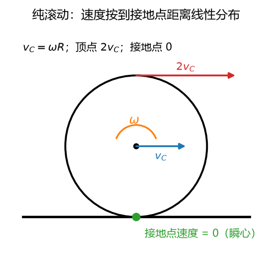

# 第 09 讲：刚体平面运动——基点法与速度瞬心

> 前置：第 07 讲（平移与定轴转动——本讲的两块积木）、第 08 讲（速度合成定理——基点法的亲戚）｜ 预计投入：4–5 小时（运动学收官大讲，例题多）
> 本讲回答什么问题："又平又转"的刚体（车轮、连杆、机器人臂）速度怎么算？凭什么说"每个瞬时它都在绕一个点转"？那个点（**速度瞬心**）怎么找、为什么加速度没有对应的"瞬心法"？

> **本讲目标（学完你能）：**
> 1. 对平面运动刚体，能用**基点法** $\mathbf{v}_B = \mathbf{v}_A + \boldsymbol{\omega}\times\mathbf{r}_{BA}$ 与加速度版解出未知点的速度、加速度（含连杆角加速度）；
> 2. 能按场景在三种方法里选对：基点法（通用）、速度投影定理（快但有局限）、**瞬心法**（找点即得全刚体速度分布，含纯滚动轮）；
> 3. 能对轮杆组合机构做多对象级联分析（曲柄定轴→连杆平面→滑块平移，逐个选法传递）。
>
> 目标达成 = 文末"掌握度自测"全打勾。

> **怎么学这一讲：** 先看成品（曲柄滑块同一道题、三种解法的完整核对照）→ 定义与分解（为什么 3 个自由度、为什么 ω 全刚体唯一）→ 三种方法依次上手 → 加速度与"为什么没有瞬心法" → 级联综合 → 数值验证 → 作业。本讲数值结论有归档脚本可复跑（`scripts/lec09-01_verify_planar_motion.py`，见 §8）。

## 0. 开场：内燃机的心脏，一道题三种方法

汽缸里活塞往复、曲轴旋转——两者之间靠**连杆**传力。连杆的运动形态既不是平移也不是定轴转动：它跟着曲柄销甩、又推着活塞滑，**又平又转**。这就是刚体的**平面运动**——机构学里最常见的形态，本讲的全部内容。



**图 L09-1**：曲柄滑块机构：曲柄 OA 定轴转动，连杆 AB 平面运动，滑块 B 沿水平导轨平移。


**本讲主战场例题**（§3/§4/§5 三节各自用一种方法解它）：曲柄 $r = 0.1$ m 匀速逆时针转（$\omega_O = 10$ rad/s），连杆 $l = 0.3$ m，图示位置曲柄与水平成 $60°$。求滑块速度、连杆角速度。

**成品核对照**（三种解法对同一道题的答案——每一格怎么来的，就是本讲三种方法）：

| 未知量 | 基点法（§3） | 投影定理（§4） | 瞬心法（§5） |
| --- | --- | --- | --- |
| 滑块速度 $v_B$ | $1.017$ m/s（向左） | $1.017$ m/s（两行解） | $1.017$ m/s（$= \omega\,|PB|$） |
| 连杆角速度 $\omega_{AB}$ | $-1.741$ rad/s（顺时针） | **定不了**（投影丢角量） | $-1.741$（$= v_A/|PA|$） |
| 瞬心位置 | —— | —— | $P = (0.337,\ 0.584)$ m（**在连杆外、机构上方**） |

外加加速度一问（§6 基点法独挑大梁）：该瞬时滑块加速度 $a_B = 3.34$ m/s²、连杆角加速度 $\alpha_{AB} = 29.2$ rad/s²——**加速度问题没有瞬心法**，为什么（§6.3，纯滚动轮接地点的反例数字），是本讲最后一道思考题。

### 0.1 路线

§1 定义与简化 → §2 运动分解（随基点平移 + 绕基点转动；ω 的唯一性）→ §3 基点法（例 1）→ §4 投影定理（例 2）→ §5 瞬心法（例 3、例 4 纯滚动轮、找法汇总）→ §6 加速度基点法（例 5 + 为什么无瞬心法）→ §7 多对象级联 → §8 数值验证 → 收尾。

## 1. 平面运动：定义与简化

**定义**：刚体运动中，**体内每一点到某个固定平面的距离保持不变**（各点都在自己的平行平面里运动，且全体同步）。

工程对应：所有"轮-杆平面机构"（曲柄滑块、四杆机构、齿轮）里的构件都属此类。

**简化**：由于每个平行平面里的运动图景全同，取代表平面剖一刀，刚体的运动就浓缩成**一块平面图形 S 在自身平面内的运动**——此后我们只跟这块图形打交道。

**自由度与运动方程**：图形的位置需要三个数——

$$x_A(t),\ y_A(t)\ (\text{任选基点 } A \text{ 的坐标}),\qquad \varphi(t)\ (\text{图形的转角})$$

3 个自由度：比平移（1 个代表点，2 自由度）多一个"转"，比定轴转动（1 自由度）多两个"挪"——**它是 L07 两块积木的合体**。

## 2. 运动分解：随基点平移 + 绕基点转动

### 2.1 分解的构造

在图形上任选**基点** A，想象挂上一个"**随 A 平移的参考系**"（不转，只跟 A 挪）。图形的运动被拆成两步：

1. **随基点平移**：整个图形跟着 A 挪（图形上每点都被搬运 $x_A, y_A$ 的那份）；
2. **绕基点转动**：在平移系中看，图形绕 A 转动（转角 $\varphi$）。

### 2.2 ω 与基点无关：整个刚体共享一个角速度

分解里"平移部分"显然随基点换人而变（基点选 A 还是 B，搬运速度不同）。但**转动部分不变**——一条干净的论证：

刚体不变形 ⇒ 图形上**任意两条线段的夹角不变** ⇒ 所有线段的方位角彼此只差常数 ⇒ **所有线段方位角的时间变化率是同一个数**。这个数就是刚体的角速度 $\omega = \dot\varphi$——它是**整个刚体的属性**，不随"你看哪条线段/选哪个基点"而变。对比：平移速度 $v_A$ 是"每点各一份"（各点不同），$\omega$ 是"全刚体一份"（各点相同）——**这份不对称是平面运动理论的中轴**。

### 2.3 基点法的亲戚关系（与 L08 辨析）

基点法的速度公式（§3 详述）$\mathbf{v}_B = \mathbf{v}_A + \boldsymbol{\omega}\times\mathbf{r}_{BA}$ 长得就是 L08 的 $\mathbf{v}_a = \mathbf{v}_e + \mathbf{v}_r$。对应关系：

| 本讲 | L08 |
| --- | --- |
| 动点 B（刚体上的另一点） | 动点 |
| **随 A 平移的动系**（人为构造、不固连刚体！） | 动系 |
| 牵连 = $\mathbf{v}_A$（平移系全同速） | $\mathbf{v}_e$ |
| 相对 = B 绕 A 转动 $\boldsymbol{\omega}\times\mathbf{r}_{BA}$ | $\mathbf{v}_r$ |

**形似神不同**的一处要盯住：L08 的动系通常**固连**在转动刚体上（凸轮、导杆），因此加速度会冒出科氏项；本讲的"动系"是**构造出来的平移系**（它不转，只挪）——**没有科氏项**（$\omega_{动系} = 0$，L08 §4.3 的消失条件自动满足）。两套公式一脉相承又各守本分。



**图 L09-2**：平面运动分解：随基点 A 平移 + 绕 A 转动。$v_B=v_A+v_{BA}$，其中 $v_{BA}=\omega\times r_{AB}$。基点法的全部内容就是这一张矢量三角形。

## 3. 速度分析：基点法（第一件方法，通用）

### 3.1 公式与用法

选基点 A（**选速度已知或易算的点**），刚体上任意点 B：

$$\boxed{\;\mathbf{v}_B = \mathbf{v}_A + \boldsymbol{\omega}\times\mathbf{r}_{BA}\;}$$

$\mathbf{r}_{BA} = \overrightarrow{AB}$ 从基点指向 B；$\boldsymbol{\omega} = \omega\,\mathbf{k}$ 垂直平面。**记号纪律**：$\mathbf{v}_{BA} = \boldsymbol{\omega}\times\mathbf{r}_{BA}$ 读"B 相对 A 的速度"——下标顺序**从后往前读**（B 相对 A），与 L08 的 $\mathbf{v}_r$ 同一个思想不同记号。

平面展开（$\mathbf{k}\times(x, y) = (-y,\ x)$）：

$$\mathbf{v}_B = \mathbf{v}_A + \omega\,(-y_{BA},\ x_{BA})$$

矢量方程两个投影 → **能解两个未知量**（如：$\omega$ 与 $v_B$ 大小；或两点的速度各一分量）。

### 3.2 例 1：曲柄滑块（开场例题，基点法解）

**已知**：$\varphi = 60°$，$r = 0.1$ m，$l = 0.3$ m，$\omega_O = 10$ rad/s 逆时针。**求**：$v_B$、$\omega_{AB}$。

**第 1 步：位置**（几何关系，约束方程解 B）：$A = (0.1\cos 60°,\ 0.1\sin 60°) = (0.05,\ 0.0866)$；B 在导轨上（$y_B = 0$）且 $|AB| = 0.3$：

$$(x_B - 0.05)^2 + 0.0866^2 = 0.3^2 \;\Rightarrow\; x_B = 0.05 + \sqrt{0.09 - 0.0075} = 0.3372$$

**第 2 步：基点选 A**（速度已知：定轴转动公式）：

$$\mathbf{v}_A = \omega_O\,\mathbf{k}\times(0.05,\ 0.0866) = 10\,(-0.0866,\ 0.05) = (-0.866,\ 0.5)\ \text{m/s}$$

**第 3 步：矢量方程**。$\mathbf{r}_{BA} = (0.3372 - 0.05,\ 0 - 0.0866) = (0.2872,\ -0.0866)$；滑块速度沿导轨 $\mathbf{v}_B = (v_B,\ 0)$：

$$(v_B,\ 0) = (-0.866,\ 0.5) + \omega\,\mathbf{k}\times(0.2872,\ -0.0866) = (-0.866,\ 0.5) + \omega\,(0.0866,\ 0.2872)$$

**第 4 步：投影解**（y 先消 ω）：

$$y:\ 0 = 0.5 + 0.2872\,\omega \;\Rightarrow\; \omega_{AB} = -1.741\ \text{rad/s}\ (\text{负：顺时针})$$
$$x:\ v_B = -0.866 + 0.0866\times(-1.741) = -1.017\ \text{m/s}\ (\text{向左})$$

**答**：$v_B = 1.017$ m/s（滑块朝曲柄回摆方向），$\omega_{AB} = 1.741$ rad/s 顺时针。

**战术要点**：投影顺序"先消哪个未知"是自由度——本例 y 方程只含 $\omega$（$v_B$ 的 y 分量为零），先解它再回代，两行收工。未知量的布置（滑块速度方向已知）来自**约束**——导轨没收了竖直自由度（L01 约束思想的运动学兑现）。

## 4. 速度投影定理：第二件方法（快，但有局限）

### 4.1 定理与推导

$$\boxed{\;(\mathbf{v}_A)\_{AB} = (\mathbf{v}_B)\_{AB}\;\text{——刚体上两点的速度在两点连线方向上的投影相等}\;}$$

**两行推导**（刚体约束的直接后果）：两点距离不变 $|\mathbf{r}_B - \mathbf{r}_A| = \text{const}$，对时间求导（L06 求导机器）：

$$(\mathbf{v}_B - \mathbf{v}_A)\cdot\mathbf{r}_{BA} = 0$$

——相对速度垂直连线（绕基点转动的速度本来就该垂直半径）⇒ 两速度沿连线分量相等。**刚体"不变形"三个字的运动学签名**。

### 4.2 例 2：同一道题，投影定理两行解

连线 AB 方向单位矢量 $\hat{\mathbf{e}}_{AB} = (0.2872,\ -0.0866)/0.3 = (0.9574,\ -0.2887)$：

$$\mathbf{v}_B\cdot\hat{\mathbf{e}}_{AB} = \mathbf{v}_A\cdot\hat{\mathbf{e}}_{AB} = -0.866\times 0.9574 + 0.5\times(-0.2887) = -0.9735$$
$$v_B \times 0.9574 = -0.9735 \;\Rightarrow\; v_B = -1.017\ \text{m/s}\ ✓$$

与例 1 相同的答案，两行、不用解联立——**当只求"连线分量"时它是最快的方法**。

### 4.3 局限（什么时候必须换方法）

投影定理只约束**连线方向**的分量——垂直连线的那份（由 $\omega$ 控制的转动分量）在投影中**被丢弃**。因此：

- 求不出 $\omega$（例 2 一行也没碰角速度——核对照里"定不了"那一格）；
- 两点速度都未知时（一个方程两个未知）解不动；
- 求任意第三点的速度？没有第三点什么事——定理只谈两点。

**选法口径**：求连线分量、速度信息够 → 投影定理；求 $\omega$、求全刚体分布 → 瞬心法（§5）；加速度 → 基点法（§6）。

## 5. 速度瞬心法：第三种方法（找一点，全刚体到手）

### 5.1 瞬心：定义、存在与唯一

**速度瞬心** P：该瞬时速度为零的点（$\mathbf{v}_P = 0$）。

**存在**（$\omega \neq 0$ 时）：把基点法用在 P 上（P 当目标点、A 当基点）——令 $\mathbf{v}_P = \mathbf{v}_A + \omega\,\mathbf{k}\times\mathbf{r}_{PA} = 0$（$\mathbf{r}_{PA}$ 从基点 A 指向 P，§3.1 的记号纪律），解 $\omega\,\mathbf{k}\times\mathbf{r}_{PA} = -\mathbf{v}_A$，一行解出：

$$\mathbf{r}_{PA} = \frac{1}{\omega}\,(-v_{Ay},\ v_{Ax}), \qquad P = A + \mathbf{r}_{PA}$$

构造一眼可验：$\mathbf{k}\times(-v_{Ay},\ v_{Ax}) = (-v_{Ax},\ -v_{Ay}) = -\mathbf{v}_A$，乘 $\omega$ 后正好把 $\mathbf{v}_A$ 清零。（用例 3 验算：$(-0.5,\ -0.866)/(-1.741) = (0.287,\ 0.497)$，$P = (0.05,\ 0.0866) + (0.287,\ 0.497) = (0.337,\ 0.584)$ ✓ 与几何解一致。）

**唯一**：若 P、P' 都零速，$\mathbf{v}_{P'} = \mathbf{v}_P + \omega\,\mathbf{k}\times\mathbf{r}_{PP'} = \omega\,\mathbf{k}\times\mathbf{r}_{PP'} = 0$ ⇒ $\mathbf{r}_{PP'} \parallel \mathbf{k}$——平面内两点重合。故 $\omega \neq 0$ 时瞬心存在且唯一。

**找到瞬心后的世界**：以 P 为新基点，$\mathbf{v}_X = \omega\,\mathbf{k}\times\mathbf{r}_{PX}$——**该瞬时全刚体的速度分布 = 绕 P 的纯转动分布**：速度垂直于"辐条"、大小沿半径线性（$\omega |PX|$）。这就是"每个瞬时，平面运动刚体都在绕一个瞬时的中心转"的准确含义——**这是速度关系的等价计算，不是刚体真的装了轴承**（加速度分析立刻拆穿，§6.3）。

### 5.2 瞬心找法汇总（工程速查表）

| 已知条件 | 瞬心位置 | 说明 |
| --- | --- | --- |
| 两点速度**方向**（不平行） | 两条"过该点、垂直于其速度"的直线的**交点** | 最常用；例 3 |
| 两点速度**平行且垂直连线**（大小或比值已知） | 在连线（或延长线）上，按 $v_A/v_B = \|PA\|/\|PB\|$ 定点 | 内分（反向）/外分（同向） |
| **纯滚动**接触 | **接触点本身**（接触无滑动 ⇒ 该点速度 = 地面速度 = 0） | 轮类专用；例 4 |
| 两点速度**平行且不垂直连线**、或两点速度**相等** | 瞬心在**无穷远**——**瞬时平移**（该瞬时 $\omega = 0$、全体同速） | 曲柄滑块 $\varphi = 90°$ 即属此类 |
| （补充）瞬心可以在**刚体外部** | 平面图形的"数学延伸"上 | 材料外、平面内；例 3 的 P 悬在机构上方 |



**图 L09-3**：A 点速度垂直于 OA，所以过 A 作 OA 的延长线；B 点速度水平，所以过 B 作竖直线。两线交点 P 就是连杆 AB 的瞬心（本例时刻位于 B 点上方）。瞬心可以在构件外部——这是初学者最容易怀疑找错的一步。

### 5.3 例 3：同一道题，瞬心法解（核对照最后一列兑现）

**找 P**：$v_A \perp OA$（A 绕 O 转）→ P 在**直线 OA** 上；$v_B$ 水平 → P 在**过 B 的竖直线**上。两线交点：

$$P = (x_B,\ 1.732\,x_B) = (0.3372,\ 0.5841)\ \text{m}$$

（OA 线过原点、斜率 $\tan 60° = 1.732$。）

**算 ω**：$|PA| = |(0.2872,\ 0.4975)| = 0.5744$ m，$|v_A| = 1$ m/s：

$$\omega_{AB} = \frac{|v_A|}{|PA|} = \frac{1}{0.5744} = 1.741\ \text{rad/s}$$

转向：A 绕 P 以 $v_A = (-0.866, 0.5)$ 转 → 顺时针（与例 1 的负号一致）。

**算 v_B**：$|PB| = 0.5841$ m：

$$v_B = \omega\,|PB| = 1.741\times 0.5841 = 1.017\ \text{m/s}\ ✓$$

方向：B 绕 P 转动的切向 = 水平向左 ✓。**三法闭环**（核对照三列同数）。注意本例的 P 悬在连杆**外**、机构**上方**——瞬心是平面延伸上的数学点，不必在材料里。

### 5.4 例 4：纯滚动的轮子（瞬心法的工程主场）

车轮半径 $R = 0.2$ m，轮心速度 $v_C = 2$ m/s 水平向右，**纯滚动**（接触点不打滑，L08 §5.2 的概念）。

**瞬心 = 接地点 P**：纯滚动 ⇒ 轮缘与地面接触点速度相等（无相对滑动）⇒ 接地点速度 = 地面速度 = **零**。

$$\omega = \frac{v_C}{R} = \frac{2}{0.2} = 10\ \text{rad/s}\ (\text{顺时针})$$

**速度分布**（绕 P 的放射线性，$|v_X| = \omega\,|PX|$）：

- 轮心 C：$|PC| = R$ → $v_C = 2$ m/s ✓（自洽）；
- **顶点 T**：$|PT| = 2R$ → $v_T = 4$ m/s（水平向前，方向绕 P 转）——"轮顶比轮心快一倍"，火车车轮下缘磨出的钢轨、水滴从轮胎顶甩出的初速，都是这个 2 倍在物理世界的签名；
- 任意轮缘点：速度绕 P 呈"风车形"分布。

**瞬心法一句总结**：找对 P，全刚体速度分布一行到手（它把"平移+转动"的合成问题改写成"纯转动"的老关系——L07 §3 的公式全套复活）。

### 5.5 瞬心的瞬时性（三条纪律）

1. **P 不是固定点**：每一瞬瞬心换位置。纯滚动轮的接地点沿地面**挪**（下一瞬换新的地面点充当）；连杆瞬心更是在空中游走。把瞬心当"固定轴"是本讲第一大错（对速度是瞬时等价、对加速度直接错，§6.3）；
2. **P 在刚体外合法**：平面图形的延伸平面上任一点都可以（例 3）；
3. **瞬时平移**：$\omega = 0$ 的瞬时（瞬心在无穷远），全体同速——曲柄滑块 $\varphi = 90°$ 时连杆恰处此形（作业题 2 亲手验证）。

**下一讲**：速度的三种方法齐了。加速度？回到基点法——并且要回答"为什么速度有瞬心法、加速度没有"。



**图 L09-4**：纯滚动的速度分布：接地点速度为零（瞬心），轮心 $v_C=\omega R$，顶点 $2v_C$。速度沿半径线性分布，这是“滚动 = 绕瞬心瞬时转动”的直接图像。

## 6. 加速度分析：基点法（加速度没有瞬心法）

### 6.1 公式：基点法的加速度版

对 §3 的速度公式再求导（$\dot{\boldsymbol{\omega}} = \alpha\,\mathbf{k}$、$\dot{\mathbf{r}}_{BA} = \mathbf{v}_B - \mathbf{v}_A = \boldsymbol{\omega}\times\mathbf{r}_{BA}$）：

$$\boxed{\;\mathbf{a}_B = \mathbf{a}_A + \underbrace{\boldsymbol{\alpha}\times\mathbf{r}_{BA}}_{\mathbf{a}_{BA}^t\ \text{切向}} + \underbrace{\boldsymbol{\omega}\times(\boldsymbol{\omega}\times\mathbf{r}_{BA})}_{\mathbf{a}_{BA}^n\ \text{法向}}\;}$$

相对加速度两块（把"随 A 平移系中 B 绕 A 转动"代入 L07 定轴转动公式，逐字照搬）：

- $\mathbf{a}_{BA}^t = \alpha\,\mathbf{k}\times\mathbf{r}_{BA}$：切向，大小 $\alpha\,|AB|$、垂直 AB（转速在变）；
- $\mathbf{a}_{BA}^n = -\omega^2\,\mathbf{r}_{BA}$：法向，大小 $\omega^2|AB|$、**从 B 指向 A**（向"轴"）——**这一块最容易漏**：只要 $\omega \neq 0$ 它就在，与 $\alpha$ 无关。

矢量方程两投影 → 解两个未知（典型：$a_B$ 与 $\alpha$，如例 5）。**战术**：先在草图上把五块加速度的已知方向全部标出（$a_A$ 的方向由曲柄定轴转动给出、$a_{BA}^n$ 沿连线、$a_{BA}^t$ 垂连线），再选投影轴消未知。

### 6.2 例 5：曲柄滑块的加速度（开场核对照最后一行兑现）

**接例 1**（$\varphi = 60°$、$\omega_O = 10$、$\omega_{AB} = -1.741$ rad/s 已解出）。求 $a_B$、$\alpha_{AB}$。

**五个分量**：

1. $\mathbf{a}_A$（A 绕 O 匀速转动，向心）：$\mathbf{a}_A = -\omega_O^2\,\overrightarrow{OA} = -100\times(0.05,\ 0.0866) = (-5,\ -8.66)$ m/s²；
2. $\mathbf{a}_{BA}^n$：$\omega_{AB}^2 = 1.741^2 = 3.03$，大小 $3.03\times 0.3 = 0.909$ m/s²，沿 B→A 方向（单位矢 $(A-B)/0.3 = (-0.957,\ 0.289)$）：$\mathbf{a}_{BA}^n = 0.909\times(-0.957,\ 0.289) = (-0.870,\ 0.262)$ m/s²；
3. $\mathbf{a}_{BA}^t = \alpha\,\mathbf{k}\times\mathbf{r}_{BA}$：方向 $(0.0866,\ 0.2872)/0.3 = (0.289,\ 0.957)$（垂直 AB），大小 $0.3\alpha$；
4. $\mathbf{a}_B$：沿导轨，$(a_B,\ 0)$。

**方程**：$(a_B,\ 0) = (-5,\ -8.66) + (-0.870,\ 0.262) + 0.3\alpha\,(0.289,\ 0.957)$

$$y:\ 0 = -8.66 + 0.262 + 0.287\,\alpha \;\Rightarrow\; \alpha_{AB} = 29.2\ \text{rad/s}^2$$
$$x:\ a_B = -5 - 0.870 + 0.0866\times 29.2 = -3.34\ \text{m/s}^2$$

**答**：滑块加速度 $3.34$ m/s²（与速度同向，继续向左加速中）、连杆角加速度 $29.2$ rad/s²——量级远超曲柄的 $\omega_O$，连杆角速度在半个曲柄周期内从 $+1.74$ 翻到 $-1.74$ 再翻回，惯性载荷剧烈波动（这正是 L17 达朗贝尔分析连杆动载荷时会回来找的数）。

### 6.3 为什么速度有瞬心法、加速度没有

**核心反例一招制胜**：纯滚动轮的**接地点**是速度瞬心（$\mathbf{v}_P = 0$），但它的加速度**不为零**：

$$\mathbf{a}_P = \mathbf{a}_C + \boldsymbol{\alpha}\times\mathbf{r}_{CP} + \boldsymbol{\omega}\times(\boldsymbol{\omega}\times\mathbf{r}_{CP}) = 0 + 0 + \left(0,\ \omega^2 R\right) = (0,\ 20)\ \text{m/s}^2$$

（例 4 数据：$\omega^2 R = 100\times 0.2$——**方向竖直向上、指向轮心**。）几何直觉：接地点沿**摆线**（轮缘一固定点随纯滚动轮画出的曲线——轮缘上的钉子在滚动的车轮上画的就是它）运动，此刻正处在摆线的**尖点**——速度归零、加速度满量（和竖直上抛最高点是同一现象，L06 题 1(a)）。

**结论的三层结构**：

1. "绕瞬心纯转动"是**速度关系**的瞬时等价改写（§5.1）——只在速度层面成立；
2. 速度瞬心处加速度一般非零（上例：20 m/s²）——它自己有加速度，就不能当"加速度的轴"用；
3. "加速度瞬心"（$\mathbf{a}_Q = 0$ 的点）一般也存在，但**没有两条垂线交点那样的图解速查法**（加速度方向与"到某点的连线"无固定垂直关系），每题都得从基点法方程组现解——失去了"找点即得"的速度优势。

所以工程实践只有一条规则：**加速度问题，老实回基点法**（五个分量、两投影、解两未知）。

## 7. 综合应用：多对象级联（运动学的收官打法）

### 7.1 形态判别 → 方法选择（总表）

机构 = 多个对象（点 / 平移刚体 / 定轴刚体 / 平面运动刚体）用约束（铰、导轨、齿轮啮合、纯滚动）串起来。逐对象判形态、各选方法：

| 对象形态 | 速度工具 | 加速度工具 |
| --- | --- | --- |
| 点（沿已知轨迹） | L06 自然法 | L06 切向/法向分解 |
| 平移刚体 | 一个代表点（L07 §1） | 一个代表点 |
| 定轴转动刚体 | $v = \omega r_\perp$（L07 §3） | $a_t = \alpha r_\perp,\ a_n = \omega^2 r_\perp$ |
| **平面运动刚体** | 基点法 / 投影定理 / **瞬心法**（本讲三件） | 基点法（§6） |

### 7.2 级联纪律与曲柄滑块的完整复盘

**级联纪律**：①接点（曲柄销 A、铰 B 这类**两个构件共享的物理点**）是传递站——它在两个对象里的速度、加速度**必须相同**（同一块材料）；②每个对象独立选法，解完一个把接点值传给下一个。

曲柄滑块的三级级联复盘（本讲全程的一条线）：

| 对象 | 形态 | 用什么 | 解出什么 |
| --- | --- | --- | --- |
| 曲柄 OA | 定轴转动 | $v_A = \omega_O\, OA$、$a_A = \omega_O^2\,OA$ 向心 | A 点速度加速度（传递给连杆） |
| 连杆 AB | **平面运动** | 基点法（例 1/例 5）或瞬心（例 3） | $\omega_{AB}$、$\alpha_{AB}$、B 点速度加速度 |
| 滑块 | 平移 | 一个代表点 = B | 活塞的运动档案（$v_B$、$a_B$） |

组合机构（轮+杆、多杆）只是这个骨架的加长——每加一个对象加一级。四杆机构的全程数值仿真是 §8 实验 4 / 作业题 7 的地盘。

## 8. 数值验证：平面运动的可复跑检验

脚本 `scripts/lec09-01_verify_planar_motion.py`（**规模纪律：目标 < 1 秒，纯 numpy**；中心差分与三点二阶差分沿用 L06/L08 的工具）：

| 实验 | 验证什么 | 设计 |
| --- | --- | --- |
| 1 | 例 1–3 三法闭环 + 例 5 加速度 | $\varphi = 60°$ 定点：基点法 vs 投影 vs 瞬心 vs 差分四方核对 |
| 2 | 曲柄滑块**全周期** | $\varphi$ 扫 $0$–$2\pi$（720 点）：位置闭式 → 差分 $v_B, a_B$ vs 基点法联立方程（含死点 $\varphi = 0, \pi$） |
| 3 | 纯滚动轮速度分布 | 轮缘 360 点逐点验证 $\|\mathbf{v}\| = \omega\,\|PX\|$ 且 $\mathbf{v}\perp\overrightarrow{PX}$（绕接地点） |
| 4 | 四杆机构全程 | 位置闭式（两圆交点）→ 差分 $\omega_{连杆}, \omega_{摇杆}$ vs 速度联立方程 |
| 5 | 瞬心存在唯一 + 速度分布绕它 | 500 组随机运动状态：$\mathbf{r}_{PA} = (-v_{Ay},\ v_{Ax})/\omega$ 构造瞬心（$P = A + \mathbf{r}_{PA}$，§5.1 公式），验证 $\mathbf{v}_B = \boldsymbol{\omega}\times\mathbf{r}_{PB}$、$\|\mathbf{v}_B\| = \omega\|PB\|$ |

**实测输出**（2026-09-24 实跑原文）：

```
================================================================
L09 planar motion verification
================================================================
[Exp 1] crank-slider at phi=60deg: three methods + acceleration
  v_B: base-point -1.0168, projection -1.0168, ICR -1.0168, diff -1.0168  PASS
  omega_AB = -1.7408 rad/s, ICR P = (0.3372, 0.5841), |PA| = 0.5745
  accel: a_B = -3.338 m/s^2 (diff -3.338), alpha_AB = 29.24 rad/s^2  PASS
[Exp 2] crank-slider full cycle (2881 steps, includes dead points)
  max | v_B(diff) - v_B(formula) | = 1.5e-03
  max | v_B(diff) - v_B(ICR) | = 1.5e-03  PASS
  v_B at dead points phi=0/pi: -0.000 / -0.000  PASS
[Exp 3] rolling wheel rim: |v| = omega*|PX| and v perpendicular PX
  max | |v| - omega*r_P | = 8.9e-16  PASS
  max | v . (X - P) | = 1.1e-16  PASS
  top speed = 4.000 m/s (= 2*v_C)  PASS
[Exp 4] four-bar linkage full cycle (r1=0.1, r2=0.35, r3=0.3, d=0.4)
  omega coupler/rocker diff vs equations: max 8.2e-04 / 1.7e-03  PASS
[Exp 5] ICR existence & distribution, 500 random states
  max | v_P | = 3.1e-16  PASS (construction gives zero velocity)
  max | v_B(base-point) - v_B(about ICR) | = 2.0e-15  PASS
  max | |v_B| - omega*|PB| | = 3.6e-15  PASS
  max | v_B . (B - P) | = 5.3e-15  PASS (perpendicular)
OVERALL: ALL PASS
```

**一个诚实的修正（本讲最大的一次出错：正文公式写反，被自己的脚本抓包）**：§5.1 瞬心构造式初稿写成了 $\mathbf{r}_{PA} = (v_{Ay},\ -v_{Ax})/\omega$——**分量符号反了**。写验证脚本时要用这个公式，一验就穿帮：拿例 3 的数据硬核对，正确形式是 $\mathbf{r}_{PA} = (-v_{Ay},\ v_{Ax})/\omega$、$P = A + \mathbf{r}_{PA}$（已修正并附例 3 验算）。教训直白：**能被数值检验盯住的公式，错不了太久；盯不住的，才危险**。另有三处脚本判据/索引问题一并修正：①死点检查查了第 180 步（那是 $\varphi = \pi/2$ 瞬时平移位形，$v_B = -1$ 恰好是正确值）——$\varphi = \pi$ 的正确索引是第 1440 步；②粗网格（720 点）差分分辨率不够却配了 1e-6 的阈值——加密到 2881 点后误差降 16 倍、阈值按方法分辨率定——这已是**连续第三讲**踩"阈值与数值方法分辨率不匹配"（L07 浮点 ==、L08 容差低于差分分辨率、本讲网格过粗），该坑正式列入个人黑名单；③"顶点速度"从离散轮缘网格上找（顶点不在网格上，打印 4.000 但 1e-12 判据必挂）——改成直接按公式计算精确顶点。脚本里另有两段写作残留（`if False else` 纠结残段、placeholder 行）清理后才跑——**思考过程泄漏进代码和泄漏进正文一样，都要在交付前清零**。

三个读点：① 开场核对照的每一个数（$v_B$、$\omega_{AB}$、瞬心坐标、$|PA|$、加速度两问）被**四条独立路径**（基点法/投影/瞬心/差分）复核——三法同解是数学恒等不是巧合；② 全周期扫描含**死点**（$\varphi = 0, \pi$ 处 $v_B$ 精确过零、$\varphi = \pi/2$ 瞬时平移处 $v_B = v_{Ax}$）——公式在特殊位形不失效；③ 轮缘速度分布**逐点垂直于辐条**（$10^{-16}$）——"绕瞬心纯转动"的改写在速度关系上严格成立，§6.3 的加速度反例提醒这份计算的边界。

## 9. 常见错误清单（对答案，校准感觉）

> 本节零新知识，逐条对应正文小节。

| # | 错误 | 为什么错 | 锚定 |
| --- | --- | --- | --- |
| 1 | 把瞬心当固定轴（加速度也"绕瞬心"算） | 瞬心是**瞬时**速度零点；纯滚动接地点 $a = \omega^2 R = 20$ m/s² 满量 | §5.5/§6.3 |
| 2 | 加速度方程漏 $a_{BA}^n$ | $\omega\neq 0$ 它就在（与 $\alpha$ 无关）；法向沿 B→A | §6.1 |
| 3 | 投影定理去解两点速度都未知的问题 | 只约束连线分量，一方程解不了两未知 | §4.3 |
| 4 | $\mathbf{r}_{BA}$ 方向用反 | 从**基点 A 指向 B**（"B 相对 A"）；反了叉乘符号全反 | §3.1 |
| 5 | ω 当成"每点一份"的量 | $\omega$ 全刚体唯一（方位角变化率），各点不同的是速度不是 ω | §2.2 |
| 6 | $\mathbf{v}_{BA}$ 当 B 的绝对速度 | 是 B 相对"随 A 平移系"的速度（相对量） | §3.1 |
| 7 | 两点速度平行且不垂直连线时硬找垂线交点 | 垂线平行不相交 → 瞬心在无穷远 = **瞬时平移**（ω = 0） | §5.2/§5.5 |
| 8 | 死点当成"机构卡死" | $\varphi = 0, \pi$ 只是滑块速度瞬时为零（$v_B$ 连续过零），机构照转 | §8 Exp 2 |
| 9 | 纯滚动接触点速度不当零 | 接触无滑动 ⇒ 接地点速度 = 地面速度 = 0（瞬心） | §5.4 |
| 10 | 级联时接点速度在相邻对象里写不同值 | 铰/销是同一物理点——两对象中的速度加速度必须一致 | §7.2 |

## 10. 本讲小结（一页骨架）

- **定义与简化**：平面运动 = 各点到固定平面距离不变 → 一块平面图形在自身平面内动；**3 自由度**（基点 2 坐标 + 1 转角）。
- **分解**：随基点平移 + 绕基点转动；**平移部分随基点变、转动部分（ω）全刚体唯一**（任意线段方位角变化率同一个数）。基点法的"动系"是**构造的平移系**（不转 → 无科氏，与 L08 辨析）。
- **三种方法**：基点法 $\mathbf{v}_B = \mathbf{v}_A + \boldsymbol{\omega}\times\mathbf{r}_{BA}$（通用，两投影解两未知）；投影定理（连线分量相等，刚体不变形的求导签名——快但丢角量）；**瞬心法**（速度零点存在唯一，找到后全刚体速度 = 绕 P 纯转动分布；找法：两垂线交点 / 纯滚动接地点 / 平行情形查表）。
- **瞬心三纪律**：瞬时性（不是固定轴）、可在刚体外、瞬时平移（无穷远，ω = 0）。
- **加速度**：$\mathbf{a}_B = \mathbf{a}_A + \boldsymbol{\alpha}\times\mathbf{r}_{BA} - \omega^2\mathbf{r}_{BA}$（切向+法向两块，法向易漏）；**无瞬心法**——速度瞬心处 $a \neq 0$（纯滚动接地点 $a = \omega^2 R$ 向上是反例）。
- **级联**：逐对象判形态选方法，接点（同一物理点）传递；曲柄定轴→连杆平面→滑块平移是原型。
- **运动学三讲收官**：点的三法（L06）、合成运动（L08）、刚体三形态（L07+本讲）——"**怎么动**"的全部工具箱就位。下一讲起回答"**为什么这么动**"：L10 牛顿第二定律登场，力回到牌桌。

## 11. 掌握度自测（行为化清单，全部打勾才算讲过）

- [ ] 我能背出平面运动的 3 自由度构成，并解释"ω 全刚体唯一"的方位角论证
- [ ] 给曲柄滑块类题，我能用基点法两投影解出未知（并说清投影消元的顺序自由）
- [ ] 我能用"距离不变求导"两行推出速度投影定理，并说出它的两个局限
- [ ] 给两点速度方向我能找瞬心；纯滚动轮我直接指接地点；平行不垂直连线我知道是瞬时平移
- [ ] 我能解释"绕瞬心纯转动"为什么只是速度关系的改写（含纯滚动接地点 a = 20 m/s² 的反例）
- [ ] 加速度题我能一次列全五块（$a_A$、$a_{BA}^t$、$a_{BA}^n$、未知、约束方向）再投影
- [ ] 我能说清基点法的"平移动系"与 L08 动系的异同（为什么不冒科氏项）
- [ ] 给组合机构我能画级联表（对象-形态-方法-传递量），并知道接点必须同速

## 12. 作业（先独立做，再看参考答案——答案只用本讲内容）

**题 1（判断，每小题答"对/错" + 一句理由）**
(a) 平面运动刚体上各点速度一定互不相同。
(b) 平面运动刚体每一瞬时都存在唯一的速度瞬心（允许在无穷远）。
(c) 速度瞬心处的加速度必为零。
(d) 平面运动分解中，平移部分与基点选择有关、转动部分与基点选择无关。
(e) 速度投影定理适用于求刚体上任意两点的任意速度分量。

**参考答案：**
(a) **错**。瞬时平移时全体同速（$\omega = 0$ 瞬时，如曲柄滑块 $\varphi = 90°$ 的连杆）（§5.5）。
(b) **对**。$\omega \neq 0$ 时存在唯一（§5.1 的构造+唯一性证明）；$\omega = 0$ 瞬时平移时"在无穷远"——表里的合法一行（§5.2）。
(c) **错**。纯滚动轮接地点 $a = \omega^2 R$ 指向轮心（§6.3 的反例）。
(d) **对**。基点换人搬运速度变；ω 是全刚体属性（§2.2）。
(e) **错**。只约束**连线方向**的分量；垂直分量被丢弃（§4.3）。

**题 2** 曲柄滑块：$r = 0.08$ m、$l = 0.24$ m、$\omega_O = 6$ rad/s 匀速。求 $\varphi = 90°$（曲柄竖直向上）时的滑块速度与连杆角速度，并说出连杆此刻的运动形态。

**参考答案：**
$A = (0,\ 0.08)$、$v_A = 6\,\mathbf{k}\times(0,\ 0.08) = (-0.48,\ 0)$ m/s。$x_B = \sqrt{0.24^2 - 0.08^2} = 0.2263$ m，$\mathbf{r}_{BA} = (0.2263,\ -0.08)$。
方程：$(v_B,\ 0) = (-0.48,\ 0) + \omega\,(0.08,\ 0.2263)$。$y$：$0 = 0.2263\,\omega \Rightarrow \omega_{AB} = 0$；$x$：$v_B = -0.48$ m/s。
**连杆此刻瞬时平移**（$\omega = 0$、全体同速 $-0.48$ m/s；瞬心在无穷远）——速度瞬心法在表里查"平行且不垂直连线"那一行，直接得同样结论。

**题 3** 纯滚动轮 $R = 0.25$ m、轮心 $v_C = 1.5$ m/s 水平向右。求 $\omega$、接地点速度、最高点速度、轮缘最前方点（与轮心同高的最右点）的速度。

**参考答案：**
$\omega = v_C/R = 6$ rad/s（顺时针）；接地点速度 = 0（瞬心）；最高点 $|PT| = 2R$ → $v_T = 2v_C = 3$ m/s（水平向右）。
最右点 X：$\overrightarrow{PX} = (0.25,\ 0.25)$，轮顺时针即 $\boldsymbol{\omega} = -6\,\mathbf{k}$：

$$\mathbf{v}_X = \boldsymbol{\omega}\times\overrightarrow{PX} = -6\,\mathbf{k}\times(0.25,\ 0.25) = -6\times(-0.25,\ 0.25) = (1.5,\ -1.5)\ \text{m/s}$$

大小 $\sqrt{2}\times 1.5 = 2.12$ m/s，方向**斜向前下方 45°**（绕接地点顺时针转的切向）。另核：$\omega\,|PX| = 6\times 0.354 = 2.12$ ✓。

**题 4** 四杆机构：曲柄 $r_1 = 0.1$ m（$\omega_1 = 5$ rad/s 逆时针）、连杆 $r_2 = 0.35$ m、摇杆 $r_3 = 0.3$ m、机架（机构中固定不动的基准杆）$OD = 0.4$ m。图示位置曲柄竖直向上（$A = (0,\ 0.1)$），此时解得 $B = (0.2987,\ 0.2823)$ m（已给，不必自解）。求连杆与摇杆的角速度。

**参考答案：**
$v_A = 5\,\mathbf{k}\times(0,\ 0.1) = (-0.5,\ 0)$ m/s；$\mathbf{r}_{BA} = (0.2987,\ 0.1823)$、$\overrightarrow{DB} = (-0.1013,\ 0.2823)$。
连杆基点法：$\mathbf{v}_B = (-0.5,\ 0) + \omega_2\,(-0.1823,\ 0.2987)$；摇杆：$\mathbf{v}_B = \omega_3\,(-0.2823,\ -0.1013)$。
$y$：$0.2987\,\omega_2 = -0.1013\,\omega_3 \Rightarrow \omega_3 = -2.951\,\omega_2$；$x$：$-0.5 - 0.1823\,\omega_2 = -0.2823\,\omega_3 = 0.833\,\omega_2 \Rightarrow \omega_2 = -0.492$ rad/s。
**$\omega_{连杆} = 0.492$ rad/s（顺时针）、$\omega_{摇杆} = 1.453$ rad/s（逆时针）。**

**题 5** 轮子匀速纯滚动（$v_C = 1.5$ m/s、$R = 0.25$ m）。求接地点与最高点的加速度。

**参考答案：**
$\mathbf{a}_C = 0$（匀速直线）、$\alpha = 0$（$\omega$ 恒定）。两点都只剩向轴（轮心）的法向项：
接地点：$\mathbf{a} = \omega^2 R$ 竖直**向上**（指向轮心）$= 6^2\times 0.25 = 9$ m/s²；
最高点：$\mathbf{a} = \omega^2 R$ 竖直**向下**（指向轮心）$= 9$ m/s²。
两点加速度大小相等、方向相反——速度绕瞬心分布，**加速度绕轮心**计算（速度瞬心不是加速度零点，§6.3 的数字版）。

**题 6** 平面运动杆上两点：$A = (0,\ 0)$ 速度 2 m/s 水平向右；$B = (0.3,\ 0.4)$ m 速度竖直（大小未知）。求瞬心位置、角速度、$v_B$。

**参考答案：**
$P$：过 A 的竖直线（$\perp v_A$）与过 B 的水平线（$\perp v_B$）交点 → $P = (0,\ 0.4)$ m（**在杆外**——杆从 (0,0) 到 (0.3,0.4)，P 悬在杆左上方的平面延伸处）。
$\omega = v_A/|PA| = 2/0.4 = 5$ rad/s；转向：$\mathbf{v}_A = 5\,\mathbf{k}\times\overrightarrow{PA} = 5\,\mathbf{k}\times(0,\ -0.4) = (2,\ 0)$ ✓ **逆时针**。
$v_B = \omega\,|PB| = 5\times 0.3 = 1.5$ m/s，方向 $\mathbf{k}\times\overrightarrow{PB} = \mathbf{k}\times(0.3,\ 0) = (0,\ 0.3)$ → 竖直**向上**。

**题 7（代码题）** 曲柄滑块全周期数值验证（§8 实验 2 的迷你版）：$\varphi$ 取 200 点扫过 $[0, 2\pi]$，每点用闭式 $x_B = r\cos\varphi + \sqrt{l^2 - r^2\sin^2\varphi}$ 定位置（$r = 0.1$、$l = 0.3$、$\omega_O = 10$），用基点法联立解 $v_B$，与 $x_B(t)$ 的中心差分对照。参考骨架（补全后运行）：

```python
import numpy as np

r, l, w0 = 0.1, 0.3, 10.0
phis = np.linspace(0.0, 2.0 * np.pi, 200)
ts = phis / w0
xB = r * np.cos(phis) + np.sqrt(l**2 - r**2 * np.sin(phis)**2)
vB_diff = np.gradient(xB, ts)              # central difference of position
vB_formula = np.zeros_like(phis)
for i, ph in enumerate(phis):
    A = (r * np.cos(ph), r * np.sin(ph))
    vA = w0 * np.array([-A[1], A[0]])      # v_A = w0 k x OA
    rBA = np.array([xB[i] - A[0], -A[1]])
    # v_B = (vB, 0) = vA + w * k x rBA  -> solve y for w, then x
    w = -vA[1] / rBA[0]                    # y: 0 = vAy + w*xBAs
    vB_formula[i] = vA[0] - w * rBA[1]     # x: vB = vAx - w*yBA
print("max |vB_diff - vB_formula| = %.2e" % np.max(np.abs(vB_diff - vB_formula)))
```

**参考答案：** 运行输出 `max |vB_diff - vB_formula| = 4.19e-04`（200 点网格的差分分辨率 $O(\mathrm{d}t^2)$ 量级；网格加密一倍误差降约四倍）。要点：①`np.gradient` 是封装好的中心差分（与手写 `(f[k+1]-f[k-1])/2h` 等价）；②基点法的两行消元（先 y 解 ω 再回代 x）在代码里就是两个表达式——手算的"投影顺序自由"在程序里是"先解谁后用谁"；③死点 $\varphi = 0, \pi$ 处两个来源都给 $v_B = 0$（对照 §8 实验 2）。
