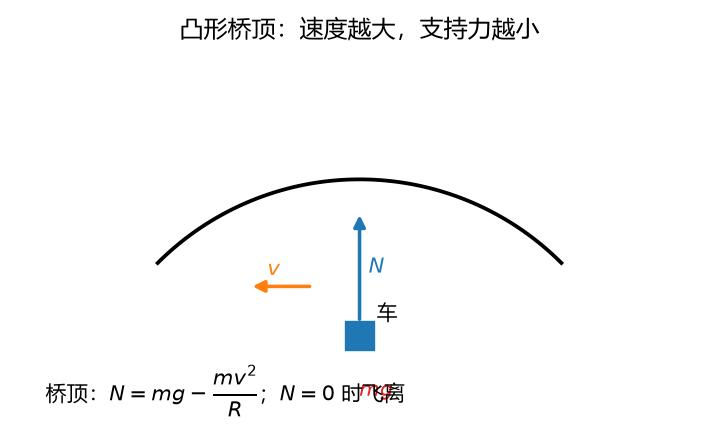
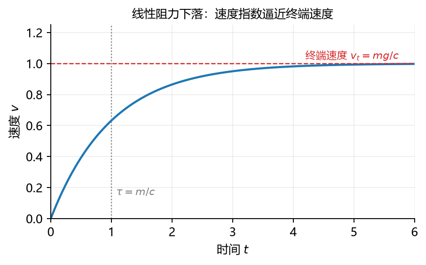

# 第 10 讲：质点动力学——牛二与两类问题

> 前置：第 01–05 讲（受力图、摩擦）+ 第 06–09 讲（运动学全套——"怎么动"的工具箱）｜ 预计投入：3.5–4.5 小时
> 本讲回答什么问题：运动学答完了"怎么动"，现在回答"**为什么这么动**"——力与运动怎么定量挂钩？为什么有的题"求导就完"、有的题要积分还得盯死初始条件？

> **本讲目标（学完你能）：**
> 1. 给一道质点动力学题，能判类（第一类知运动求力 / 第二类知力求运动）、画受力图（L01）、选对坐标形式（直角/自然）列出运动微分方程；
> 2. 第一类问题能解（运动学全套 + 乘质量）；第二类问题能**积分求解**——含初始条件的完整解（常力、线性阻力两大类讲透）；
> 3. 知道解析解失效时（如 $v^2$ 阻力）走数值积分路线，并且知道**怎么检验数值解可信**（对照解析基准 / 收敛阶）。
>
> 目标达成 = 文末"掌握度自测"全打勾。

> **怎么学这一讲：** 先看两个开场例（电梯体重秤 + 跳伞员的终端速度——两类问题各一）→ 牛顿三定律的"大学版"（重点惯性系）→ 运动微分方程三种形式 → 第一类问题（求导方向，两例）→ 第二类问题（积分方向，两例+数值路线）→ 总装流程 → 数值验证 → 作业。本讲数值结论有归档脚本可复跑（`scripts/lec10-01_verify_particle_dynamics.py`，见 §6）。

## 0. 开场：力回到牌桌

前四讲我们把力"请出场"了——运动学只描述运动，不问原因。现在把力请回来，让它和 L06–L09 的全套工具**对接**。对接的接口只有一条方程（牛顿第二定律），但威力覆盖整个动力学篇。先看它管的两类活儿——**本讲全部内容就是这两类问题的方法论**：

### 0.1 例 A：电梯里的体重秤（第一类：知运动求力）

你站在电梯的体重秤上（$m = 80$ kg），电梯以 $2$ m/s² **向上加速**——秤的读数是多少？

运动告诉你加速度（$\mathbf{a} = 2\,\text{m/s}^2$ 竖直向上），力里有一个未知（秤的法向反力 $N$）。**已知运动、求力**——这类问题叫**第一类问题**，方向是"求导"（加速度已知，力直接算出来）：

$$N - mg = ma \;\Rightarrow\; N = m(g + a) = 80\times(9.8 + 2) = 944\ \text{N}\ (\text{秤"显示" } 96.3\ \text{kg})$$

电梯加速**上行**你变"重"（超重），加速**下行**则 $N = 80\times(9.8-2) = 624$ N（失重，显示 63.7 kg）——**秤称的从来不是你的质量，是它给你的法向力**（视重）。质量 80 kg 一步没变。

### 0.2 例 B：跳伞员能落多快（第二类：知力求运动）

跳伞员（$m = 80$ kg）张开伞后受重力 $mg$ 与空气阻力（伞张开后近似线性 $F_d = k v$，$k$ 待定）。设计要求：**终端速度**（匀速下落的稳定速度）为 5 m/s。问：他跳出后多久"稳"下来、期间下落多远？

**已知力、求运动**——**第二类问题**，方向是"积分"（力给加速度、加速度要积成速度和位置）。本讲学完你能交出（§4.3 完整推导）：

| 量 | 结果 |
| --- | --- |
| 阻力系数（按终端速度反推） | $k = mg/v_t = 156.8$ N·s/m |
| 特征时间 | $\tau = m/k = 0.510$ s |
| 速度 $v(t)$ | $v_t\,(1 - e^{-t/\tau})$——指数逼近终端速度 |
| 到 95% 终端速度 | $t = 3\tau = 1.53$ s |
| 期间下落 | $y = v_t t - v_t\tau(1-e^{-t/\tau}) = 5.23$ m |

两类问题的分工一眼可见：**第一类是"翻译"（运动 → 力），第二类是"求解"（力 → 运动的微分方程 + 初始条件）**——后者难一个量级，也是动力学的主战场。

### 0.3 路线

§1 牛顿三定律的大学版（惯性系！）→ §2 运动微分方程的三种形式与两类问题总表 → §3 第一类问题（例 1 电梯、例 2 拱桥——自然坐标形式亮相）→ §4 第二类问题（例 3 抛体、例 4 跳伞——分离变量转正、$v^2$ 阻力走数值）→ §5 总装流程与量纲校验 → §6 数值验证（含欧拉 vs RK4 的收敛阶体检）→ 收尾。

## 1. 牛顿三定律的大学版

三条定律高中都见过，这里逐条做"大学升级"——每条只加一句以前没挑明的话：

### 1.1 第一定律（惯性定律）+ 升级句：它定义了惯性系

不受力（或合力为零）的质点保持静止或匀速直线运动。

**升级句**：这条定律的真正作用是**定义"惯性参考系"**——存在一类参考系，在其中"不受力的物体不加速"；牛二**只在这类系里成立**。地面系是不是惯性系？**近似是**（地球自转的效应小到日常可忽略，但 L08 §4.5 的河流冲岸、落体偏东就是"地面系不严格惯性"的证据——严格处理是 L11 的活儿）。本课程默认地面系近似惯性系。

### 1.2 第二定律 + 升级句：它的适用边界

$$\mathbf{F}_{合} = m\,\mathbf{a}$$

**升级句**：①只在**惯性系**成立（非惯性系要用改造版，L11）；②适用于**质点**（或平移刚体的质心——L12 展开）；③低速宏观（接近光速或原子尺度，牛二让位于相对论/量子力学——工程力学不涉）。

**质量 $m$ 的身份**：惯性的度量——同样的力，质量大的加速小（难推动）。注意与**重量** $G = mg$ 的区分：质量是标量、不随地点变；重量是力（引力）、随 $g$ 变（月球上 $g = 1.62$，80 kg 的人重量从 784 N 掉到 130 N，质量纹丝不动）。天平测质量（对比法）、体重秤测的是法向力（视重）。

### 1.3 第三定律 + 升级句：它在动力学里的角色

作用与反作用：等值、反向、共线、**作用在两个物体上**（L01 已用熟）。

**升级句**：动力学的"内力定理"全靠它——L12 将证明**质点系内力成对抵消、不改变系统总动量**；它也是"牛二为什么不能把 ma 挪到左边当第三个力"的根源（见 §2.1 的书写纪律）。

## 2. 质点运动微分方程：三种形式与两类问题

### 2.1 基本形式与书写纪律

$$\boxed{\;m\,\mathbf{a} = \sum\mathbf{F}_i\;}$$

写成 $m\mathbf{a} = \sum\mathbf{F}$（质量 × 加速度 = 合力）而不是 $\sum\mathbf{F} + (-m\mathbf{a}) = 0$，是有讲究的：**$m\mathbf{a}$ 不是力**，是"运动一侧"的量；$\mathbf{F}_i$ 才是物理的力（能在受力图上画出来的）。若把 $-m\mathbf{a}$ 画进受力图当"力"用，就混入了**假想力**的记法——那是 L11 非惯性系的合法操作，在惯性系里是记错。（"惯性力"这个词到 L11 才正式引入，现在先立此规矩。）

### 2.2 直角坐标形式

矢量方程投影到坐标轴（L01 的分量纪律动力学版）：

$$\boxed{\;m\ddot{x} = \sum F_x,\qquad m\ddot{y} = \sum F_y\;}$$

**适用场景**：轨迹未知或力沿固定方向（重力、弹簧沿坐标轴）——每个方程独立、好积。

### 2.3 自然坐标形式（轨迹已知时的向心项）

点沿已知轨迹运动（L06 自然法），把方程投影到切向 $\boldsymbol{\tau}$、法向 $\mathbf{n}$：

$$\boxed{\;m\,a_t = \sum F_t\ (\text{切向：管快慢}),\qquad m\,\frac{v^2}{\rho} = \sum F_n\ (\text{法向：管向心})\;}$$

**适用场景**：轨迹已知（圆周、拱桥、弯道）——法向方程直接把"向心需求"（$mv^2/\rho$）和"法向力供给"（正压力、张力沿绳分量）核对。第 09 讲之前你算的是"运动学的 $a_n$"；从本讲起它有了物理身份——**它乘上质量就是法向合力的值**。

### 2.4 两类问题总表（本讲的地图）

| | 第一类：知运动求力 | 第二类：知力求运动 |
| --- | --- | --- |
| 已知 | 运动方程 / 加速度 / 速度变化 | 受力（各力的规律） |
| 数学方向 | **求导**（L06 正向问题的动力学版） | **积分**（L06 逆问题转正） |
| 难度 | 低——"翻译" | 高——**微分方程 + 初始条件** |
| 典型 | 电梯秤、拱桥、圆周求力 | 抛体、阻力下落、振动（L20） |
| 注意 | 加速度要从运动学老老实实算出 | 初始条件是命根子（§4.1） |

## 3. 第一类问题：知运动求力

### 3.1 流程

$$\text{运动学全套（L06–L09 算出 }\mathbf{a}\text{）} \;\xrightarrow{\times m}\; \sum\mathbf{F} \;\xrightarrow{\text{已知力逐一减去}}\; \text{未知力}$$

三步全是熟活：运动学的关系算 $\mathbf{a}$，乘质量得合力，把已知的力（重力、给定力）从合力里"减"掉就是待求力。

### 3.2 例 1：电梯体重秤（开场例 A 的规范解法）

**题目**：$m = 80$ kg，电梯以 $a = 2$ m/s² 加速上行。求秤的读数。

**第 1 步（对象+受力图）**：人（质点）；受力 = 重力 $mg$（下）+ 秤法向力 $N$（上）。
**第 2 步（坐标+方程）**：竖直向上为正，$m a = N - mg$：

$$N = m(g + a) = 80\times 11.8 = 944\ \text{N}$$

**答**：944 N（秤显示 96.3 kg——视重）。匀速段 $a = 0$：$N = mg = 784$ N（78.4 kg，"正常"）；加速下行 $a = -2$：$N = 624$ N。**视重 = $m(g+a)$**，一行公式吃下超重失重的全部情形（$a = -g$ 时 $N = 0$——自由落体的完全失重，航天训练的抛物线飞行就飞这条线）。

### 3.3 例 2：汽车过拱桥（自然坐标形式的亮相）

**题目**：汽车 $m = 1500$ kg 以 $v = 72$ km/h（= 20 m/s）驶过半径 $R = 50$ m 的圆弧拱桥**顶部**。求桥面法向反力 $N$；并问车速多大时车会"飞离"桥面。

**受力图**：重力 $mg$（下）+ 桥面法向力 $N$（上，桥顶处竖直）。**运动**：轨迹已知（圆弧）——自然坐标形式。桥顶处曲率中心（圆心）在**下方**，$\mathbf{n}$ 指向下：

$$\text{法向：}\quad m\,\frac{v^2}{R} = mg - N$$

$$N = m\left(g - \frac{v^2}{R}\right) = 1500\times(9.8 - 8.0) = 2700\ \text{N}$$

车重 $mg = 14700$ N——桥顶时车对桥面的压力只剩 **18.4%**（失重）；"离心趋势"不是玄学，就是 $mv^2/R$ 这个向心项在跟法向力对照。**飞离条件**（$N = 0$）：

$$v = \sqrt{gR} = \sqrt{9.8\times 50} = 22.14\ \text{m/s} = 79.7\ \text{km/h}$$

超过这个速度，桥面"供不起"向心需求，车轮与桥面脱离（约束失效，轨迹改抛物线）——拱桥限速的力学根据。



**图 L10-1**：凸形桥顶：支持力 $N=mg-mv^2/R$，速度越大 $N$ 越小；$N=0$ 时车飞离桥面。这是牛二法向方程的直接应用，也是“失重”的定量版本。

## 4. 第二类问题：知力求运动

### 4.1 总流程与初始条件的"命根子"地位

$$\text{受力图} \to \text{微分方程 }（m\ddot{x} = \sum F） \to \text{积分} \to \text{运动方程（含积分常数）} \xrightarrow{\text{初始条件钉常数}} \text{唯一解}$$

**初始条件**（$t=0$ 的位置与速度）决定**一族解里的哪一个**——L06 §5.1 积分常数的动力学身份。没有初始条件的"解"只是解族，工程上等于没解。第二类问题的标准事故：解出 $v = v_0 + at$ 却没交代 $v_0$ 哪来的。

### 4.2 例 3：抛体（第二类的"入门款"）

**题目**：$v_0 = 20$ m/s、仰角 $30°$、忽略空气阻力。求运动方程、射程、飞行时间、峰高。

**受力图**：只受重力 $mg$（下）——最干净的力环境。**方程**（直角坐标，x 水平、y 上）：

$$m\ddot{x} = 0,\qquad m\ddot{y} = -mg$$

**积分**（初始条件：$x_0 = y_0 = 0$、$v_{x0} = 20\cos 30°$、$v_{y0} = 20\sin 30°$）：两次积分（L06 §5.2 的匀变速流程）：

$$x = v_0\cos\theta\,t,\qquad y = v_0\sin\theta\,t - \frac{1}{2}g t^2$$

**三个指纹**（高中公式的牛二推导版——现在你知道它们从哪来）：

- 飞行时间：$y = 0 \Rightarrow t = \dfrac{2v_0\sin\theta}{g} = \dfrac{2\times 20\times 0.5}{9.8} = 2.04$ s；
- 射程：$x(t_{飞}) = \dfrac{v_0^2\sin 2\theta}{g} = \dfrac{400\times 0.866}{9.8} = 35.4$ m；
- 峰高：$\dfrac{v_0^2\sin^2\theta}{2g} = \dfrac{100}{19.6} = 5.10$ m。

### 4.3 例 4：线性阻力下落（分离变量转正主力）

**题目**：跳伞员 $m = 80$ kg，张伞后阻力 $F_d = k v$（$k$ 待定），设计终端速度 $v_t = 5$ m/s。取向下为正，求 $v(t)$ 与"到达 95% 终端速度"的时间、下落距离。

**第 1 步（方程）**：

$$m\,\dot{v} = mg - k v$$

**第 2 步（定性预判）**：$v = 0$ 时 $\dot v = g$（起步自由落体）；$v = mg/k$ 时 $\dot v = 0$（匀速）——这个"让加速度归零的速度"就是**终端速度** $v_t = mg/k$。解出 $k$：

$$k = \frac{mg}{v_t} = \frac{80\times 9.8}{5} = 156.8\ \text{N·s/m}$$

**第 3 步（分离变量积分——L06 §5.3 的工具正式转正）**：$\dfrac{\mathrm{d}v}{g - (k/m)v} = \mathrm{d}t$。令 $\tau = m/k = 0.510$ s（**特征时间**）：

$$\int_0^v \frac{\mathrm{d}v'}{g - v'/\tau} = t \;\Rightarrow\; \ln\frac{g - v/\tau}{g} = -\frac{t}{\tau} \;\Rightarrow\; \boxed{\;v(t) = v_t\,(1 - e^{-t/\tau})\;}$$

**第 4 步（读数）**：

- 95% 终端速度：$1 - e^{-t/\tau} = 0.95 \Rightarrow t = \tau\ln 20 = 3\tau = 1.53$ s；
- 下落距离（再积分一次）：$y(t) = v_t\,t - v_t\tau\,(1 - e^{-t/\tau})$，代 $t = 1.53$ s：$y = 7.65 - 2.42 = 5.23$ m。

**物理图景**：速度**指数逼近**终端速度——理论上永不到达、工程上 $3\tau$ 就算"到了"（95%）。$\tau = m/k$ 小（轻物/大阻力）就"秒稳"，$\tau$ 大（重物/小阻力）则缓慢滑向匀速。这个"指数逼近稳态"的模式是 L20 阻尼振动的原型。

### 4.4 当解析解不存在：$v^2$ 阻力与数值路线

真实空气阻力更接近 $F_d = c v^2$（速度平方）。方程 $m\dot v = mg - c v^2$ 照样可分离变量，但积分出来含**双曲正切** $\tanh$（认识即可：形似 $\frac{e^x - e^{-x}}{e^x + e^{-x}}$ 的函数，行为"压缩到 ±1"）——考试主线用线性阻力，$v^2$ 型记两条：**终端速度依然存在**（$v_t = \sqrt{mg/c}$，令 $\dot v = 0$）且**数值积分随时能解**（§6 实验 3 就干这个）。

更一般的情形（力随位置/速度/时间任意变化、多方向耦合）解析解基本没有——**数值积分（欧拉、RK4）是动力学的常规方法**，"会列方程 + 会数值求解 + 会检验可信度"是本讲交付的三件套。检验纪律在 §6（含收敛阶实证：误差按 $\mathrm{d}t$ 的几次幂衰减，是数值方法的"等级证"）。



**图 L10-2**：线性阻力下落：$v(t)=v_t(1-e^{-t/\tau})$，终端速度 $v_t=mg/c$，时间常数 $\tau=m/c$。速度先快后慢地逼近终端值，不会越过它。

## 5. 总装流程与量纲校验

### 5.1 质点动力学解题五步（全课程通用骨架）

$$\text{①取对象（质点/质心）} \to \text{②受力图（L01 原班纪律）} \to \text{③判运动形态、选坐标形式} \to \text{④列方程（投影）} \to \text{⑤求解 + 校验}$$

各步的"弹药来源"：①②静力学篇（L01 受力图、L05 摩擦三态）；③运动学篇（L06 三法、L07–L09 刚体形态）；④本讲的微分方程；⑤第一类直接代数、第二类积分（或数值）。**动力学 = 静力学的受力图 + 运动学的加速度 + 一条牛二**——前九讲的所有装备在此合体。

### 5.2 单位制与量纲（收尾校验器）

SI 基本量：质量 kg、长度 m、时间 s。**力的单位是导出的**：使 1 kg 产生 1 m/s² 的力叫 1 牛顿（N = kg·m/s²）——"牛顿"不是基本单位，是 $ma$ 的量纲组合。

**量纲检查**（解题最后一道关卡）：等式两边每个 [M][L][T] 幂次必须相同。快速示范：

| 量 | 量纲 | 检查 |
| --- | --- | --- |
| $mv^2/\rho$ | $\text{kg}\cdot\text{m/s}^2 = \text{N}$ | 法向方程左边是力 ✓（若写成 $v^2/\rho$ 就只是加速度——**忘乘 $m$** 是高发量纲事故） |
| 线性阻力系数 $k$（$kv$ 是力） | $\text{N}\cdot\text{s/m} = \text{kg/s}$ | 例 4 的 156.8 N·s/m ✓ |
| 平方阻力系数 $c$（$cv^2$ 是力） | $\text{N}\cdot\text{s}^2/\text{m}^2 = \text{kg/m}$ | §6 实验 3 的 31.36 ✓ |

**理解层次**：量纲检查**要会用**（每次列完方程 30 秒扫一遍——它抓不住系数错误，但抓得住结构性错误）。

## 6. 数值验证：微分方程的数值积分 vs 解析解

脚本 `scripts/lec10-01_verify_particle_dynamics.py`（**规模纪律：目标 < 1 秒，纯 numpy**）。工具两件：**欧拉法**（L06 §7 老朋友，一阶精度 $O(\mathrm{d}t)$）；**RK4（四阶龙格-库塔）**——工程默认的常微分方程解法：一步内对斜率采样四次加权平均，全局误差 $O(\mathrm{d}t^4)$。本讲把 RK4 当**黑盒**用（怎么采样不展开），但它的工作许可证要在实验 4 里**用误差衰减数据发**。

| 实验 | 验证什么 | 设计 |
| --- | --- | --- |
| 1 | 例 3 抛体：数值 vs 解析 | $t = 1$ s 处 $x, y$：欧拉 / RK4 / 解析三方 |
| 2 | 例 4 跳伞：数值 vs 解析 | $t = 1.53$ s 处 $v, y$（$v_t = 5$、$\tau = 0.510$） |
| 3 | $v^2$ 阻力：数值 vs $\tanh$ 解析 | $v_t = 5$（$c = mg/v_t^2$）、$t = 1.53$ s |
| 4 | **收敛阶体检**：欧拉 $O(\mathrm{d}t)$ vs RK4 $O(\mathrm{d}t^4)$ | 线性阻力问题 $v(1$ s$)$，$\mathrm{d}t \in \{0.1, 0.01, 0.001\}$：误差缩放倍数实证 |
| 5 | 例 2 拱桥：$N(v)$ 扫描与飞离点 | $v$ 扫 $0$–$25$ m/s、数值找 $N = 0$ 过零 vs 解析 $\sqrt{gR}$ |

**实测输出**（2026-09-25 实跑原文）：

```
================================================================
L10 particle dynamics verification
================================================================
[Exp 1] projectile (v0=20 m/s, 30 deg): numeric vs analytic at t=1 s
  analytic:  x = 17.3205, y = 5.1000
  Euler  (dt=1e-3): x = 17.3205, y = 5.1049  (err 4.9e-03)
  RK4    (dt=1e-3): x = 17.3205, y = 5.1000  (err 9.8e-14)  PASS
[Exp 2] skydiver linear drag (v_t=5, tau=0.510): t=1.53 s
  analytic:  v = 4.7508, y = 5.2261
  Euler  (dt=1e-4): v = 4.7508, y = 5.2261  (v err 7.3e-05)
  RK4    (dt=1e-3): v = 4.7508, y = 5.2261  PASS
[Exp 3] quadratic drag (v_t=5): t=1.53 s
  analytic (tanh): v = 4.9752
  RK4    (dt=1e-3): v = 4.9752  PASS
  note: quadratic drag reaches 99.5% of v_t at t=1.53 s (linear: 95.0%)
[Exp 4] convergence order check: v(1 s) of linear-drag fall, err vs dt
  dt=0.100: Euler err=1.40e-01, RK4 err=2.00e-05
  dt=0.010: Euler err=1.36e-02, RK4 err=1.73e-09
  dt=0.001: Euler err=1.35e-03, RK4 err=1.67e-13
  Euler ratios: 10.3, 10.0 -> order ~1
  RK4   ratios: 1.2e+04, 1.0e+04 -> order ~4 (float floor)
  PASS: Euler order 1, RK4 order 4 (empirical)
[Exp 5] hump bridge N(v) scan (m=1500, R=50)
  N at v=20 m/s: 2700.0 N (analytic 2700.0)  PASS
  numeric liftoff speed: 22.136 m/s vs sqrt(gR)=22.136  PASS
OVERALL: ALL PASS
```

**一个诚实的修正（积分终点没对齐网格）**：初版脚本把实验 2/3 的考察时刻取成精确的 $3\tau = 1.5306$ s——它**不是** $\mathrm{d}t = 10^{-3}$ s 的整数倍，积分器 round 成 1531 步、实际积到 1.531 s。多积的 0.4 ms 给 RK4 凭空记上 $\sim 2\times10^{-4}$ 的"假误差"，把 1e-8 判据打挂、两个实验 FAIL。修正：$t$ 取网格对齐的 1.53 s（正文例 4 的 5.23 m 在两种取法下四舍五入相同——5.229 与 5.226 都进位成 5.23）。这是"**落点要对齐**"坑族的第三次变体：L07 的差分落点时刻、L09 的死点索引、本讲的积分终点——**凡是"数值网格"和"理论时刻"打交道的地方，先问整除不整除**。另：预写输出块的多个误差数字（欧拉 2.07e-02 系列等）为拍估、已按实测整块回填。

三个读点：① 例 1–例 4 的讲义数字全部被数值复算（跳伞 4.75 m/s / 5.23 m、拱桥 2700 N、飞离 22.14 m/s）；② **实验 4 是本讲数值教育的核心**：$\mathrm{d}t$ 缩 10 倍，欧拉误差精确缩 10 倍（一阶）、RK4 缩约 $10^4$ 倍（四阶，直至浮点地板）——"误差阶"不是说明书上的宣称，是**扫出来的事实**；③ $v^2$ 阻力到 99.5% 终端速度比线性阻力到 95% 还快（同 $v_t$ 下低速段阻力更小、加速更猛）——两种阻力模型的特点差异，工程选型时有感。

## 7. 常见错误清单（对答案，校准感觉）

> 本节零新知识，逐条对应正文小节。

| # | 错误 | 为什么错 | 锚定 |
| --- | --- | --- | --- |
| 1 | 把 $-m\mathbf{a}$ 画进受力图当第三个力 | $m\mathbf{a}$ 是运动侧的量，不是力；惯性系里受力图只画真实的力（惯性力是 L11 非惯性系的合法记法） | §2.1 |
| 2 | 在加速参考系里直接用牛二 | 牛二只认惯性系；加速系需改造（L11） | §1.1/§1.2 |
| 3 | 第二类问题不写初始条件 | 积分给一族解，初始条件钉出唯一的那一个 | §4.1 |
| 4 | 质量、重量混说（"80 kg 重"） | kg 是质量单位、N 是力单位；秤显示的 kg 是**视重**换算 | §1.2/例 1 |
| 5 | 法向方程符号套错（拱桥 $\pm$） | $\mathbf{n}$ 指凹侧——拱桥 n 朝下（$mg - N$）、凹桥 n 朝上（$N - mg$），每题画图定 | 例 2 |
| 6 | "速度大所以受力大" | 牛二联的是**加速度**；匀速圆周速度大但切向力为零 | §1.2 |
| 7 | 终端速度记成 $k/m$ | $v_t = mg/k$（力平衡解出）；$\tau = m/k$ 才是含 $k$ 在分母的量 | §4.3 |
| 8 | $mv^2/\rho$ 忘乘质量 | 量纲立刻暴露（m/s² ≠ N）；量纲检查是最后一道关卡 | §5.2 |
| 9 | 数值解没有可信度依据 | 必须对照解析基准、或做收敛检查（dt 加密看解稳不稳） | §4.4/§6 |
| 10 | 抛体 x、y 方程写成耦合 | 重力只在 y 方向，x 方向无力——两方程独立（坐标分解的意义） | 例 3 |

## 8. 本讲小结（一页骨架）

- **牛二**：$m\mathbf{a} = \sum\mathbf{F}$（惯性系、质点、低速宏观）；$m\mathbf{a}$ 不是力（书写纪律）；质量=惯性度量（不变），重量 $G = mg$（随 $g$ 变）。
- **三种形式**：矢量（总纲）、直角坐标（$m\ddot{x} = \sum F_x$，轨迹未知/力沿固定方向）、自然坐标（$m a_t = \sum F_t$、$mv^2/\rho = \sum F_n$，轨迹已知——向心项有了物理身份）。
- **两类问题**：第一类知运动求力（求导——运动学全套 × m；视重 $m(g+a)$、拱桥 $N = m(g - v^2/R)$、飞离 $\sqrt{gR}$）；第二类知力求运动（积分 + **初始条件命根子**）。
- **第二类两大件**：抛体（高中公式的牛二来历）；线性阻力（$v_t = mg/k$、$\tau = m/k$、$v = v_t(1-e^{-t/\tau})$ 指数逼近——L20 阻尼振动原型）；$v^2$ 阻力（$v_t = \sqrt{mg/c}$、tanh 认识即可、数值路线随时可用）。
- **数值方法**：欧拉 $O(\mathrm{d}t)$、RK4 $O(\mathrm{d}t^4)$（黑盒 + 误差阶实证）；检验纪律 = 对照解析基准 / 收敛扫描。
- **五步流程**：对象 → 受力图（L01）→ 判形选坐标（L06–L09）→ 方程 → 解 + 量纲校验。
- **下一讲**：牛二只认惯性系——**加速的车厢、旋转的转盘里怎么办**？L11 正式引入惯性力（牵连惯性力 + 科氏惯性力，L08 的科氏加速度换个身份回来）。

## 9. 掌握度自测（行为化清单，全部打勾才算讲过）

- [ ] 我能背出牛二的适用边界（惯性系/质点/低速宏观），并说出第一定律的真正作用（定义惯性系）
- [ ] 我能解释为什么 $-m\mathbf{a}$ 不能画进受力图（以及谁在什么场合可以画）
- [ ] 给轨迹已知的题（圆弧/弯道），我能列自然坐标形式的方程并说法向方程在"对什么"
- [ ] 视重一行式 $m(g+a)$ 我能现场推出（含自由落体 $N=0$ 的特例）
- [ ] 线性阻力问题我能从方程一路推到 $v = v_t(1-e^{-t/\tau})$，并说清 $v_t$、$\tau$ 各由什么决定
- [ ] 我能说出第二类问题缺初始条件时的后果（解族而非解）
- [ ] 量纲检查我会在每个方程列完后扫一遍（能抓结构错误、抓不住系数错误）
- [ ] 欧拉与 RK4 的精度阶我能说出（一阶/四阶），并且知道这"阶"该怎么用实验证实（dt 扫描看误差缩放）

## 10. 作业（先独立做，再看参考答案——答案只用本讲内容）

**题 1（判断，每小题答"对/错" + 一句理由）**
(a) 牛顿第二定律在非惯性参考系中不成立。
(b) 质点速度越大，所受合力一定越大。
(c) 质点作匀速圆周运动时，合力必指向圆心。
(d) 第二类问题在没有初始条件时解不唯一。
(e) 线性阻力下落的物体在有限时间内严格达到终端速度。

**参考答案：**
(a) **对**。牛二只适用于惯性系（§1.1）；非惯性系要加惯性力改造（L11）。
(b) **错**。牛二联的是加速度——匀速（无论多快）合力为零（§1.2）。
(c) **对**。匀速圆周 $a_t = 0$ → 切向无力；全部加速度是法向的，合力必过圆心（§2.3）。变速圆周则不然（有切向分量）。
(d) **对**。积分给一族含常数的解，初始条件负责选出一个（§4.1）。
(e) **错**。$v = v_t(1-e^{-t/\tau})$ 是**渐近**逼近——数学上永不到达；工程上 $3\tau$（95%）即视为"达到"（§4.3）。

**题 2** 体重秤上 $m = 60$ kg 的人，电梯分别以 $1.5$ m/s² 加速上行、匀速、以 $1.5$ m/s² 加速下行。求三种情形的秤读数（N 与"kg 显示"）。

**参考答案：**
上行加速：$N = 60\times(9.8+1.5) = 678$ N（显示 69.2 kg，超重）；匀速：$N = 588$ N（60.0 kg）；下行加速：$N = 60\times(9.8-1.5) = 498$ N（50.8 kg，失重）。一行式 $N = m(g \pm a)$ 全覆盖。

**题 3** 汽车 $m = 1200$ kg 以 $54$ km/h（15 m/s）通过半径 $R = 40$ m 的拱桥顶。求桥面反力；并求飞离速度。

**参考答案：**
$a_n = v^2/R = 225/40 = 5.63$ m/s²。法向（n 指向圆心=向下）：$m v^2/R = mg - N$：
$N = 1200\times(9.8 - 5.63) = 1200\times 4.175 = 5010$ N（车重 11760 N，桥顶只剩 42.6%）。
飞离：$N = 0 \Rightarrow v = \sqrt{gR} = \sqrt{392} = 19.8$ m/s $= 71.3$ km/h。

**题 4** 抛体 $v_0 = 30$ m/s、仰角 $45°$。求射程、飞行时间、峰高。

**参考答案：**
飞行时间 $t = 2v_0\sin\theta/g = 2\times 30\times 0.707/9.8 = 4.33$ s；射程 $= v_0^2\sin 2\theta/g = 900/9.8 = 91.8$ m（$45°$ 恰好 $\sin 2\theta = 1$，同速度下射程最大）；峰高 $= v_0^2\sin^2\theta/(2g) = 450/19.6 = 22.96$ m。

**题 5** 张伞后的跳伞员 $m = 70$ kg，阻力 $F_d = 343\,v$（N）。求终端速度、特征时间、达到 99% 终端速度的时间与下落距离。

**参考答案：**
$v_t = mg/k = 70\times 9.8/343 = 2.0$ m/s；$\tau = m/k = 70/343 = 0.204$ s。
99%：$1 - e^{-t/\tau} = 0.99 \Rightarrow t = \tau\ln 100 = 0.204\times 4.605 = 0.939$ s。
下落：$y = v_t t - v_t\tau(1-e^{-t/\tau}) = 2\times 0.939 - 2\times 0.204\times 0.99 = 1.878 - 0.404 = 1.47$ m。

**题 6** 物块 $m = 10$ kg 沿 $30°$ 光滑程度一般的斜面下滑（摩擦系数 $f = 0.2$），从静止开始。求加速度、2 s 末的速度与滑行距离。

**参考答案：**
沿斜面方向（下滑为正）：$ma = mg\sin 30° - f\,mg\cos 30°$（法向 $N = mg\cos 30°$，摩擦 $= fN$）：
$a = g(\sin 30° - 0.2\cos 30°) = 9.8\times(0.5 - 0.173) = 3.20$ m/s²。
2 s 末：$v = at = 6.40$ m/s；滑行 $s = \frac{1}{2}at^2 = 6.40$ m。
（结构：先由力求加速度——第二类的"恒力简化版"；再积分得运动。斜面 + 摩擦是 L05 与本讲的标准接口。）

**题 7（代码题）** 用欧拉与 RK4（各 $\mathrm{d}t = 0.01$ s）解例 4 的跳伞方程（$m = 80$、$v_t = 5$），到 $t = 1$ s，与解析解 $v = v_t(1 - e^{-t/\tau})$ 对照。参考骨架（补全后运行）：

```python
import numpy as np

m, g, vt = 80.0, 9.8, 5.0
k = m * g / vt
tau = m / k

def f(t, s):                      # s = [y, v];  s' = [v, g - (k/m) v]
    return np.array([s[1], g - (k / m) * s[1]])

def integrate(method, dt, t_end):
    s = np.array([0.0, 0.0])
    t = 0.0
    n = int(round(t_end / dt))
    for _ in range(n):
        if method == "euler":
            s = s + dt * f(t, s)
        else:                      # rk4
            k1 = f(t, s)
            k2 = f(t + dt / 2, s + dt / 2 * k1)
            k3 = f(t + dt / 2, s + dt / 2 * k2)
            k4 = f(t + dt, s + dt * k3)
            s = s + dt / 6 * (k1 + 2 * k2 + 2 * k3 + k4)
        t += dt
    return s

for name in ("euler", "rk4"):
    s = integrate(name, 0.01, 1.0)
    print("%s: v(1) = %.6f" % (name, s[1]))
print("analytic: v(1) = %.6f" % (vt * (1 - np.exp(-1.0 / tau))))
```

**参考答案：** 运行输出：`euler: v(1) = 4.292736`、`rk4: v(1) = 4.296145`、`analytic: v(1) = 4.296145`（解析值 $v(1) = 5(1 - e^{-1/0.510}) = 5(1-0.1408) = 4.296$）。RK4 与解析**六位小数全同**（$\mathrm{d}t = 0.01$ 的四阶误差 $\sim 10^{-9}$，被打印精度掩盖）；欧拉差 $3.4\times10^{-3}$（一阶误差 $\approx g_{有效}\,\mathrm{d}t\,t/2$ 量级——与 §6 实验 4 的缩放规律一致）。要点：RK4 的骨架就是"四次采样斜率加权平均"，状态向量 $\mathbf{s} = [y, v]$ 把二阶方程拆成一阶方程组的标准做法（**所有**高阶微分方程数值解的第一步都是这个降阶）。
