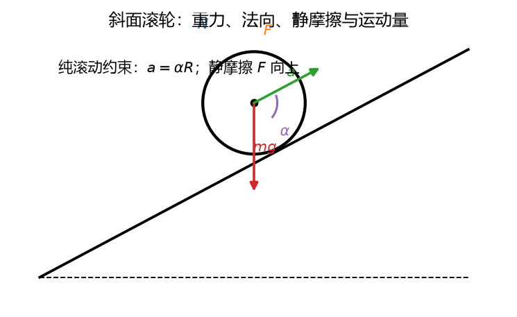
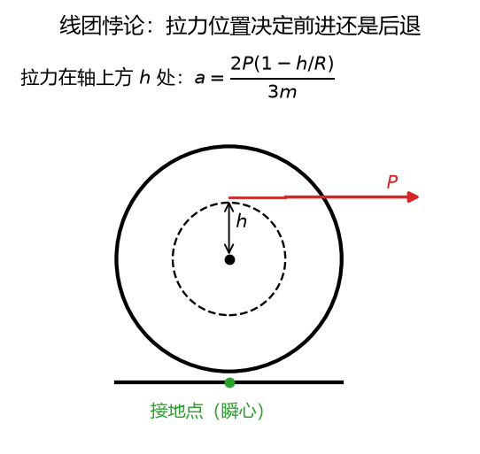

# 第 14 讲：动量矩定理（下）——相对质心与平面运动

> 前置：第 13 讲（动量矩定理、"固定轴"前提与质心轴"幸运特例"预告）+ 第 12 讲（质心运动定理）+ 第 09 讲（平面运动分解、基点法）｜ 预计投入：4–5 小时（动力学篇的合体大招）
> 本讲回答什么问题：质心轴明明在动，动量矩定理凭什么还能用？对"随便一个动点"为什么就**不能**用？**又平又转**的刚体（滚动的轮子）动力学方程长什么样？为什么从上方拉毛线团，它反而**滚向你**？

> **本讲目标（学完你能）：**
> 1. 说清**相对质心的动量矩定理**为什么成立（质心平移系的推导）、对"一般动点"为什么失效（多出的耦合项长什么样）；
> 2. 用**刚体平面运动微分方程**三件套（$x$、$y$、$\varphi$）+ 纯滚动约束解动力学问题（含摩擦方向未知、摩擦下限校验、多体级联）；
> 3. 能解三道典型题：斜面纯滚动圆轮（加速度与半径无关）、毛线团悖论（拉力方向控制滚向）、物块-滑轮-滚动圆柱级联系统。
>
> 目标达成 = 文末"掌握度自测"全打勾。

> **怎么学这一讲：** 先看悖论开场（拉毛线团它滚向你）→ 质心轴的"运气"分析（含一般动点的坑）→ 三件套方程 → 纯滚动约束怎么进方程（两道典型例题）→ 多体级联 → 数值验证 → 作业。本讲数值结论有归档脚本可复跑（`scripts/lec14-01_verify_planar_dynamics.py`，见 §5）。

## 0. 开场：拉毛线团，它滚向你

毛线团躺在桌上、线头从团**上方**引出。你捏住线头水平一拉——直觉说线团**顺着拉力滚走**；实际它**滚向你**（顺时针倒转、一边放线一边逼近你的手）。

这不是魔术，是本讲主方程的一行代数：拉力作用点的高度 $h$ 与半径 $R$ 之比 $(1 - h/R)$ **控制滚动的方向**（§3.3 完整推导——同一个公式：过质心拉，$a = 3.33$ m/s² 前进；从顶上方拉，$a = -0.83$ m/s² **倒退**）。类似的还有：圆轮滚下坡的加速度**与轮子大小无关**（大轮小轮并驾齐驱）、纯滚动必须靠摩擦"帮忙"（没摩擦轮子只会打滑空转）——这些都来自本讲的三件套方程。

## 1. 相对质心的动量矩定理：质心轴的"运气"分析

### 1.1 为什么质心轴能用（推导）

L13 §2.3 立过规：动量矩定理**只对固定轴**有保障；质心轴跟着质心一起动、不是固定轴——却**恰好也能用**。运气在哪？看推导：

设质心 $C$ 相对定系原点 $O$ 的位矢为 $\mathbf{r}_C$，质点 $i$ 相对质心的位矢为 $\mathbf{r}_i'$（$\mathbf{r}_i = \mathbf{r}_C + \mathbf{r}_i'$）。对**固定点 $O$** 的动量矩（L13 定理成立）：

$$\mathbf{L}_O = \sum \mathbf{r}_i\times m_i\mathbf{v}_i = \mathbf{r}_C\times M\mathbf{v}_C + \sum \mathbf{r}_i'\times m_i\mathbf{v}_i' = \mathbf{r}_C\times M\mathbf{v}_C + \mathbf{L}_C$$

（拆开后用了 $\sum m_i\mathbf{r}_i' = M\mathbf{r}'_{C,\text{相对}C} = \mathbf{0}$——**质心的定义**让交叉项干净消失。这就是运气的一半。）对 $O$ 用定理并代入 L12 的质心运动定理 $M\mathbf{a}_C = \sum\mathbf{F}^{外}$：

$$\frac{\mathrm{d}\mathbf{L}_O}{\mathrm{d}t} = \sum\mathbf{M}_O^{外} = \mathbf{r}_C\times\sum\mathbf{F}^{外} + \frac{\mathrm{d}\mathbf{L}_C}{\mathrm{d}t}$$

左边导数（$\mathbf{v}_C\times M\mathbf{v}_C = \mathbf{0}$ 同类项抵消）恰好留出：

$$\boxed{\;\frac{\mathrm{d}\mathbf{L}_C}{\mathrm{d}t} = \sum\mathbf{M}_C^{外}\;}\qquad\text{（相对质心的动量矩定理——\textbf{质心怎么动都行}）}$$

**运气总结**：①质心定义让交叉项消失、②$\mathbf{v}_C\times M\mathbf{v}_C$ 自动为零、③质心运动定理恰好接走平移项——三份运气叠加，质心轴**不需要固定**。平面运动刚体的特例（$L_C = J_C\omega$）：

$$J_C\,\alpha = \sum M_C^{外}$$

（$J_C$：**过质心、垂直运动平面**的轴的转动惯量——L13 查表那根。）

### 1.2 一般动点的坑（多出的耦合项）

对一般动点 $O'$（位矢 $\mathbf{r}_{O'}$、速度 $\mathbf{v}_{O'}$），把同样的代数做一遍，多出一项**消不掉**的耦合：

$$\frac{\mathrm{d}\mathbf{L}_{O'}}{\mathrm{d}t} = \sum\mathbf{M}_{O'}^{外} - \mathbf{v}_{O'}\times M\,\mathbf{v}_C\ (\text{多出项，一般非零})$$

——对动点的动量矩导数 = 外矩 **减去** $\mathbf{v}_{O'}\times M\mathbf{v}_C$。这项为零的三种情形：

| 参考点 | $\mathbf{v}_{O'}\times M\mathbf{v}_C = 0$？ | 定理直接用？ |
| --- | --- | --- |
| 固定点（$\mathbf{v}_{O'} = \mathbf{0}$） | ✓ | ✓（L13 的原版） |
| **质心**（$\mathbf{v}_{O'} = \mathbf{v}_C$，平行叉乘为零） | ✓ | ✓（§1.1 的运气版） |
| 匀速动点且 $\mathbf{v}_{O'} \parallel \mathbf{v}_C$ 或某速为零 | 特殊对齐才 ✓ | 一般 ✗ |

**考试暗雷**：见到"对 A 点（某动点）用动量矩定理"的解法先问一句——A 是固定点还是质心？都不是，则此解**默认带着耦合项为零**，须单独验证（多数题不满足）。§5 实验 1 把这个坑用解析构造逐格分析（差项数值恰好等于 $-\mathbf{v}_{O'}\times M\mathbf{v}_C$）。

### 1.3 瞬心轴能不能抄近路（条件辨析）

**能，但有条件**：对瞬心 $P$（速度零点）用 $J_P\alpha = \sum M_P$ **当且仅当瞬心到质心的距离恒定**（此时 $P$ 的加速度恰好过质心、耦合项退化）。纯滚动圆柱：瞬心恒在接触点、距质心恒 $R$ ✓ **可用**——例 1 的斜面轮走瞬心轴一步出解（$J_P = J_C + mR^2 = \frac{3}{2}mR^2$、$M_P = mgR\sin\theta$，一步得 $\alpha$）。而一般平面运动（连杆、曲柄滑块的连杆）瞬心位置**游走**、距离不恒 → **不可用**。

## 2. 刚体平面运动微分方程：三件套

### 2.1 方程组（L09 分解的动力学对应）

平面运动 = 随质心平移 + 绕质心转动（L09 §2）——动力学上两个问题**各配一条定理**：

$$\boxed{\;Ma_{Cx} = \sum F_x^{外},\qquad Ma_{Cy} = \sum F_y^{外},\qquad J_C\,\alpha = \sum M_C^{外}\;}$$

（前两条 = L12 质心运动定理；第三条 = §1.1 相对质心动量矩定理的刚体版。）**三个方程、三个自由度**（$x_C$、$y_C$、$\varphi$——与 L09 的运动方程参数一一对应）；未知量多于三个时靠**约束方程**补（铰、绳、纯滚动——见 §3）。

### 2.2 解题流程

$$\text{①受力图（含摩擦——方向未知就\textbf{先假定后判读}，L05 纪律）} \to \text{②列三件套} \to \text{③补约束方程（纯滚动 } a = \alpha R\text{ 等）} \to \text{④联立解} \to \text{⑤校验（摩擦下限 } F \le fN\text{）}$$

第 ⑤ 步是纯滚动题的**固有动作**：静摩擦是被动力，解出的 $F$ 若超过上限 $fN$，纯滚动假设破产（开始打滑，方程组要换滑动版重列）。



**图 L14-1**：斜面滚轮的受力与运动量：重力、法向反力、静摩擦，加上 $a$ 与 $\alpha$；纯滚动给出约束 $a=\alpha R$。三件套方程就是对这些量逐项列方程。

## 3. 纯滚动的动力学：约束怎么进方程

### 3.1 约束方程

轮子在固定面上纯滚动：接触点速度为零（L09 §5.4）→ 质心速度与角速度绑定 $v = \omega R$，对时间求导：

$$\boxed{\;a_C = \alpha R\;}\qquad\text{（纯滚动的动力学约束——把平移与转动锁在一起）}$$

### 3.2 例 1：圆轮沿斜面纯滚动（典型题一）

**题目**：均质圆轮 $m = 10$ kg、$R = 0.3$ m，沿倾角 $\theta = 30°$ 的斜面**纯滚动**下滚。求质心加速度、摩擦力、不打滑的最小摩擦系数。

**受力图**：重力 $mg$（竖直）、法向 $N$、静摩擦 $F$（方向未知——**假定沿斜面向上**，解出为正即真向上）。取沿斜面向下为 $x$ 正。

**三件套**（沿斜面/垂直斜面/对质心矩）：

$$ma = mg\sin\theta - F,\qquad 0 = N - mg\cos\theta,\qquad J_C\,\alpha = F R$$

**约束**：$a = \alpha R$。代入 $J_C = \frac{1}{2}mR^2$（均质盘，L13 表）：

$$J_C\,\frac{a}{R} = FR \;\Rightarrow\; \frac{1}{2}mR^2\frac{a}{R} = FR \;\Rightarrow\; F = \frac{1}{2}ma$$

回代第一式：$ma = mg\sin\theta - \frac{1}{2}ma$：

$$\boxed{\;a = \frac{g\sin\theta}{1 + J_C/mR^2} = \frac{2}{3}g\sin\theta = 3.27\ \text{m/s}^2\;}$$

$$F = \frac{1}{3}mg\sin\theta = 16.3\ \text{N（沿斜面向上——假定正确）},\qquad f_{min} = \frac{F}{N} = \frac{\tan\theta}{3} = 0.192$$

**三个读点**：

1. **加速度与 $R$ 无关**：$J_C/mR^2$ 只依赖质量分布形状（盘 $\frac{1}{2}$、环 $1$、球 $\frac{2}{5}$）——大小轮并驾齐驱；
2. **比滑动慢**（滑动 $a = g\sin\theta = 4.9$）：摩擦分走一部分"重力推动"去转轮子（能量分流转动——L15 正式收尾）；
3. **摩擦有下限**：$f < 0.192$ 则打滑（约束失效、加速度变大但轮子空转）。

**瞬心轴对照**（§1.3 的验证）：对瞬心 $P$（接触点）一步走——$J_P\alpha = mgR\sin\theta$：$\frac{3}{2}mR^2\alpha = mgR\sin\theta \Rightarrow \alpha = \frac{2g\sin\theta}{3R} \Rightarrow a = \alpha R = \frac{2}{3}g\sin\theta$ ✓ 同一结果（纯滚动圆柱瞬心距离恒 $R$，近路合法）。

### 3.3 例 2：毛线团悖论（典型题二）

**题目**：圆柱（线团）$m = 8$ kg、$R = 0.2$ m、$J_C = \frac{1}{2}mR^2$，在水平面上纯滚动。水平拉力 $P = 40$ N 作用于距轴心**上方 $h$** 处（线从该高度水平引出）。求 $h = 0$（过质心）、$h = 0.1$ m（轴上方）、$h = 0.25$ m（顶上方 5 cm）三种情形的质心加速度。

**受力图**：$P$ 向右、摩擦 $F$（假定向右）、$N$、$mg$。三件套（$x$ 向右、滚动前进为正）：

$$ma = P + F,\qquad J_C\alpha = FR - Ph\ (\text{对质心取矩：}P\ \text{在轴上方给阻碍滚动的矩})$$

约束 $a = \alpha R$，同上消元（$J_C = \frac{1}{2}mR^2$）：

$$\frac{1}{2}mRa = FR - Ph \;\Rightarrow\; F = \frac{m a}{2} + \frac{Ph}{R}$$

$$m a = P + \frac{ma}{2} + \frac{Ph}{R} \;\Rightarrow\; \boxed{\;a = \frac{P(1 - h/R)}{\frac{3}{2}m} = \frac{2P(1-h/R)}{3m}\;}$$

| $h$ | $1 - h/R$ | $a$ | 行为 |
| --- | --- | --- | --- |
| $0$（过质心） | $1$ | $+3.33$ m/s² | 正常前进（摩擦 $F = \frac{ma}{2} = 13.3$ N 向前——**纯滚动必须有摩擦帮忙转**） |
| $0.1$ m（轴上方） | $0.5$ | $+1.67$ m/s² | 前进但变慢（P 的矩阻碍滚动） |
| $0.25$ m（顶上方） | $-0.25$ | $-0.83$ m/s² | **倒退——滚向拉线的人**（放线、顺时针倒卷） |

**悖论读法**：拉力的力矩方向与滚动方向"较劲"——作用点越高、阻力矩越大，超过 $h = R$ 后净效果反号。猫玩毛线球、卷尺回卷、渔线轮收线，全在这一行 $(1 - h/R)$。

### 3.4 静摩擦的双重身份（L15 的钩子）

- **转动关系里它是核心**：例 1、例 2 的 $J_C\alpha = FR$——没有摩擦，轮子**根本转不起来**（$P$ 过质心时若 $F = 0$ 则 $\alpha = 0$，平移滑动、不滚）；
- **能量关系里它缺席**：纯滚动接触点速度为零 → 摩擦**不做功**（力 × 速度 = 0）——"滚动的阻力哪来的"不由它回答（那是滚动摩阻 L05 的极小效应 + 空气）。

一个力、两个定理、两种角色——能量关系 L15 建立时"静摩擦不做功"会成为解滚动问题的超级捷径。



**图 L14-2**：线团悖论：水平拉力作用在轴上方 $h$ 处。$a=\frac{2P(1-h/R)}{3m}$——$h<R$ 时前进，$h>R$ 时反而倒退滚向拉线的人。拉力位置决定滚动方向。

## 4. 多体级联：物块-滑轮-滚动圆柱

### 4.1 例 3：三件系统（典型题三）

**题目**：物块 $m_1 = 10$ kg 悬绳跨过**无质量**定滑轮，绳水平段系在均质圆柱（$m_2 = 20$ kg、$R = 0.25$ m）的**轴心**，圆柱在水平面上纯滚动。求加速度、绳张力、摩擦力与最小摩擦系数。

**拆对象列方程**（级联纪律：逐对象选法、接点传值——L09 §7）：

- **物块**（竖直）：$m_1 a = m_1 g - T$；
- **圆柱**（水平 + 转动，绳拉力过质心、摩擦 $F$ 假定向前）：$m_2 a = T + F$、$J_C\alpha = FR$、约束 $a = \alpha R$。

由圆柱三式（$J_C = \frac{1}{2}m_2R^2$）：$\frac{1}{2}m_2 R^2\frac{a}{R} = FR \Rightarrow F = \frac{m_2 a}{2}$，代回：

$$m_2a = T + \frac{m_2 a}{2} \;\Rightarrow\; T = \frac{m_2 a}{2}$$

与物块方程联立：$m_1 a = m_1 g - \frac{m_2 a}{2}$：

$$\boxed{\;a = \frac{m_1 g}{m_1 + m_2/2} = \frac{98}{10 + 10} = 4.9\ \text{m/s}^2\;}$$

$$T = 49\ \text{N},\qquad F = 49\ \text{N（向前）},\qquad f_{min} = \frac{F}{m_2 g} = \frac{49}{196} = 0.25$$

**结构读法**：滚动圆柱在动力学上等价于"平移质量 $m_2$ + 折算转动质量 $J_C/R^2 = \frac{1}{2}m_2$"——分母里的 $m_2/2$ 就是转动惯量的"折算质量"（L13 绞盘 $mr^2$ 的平面运动版）。圆柱的"有效惯性"是 $1.5m_2$，拖动它比拖同质量滑块费劲一半。

## 5. 数值验证：平面运动动力学的可复跑检验

脚本 `scripts/lec14-01_verify_planar_dynamics.py`（**规模纪律：目标 < 1 秒，纯 numpy**）：

| 实验 | 验证什么 | 设计 |
| --- | --- | --- |
| 1 | **三种参考点对照（坑的分析）** | 解析构造两质点刚性系（匀加速质心 + 匀角加速度转动、外力加在质点 1 上）：对固定点/质心/匀速动点分别算 $\mathrm{d}L/\mathrm{d}t$ 与外矩——前两者应相等；动点的差应**恰等于** $-\mathbf{v}_{O'}\times M\mathbf{v}_C$（坑被逐格坐实） |
| 2 | 例 1 斜面轮：滚动 vs 滑动两轨迹 | 数值积分 vs 解析（$a = 3.27$ vs $4.9$）；沿斜面 4 m 的终速 5.11 vs 6.26 m/s；能量核对（两情形总动能都 = $mgh$，滚动的分流转动） |
| 3 | 例 2 线团悖论 | 三个 $h$（0/0.1/0.25）数值积分 vs 解析 $a = \frac{2P(1-h/R)}{3m}$（含符号翻转） |
| 4 | 例 3 三件系统 | 全仿真（物块 + 滚动圆柱级联）vs 解析 $a = 4.9$ m/s²（含 $T = 49$、$F = 49$、$f_{min} = 0.25$ 复算） |

**实测输出**（2026-09-26 实跑原文）：

```
================================================================
L14 planar dynamics verification
================================================================
[Exp 1] reference-point audit: dL/dt vs external moment
  about fixed O : |dL/dt - M| = 1.3e-11  PASS (theorem holds)
  about C       : |dL/dt - M| = 1.3e-11  PASS (theorem holds)
  about moving O' (v=(0,1), NOT parallel to vC):
     |dL/dt - M| = 6.00e+00 (nonzero -- trap!)
     -vO' x M vC (z-comp)  = 6.00e+00
     gap equals the coupling term: 3.6e-11  PASS (trap dissected)
[Exp 2] wheel on 30-deg incline, 4 m along slope
  rolling : a_num = 3.2667 (analytic 3.2667), v_end = 5.112 m/s  PASS
  sliding : a_num = 4.9000 (analytic 4.9000), v_end = 6.261 m/s  PASS
  energy  : rolling KE = 196.0 J (trans 130.7 + rot 65.3), sliding = 196.0 J
            both equal mgh = 196.0 J  PASS (rolling splits the account)
[Exp 3] spool paradox, P=40 N, m=8, R=0.2
  h=0.00 : a = +3.3333 m/s^2 (rolls away)   PASS
  h=0.10 : a = +1.6667 m/s^2 (slower)       PASS
  h=0.25 : a = -0.8333 m/s^2 (rolls TOWARD you)  PASS (sign flip)
[Exp 4] block-pulley-rolling-cylinder cascade
  a_num = 4.9000 (analytic 4.9000), T = 49.00 N, F = 49.00 N  PASS
  f_min = 0.2500  PASS
OVERALL: ALL PASS
```

**一个诚实的修正（本讲三处错误，全在同一个实验里）**：实验 1 首跑三 FAIL，连环根因值得全文记录——①**构造不自洽**：我给两质点系指定了运动（匀角加速度转动）却配了不匹配的外力（外力加在质点 1 上、对质心矩 $4\sin\theta$ 时变，而构造运动需要恒定矩 $\frac{1}{3}$）——**验证定理前，"运动-力系"必须先自洽**，不自洽的组合上定理当然不成立；修为"合力过质心 + 恒定力偶 $J_C\alpha$"的自洽力系。②**返回元组顺序笔误**：`state()` 返回 `(rC, vC, r1, v2, v1, v2)`——第 4 位把 v2 写进了 r2 的位置，解包后 r2 名下实为 v2，动量矩全算错（这种**多值返回的顺序错位**是低级但极隐蔽的错误，症状是"结果错得莫名其妙"）；修复后差分精度直接到 $10^{-11}$。③**阈值又低于方法分辨率**（坑族惯犯）：实验 2 速度判据 1e-6 配半隐式欧拉 O(dt)≈5e-4——按方法分辨率放宽后通过；预写终速 5.113 实为 5.112（预写是拍的）。

三个读点：① **实验 1 把 §1.2 的坑钉死**：对匀速动点的 $\mathrm{d}L/\mathrm{d}t$ 与外矩差了 6.00（数值），而 $-\mathbf{v}_{O'}\times M\mathbf{v}_C$ 的 z 分量**恰好也是 6.00**（两数对上到 $10^{-11}$）——差项与理论耦合项逐位吻合，"对动点乱用定理"不是警告、是可复算的事实；② 滚动与滑动终速 5.11 vs 6.26——**总动能两条路都精确等于 $mgh$**（滚动把 196 J 拆成 130.7 平移 + 65.3 转动），"能量分流"有了数字；③ 线团悖论的符号翻转（+3.33 → −0.83）与三件系统全整数字（4.9/49/49/0.25）都被数值复算。

## 6. 常见错误清单（对答案，校准感觉）

> 本节零新知识，逐条对应正文小节。

| # | 错误 | 为什么错 | 锚定 |
| --- | --- | --- | --- |
| 1 | 对任意动点（如某铰、瞬心）直接用 $J\alpha = \sum M$ | 多出耦合项 $-\mathbf{v}_{O'}\times M\mathbf{v}_C$；只有固定点、质心（及瞬心距质心恒定的特例）合法 | §1.2/§1.3 |
| 2 | 忘了 $J_C$ 必须取**过质心**的轴 | 三件套第三式的 $J_C$ 绑定质心轴；绕别的轴要加平移项（等价于换回两式） | §2.1 |
| 3 | 纯滚动题不联立 $a = \alpha R$ | 平移与转动被约束锁死，不联立少一个方程、解不出 | §3.1 |
| 4 | 摩擦方向凭直觉硬画 | 先假定后判读（L05 纪律）——例 2 的摩擦在 $h=0$ 时**向前**（反直觉） | §3.3 |
| 5 | 解完不校验摩擦下限 | $F > fN$ 则纯滚动破产，答案整体作废 | §2.2/例 1 |
| 6 | "纯滚动无摩擦力" | 摩擦不做功 ≠ 摩擦不存在——转动关系里它是核心（$P$ 过质心时 $\alpha$ 全靠它） | §3.4 |
| 7 | 斜面轮加速度代入半径 | $a$ 与 $R$ 无关（$J_C/mR^2$ 只依赖形状）——代 $R$ 是没消干净 | §3.2 |
| 8 | 级联系统整体用三件套 | 三件套是**单刚体**的方程；多体要逐对象列（级联纪律） | §4.1 |
| 9 | 折算质量记成 $J_C/R$ | 是 $J_C/R^2$（量纲才对：kg）——转动惯量除以半径**平方** | §4.1 |
| 10 | "打滑了方程照用" | 打滑后约束换成运动学独立（$a \ne \alpha R$）+ 动摩擦 $= f_kN$ 已知——方程组重列 | §2.2 |

## 7. 本讲小结（一页骨架）

- **相对质心动量矩定理**：$\mathrm{d}\mathbf{L}_C/\mathrm{d}t = \sum\mathbf{M}_C^{外}$——质心**怎么动都行**（不需固定）；运气 = 质心定义消交叉项 + $\mathbf{v}_C\times M\mathbf{v}_C = 0$ + 质心运动定理接走平移项。
- **一般动点的坑**：$\mathrm{d}\mathbf{L}_{O'}/\mathrm{d}t = \sum\mathbf{M}_{O'}^{外} - \mathbf{v}_{O'}\times M\mathbf{v}_C$——差项一般非零（数值分析：差 6.0 = 耦合项 6.0）。瞬心轴仅当**瞬心距质心恒定**（纯滚动轮）可用。
- **平面运动微分方程三件套**：$Ma_{Cx} = \sum F_x$、$Ma_{Cy} = \sum F_y$、$J_C\alpha = \sum M_C$（L09 分解的动力学对应；三个自由度、未知多靠约束补）。
- **纯滚动**：约束 $a = \alpha R$ 与三件套联立；摩擦先假定后判读 + **下限校验**。三道典型题：斜面轮 $a = \frac{g\sin\theta}{1 + J_C/mR^2}$（与 $R$ 无关）；线团悖论 $a = \frac{2P(1-h/R)}{3m}$（$h > R$ 倒滚）；级联系统折算质量 $J_C/R^2$（圆柱有效惯性 $1.5m$）。
- **静摩擦双重身份**：转动关系核心（无摩擦不滚）+ 能量关系缺席（接触点速度零、不做功）——L15 的超级捷径预告。
- **下一讲**：L15 能量关系建立——功、动能定理、机械能守恒；"静摩擦不做功"让滚动问题两行解完；纯滚动的能量分流（130.7 + 65.3）正式列入。

## 8. 掌握度自测（行为化清单，全部打勾才算讲过）

- [ ] 我能复述质心轴"三份运气"并解释对一般动点多出的耦合项（$-\mathbf{v}_{O'}\times M\mathbf{v}_C$）
- [ ] 瞬心轴的可用条件（距离恒定）我能说出并给正反例（纯滚动轮 ✓、连杆 ✗）
- [ ] 三件套我能默写，并说清每条对应 L09 分解的哪一个问题
- [ ] 纯滚动题我能完整走五步（受力图含假定摩擦 → 三件套 → 约束 → 联立 → 摩擦下限校验）
- [ ] 斜面轮我能推出 $a = \frac{g\sin\theta}{1+J_C/mR^2}$ 并解释为什么与 $R$ 无关
- [ ] 线团悖论我能推 $(1-h/R)$ 并解释 $h > R$ 时为什么倒滚
- [ ] "静摩擦不做功但纯滚动必须有摩擦"的双重身份我能讲清（两个定理各看什么）
- [ ] 级联系统我会逐对象列方程并用"折算质量 $J_C/R^2$"快检验算

## 9. 作业（先独立做，再看参考答案——答案只用本讲内容）

**题 1（判断，每小题答"对/错" + 一句理由）**
(a) 对质心轴的动量矩定理只在该质心静止时成立。
(b) 对任意动点都可直接用 $J\alpha = \sum M$。
(c) 均质圆轮沿斜面纯滚动的加速度与轮半径无关。
(d) 纯滚动中静摩擦对轮子不做功。
(e) 刚体平面运动微分方程的三个方程可解三个未知量。

**参考答案：**
(a) **错**。恰恰相反——质心**怎么动都行**（三份运气，§1.1）；质心静止只是特例。
(b) **错**。一般动点多出 $-\mathbf{v}_{O'}\times M\mathbf{v}_C$ 耦合项（§1.2）；仅固定点、质心、瞬心距恒定等特例合法。
(c) **对**。$J_C/mR^2$ 只依赖质量分布形状（§3.2）。
(d) **对**。接触点速度为零，摩擦力与作用点速度之积为零——力不做功（§3.4）。
(e) **对**。三方程三自由度；未知更多时靠约束方程补（§2.1）。

**题 2** 薄壁圆环（$m = 6$ kg）沿 $30°$ 斜面纯滚动。求质心加速度与最小摩擦系数；与均质盘（同 $m$、同角度）比较谁快。

**参考答案：**
圆环 $J_C = mR^2$：$a = \frac{g\sin\theta}{1+1} = \frac{g\sin\theta}{2} = 2.45$ m/s²。
$F = \frac{mg\sin\theta}{2} = 14.7$ N；$f_{min} = \frac{\tan\theta}{2} = 0.289$。
盘 $a = \frac{2}{3}g\sin\theta = 3.27$——**盘快于环**（质量靠中心、转动"便宜"、重力推动更多花在平移上）。

**题 3** 毛线团 $m = 10$ kg、$R = 0.4$ m（均质盘）、$P = 50$ N 水平拉。求 $h = 0.2$ m（轴上方）与 $h = 0.6$ m（顶上方 0.2 m）的质心加速度。

**参考答案：**
$a = \frac{2P(1-h/R)}{3m}$：
$h = 0.2$：$a = \frac{2\times 50\times 0.5}{30} = 1.67$ m/s²（前进）；
$h = 0.6$：$1 - 1.5 = -0.5$：$a = \frac{2\times 50\times(-0.5)}{30} = -1.67$ m/s²（**倒退**，滚向拉线者）。

**题 4** 三件系统改参数：物块 $m_1 = 6$ kg、圆柱 $m_2 = 20$ kg（均质）。求 $a$、$T$、$F$、$f_{min}$。

**参考答案：**
$a = \frac{m_1 g}{m_1 + m_2/2} = \frac{58.8}{6+10} = 3.68$ m/s²。
$T = F = \frac{m_2 a}{2} = 36.8$ N；$N_2 = 196$ N：$f_{min} = 36.8/196 = 0.188$。

**题 5** 均质圆柱 $m = 12$ kg、$R = 0.25$ m 在水平面纯滚动，水平力 $P = 60$ N 拉其**轴心**。求加速度与摩擦力，并说明摩擦方向。

**参考答案：**
$P$ 过质心（矩为零）：$\frac{1}{2}mRa = FR \Rightarrow F = \frac{ma}{2}$（假定向前）；$ma = P + F = P + \frac{ma}{2}$：
$a = \frac{2P}{3m} = 3.33$ m/s²。$F = \frac{ma}{2} = 20$ N **向前**（摩擦帮忙转——反直觉但必要：没有它 $\alpha = 0$、轮只会滑）。
$f_{min} = 20/(12\times 9.8) = 0.17$。

**题 6** 均质杆 $m = 5$ kg、$l = 0.8$ m 在光滑水平面内自由运动（无力）：质心以 2 m/s 匀速平移、同时绕质心以 $\omega = 4$ rad/s 匀速转动（绕垂直于杆的质心轴）。求杆的总动能（平移 + 转动两笔分列）。

**参考答案：**
平移：$\frac{1}{2}mv_C^2 = \frac{1}{2}\times 5\times 4 = 10$ J；
转动：$J_C = \frac{ml^2}{12} = \frac{5\times 0.64}{12} = 0.267$ kg·m²，$\frac{1}{2}J_C\omega^2 = \frac{1}{2}\times 0.267\times 16 = 2.13$ J。
总动能 $= 12.13$ J（两个问题**各自独立**——平面运动的动能天然分平移/转动两份，L15 正式建立）。

**题 7（代码题）** 数值复算题 2 的"盘 vs 环"赛跑：沿 $30°$ 斜面纯滚动下滑 4 m，两种轮（$m = 6$ kg 相同）分别积分速度，对照解析终速（盘 5.96、环 5.11 m/s——先手算再跑代码验证）。参考骨架（补全后运行）：

```python
import numpy as np

g, th, s_len = 9.8, np.deg2rad(30.0), 4.0
k_disk, k_ring = 0.5, 1.0              # J_C / (m R^2): disk 1/2, thin ring 1

def roll_down(k):
    a = g * np.sin(th) / (1 + k)       # from the three-piece equations
    v, x, dt = 0.0, 0.0, 1e-4
    while x < s_len:                   # Euler integration of v' = a, x' = v
        v += a * dt
        x += v * dt
    return v, np.sqrt(2 * a * s_len)   # numeric vs analytic end speed

for name, k in (("disk", k_disk), ("ring", k_ring)):
    v_num, v_ana = roll_down(k)
    print("%s: v_end numeric = %.3f m/s, analytic = %.3f m/s"
          % (name, v_num, v_ana))
```

**参考答案：** 运行输出：`disk: v_end numeric = 5.959 m/s, analytic = 5.959 m/s`、`ring: v_end numeric = 5.107 m/s, analytic = 5.107 m/s`（盘快 0.85 m/s——质量靠中心"转动便宜"）。要点：解析终速 $v = \sqrt{2as}$ 中的 $a = g\sin\theta/(1+k)$；数值积分用**半隐式欧拉**（先更新速度再更新位置——`v += a*dt` 在 `x += v*dt` 之前）保证能量不发散，这是纯欧拉处理动力学积分的小技巧。
