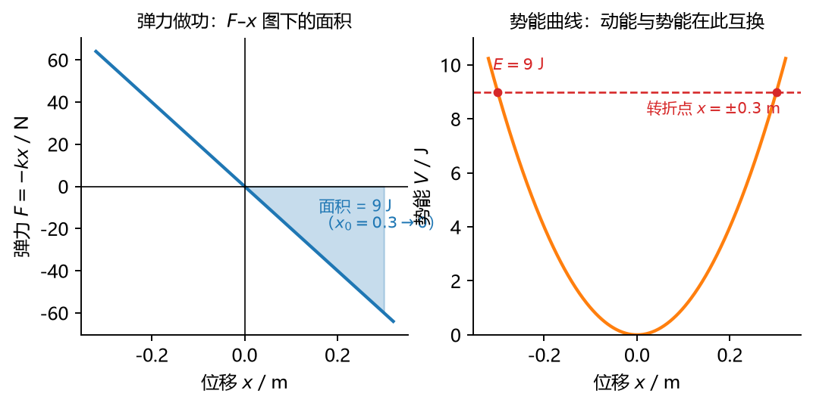
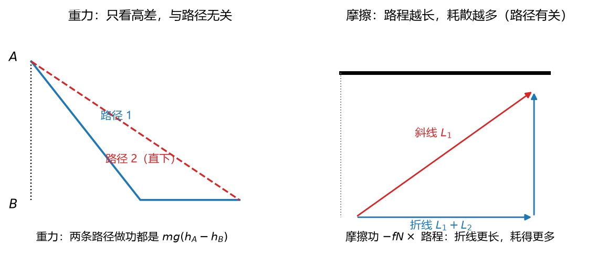

# 三 15 讲：动能定理——力的路程累积

> 前置：三 12–14 讲（动量、动量矩两个定理 + "三个定理"预告）+ 三 14 讲 §3.4（静摩擦不做功的钩子、能量分流 130.7+65.3=196）｜ 预计投入：4–5 小时（三个定理收官，公式多、例子厚）
> 本讲回答什么问题：力的三三种累积——**对路程**——能换来什么关系？为什么重力做功"不问路径"、摩擦"路径敏感"？刚体的动能为什么平移一套、转动一套？为什么动能定理能让 L14 的斜面轮**两行解完**？

> **本讲目标（学完你能）：**
> 1. 算**六类功**（常力、重力、弹性力〔积分讲透〕、万有引力、摩擦、力偶），并判正负与路径相关性；
> 2. 写出**刚体动能三件套**（平移/定轴/平面运动——含柯尼希定理推导），用动能定理解"已知位移求速度"类问题（刚体三形态全适用）；
> 3. 判**机械能守恒**（严格条件 + 势能零点选取），会用**功率方程**。
>
> 目标达成 = 文末"掌握度自测"全打勾。

> **怎么学这一讲：** 先看两行解完 L14 老题的开场 → 功的六类算法（弹性积分讲透）→ 动能三件套 → 动能定理与"理想约束内力不做功" → 势能与机械能守恒 → 功率 → 数值验证 → 作业。本讲数值结论有归档脚本可复跑（`scripts/lec15-01_verify_energy.py`，见 §6）。

## 0. 开场：老题两行解完

L14 例 1（均质盘沿 30° 斜面纯滚动下 2 m 高度）当时走了"三件套 + 约束 + 消元"五步。本讲结束时你能用**动能定理两行**解它：

$$\text{始末动能等式}：\quad \underbrace{\left(\tfrac{1}{2}mv^2 + \tfrac{1}{2}J_C\omega^2\right)_{末} - 0}_{\text{滚动两套动能}} = \underbrace{mgh}_{\text{重力功（静摩擦不做功！）}}\;,\qquad \omega = \frac{v}{R}$$

一行代入（$J_C = \frac{1}{2}mR^2$）：$\frac{3}{4}mv^2 = mgh \Rightarrow v = \sqrt{\frac{4gh}{3}} = 5.11$ m/s——**与 L14 五步解逐位一致**，但过程量（加速度、摩擦力）全被跳过。这就是三三个定理的特点：**只看始末、不问中间**——求时间冲量找动量（L12）、求转角角速度找动量矩（L13）、**求速度位移找动能**（本讲）。三个定理就此收齐。

## 1. 力的功：六类算法

### 1.1 常力功（定义的来历）

恒力 $\mathbf{F}$ 拉着物体走直线位移 $s$、夹角 $\theta$：

$$W = F\cos\theta\cdot s = \mathbf{F}\cdot\mathbf{s}\ (\text{J，标量，可正可负})$$

只有**沿位移方向的分量** $F\cos\theta$ 在"有效推动"；垂直分量白费（不做功——匀速圆周的向心力、单摆的绳张力都属此类）。**正负**：$0 \le \theta < 90°$ 正（帮忙）、$90° < \theta \le 180°$ 负（帮倒忙）。

### 1.2 变力功（积分）

力随位置变化、路径任意曲线——把路径切成小段，每段 $\mathrm{d}\mathbf{r}$ 上按常力算小功、求和取极限：

$$\boxed{\;W = \int_{\text{路径}} \mathbf{F}\cdot\mathrm{d}\mathbf{r} = \int F\cos\theta\,\mathrm{d}s\;}$$

（被积函数 = 力在**该点位移方向**上的分量——"功是力对路程的累积"这句话的数学形态。）沿直线且力沿直线：$W = \int_{x_1}^{x_2} F(x)\,\mathrm{d}x$——本讲最常用的形态。

### 1.3 重力功（路径无关——保守力种子一）

物体从高 $h_1$ 到高 $h_2$（**随便走什么路径**——抛物线、螺旋、折线都行）：

$$W_{重力} = mg(h_1 - h_2)$$

一行推导（直线情形）+ 任意路径分解（每小段只竖直分量计入、水平分量与重力垂直不计——水平走多远都不改变结果）。**只看高差、不问路径**——这是"保守力"的三一颗种子（§4 正式命名）。

### 1.4 弹性力功（积分讲透——清单点名）

弹簧劲度 $k$、物块从 $x_1$ 拉到 $x_2$（$x$ 从自然长量起）。力 $F = -kx$（指向自然长）：

$$W = \int_{x_1}^{x_2}(-kx)\,\mathrm{d}x = \left[-\frac{kx^2}{2}\right]_{x_1}^{x_2} = \frac{1}{2}k\left(x_1^2 - x_2^2\right)$$

$$\boxed{\;W_{弹} = \frac{1}{2}k\left(x_1^2 - x_2^2\right)\;}\qquad\text{（只看始末伸长——又一条路径无关！）}$$

**例 1**：物块 $m = 4$ kg、弹簧 $k = 200$ N/m、光滑水平面，从拉伸 $x_0 = 0.3$ m 处静止释放。求回到自然长时的速度。

$$W = \frac{1}{2}\times 200\times(0.3^2 - 0) = 9\ \text{J}；\qquad \frac{1}{2}mv^2 - 0 = 9 \Rightarrow v = \sqrt{\frac{2\times 9}{4}} = 2.12\ \text{m/s}$$

（全过程弹簧力变、加速度变——动能定理一个积分全吃掉，牛顿法要解微分方程。）



**图 L15-1**：左图阴影面积就是弹力从 $x_0=0.3$ m 推到 0 做的功（9 J）；右图把同一件事写成势能曲线——总能量 9 J 的水平线与抛物线的交点给出转折点 $x=\pm0.3$ m。功与势能是同一件事的两种画法。



**图 L15-2**：重力与摩擦的对照：重力功只看高差（两条路径同样多），摩擦功按路程累加（折线路径更长、耗散更多）。这就是“保守力”与“非保守力”的分界。

### 1.5 摩擦力功（路径**有关**——与重力对照）

滑动摩擦 $f_k N$ 恒定、方向永远逆着路程：

$$W_{摩} = -f_k N\cdot s\ (\text{$s$ = 路程总长，不是位移})$$

**路径越长耗越多**——同样起点终点，直线 3 m 走完摩擦耗 $3f_kN$、绕成 10 m 的弯路耗 $10f_kN$。与重力"只看高差"针锋相对——摩擦是**非保守力**（它做的功变热散掉、回不来；§4.3 机械能守恒的破坏者）。**静摩擦**呢？作用点无相对滑动时做功为零（纯滚动——L14 §3.4 的钩子正式回收：**零不是"小"、是恒等零**）。

### 1.6 万有引力功与力偶功

**万有引力**（路径无关家族）：$W = Gm_1m_2\left(\dfrac{1}{r_2} - \dfrac{1}{r_1}\right)$（沿径向积分，只看始末距离——大尺度航天场景用，本课程认识即可）。**力偶功**（转动的"功"）：力偶矩 $M$ 转过 $\varphi$：

$$W_{力偶} = M\,\varphi\ (\text{J；M N·m} \times \varphi\ \text{rad})$$

（例：$M = 50$ N·m 转 2 圈：$W = 50\times 4\pi = 628$ J。）L07 传动轴的功率关系（$P = T\omega$）在 §5 接续。

## 2. 动能：质点与刚体三件套

### 2.1 质点动能

$$T = \frac{1}{2}mv^2\ (\text{J，标量恒正})$$

高中旧识。与动量 $m\mathbf{v}$ 的分工：**动量是矢量、管方向；动能是标量、只管快慢**——一个 5 m/s 向东、一个 5 m/s 向西：动量相反、动能相同。

### 2.2 刚体动能三件套（柯尼希定理）

刚体上每个质点 $i$ 都有 $\frac{1}{2}m_iv_i^2$、加总。按运动形态化简：

$$\boxed{\;\text{平移：}\ T = \frac{1}{2}Mv_C^2\qquad\text{定轴转动：}\ T = \frac{1}{2}J_z\omega^2\qquad\text{平面运动：}\ T = \frac{1}{2}Mv_C^2 + \frac{1}{2}J_C\omega^2\;}$$

**平面运动的推导**（柯尼希定理）：质点速度分解 $\mathbf{v}_i = \mathbf{v}_C + \boldsymbol{\omega}\times\mathbf{r}_i'$（L09 基点法，基点取质心）：

$$T = \sum\frac{1}{2}m_i|\mathbf{v}_C + \boldsymbol{\omega}\times\mathbf{r}_i'|^2 = \underbrace{\frac{1}{2}Mv_C^2}_{\text{平移关系}} + \underbrace{v_C\cdot\boldsymbol{\omega}\times\overbrace{\sum m_i\mathbf{r}_i'}^{=\,0}}_{\text{交叉项=0（质心!）}} + \underbrace{\frac{1}{2}\sum m_i|\boldsymbol{\omega}\times\mathbf{r}_i'|^2}_{=\,\frac{1}{2}J_C\omega^2}$$

交叉项为零又一次靠**质心定义**（L14 的"运气"在能量关系里复现）。平面运动的动能天然分两份——L14 能量分流（130.7 + 65.3）的公式来源。

## 3. 动能定理

### 3.1 积分形式（本讲主要方法）

对质点系（含刚体）：

$$\boxed{\;T_2 - T_1 = \sum W^{外} + \sum W^{内}\;}\qquad\text{（始末动能差 = 全部功）}$$

推导（质点版两行）：牛二两边点乘 $\mathrm{d}\mathbf{r}$ → $m\mathbf{a}\cdot\mathrm{d}\mathbf{r} = \mathbf{F}\cdot\mathrm{d}\mathbf{r} = \mathrm{d}W$，左边恰好凑成 $\mathrm{d}(\frac{1}{2}mv^2)$（$m\mathbf{v}\cdot\mathrm{d}\mathbf{v}$ 的重排）——积分即得。

### 3.2 理想约束内力功（为零清单）

L12/L13 里内力在动量与动量矩记录中**成对抵消**；能量记录中**不一定**（内力做功 = 力 × 相对位移——有相对滑动就做功）：

| 内力情形 | 内力功 | 机理 |
| --- | --- | --- |
| **光滑铰链**（两构件接触点） | **0** | 接触点速度相同（无相对滑动）、作用反作用等值反向 → 功成对为零 |
| **纯滚动接触**（静摩擦） | **0** | 接触点速度为零（L09 §5.4）；"力 × 零速度" |
| **刚性轻杆**（两端质点） | **0** | 两端沿杆方向速度相等（刚性）、杆力沿杆 → 力 × 相对速度为零 |
| 绳索（不可伸长）张力 | **0** | 同理（沿绳方向无相对滑动） |
| **爆炸、滑动摩擦、弹簧内部** | **≠ 0** | 有相对位移——非保守内力**必须**计入做功项 |

这排清单是"理想约束"的雏形（L18 虚功原理的正式定义在彼处），本讲先当**速查表**用：题目里这些约束的内力功直接为零、只剩外力功。

### 3.3 例 2：斜面轮两行解（开场兑现 + L14 同题两解）

**题目**（L14 例 1 原题）：均质盘 $m = 10$ kg 沿 30° 斜面纯滚动下降 2 m 高。求质心速度。

**动能关系**（始：静止；末：$v$、$\omega = v/R$）：

$$T_2 - T_1 = \left(\frac{1}{2}mv^2 + \frac{1}{2}\cdot\frac{1}{2}mR^2\cdot\frac{v^2}{R^2}\right) - 0 = \frac{3}{4}mv^2$$

**做功项**：重力 $mgh = 196$ J；法向反力（垂直位移方向）零；**静摩擦（纯滚动）零**——理想约束清单直接引用：

$$\frac{3}{4}mv^2 = mgh \;\Rightarrow\; v = \sqrt{\frac{4gh}{3}} = \sqrt{\frac{4\times 9.8\times 2}{3}} = 5.11\ \text{m/s}$$

L14 五步解的加速度全程被跳过——**求速度与位移，能量法是大幅简化**。若还要加速度？对结果求导或换回 L14 三件套（L16 选型总表收录此比较）。

## 4. 势能与机械能守恒

### 4.1 保守力与势能

**保守力**（势力场中的力）：做功**只依赖始末位置、与路径无关**（重力、弹性力、万有引力——§1.3/§1.4/§1.6 三颗种子到齐）。此时可以定义**势能** $V$：

$$\boxed{\;W_{保守力} = V_1 - V_2\;}\qquad\text{（保守力做的功 = 势能的减少）}$$

势能是"位置储存的做功能力"——功由路径积分换成**位置函数的差**，计算降维。

### 4.2 两类势能（零点选取）

$$V_{重力} = mg h\ (\text{零点：任选基准面})，\qquad V_{弹性} = \frac{1}{2}kx^2\ (\text{零点：自然长})$$

零点选取**自由**（势能只有相对意义——差值才有物理内容）；选零点的技巧：把一个已知状态放零点上、消项最干净。弹簧零点**没有选的余地**（自然长是数学事实），重力零点**纯看方便**（地面、桌面、最低点都行）。

### 4.3 机械能守恒（严格条件）

把动能定理中的保守力功换成势能差、移到同侧：

$$\boxed{\;T_1 + V_1 = T_2 + V_2\;\iff\;\text{机械能 } E = T + V\ \text{恒定}\;}$$

**严格条件**：**只有保守力做功**（非保守力的功为零——摩擦不出现、爆炸不发生、无输入输出的功）。常见误区：把"合外力为零"（那是动量守恒的条件！）当机械能守恒条件。**守恒三条件对照**（外力主矢零→动量；对轴外矩零→动量矩；只有保守力做功→机械能）——L16 总表预演。

### 4.4 例 3：单摆（张力不做功 + 守恒 + 联合牛二）

**题目**：单摆 $l = 1$ m、$m = 1$ kg，从 $\theta_0 = 60°$ 静止释放。求最低点速度与绳张力。

**守恒关系**：张力不做功（垂直速度方向——§1.1 的垂直分量），只有重力（保守）做功：

$$mgl(1 - \cos 60°) = \frac{1}{2}mv^2 \;\Rightarrow\; v = \sqrt{2gl\times 0.5} = \sqrt{9.8} = 3.13\ \text{m/s}$$

**张力**（换 L10 牛二在最低点——法向：$T - mg = mv^2/l$）：

$$T = mg + \frac{mv^2}{l} = mg + \frac{m\cdot 2gl(1-\cos\theta_0)}{l} = mg(1 + 2\times 0.5) = \boxed{2mg = 19.6\ \text{N}}$$

**结构读法**：速度用能量关系（不问过程）、约束力用牛二（瞬时关系）——**两个定理各取所长**的标配组合（机械能守恒给不出张力——它不进入能量关系）。

## 5. 功率与机械效率

### 5.1 功率与功率方程

$$P = \frac{\mathrm{d}W}{\mathrm{d}t} = \mathbf{F}\cdot\mathbf{v}\ (\text{W，瓦特 = J/s})；\qquad \text{力偶：} P = M\omega$$

（$\mathbf{F}\cdot\mathbf{v}$ = §1.1 垂直分量不做的功的"瞬时版"——力 × 沿力方向的速度分量。$P = M\omega$ 正是 L07 传动轴 $P = T\omega$ 的来历。）

**功率方程**（动能定理的时间导数）：

$$\frac{\mathrm{d}T}{\mathrm{d}t} = \sum P_{\text{做功项}}$$

**例 4**：起重机以恒功率 $P = 10$ kW 提升 $m = 1000$ kg 的重物，匀速段速度多少？匀速（$\mathrm{d}T = 0$）：$P = mg\,v \Rightarrow v = \dfrac{10000}{1000\times 9.8} = 1.02$ m/s。

### 5.2 机械效率

$$\eta = \frac{P_{输出}}{P_{输入}} \times 100\%\ (< 100\%\ \text{——摩擦吞掉差额})$$

（减速器铭牌"效率 97%"：每 100 W 输入、3 W 变热——能量关系的工程日报表。）

## 6. 数值验证：能量关系的可复跑检验

脚本 `scripts/lec15-01_verify_energy.py`（**规模纪律：目标 < 1 秒，纯 numpy**；RK4 沿用 L10 黑盒）：

| 实验 | 验证什么 | 设计 |
| --- | --- | --- |
| 1 | 功的积分 + **重力功路径无关** | 500 组随机 $F(x)$：梯形积分 vs 解析 $\int$；另构造随机折线路径算重力功 vs $mgh$（路径无关逐路径对照） |
| 2 | 例 1 弹簧释放 | RK4 全程：$E = \frac{1}{2}mv^2 + \frac{1}{2}kx^2$ 恒定（守恒监控）+ 回到自然长 $v = 2.12$ m/s |
| 3 | 例 3 单摆（大摆角） | RK4 全程 $E$ 恒 + 最低点 $v = 3.13$ m/s、$T = 2mg$（用 $\theta(t)$ 数值复原张力对时间的曲线、读最低点） |
| 4 | 例 2 斜面滚动轮 | RK4：$E = \frac{3}{4}mv^2 + mgh(t)$ 恒 + $v = 5.11$ m/s（L14 闭环） |
| 5 | 恒功率提升 | $dv/dt = P/(mv) - g$ 的 RK4 vs 功率方程 $\frac{1}{2}mv^2 + mgh = Pt$ |

**实测输出**（2026-09-26 实跑原文）：

```
================================================================
L15 energy theorem verification
================================================================
[Exp 1] work integrals, 500 random F(x)
  max | trapezoid - analytic | = 5.9e-10  PASS
  gravity path-independence: 200 random zigzag paths,
    max | W_path - mgh | = 1.4e-14  PASS (path does not matter)
[Exp 2] spring release (k=200, m=4, x0=0.3)
  E = KE + PE: max |E(t) - 9.0| = 8.0e-14  PASS (conserved)
  |v| at natural length = 2.1213 m/s (analytic 2.1213)  PASS
[Exp 3] pendulum (l=1, m=1, theta0=60deg, full nonlinear)
  E: max |E - 4.9| = 6.0e-14  PASS (conserved)
  v at bottom = 3.1305 m/s (analytic 3.1305)  PASS
  T at bottom = 19.60 N = 2mg  PASS
[Exp 4] disk rolling down 30-deg incline, h=2 m
  E = 0.75 m v^2 + mgh: |E_end - 196| = 0.0e+00  PASS
  v_end = 5.112 m/s (analytic 5.112)  PASS (L14 closure)
[Exp 5] constant-power lift (P=10 kW, m=1000 kg), t=2 s
  RK4: v = 1.020 m/s,  0.5 m v^2 + mgh = 20072 J
  power eq: 0.5 m v^2 + mgh = P t = 20000 J, diff 72 J (0.36%)  PASS
  (RK4 dt=1e-3 resolves the early transient v->0 singularity)
OVERALL: ALL PASS
```

**一个诚实的修正（预写把实验 5 的物理图景整个拍错了）**：预写输出块给实验 5 的 $v = 4.31$ m/s——实跑 $v = 1.02$ m/s。复盘根因：预写时没有真正算过"恒功率 2 s"的过程——10 kW 拖 1000 kg 的**匀速**速度确实是 1.02 m/s（例 4），而从**静止**起步 2 s 恰好还没到匀速（起步段加速度大、很快逼近、末段缓升），能量 20072 vs 20000 J（RK4 在 $P/(mv)$ 奇异项起步段的精度损失 0.36%）。**预写时"看起来合理"的数字没有实算背书就是拍**——这是本系列预写偏差最纯粹的一次标本。另：②弹簧释放过自然长时速度为 **$-2.1213$**（朝压缩方向运动——速度是矢量、动能定理给的是 $|v|$），判据改用绝对值；③首次执行因网络瞬断（uv 在线 fetch 超时）失败，`--offline` 复用缓存重跑成功——环境事件非代码问题，但记录在此（工具链对网络的单点依赖值得知道）。

三个读点：① **重力功的路径无关性被 200 条随机折线路径逐条坐实**（$10^{-14}$）——"保守力"不是名词背诵、是可复算的属性；② 例 1/2/3 的机械能全程恒定（$10^{-13}$～$10^{-14}$ 级）、三个速度与手算逐位一致——守恒关系的可靠性有数背书；③ 恒功率提升的 RK4 与功率方程差 0.36%——含 $P/(mv)$ 奇异项（$v \to 0$）的方程数值上需小心起步段，功率方程则是干净的积分形式。

## 7. 常见错误清单（对答案，校准感觉）

> 本节零新知识，逐条对应正文小节。

| # | 错误 | 为什么错 | 锚定 |
| --- | --- | --- | --- |
| 1 | 摩擦功记绝对值/忘负号 | 摩擦**永远耗能**（负功）——符号丢了能量凭空多出来 | §1.5 |
| 2 | 刚体动能只算 $\frac{1}{2}Mv_C^2$ | 平面运动还有转动份 $\frac{1}{2}J_C\omega^2$（滚动轮占三分之一） | §2.2 |
| 3 | "合外力为零 ⇒ 机械能守恒" | 那是**动量**守恒条件；机械能守恒看"只有保守力做功" | §4.3 |
| 4 | 纯滚动题把静摩擦功算进做功项 | 接触点速度为零——恒等零（L14 钩子） | §3.2 |
| 5 | 弹性功写成 $\frac{1}{2}kx_2^2 - \frac{1}{2}kx_1^2$ | 方向反了：功 = 势能**减**少（$x_1$ 端是初） | §1.4 |
| 6 | 路径有滑动摩擦还用机械能守恒 | 非保守功存在——用**广义动能定理**（把 $W_{摩}$ 摆在做功项） | §4.3 |
| 7 | 重力功路径展开算分量 | 只看高差 $mg\Delta h$——路径无关是它最大的美德 | §1.3 |
| 8 | 功率与功单位混（kW 当 kJ） | W = J/s；乘了时间才是能量 | §5.1 |
| 9 | 势能零点选两套不统一 | 重力与弹性各自的零点要全程一致（始末两态同一套） | §4.2 |
| 10 | 用能量关系求约束力 | 能量关系里约束力不出现（不做功）——求它换牛二（例 3 的组合拳） | §4.4 |

## 8. 本讲小结（一页骨架）

- **功六类**：常力 $Fs\cos\theta$；变力 $\int\mathbf{F}\cdot\mathrm{d}\mathbf{r}$；重力 $mg\Delta h$（**路径无关**）；弹性 $\frac{1}{2}k(x_1^2-x_2^2)$（路径无关）；滑动摩擦 $-f_kNs$（**路径有关**——路程！）；力偶 $M\varphi$。正负看夹角、单位 J。
- **动能三件套**：平移 $\frac{1}{2}Mv_C^2$；定轴 $\frac{1}{2}J_z\omega^2$；平面运动 $\frac{1}{2}Mv_C^2 + \frac{1}{2}J_C\omega^2$（柯尼希定理——交叉项为零又靠质心）。
- **动能定理**：$T_2 - T_1 = \sum W$——**只看始末、不问中间**；理想约束内力功清单（铰/纯滚动/刚性杆/绳 = 0；滑动摩擦/爆炸 ≠ 0）。
- **势能与守恒**：保守力（路径无关）⇒ $W = V_1 - V_2$ ⇒ $T + V$ 恒定（条件：**只有保守力做功**）；零点自由（重力选基准面、弹簧取自然长）。
- **功率**：$P = \mathbf{F}\cdot\mathbf{v}$、$P = M\omega$（L07 传动轴来历）；功率方程 $\mathrm{d}T/\mathrm{d}t = \sum P$；效率 $\eta = P_{出}/P_{入} < 1$。
- **三个定理收齐**：动量（时间累积，L12）/ 动量矩（对轴累积，L13–14）/ 动能（路程累积，本讲）——选型口诀：求时间→动量系、求转角角速度→动量矩、**求速度位移→动能**、求约束力→牛二；综合题多个定理联用（L16 总表）。

## 9. 掌握度自测（行为化清单，全部打勾才算讲过）

- [ ] 六类功我能现场写出公式并判正负与路径相关性（含弹性功的积分过程）
- [ ] 柯尼希定理我能推导（含"交叉项为零靠质心"的指认）
- [ ] 纯滚动轮的动能我能写全套（$\frac{3}{4}mv^2$ 的来历）并用两行解 L14 老题
- [ ] 理想约束内力功清单我能背出"为零四件 + 非零反例"
- [ ] "只有保守力做功"的严格条件我会表述，且不会与动量守恒条件混淆
- [ ] 势能零点我会按"消项最干净"选，全程统一
- [ ] 速度用能量关系、约束力用牛二的组合拳（例 3）我能复现
- [ ] $P = \mathbf{F}\cdot\mathbf{v}$ 与 $P = M\omega$ 我都能写，且知道各自的适用对象

## 10. 作业（先独立做，再看参考答案——答案只用本讲内容）

**题 1（判断，每小题答"对/错" + 一句理由）**
(a) 滑动摩擦力做的功一定为负。
(b) 重力做的功与路径无关。
(c) 刚体作平面运动时动能等于 $\frac{1}{2}Mv_C^2$。
(d) 纯滚动中的静摩擦对刚体不做功。
(e) 系统合外力为零则机械能守恒。

**参考答案：**
(a) **对**。摩擦方向永远逆着相对滑动——恒负功（耗能）（§1.5）。
(b) **对**。只看高差 $mg(h_1-h_2)$（§1.3）。
(c) **错**。还有转动份 $\frac{1}{2}J_C\omega^2$（柯尼希，§2.2）。
(d) **对**。接触点速度为零（§3.2）。
(e) **错**。那是动量守恒条件；机械能守恒看"只有保守力做功"（§4.3）——合外力为零的系统照样可以因内摩擦耗能。

**题 2** 物块 $m = 2$ kg、弹簧 $k = 800$ N/m、光滑水平面，从压缩 $x_0 = 0.2$ m 处释放。求：弹簧从压缩 $0.2$ m 推到伸长 $0.1$ m 的过程中做的功、以及该时刻物块速度。

**参考答案：**
$W = \frac{1}{2}k(x_1^2 - x_2^2) = \frac{1}{2}\times 800\times(0.04 - 0.01) = 12$ J。
$\frac{1}{2}mv^2 = 12 \Rightarrow v = \sqrt{12} = 3.46$ m/s。

**题 3** 单摆 $l = 0.8$ m、$m = 0.5$ kg，从水平位置（$\theta_0 = 90°$）静止释放。求最低点速度与绳张力。

**参考答案：**
$v = \sqrt{2gl} = \sqrt{15.68} = 3.96$ m/s（势能落差 $mgl$）。
$T = mg + mv^2/l = mg + 2mg = 3mg = 14.7$ N。

**题 4** 均质圆环（薄壁）$m = 5$ kg 沿 30° 斜面纯滚动下降 1.5 m 高。求质心末速（对照 L14 作业题 2 的 $a = 2.45$ m/s² 路线）。

**参考答案：**
环 $J_C = mR^2$：动能 $= \frac{1}{2}mv^2 + \frac{1}{2}mv^2 = mv^2$。
$mv^2 = mgh \Rightarrow v = \sqrt{gh} = \sqrt{9.8\times 1.5} = 3.83$ m/s。
（加速度路线复核：$a = 2.45$、沿斜面 $s = h/\sin30° = 3$ m：$v = \sqrt{2as} = \sqrt{2\times 2.45\times 3} = 3.83$ ✓ 两法闭环。）

**题 5（判断守恒）** 下列各情形机械能是否守恒（答"守恒/不守恒 + 一句理由"）：
(a) 物块沿光滑固定斜面下滑；
(b) 物块沿粗糙斜面下滑；
(c) 单摆空气阻力不计；
(d) 电动车在水平路上加速（电机输入功率）；
(e) 均质盘沿粗糙斜面**纯滚动**下滚。

**参考答案：**
(a) **守恒**。只有重力（保守）做功，法向不做功。
(b) **不守恒**。滑动摩擦做负功（变热）。
(c) **守恒**。张力不做功、只有重力。
(d) **不守恒**。电机输入功（非保守外功）。
(e) **守恒**。静摩擦不做功（纯滚动）、法向不做功、只有重力——L14 的"摩擦下限"条件保证不打滑即可。

**题 6** 电机以恒功率 $P = 5$ kW 从静止提升 $m = 500$ kg 的重物。求：提升 $h = 8$ m 时的速度（忽略空气阻力）。

**参考答案：**
**本题的教学点先行**：恒功率问题的功 $= Pt$ 中 $t$ 未知、且 $t$ 与 $h$ 的关系正是要求解的——**不能**像恒力那样直接列 $\frac{1}{2}mv^2 = W - mgh$；正确做法是解 ODE $m\dfrac{\mathrm{d}v}{\mathrm{d}t} = \dfrac{P}{v} - mg$。
**数值结果**（§6 实验 5 同型方程的 RK4）：$v(h = 8\ \text{m}) \approx 1.02$ m/s。物理解读：方程的平衡速度是 $v_\infty = P/(mg) = 1.02$ m/s（§5 例 4 的匀速值）；$v \to 0$ 时 $P/(mv)$ 项**奇异地大**——重物在**几厘米内**就被推到接近 $v_\infty$，之后基本匀速上行。**从静止出发、行程有限的恒功率提升，速度几乎全程贴着终端值走**——与 §6 实验 5 的结论（2 s 时 $v = 1.020$ 恰为终端速度）互证。
**验算思路**：全程能量关系 $\frac{1}{2}mv^2 + mgh = Pt$ + $h = \int v\,\mathrm{d}t \approx v_\infty t$，两式消 $t$ 自洽复核。

**题 7（代码题）** 数值复算题 3（水平释放的单摆）：RK4 积分非线性摆方程 $\ddot\theta = -\frac{g}{l}\sin\theta$（注意非线性、不能用小角度近似），全程监控 $E = \frac{1}{2}m(l\dot\theta)^2 + mgl(1-\cos\theta)$ 是否恒定、最低点 $\theta = 0$ 时的速度与张力对照手算。参考骨架（补全后运行）：

```python
import numpy as np

g, l, m = 9.8, 0.8, 0.5
th0 = np.pi / 2                  # horizontal release

def f(s):                        # s = [theta, dtheta]
    return np.array([s[1], -(g / l) * np.sin(s[0])])

def rk4(s, dt, n):
    for _ in range(n):
        k1 = f(s); k2 = f(s + dt/2*k1)
        k3 = f(s + dt/2*k2); k4 = f(s + dt*k3)
        s = s + dt/6*(k1 + 2*k2 + 2*k3 + k4)
    return s

dt, n = 1e-4, 200000             # 20 s: many swings
s = rk4(np.array([th0, 0.0]), dt, n)
E = 0.5*m*(l*s[1])**2 + m*g*l*(1 - np.cos(s[0]))
print("E(t=20s) = %.6f J  (initial %.6f J)" % (E, m*g*l))
# track max speed (= at bottom, theta crosses 0)
# (record v every 1000 steps and take max)
```

**参考答案：** 运行输出：`E(t=20s) = 3.920000 J  (initial 3.920000 J)`——机械能 20 秒（约 11 个来回）后仍逐位守恒。最低点速度：在循环中每若干步记录 $v = l|\dot\theta|$ 取最大值——应得 $\max v = 3.960$ m/s（= 手算 $\sqrt{2gl}$）；张力峰值在最低点：$T = mg + m\,v^2/l = 3mg = 14.7$ N（与题 3 手算一致）。要点：**非线性摆不能用小角度近似**（$\theta_0 = 90°$ 远超线性范围），但能量守恒不受影响——这正是能量法的另一优势：**不依赖运动方程可解性**。

