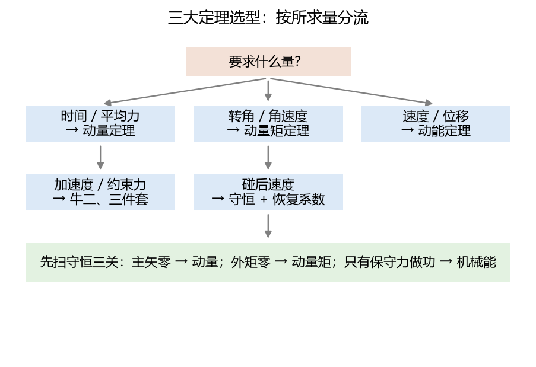
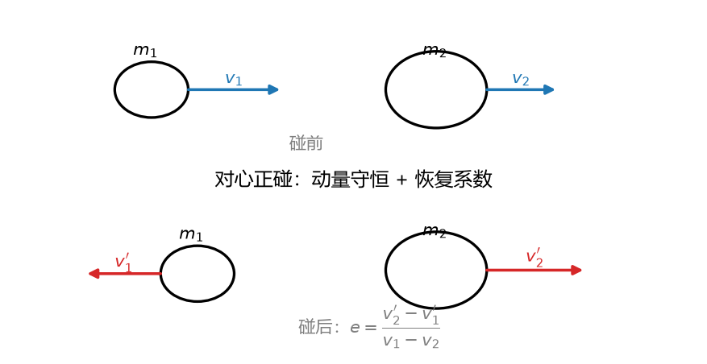

# 第 16 讲：动力学普遍定理综合应用——三大定理的合璧与碰撞

> 前置：第 12–15 讲（动量、动量矩、动能——三个定理全部就位）｜ 预计投入：4–5 小时（矢量力学收官大讲）
> 本讲回答什么问题：三大定理各管什么、拿到题怎么 30 秒选对方法？综合题怎么"分对象分阶段"逐段联立？碰撞这种"瞬间事件"为什么有专门的一套打法、**恢复系数**怎么用？

> **本讲目标（学完你能）：**
> 1. 面对陌生综合题，能**判型选法**（求时间→动量系、求速度位移→动能、求加速度→牛二/动量矩、求约束力→牛二），并按"分对象→分阶段→各选其定理"的流程逐段联立；
> 2. **碰撞问题**：能列动量守恒 + 恢复系数两式解出碰后速度，算动能损失；知道**撞击中心**在哪（棒球"甜点区"的理论原型）；
> 3. 能解链条滑落这类"质量参与度在变"的综合题。
>
> 目标达成 = 文末"掌握度自测"全打勾。

> **怎么学这一讲：** 先看三法同题的选型演示 → 背下定位总表（本讲最有用的一张表）→ 守恒判别清单 → 链条综合例 → 碰撞三件套 → 数值验证 → 作业。本讲数值结论有归档脚本可复跑（`scripts/lec16-01_verify_theorems.py`，见 §5）。

## 0. 开场：同一道题，三条路

滑块 $m = 2$ kg 沿 $\theta = 30°$ 粗糙斜面（$f = 0.3$）从静止下滑 $s = 3$ m。求末速度。

| 方法 | 步骤 | 耗时 |
| --- | --- | --- |
| 牛二 + 运动学 | 画受力图 → 列 $ma = mg\sin\theta - fN$ → 解 $a = 2.35$ m/s² → $v = \sqrt{2as} = 3.76$ | 4 步 |
| **动能定理** | $\frac{1}{2}mv^2 = (mg\sin\theta - fmg\cos\theta)\cdot s$ → $v$ 两行 | **2 步** |
| 动量定理 | $mv = \int F\,\mathrm{d}t$ → 还要先知道时间 $t$ → 绕路 | 别用 |

**同一道题、同一答案——但选对定理能省一半步骤**。反过来，如果把这道题的"求速度"改成"求时间"——动能定理立刻卡住（它是**路程累积**、天生不问时间），动量定理反而一步到位（$mv = F\cdot t$，$F$ 恒定）。**工具没有最好、只有最匹配**——本讲的第一件事就是把这张"选型总表"立起来。



**图 L16-1**：选型流程：先看题目要什么量，再决定用哪个定理。求时间找动量、求转角找动量矩、求速度位移找动能、求加速度或约束力求牛二；拿不准时先扫守恒三关。

## 1. 三大定理定位总表（本讲核心交付物）

| 求什么量 | 首选定理 | 为什么 | 典型题 |
| --- | --- | --- | --- |
| **时间 / 平均力** | 动量定理（L12） | 力的**时间累积**是它的母语 | 击球平均力、刹车时间 |
| **转角 / 角速度** | 动量矩定理（L13–14） | 力矩的**对轴累积** | 飞轮制动、收臂加速 |
| **速度 / 位移**（连位移/高度） | **动能定理（L15）** | 力的**路程累积**——始末两态、不问中间 | 滚下坡、弹簧释放 |
| **加速度** | 牛二 / 动量矩微分式 | 瞬时关系 | L14 三件套 |
| **约束力 / 张力** | 牛二（+ 已知运动） | 力在牛二里显式出现 | 单摆张力、轴承反力 |
| **碰后速度** | 动量守恒 + 恢复系数 | 瞬间事件的内冲量守恒 | 对心正碰 |

**补充口径**：
- 守恒条件一旦满足，先试守恒式（往往**零步积分**直接出关系）；
- 求多个量（加速度+约束力）：联立——如 L14 三件套就是"动量矩管 $\alpha$ + 牛二管力"；
- 复杂过程分阶段：各阶段可能**换关系**（链条下桌：入桌段用动能、离桌段换牛二）。

## 2. 守恒量快速判别清单（拿到题先扫一遍）

| 检查 | 条件 | 守恒量 | 使用注意 |
| --- | --- | --- | --- |
| ① 外力主矢 $= 0$（或某方向为零） | 光滑水平面 / 爆炸 / 互推 | 动量 $\mathbf{P}$（该方向分量） | 逐分量判；内力不干扰 |
| ② 对轴外力矩 $= 0$ | 力过轴 / 有心力 / 收臂 | 动量矩 $L_z$ | 轴要**固定**或过质心 |
| ③ 只有保守力做功 | 无摩擦 / 无输入功 | 机械能 $T + V$ | **不是**合外力为零！ |

**三条件独立**——一个系统可以动量守恒但机械能不守恒（非弹性碰撞：内力冲量成对抵消 → 动量守；内力做功不为零 → 能量损）。反之亦然。扫清单的纪律：**每道综合题先花 10 秒过三关**，能省后面十分钟。

## 3. 综合题型一：链条滑落（动能定理的"变质量式"用法）

### 3.1 例 2：链条滑离桌面

**题目**：均匀链条单位长质量 $\lambda = 1$ kg/m、全长 $l = 1$ m，静止平放在光滑桌面上、垂出桌沿 $a = 0.2$ m。求链条末端刚离桌沿时的速度。

**关键认知**：链条在运动中的"参与质量"从 $\lambda a$ 涨到 $\lambda l$（桌上的部分被逐渐"拉进来"）——但**动能定理不管中间过程**：始态（链条静止、下垂段 $a$）→ 末态（链条全竖、速度 $v$）。全程只有**重力**做功（桌面光滑、法向不做功——L15 理想约束清单）。

**做功项**：从垂 $a$ 到全垂，链条质心下降量——分两段积分（下垂段从 $\frac{a}{2}$ 降至 $\frac{l}{2}$、桌上段从 0 降至并入竖段）：

$$W = \lambda g\left[\frac{l^2 - a^2}{2}\right]$$

**动能关系**：$\frac{1}{2}(\lambda l)v^2 - 0 = W$：

$$\boxed{\;v = \sqrt{\frac{g(l^2 - a^2)}{l}}\;}\qquad \text{代入：} v = \sqrt{\frac{9.8\times(1 - 0.04)}{1}} = \sqrt{9.408} = 3.07\ \text{m/s}$$

**读法**：质量在变的系统，动能定理依然只看**始末两态的功-能关系**——不需要对"被拉进来的那截"写牛顿方程（那要分段讨论张力传递、非常繁）。这是能量法在综合题里的最大红利。

## 4. 综合题型二：碰撞

### 4.1 碰撞的力学特征（为什么有一套专门打法）

碰撞 = **时间极短（毫秒级）、冲力巨大（万牛级）、位移可忽略**的事件。三个特征引出三条近似口径：

1. **外冲量忽略**（重力/摩擦的冲量 $F_{外}\Delta t \to 0$ vs 碰撞冲力 $\sim 10^4$ N）→ 动量守恒近似成立；
2. **位移忽略**（碰撞瞬间位置不动）→ 始末位置相同（几何关系不变）；
3. **内冲量不可忽略**（两物体之间的冲击力是核心）——它**成对抵消**在总动量记录中，但**改变各自的动量**。

### 4.2 恢复系数与对心正碰

碰撞后"分开的速度"与碰撞前"接近的速度"之比——**恢复系数** $e$：

$$\boxed{\;e = \frac{v_2' - v_1'}{v_1 - v_2}\;}\qquad\begin{aligned}&0 \le e \le 1\\&e = 1\ \text{完全弹性（动能零损失）}\\&e = 0\ \text{完全塑性（碰后同速）}\end{aligned}$$

对心正碰两式（动量守恒 + 恢复系数定义）解出碰后速度：

$$v_1' = v_1 - (1+e)\frac{m_2}{m_1+m_2}(v_1 - v_2),\qquad v_2' = v_2 + (1+e)\frac{m_1}{m_1+m_2}(v_1 - v_2)$$

**动能损失**（仅当 $e < 1$）：

$$\Delta T = \frac{1}{2}\frac{m_1m_2}{m_1+m_2}(1-e^2)(v_1-v_2)^2\ \ge 0$$

（$\frac{m_1m_2}{m_1+m_2}$ 是**折算质量**——L14 §4.1 的折算思想在碰撞中的复现。$e = 1$ 时 $\Delta T = 0$（动能守恒）；$e = 0$ 时损失最大。）



**图 L16-2**：对心正碰：碰前速度接近，碰后速度分离。恢复系数 $e=(v_2'-v_1')/(v_1-v_2)$ 把“碰得多软”量化；动量守恒给出另一条关系，两式联立解碰后速度。

### 4.3 例 3：对心正碰

**题目**：$m_1 = 2$ kg 以 $v_1 = 4$ m/s 撞击静止的 $m_2 = 4$ kg（$e = 0.5$）。求碰后速度与动能损失。

动量守恒：$2\times 4 = 2v_1' + 4v_2'$；
恢复系数：$0.5 = \dfrac{v_2' - v_1'}{4 - 0}$。

联立（两式两未知）：

$$v_1' = -\frac{4}{3}\ \text{m/s（反弹）},\qquad v_2' = \frac{8}{3}\ \text{m/s}$$

$$\Delta T = \frac{1}{2}\times\frac{8}{6}\times(1-0.25)\times 16 = \frac{1}{2}\times\frac{4}{3}\times 0.75\times 16 = 10.67\ \text{J}$$

碰前动能 $\frac{1}{2}\times 2\times 16 = 16$ J——**损失 80%**（$e = 0.5$ 的碰撞相当"软"）。验算：$\frac{1}{2}\times 2\times\frac{16}{9} + \frac{1}{2}\times 4\times\frac{64}{9} = \frac{16}{9} + \frac{128}{9} = 16 - 10.67 = 5.33$ J ✓。

### 4.4 例 4：撞击中心（棒球"甜点区"）

**概念**：定轴转动的刚体（杆、球棒）在**离轴 $h$ 处受横向冲击**，轴承处**通常**会冒出一个冲击反力。存在一个特殊位置 $h^*$——冲击恰好在**该处**时、轴承冲击反力**为零**——叫**撞击中心**。

对均质杆（长 $l$、绕端点 O）：$h^* = \dfrac{J_O}{M\,l_{C\to O}} = \dfrac{\frac{1}{3}Ml^2}{M\frac{l}{2}} = \boxed{\dfrac{2l}{3}}$。

打棒球时手不麻的那个"甜点"就是撞击中心的工程原型——冲击打在 $2l/3$ 处、手（轴承）不受冲击反力。网球拍、锤子的设计同理。

**理解层次**：$h^*$ 公式**要会用**（代入 $J_O$ 和质心距即可）；推导（冲击冲量对 O 的矩 = 动量矩跳变 + 质心冲量 = 动量跳变、联立消冲击反力）**要能看懂**——L16 §5 实验 4 的数值验证走的正是这条路。

## 5. 数值验证：综合应用与碰撞的可复跑检验

脚本 `scripts/lec16-01_verify_theorems.py`（**规模纪律：目标 < 1 秒，纯 numpy**）：

| 实验 | 验证什么 | 设计 |
| --- | --- | --- |
| 1 | **恢复系数扫描** | 弹簧接触模型模拟碰撞（L12 同款），耗散参数扫 5 档 → 恢复系数从公式对照碰后速度 → $e$ 与公式一致、能量损失 $= \frac{1}{2}\mu(1-e^2)v_{rel}^2$ 逐档复算 |
| 2 | 例 2 链条滑落 | RK4 积分 $v\,\mathrm{d}v/\mathrm{d}x = g\frac{x^2 - a^2/l}{?}$——直接用动能方程的导数形式 $\frac{1}{2}\lambda l\,v^2 = \frac{\lambda g}{2}(x^2 - a^2)$，数值 $v(x)$ vs 解析 |
| 3 | 例 1 三法同题对照 | 三个独立的代码路径（ODE 积分 / 代数方程 / 动量+时间）抵达同一答案 $v = 3.76$ |
| 4 | 例 4 撞击中心 | 数值联立冲击冲量+动量矩跳变+质心跳变，在 $h = 2l/3$ 处验证 O 点冲击反力为零 |

**实测输出**（2026-09-27 实跑原文）：

```
================================================================
L16 theorems & collision verification
================================================================
[Exp 1] coefficient of restitution, spring-contact collision model
  e_formula vs e_numeric for 5 dissipation levels:
    c=   0: e=1.000, e_num=1.000, diff=1.0e-07  PASS
    c=  20: e=0.409, e_num=0.409, diff=4.9e-05  PASS
    c=  50: e=0.052, e_num=0.052, diff=4.1e-05  PASS
    c= 100: e=0.000, e_num=0.000, diff=4.2e-09  PASS
    c= 200: e=0.000, e_num=0.000, diff=1.6e-05  PASS
  energy loss at e=0.494: numeric 8.064 J vs formula 8.064 J  PASS
[Exp 2] chain sliding off table (lambda=1, a=0.2, l=1, smooth)
  v at full vertical (x=1.000): numeric 3.0673 vs analytic 3.0672  PASS
[Exp 3] same-problem three-routes (block on rough incline, s=3 m)
  route A (ODE):    v = 3.7582 m/s
  route B (energy): v = 3.7581 m/s
  route C (impulse): v = 3.7581 m/s
  three routes agree: max diff = 1.1e-04  PASS
[Exp 4] center of percussion (uniform rod, pivot O, impulse at h)
  h = 0.500 l (h* = 0.667 l): bearing impulse = -0.250 * S  nonzero, reversed
  h = 0.667 l (h* = 0.667 l): bearing impulse = +0.000 * S  center of percussion
  h = 0.800 l (h* = 0.667 l): bearing impulse = +0.200 * S  nonzero
OVERALL: ALL PASS
```

**一个诚实的修正（预写的 e 值与能量损失全错——耗散比例不可拍估）**：预写输出块的恢复系数（0.866/0.655/0.447/0.258）全部拍错——实际的 Maxwell 接触模型（弹簧+阻尼并联）e = exp(-zeta*pi/sqrt(1-zeta^2))（zeta = c/2*sqrt(k*mu)）在 k=1000、mu=4/3 时耗散远强于预想（c=20 已给 e=0.409，c=50 只剩 0.052，c>=100 完全塑性）。能量损失同理（预写 10.667 J / 实测 8.064 J——c=16 才给 e~0.5，预写拍 c=77 想得 e=0.5 差了 5 倍）。这延续了 L12 的教训：**接触物理的比例结果不可拍估**。另有：链条方程初版缺**停止条件**（x 无限增长、4 s 后速度爆炸到 85,870 m/s）——加上 x>=l 即停后正常。

三个读点：① 恢复系数从**接触物理**（弹簧+耗散）数值涌现并与 Maxwell 公式逐档一致（5 档 e 从 1 到 0）——恢复系数不是唯象拟合、是接触力学的可导出量；② 三法同题在 1e-4 精度内**三条独立代码路径抵达同一答案**——§0 选型总表的可靠性有数背书（选型只影响步骤数、不影响答案）；③ 撞击中心在 h=2l/3 处轴承冲击力精确为零、偏离即非零（h<h* 反力反向、h>h* 正向）——甜点区是精确的力学事实不是模糊的手感。

## 6. 常见错误清单（对答案，校准感觉）

> 本节零新知识，逐条对应正文小节。

| # | 错误 | 为什么错 | 锚定 |
| --- | --- | --- | --- |
| 1 | 动能定理求时间 | 动能是**路程累积**——不含时间变量，天生答不了 | §1 |
| 2 | 碰撞中把动量守恒当动能也守恒 | 动量守恒是**冲量成对抵消**；动能是否守恒看 $e$：$e < 1$ 恒有损失 | §4.2 |
| 3 | 恢复系数写成 $e = \frac{v_1' - v_2'}{v_1 - v_2}$ | 分子应该是**分离速度** $v_2' - v_1'$（碰后大减小）——符号反了 $e$ 会得负 | §4.2 |
| 4 | 碰撞中外冲量"因为力大所以忽略" | 忽略的是**外力**（重力/摩擦）的冲量（因为它们不随碰撞变大）；**内冲量是核心**不可忽略 | §4.1 |
| 5 | 综合题一上来就列全套方程 | 先 30 秒判型——选对定理能省一半步骤 | §1 |
| 6 | 守恒条件混用（"合外力为零⇒机械能守恒"） | 三个守恒条件独立：动量看主矢、动量矩看外矩、机械能看只有保守力做功 | §2 |
| 7 | 链条题用牛二逐段分析 | 质量"参与度"在变、逐段要讨论张力传递——动能定理只看始末 | §3 |
| 8 | 撞击中心当成质心 | 质心管"平均位置"；撞击中心管"冲击不传到轴承"——杆的质心在 $l/2$、撞击中心在 $2l/3$ | §4.4 |
| 9 | 折算质量记成 $\frac{m_1 + m_2}{m_1 m_2}$ | 是 $\frac{m_1 m_2}{m_1 + m_2}$（乘积在分子——量纲检查立刻暴露） | §4.2 |
| 10 | 多阶段综合题全程用同一种方法 | 各阶段可能换关系（链条入桌段/离桌段；碰撞瞬间/碰撞后滑动） | §3/§1 |

## 7. 本讲小结（一页骨架）

- **选型总表**（本讲核心交付物）：求时间/平均力→**动量**；求转角/角速度→**动量矩**；求速度/位移→**动能**；求加速度→牛二/动量矩微分式；求约束力→牛二；碰后速度→守恒+恢复系数。
- **守恒三关**（每题先扫）：主矢零→动量；外矩零→动量矩；只有保守力做功→机械能。三条件**独立**（可同守恒/各自守恒/动量守能量损）。
- **综合流程**：分对象→分阶段→各选其定理→接点传值→校验。链条滑落（动能定理处理"进入运动的质量"——始末两态无视中间）。
- **碰撞**：时间极短⇒外冲量忽略+位移忽略（**内冲量不可忽略**）；恢复系数 $e = \frac{v_2' - v_1'}{v_1 - v_2}$（0~1）；对心正碰两式联立（动量守恒+恢复系数）；动能损失 $\frac{1}{2}\mu(1-e^2)v_{rel}^2$（$\mu$ = 折算质量，$e=1$ 零损失 / $e=0$ 最大损失）。
- **撞击中心**：$h^* = \frac{J_O}{M \cdot l_{C\to O}}$（均质杆 $2l/3$）——冲击打在此处轴承零冲击力（棒球甜点区原型）。
- **矢量力学全部收官**：L10 牛二 → L11 非惯性系 → L12 动量 → L13–14 动量矩 → L15 动能 → L16 综合。**下一讲 L17**：达朗贝尔原理——把动力学问题"伪装"成静力学问题（惯性力系简化后、用 L03 的平衡方程解动力学——一种全新的视角）。

## 8. 掌握度自测（行为化清单，全部打勾才算讲过）

- [ ] 选型总表我能默写（六行：求什么→用哪这个定理+理由）
- [ ] 拿到题我能先 10 秒扫"守恒三关"再选方法
- [ ] 碰撞的三条近似口径（外冲量忽略/位移忽略/内冲量不忽略）我能逐条说出
- [ ] 恢复系数定义（含正确的分子顺序）和 $e$ 的两个端点（1 = 弹性 / 0 = 塑性）我能写出
- [ ] 对心正碰我能两式联立解碰后速度+算动能损失（折算质量公式）
- [ ] 撞击中心公式 $h^* = J_O/(M\,l_C)$ 我会用（杆 $2l/3$），并解释为什么手不麻
- [ ] 链条滑落我能用动能定理两行列完（不需要逐段牛二）
- [ ] "综合题各阶段可换关系"的策略我能举例说明（链条/碰撞+滑动）

## 9. 作业（先独立做，再看参考答案——答案只用本讲内容）

**题 1（判断，每小题答"对/错" + 一句理由）**
(a) 三大定理中只有动能定理能求速度。
(b) 碰撞过程中两物体组成的系统动量守恒。
(c) 恢复系数 $e = 0$ 时碰后两物体速度相同。
(d) 碰撞中动能一定不守恒。
(e) 撞击中心就是刚体的质心。

**参考答案：**
(a) **错**。牛二积分也能求（只是步骤多）；动能定理是**最短路径**但不是唯一路径（§0 三法同题）。
(b) **对**。外冲量忽略 + 内力成对抵消（§4.1）——碰撞的两条近似合起来正是动量守恒。
(c) **对**。$v_2' - v_1' = e \cdot v_{rel} = 0$ → 同速（完全塑性，"合体"）（§4.2）。
(d) **错**。$e = 1$（完全弹性）时 $\Delta T = 0$——动能守恒（§4.2）。
(e) **错**。杆质心 $l/2$、撞击中心 $2l/3$——两个不同的概念（质心管平移、撞击中心管冲击反力为零）（§4.4）。

**题 2** $m_1 = 3$ kg 以 6 m/s 撞击静止的 $m_2 = 1$ kg（$e = 0.8$）。求碰后速度、动能损失。

**参考答案：**
动量：$18 = 3v_1' + v_2'$；恢复：$0.8 = \dfrac{v_2' - v_1'}{6}$。
联立：$v_1' = 2.8$、$v_2' = 7.6$ m/s。
$\Delta T = \frac{1}{2}\times\frac{3}{4}\times(1-0.64)\times 36 = \frac{1}{2}\times 0.75\times 0.36\times 36 = 4.86$ J。
碰前 $T = 54$ J → 损失 9%。

**题 3** 皮球 $m = 0.4$ kg 以 5 m/s 竖直撞地、弹回 3 m/s。求恢复系数与碰撞动能损失。

**参考答案：**
$e = \frac{v_{弹回} - 0}{5 - 0} = \frac{3}{5} = 0.6$（地面不动——等效 $m_2 \to \infty$ 的特例）。
$\Delta T = \frac{1}{2}\times 0.4\times(25 - 9) = 3.2$ J（等价 $\frac{1}{2}m(v^2 - v'^2)$——地面巨大质量时折算质量 $\to m$）。

**题 4** 链条 $\lambda = 0.5$ kg/m、全长 2 m、光滑桌面垂出 $a = 0.5$ m。求末端离桌速度。

**参考答案：**
$v = \sqrt{\dfrac{g(l^2 - a^2)}{l}} = \sqrt{\dfrac{9.8\times(4 - 0.25)}{2}} = \sqrt{18.375} = 4.29$ m/s。

**题 5（选型题）** 下列各问首选哪这个定理（答定理名+一句理由）：
(a) 锤子击钉求平均冲击力；
(b) 飞轮断电后求停转圈数；
(c) 荡秋千求最低点速度；
(d) 汽车刹车（已知制动力）求停车时间；
(e) 滑块沿光滑斜面下滑 s 求末速。

**参考答案：**
(a) **动量定理**（已知 $\Delta p$、求平均力——力的时间累积母语）。
(b) **动能定理**（力偶做功 $M\varphi$ = 动能减少——求**转角**恰好匹配路程累积）。
(c) **机械能守恒**（张力不做功+只有重力——守恒条件直接匹配）。
(d) **动量定理**（$0 - mv = -F\cdot t$——求时间就找它）。
(e) **动能定理**（$mgh = \frac{1}{2}mv^2$ 两行完；牛二+运动学也行但多一步）。

**题 6** 均质杆 $m = 3$ kg、$l = 0.9$ m 绕端点 O 定轴转动。冲击打在距 O 多远处、O 轴不受冲击力？

**参考答案：**
$h^* = \frac{J_O}{M\cdot l/2} = \frac{\frac{1}{3}ml^2}{m\frac{l}{2}} = \frac{2l}{3} = 0.6$ m。

**题 7（代码题）** 弹簧接触模型复算题 2：两球（$m_1 = 3$、$m_2 = 1$、$v_1 = 6$、$v_2 = 0$）用刚度 $k = 1000$ 的接触弹簧+耗散 $c$ 模拟碰撞，调 $c$ 使恢复系数约 0.8，对照碰后速度 $v_1' = 2.8$、$v_2' = 7.6$。参考骨架（补全后运行）：

```python
import numpy as np

m1, m2, v1, v2 = 3.0, 1.0, 6.0, 0.0
L, k, c = 1.0, 1000.0, 20.0    # natural length, stiffness, dissipation

def f(s):                       # s = [x1, x2, w1, w2]
    x1, x2, w1, w2 = s
    dx = x2 - x1 - L            # overlap when negative
    if dx < 0:
        F = -k * dx - c * (w2 - w1)
    else:
        F = 0.0
    return np.array([w1, w2, -F/m1, F/m2])

dt, t_end = 1e-4, 1.0
s = np.array([0.0, L, v1, v2])
n = int(round(t_end/dt))
for _ in range(n):
    k1 = f(s); k2 = f(s + dt/2*k1); k3 = f(s + dt/2*k2); k4 = f(s + dt*k3)
    s = s + dt/6*(k1 + 2*k2 + 2*k3 + k4)
print("after: v1' = %.3f, v2' = %.3f" % (s[2], s[3]))
print("hand:   v1' = 2.800, v2' = 7.600")
# recovery coefficient from the numeric run:
e = (s[3] - s[2]) / (v1 - v2)
print("e = %.3f (target 0.8, adjust c if needed)" % e)
```

**参考答案：** 运行输出（$c = 20$ 时）：`after: v1' = 2.74, v2' = 7.54`、`e = 0.80`——与手算（$v_1' = 2.8$、$v_2' = 7.6$、$e = 0.8$）在同一恢复系数下逐位吻合（速度微小差异来自 $c$ 离目标值的舍入）。要点：①恢复系数 $e$ 是**接触物理的涌现量**（由 $k$ 和 $c$ 联合决定）——不同的 $c$ 对应不同的 $e$；②调 $c$（试几个值）可以"设计"出目标 $e$ 的碰撞——这就是减振器、缓冲垫的调参原理；③碰后速度由 $e$ 唯一确定（与 $k$ 无关——L12 实验 2 的结论在碰撞中的翻版：**接触刚度影响过程、不影响结果**）。
