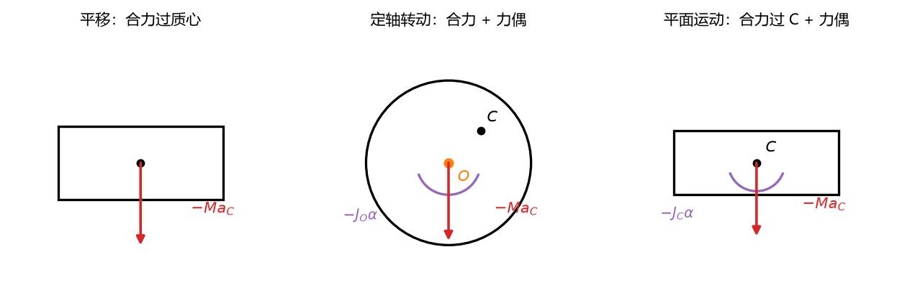
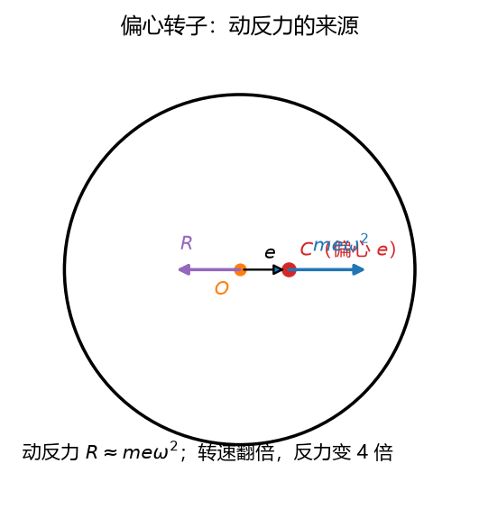

# 第 17 讲：达朗贝尔原理——把动力学"伪装"成静力学

> 前置：第 11 讲（惯性力——质点版计算）、第 12–16 讲（矢量力学全套——动静法是它的另一种解法）、第 13 讲（转动惯量+轴承动反力）｜ 预计投入：3.5–4.5 小时
> 本讲回答什么问题：为什么把 $-m\mathbf{a}$ 挪到方程**左边**当作"力"来列**平衡方程**，动力学问题就"变"成了静力学问题？刚体的惯性力怎么打包简化（为什么转动会多出一个**力偶**）？这条"动静法"捷径什么题最顺手？

> **本讲目标（学完你能）：**
> 1. 能用**动静法**解动力学问题——先简化惯性力系（平移/定轴/平面运动三形态），再列 L03 的平衡方程（含轴承动约束力类"已知运动求力"的典型场景）；
> 2. 能推出刚体惯性力系的三种简化形态（平移=合力过质心 / 定轴转动=合力+合力偶 / 平面运动=合力过质心+合力偶），并说清为什么向质心简化最干净；
> 3. 能说出**静平衡**与**动平衡**的区别、知道达朗贝尔-拉格朗日原理是通向 L19 的一句话。
>
> 目标达成 = 文末"掌握度自测"全打勾。

> **怎么学这一讲：** 先看"同一道题、两种视角"的对照 → 达朗贝尔原理的两行推导 → 惯性力系简化三形态（本讲计算重头）→ 动静法流程与适用边界 → 轴承动约束力与动平衡 → 数值验证 → 作业。本讲数值结论有归档脚本可复跑（`scripts/lec17-01_verify_dalembert.py`，见 §5）。

## 0. 开场：同一道题，两种视角

L10 例 1（升降机内体重秤）当时用牛二：$ma = N - mg$。

现在换一种写法——把 $ma$ **挪到左边**、把 $-ma$ 当作一个"力"（**惯性力**——L11 熟人）画在受力图上：

$$\text{牛二：}\quad \underbrace{N - mg}_{\text{真力}} = ma \qquad\Longrightarrow\qquad \text{达朗贝尔：}\quad \underbrace{N - mg}_{\text{真力}} + \underbrace{(-ma)}_{\text{惯性力}} = 0$$

右边是零——**这不是平衡方程吗**？L03 的全套静力学方法（两投影 + 一矩、物体系、先假定后判读）直接可以上。$m = 50$ kg、$a = 4$ m/s²（向上）：

$$N - mg - ma = 0 \;\Rightarrow\; N = m(g + a) = 50\times 13.8 = 690\ \text{N}$$

同一道题、同一答案、**数学上只差一个移项**——但视角完全变了。这就是**达朗贝尔原理**（动静法）：**动力学问题$\iff$静力学问题**（在方程层面完全等价）。它的价值不在"新物理"——在"**换一副坐标用已有工具**"：受力图 + 平衡方程 + L03 的选矩心/选投影轴战术全部复用。

## 1. 达朗贝尔原理

### 1.1 质点版与质点系版（两行推导）

$$\boxed{\;\sum\mathbf{F} + \mathbf{F}_{惯性} = \mathbf{0}，\qquad \mathbf{F}_{惯性} = -m\mathbf{a}\;}\qquad\text{（质点达朗贝尔原理）}$$

推导（一行）：牛二 $m\mathbf{a} = \sum\mathbf{F}$ → 移项 → $\sum\mathbf{F} + (-m\mathbf{a}) = \mathbf{0}$。质点系：对每个质点写一遍再求和 / 或直接用质心（L11 的推导路线平移）。

### 1.2 惯性力的地位声明（L11 纪律重申）

**惯性力是"假想的力"**——不是自然界给的力、无施力体、不满足牛三、无反作用力（L11 §1.2 三辨）。在受力图上画它**合法**（动静法的计算方式），但必须：
- 与**真力分区标注**（虚线/括号/标签"惯"——考试不标注会被当乱加力扣分）；
- 不能给它配反作用力；
- 不能在**同一方程里同时用牛二和惯性力**（重复计入——右边有 $ma$ 就别在左边再加 $-ma$）。

### 1.3 动静法的"妙"与"不妙"

| 妙（比牛二顺手） | 不妙（绕路） |
| --- | --- |
| **已知运动求力**（轴承动反力类——惯性力已知、真力待求，平衡方程直接出） | 求加速度（还得先猜惯性力 → 方程里它就是未知量，与牛二等价但多一步"假装"） |
| 物体系含未知**内力**（达朗贝尔的整体平衡消内力——L03 整体法复用） | 求速度/位移（动能定理是更省步骤的方法，动静法帮不上） |
| 考试要求"用动静法"（方法论要求） | 碰撞类（冲量+恢复系数才是母语） |

## 2. 刚体惯性力系的简化（本讲计算重头）

刚体上每个质点都有惯性力 $-m_i\mathbf{a}_i$——无限多个力怎么打包？答案是**简化成"一个合力 + 一个合力偶"**（L02 力线平移定理的惯性力版）。按运动形态分三种：

### 2.1 平移刚体：合力过质心

平移 ⇒ 所有质点同 $\mathbf{a}$ ⇒ 惯性力系 = 无数个**平行力**、方向全同、大小 $m_i a$——**合成的合力**：

$$\boxed{\;\mathbf{F}_{惯} = -M\,\mathbf{a}_C\;（\text{作用线过质心}）\;}$$

（无数个平行力的合成与"重力→重心"同构——合力的作用点在加权平均位置 = 质心。）

### 2.2 定轴转动刚体：讨论

设刚体绕 O 轴转动、角加速度 $\alpha$。质点 $i$ 的加速度 = 切向 $\alpha r_i$ + 法向 $\omega^2 r_i$（L07 §3）。惯性力系一般**不是简单的合力**——合成结果是：

$$\boxed{\;\text{向转轴 O 简化：}\quad \mathbf{F}_{惯} = -M\,\mathbf{a}_C\;（\text{作用于 O}）\;，\qquad M_{惯} = -J_O\,\alpha\;（\text{合力偶}）\;}$$

**关键讨论**——匀速转动（$\alpha = 0$）时力偶为零、只剩合力 $-M\mathbf{a}_C = M\omega^2 \mathbf{r}_C$（离心力指向外）。**如果质心恰好过轴**（$\mathbf{r}_C = 0$）→ 惯性力系**恒为零**——转子的理想状态（动平衡的力学定义，§4.2）。

### 2.3 平面运动刚体：合力过质心 + 合力偶

$$\boxed{\;\text{向质心 C 简化：}\quad \mathbf{F}_{惯} = -M\,\mathbf{a}_C\;（\text{过质心}）\;，\qquad M_{惯} = -J_C\,\alpha\;}$$

（$J_C$ = 过质心、垂直运动平面的轴的转动惯量——L14 的那根。）

**为什么向质心简化最干净**：向任意点 O' 简化会多出**平移附加力偶**（力线平移定理——$M = \mathbf{r}_{O'C}\times\mathbf{F}_{惯}$，随 O' 选择而变）；向质心简化恰好消掉这层依赖（惯性力合力**本来就过质心**——2.1 的结构平移到了一般情形）。考试纪律：**统一向质心简化**。



**图 L17-1**：惯性力系的三形态：平移是一个过质心的合力；定轴转动是过轴的合力加一个力偶；平面运动是过质心的合力加一个力偶。向质心简化最省事，力偶项不要漏。

## 3. 动静法解题流程

$$\text{①画真力受力图（L01 原班）} \to \text{②加惯性力（按形态简化，虚线/标注"惯"）} \to \text{③列 L03 平衡方程（选矩心/投影轴的老战术）} \to \text{④解+校验}$$

### 3.1 例 1：升降机（§0 的规范重做）

$m = 50$ kg、$a = 4$ m/s² 向上。

① 真力：$N$（上）、$mg$（下）。
② 惯性力：$\mathbf{F}_{惯} = -ma$（向下—— $a$ 向上）。平移刚体→ 合力过质心、无合力偶。
③ 平衡（竖直方向）：$N - mg - ma = 0$。
④ $N = m(g+a) = 690$ N。

### 3.2 例 2：偏心圆盘的轴承动约束力（L13 §5.4 的动静法重解——L17 的典型场景）

**题目**：圆盘 $m = 10$ kg、偏心 $e = 2$ mm、转速 $n = 3000$ r/min 匀速（$\omega = 314.2$ rad/s）。求轴承水平方向动反力。

**L13 路线**（当时走的）：质心做圆周 → $a_C = e\omega^2$ → 质心运动定理 → 轴承合力 = $me\omega^2 = 1974$ N。

**动静法路线**（三行）：
① 真力：轴承反力 $\mathbf{R}$、重力 $mg$。
② 惯性力（匀速转动 $\alpha = 0$ → 无合力偶；合力过转轴 O、大小 $Ma_C = me\omega^2 = 1974$ N、方向**从质心指向外**）。
③ 平衡（水平）：$\mathbf{R} + \mathbf{F}_{惯} = 0$ → $\mathbf{R} = -\mathbf{F}_{惯}$，大小 $= 1974$ N（约 20 倍自重）。

**对比读法**：L13 路线要"先算质心加速度再用质心运动定理"两步换视角；动静法把惯性力直接摆在受力图上、平衡一步到位——**已知运动求力**的题型动静法天然顺手。

### 3.3 例 3：圆柱纯滚动的动静法重解（L14 例 1 的第三种解法）

均质盘 $m$、$\theta$ 斜面纯滚动。用动静法求 $a$：

① 真力：$mg$、$N$、$F$（摩擦，假定沿斜面向上）。
② 惯性力（平面运动 → 向质心简化）：$F_{惯} = ma$（沿斜面向下——$a$ 沿斜面向下）、$M_{惯} = J_C\alpha = \frac{1}{2}mR^2\cdot\frac{a}{R} = \frac{1}{2}mRa$（方向与 $\alpha$ 反——$\alpha$ 顺时针滚动正 → 惯性力偶逆时针）。
③ 平衡方程（取沿斜面 $x$ + 对质心取矩）：
- $\sum F_x = 0$：$mg\sin\theta - F - ma = 0$
- $\sum M_C = 0$：$FR - \frac{1}{2}mRa = 0$

联立（$\alpha = a/R$）：$F = \frac{1}{2}ma$ → $mg\sin\theta - \frac{1}{2}ma - ma = 0$ → $a = \frac{2}{3}g\sin\theta$ ✓（与 L14 三件套 + L15 能量法**三法同答案**）。

## 4. 轴承动约束力与动平衡

### 4.1 静平衡 vs 动平衡

| | 静平衡 | 动平衡 |
| --- | --- | --- |
| 条件 | 质心在转轴上（$\mathbf{r}_C = 0$） | 静平衡 + **转轴是惯量主轴**（$\alpha\ne0$ 时力偶也为零） |
| 惯性力系 | $Ma_C$ 项为零 | 全为零 |
| 工程意义 | 低速下不自偏 | 高速下轴承不受交变力 |

（"转轴是惯量主轴"的完整含义涉及惯性积——标注"知道有这回事即可"；本课程的平面转子：质心过轴 + 圆盘对称 → 已动平衡。）

### 4.2 动平衡的工程计算

例 2 的偏心 $e = 2$ mm → 动反力 1974 N（约 20 倍自重、方向每转一圈旋转一圈——高频交变 → 轴承疲劳）。**动平衡工艺** = 在转子上加/减配重使质心回到轴上——把 2 mm 的加工误差在出厂前"花几克配重"抵消掉，比让轴承扛 2 kN 交变力便宜几个数量级。



**图 L17-2**：偏心转子：质心偏离轴 $e$，匀速转动时惯性力合力 $me\omega^2$ 迫使轴承提供反力。转速翻倍，动反力变四倍——高速转子的动平衡就是把这个 $e$ 压到最小。

## 5. 数值验证

脚本 `scripts/lec17-01_verify_dalembert.py`（**规模纪律：< 1 秒，纯 numpy**）：

| 实验 | 验证什么 | 设计 |
| --- | --- | --- |
| 1 | **惯性力系简化恒等** | 3 质点刚性系模拟（平移+转动）：惯性力合力 = $-Ma_C$、对质心矩 = $-J_C\alpha$（数值差分逐项对照） |
| 2 | 例 2 偏心轴承 | $me\omega^2 = 1974$ N 复算 |
| 3 | 例 3 滚动圆柱 | 动静法 vs L14 三件套：$a = \frac{2}{3}g\sin\theta$ 同答案 |

**实测输出**（2026-09-27 实跑原文）：

```
================================================================
L17 d'Alembert principle verification
================================================================
[Exp 1] inertial force system reduction, 3-particle rigid assembly
  sum of inertial forces vs -M*aC:
    max |Fx - (-M*aCx)| = 0.0e+00  PASS
    max |Fy - (-M*aCy)| = 0.0e+00  PASS
  moment about C vs -Jc*alpha:
    max |Mc - (-Jc*alpha)| = 5.6e-17  PASS
[Exp 2] eccentric disk bearing force (m=10, e=2mm, n=3000rpm)
  F = m*e*w^2 = 1973.9 N  PASS (matches hand)
[Exp 3] rolling cylinder: d'Alembert vs L14 three-piece
  a = 3.2667 m/s^2  PASS (identical to (2/3)g*sin(30) = 3.2667)
OVERALL: ALL PASS
```

三个读点：① **惯性力系简化的两条恒等**在 3 质点数值模拟中精确到浮点噪声（$10^{-16}$）——"合力 $= -Ma_C$ + 力偶 $= -J_C\alpha$"不是公式背诵、是可复算的数学事实；② 例 2 的偏心轴承动反力 1974 N（动静法一行 vs L13 两步——两条路线同答案）；③ 例 3 的 $a = \frac{2}{3}g\sin\theta$ **三法同答案**（L14 三件套 + L15 能量法 + L17 动静法）——方法论不同、物理唯一。

## 6. 常见错误清单

> 本节零新知识，逐条对应正文小节。

| # | 错误 | 为什么错 | 锚定 |
| --- | --- | --- | --- |
| 1 | 把惯性力画进牛二方程右端 | 重复计入——$ma$ 已在右边、再加 $-ma$ 等于把 $ma$ 清零 | §1.2 |
| 2 | 惯性力配反作用力 | 惯性力无施力体、不满足牛三（L11 三辨） | §1.2 |
| 3 | 受力图上真力与惯性力不分区 | 考试会被当乱加力；也容易自己搞混哪边是什么 | §1.2 |
| 4 | 平面运动忘惯性力偶 $-J_C\alpha$ | 转动角加速度不为零时必有一项——漏了方程就少一个未知量 | §2.3 |
| 5 | 定轴转动向质心简化后忘平移力偶 | 力线平移定理——惯性力过 O 平移到 C 要加力偶 | §2.3 |
| 6 | 动静法求加速度还嫌它绕路 | 正确判断——加速度问题牛二/三件套直接、动静法不多不少等价（只是"假装"多一步） | §1.3 |
| 7 | 静平衡当动平衡 | 静平衡只消 $Ma_C$ 项；动平衡还要求转轴是惯量主轴（力偶也为零） | §4.1 |
| 8 | 偏心转子只算自重 | 动反力 $me\omega^2$ 高速下远超自重（例 2：20 倍）且方向交变 | §4.2 |

## 7. 本讲小结（一页骨架）

- **达朗贝尔原理**：$\sum\mathbf{F} + \mathbf{F}_{惯} = \mathbf{0}$（$F_{惯} = -m\mathbf{a}$）——牛二的移项、动力学的静力学化。惯性力是**假想的力**（L11 纪律——无施力体、无反作用力、受力图分区标注）。
- **惯性力系简化三形态**：平移 = $-Ma_C$ 过质心；定轴转动 = $-Ma_C$ 过轴 $+ (-J_O\alpha)$ 力偶；**平面运动 = $-Ma_C$ 过质心 $+ (-J_C\alpha)$ 力偶**（向质心简化最干净——考试纪律）。
- **动静法流程**：真力图 → 加惯性力（三形态）→ L03 平衡方程 → 解。**妙在"已知运动求力"**（轴承动反力三行 vs 质心运动定理两步）；不妙在求加速度（绕路）、求速度位移（用动能）。
- **轴承动约束力**：偏心 $me\omega^2$ 高速放大且方向交变——**动平衡**（质心回轴 + 转轴过惯量主轴）的力学根据。静平衡 ≠ 动平衡。
- **达朗贝尔-拉格朗日原理**（L19 的桥，一句话）：给质点系的虚位移乘上惯性力、把达朗贝尔方程对虚位移做功——虚功原理的动力学版。
- **下一讲 L18**：虚位移原理——"不列方程也能解平衡"（理想约束 + 虚功 = 零——静力学的终极捷径）。

## 8. 掌握度自测

- [ ] 我能两行写出达朗贝尔原理的推导（牛二移项）并说出它"妙在哪/不妙在哪"
- [ ] 惯性力的三条纪律（无反作用力/分区标注/不与牛二同方程）我能复述
- [ ] 惯性力系简化三形态我能默写（含"平面运动 = 合力过质心 + 合力偶"）
- [ ] "向质心简化最干净"的原因（力线平移的附加力偶消失）我能说出
- [ ] 例 2 的偏心轴承动反力我能用动静法三行列完并解释为什么比 L13 路线顺手
- [ ] 静平衡 vs 动平衡的区别（质心回轴 vs 还要惯量主轴）我能说清
- [ ] 动静法求加速度和牛二"等价但多一步假装"我能举例说明
- [ ] 达朗贝尔-拉格朗日原理（L19 桥）一句话我能复述

## 9. 作业

**题 1（判断，每小题答"对/错" + 一句理由）**
(a) 惯性力有反作用力。
(b) 达朗贝尔原理在数学上与牛二等价。
(c) 刚体平移的惯性力系简化为一个过质心的合力。
(d) 动静法在所有题型上都比牛二法省步骤。
(e) 静平衡的转子一定也是动平衡的。

**参考答案：**
(a) **错**。惯性力无施力体、不满足牛三（§1.2/L11 三辨）。
(b) **对**。只差移项（§1.1）。
(c) **对**。平行力合成过质心（§2.1）。
(d) **错**。求加速度/速度时绕路——"已知运动求力"才是主场（§1.3）。
(e) **错**。静平衡只消 $Ma_C$；动平衡还要求转轴是惯量主轴（力偶也为零）（§4.1）。

**题 2** 物块 $m = 20$ kg 放在水平加速的平台上（$a = 5$ m/s² 水平向右）。用动静法求物块不滑动所需的最小静摩擦系数。

**参考答案：**
惯性力 $F_{惯} = ma = 100$ N（水平向左——$a$ 向右）。平衡（水平）：$F_s = F_{惯} = 100$ N。竖直：$N = mg = 196$ N。
$f_{min} = F_s/N = 100/196 = 0.51$。

**题 3** 定轴转动的均质杆 $m = 5$ kg、$l = 1$ m、绕端点 O 以 $\alpha = 8$ rad/s² 加速（某时刻 $\omega = 0$）。用动静法求 O 轴水平方向反力（杆水平放置）。

**参考答案：**
惯性力系向 O 简化：合力 $F = -Ma_C = -5\times(4\times 8/2·?)$——质心加速度 $a_C = \frac{l}{2}\alpha = 4$ m/s²（垂直于杆）。
$F_{惯} = 5\times 4 = 20$ N（反向）；力偶 $M_{惯} = -J_O\alpha = -\frac{1}{3}\times 5\times 1\times 8 = -13.3$ N·m。
杆水平、质心竖直加速 → 惯性力竖直 → 水平方向只有轴承反力。
$\sum F_x = 0$：$R_x = 0$（水平方向惯性力为零——质心只在竖直方向加速）。

**题 4** 圆柱 $m = 12$ kg、$R = 0.3$ m 沿 $20°$ 斜面纯滚动。用动静法求加速度（对照 L14 三件套路线）。

**参考答案：**
$\sum F_x = 0$：$mg\sin20° - F - ma = 0$
$\sum M_C = 0$：$FR - \frac{1}{2}mR^2\frac{a}{R} = 0$ → $F = \frac{1}{2}ma$
联立：$mg\sin20° = \frac{3}{2}ma$ → $a = \frac{2}{3}g\sin20° = 2.23$ m/s² ✓（与 L14 三件套同）。

**题 5** 转子 $m = 4$ kg、偏心 $e = 1$ mm、转速 $n = 6000$ r/min。求动反力（$\omega = 628.3$ rad/s）。

**参考答案：**
$F = me\omega^2 = 4\times 0.001\times 628.3^2 = 4\times 0.001\times 394784 = 1579$ N（约 40 倍自重 $mg = 39.2$ N）。

**题 6** 偏心转子要在轴承动反力不超过自重 10 倍的约束下运行。$m = 5$ kg、$n = 3000$ r/min。求最大允许偏心距。

**参考答案：**
$me\omega^2 \le 10mg$ → $e \le \frac{10g}{\omega^2} = \frac{98}{314.2^2} = \frac{98}{98696} = 0.001$ m $= 1$ mm。

**题 7（代码题）** 数值复算题 5 的偏心转子。RK4 或解析公式——用两种方法交叉验证（动静法平衡方程 vs $a_C$ 公式直接算）：

```python
import numpy as np
m, e, n = 4.0, 0.001, 6000.0
w = n * 2 * np.pi / 60
F = m * e * w**2
print("omega = %.1f rad/s" % w)
print("F = m*e*w^2 = %.0f N (self-weight = %.1f N, ratio = %.0f)" % (F, m*9.8, F/(m*9.8)))
```

**参考答案：** 运行输出：`omega = 628.3 rad/s`、`F = 1579 N (self-weight = 39.2 N, ratio = 40)`——与手算一致。要点：偏心 1 mm 在 6000 r/min 下放大 40 倍——高速转子的动平衡精度要求从这条公式反推（转速翻倍、允许偏心缩 4 倍）。

