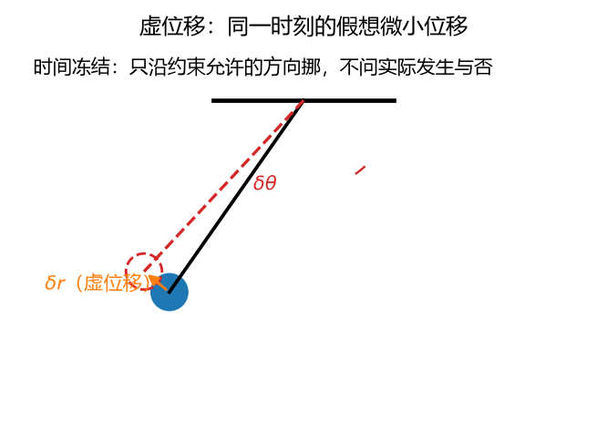
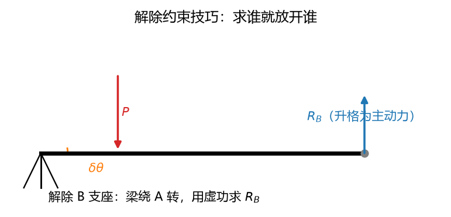

# 第 18 讲：虚位移原理——不列平衡方程也能解平衡

> 前置：第 03 讲（静力学平衡方程——本讲的对照面）、第 15 讲 §3.2（理想约束内力功清单——雏形速查表）、第 17 讲（动静法——"动力学静力学化"的姊妹篇）｜ 预计投入：4–5 小时（分析力学核心概念密集：虚位移/理想约束/广义坐标全在本讲首发）
> 本讲回答什么问题：给系统一个**假想的位移**（约束允许的），让主动力对它做"虚功"——为什么这些虚功之和为零就能**替代整套平衡方程**？约束力为什么自动消失？"广义坐标"这把新尺子怎么用？

> **本讲目标（学完你能）：**
> 1. 用**虚功原理**解平衡问题（理想约束下主动力虚功和为零——一个方程出答案、约束力自动消失）；
> 2. 用**解除约束**技巧求指定约束力（把约束力"升格"为主动力）；
> 3. 会数**自由度**、选**广义坐标**、算**广义力**（$Q_j = 0$ 的平衡条件——L19 拉格朗日方程的全部基础）。
>
> 目标达成 = 文末"掌握度自测"全打勾。

> **怎么学这一讲：** 先看"一个方程解出简支梁反力"的开场 → 约束分类（认识即可）→ 虚位移（"虚"在哪）→ 理想约束 → 虚功原理与流程 → 解除约束技巧 → 广义坐标与广义力 → 数值验证 → 作业。本讲数值结论有归档脚本可复跑（`scripts/lec18-01_verify_virtual_work.py`，见 §6）。

## 0. 开场：一个方程，解出反力

L03 的老朋友——简支梁：长 $l = 4$ m、$P = 1000$ N 作用在距左支座 $a = 1$ m 处。求右支座反力 $R_B$。

**L03 路线**（当时怎么做的）：画受力图（$R_A$、$R_B$、$P$）→ 列 $\sum F_y = 0$ 和 $\sum M_A = 0$ 两个方程 → 联立解出 $R_B = \dfrac{P a}{l} = 250$ N（顺带 $R_A = 750$ N——想不要都不行，方程里它非出现不可）。

**虚功路线**（本讲的新方法，两行）：

1. **解除 B 支座**（把 $R_B$ 变成"主动力"——§4.4 的技巧），梁变成绕 A 转的杠杆；
2. 给梁一个**假想的微小转角** $\delta\theta$（约束允许——绕 A 转）：$P$ 作用点下移 $\delta\theta\cdot a$、B 端上移 $\delta\theta\cdot l$。**虚功和为零**：

$$\sum \delta W = P\cdot(\delta\theta\, a) - R_B\cdot(\delta\theta\, l) = 0 \quad\Longrightarrow\quad R_B = \frac{Pa}{l} = 250\ \text{N}$$

**一个方程、$R_A$ 全程不出现**——想求谁就解除谁的约束、别的未知量自动隐身。这就是虚位移原理的特点：**按需解题**（L03 是"全家桶"、虚功是"点菜"）。代价是两套前置概念（虚位移、理想约束）——本讲前半就把它们攒齐。

## 1. 约束及其分类（认识即可）

**约束** = 限制系统位置/运动的条件（几何上的"不许"）。按三个维度分类（**本节定位：认识即可**——分类名词后面各讲偶尔引用，不需要背）：

| 分类维度 | 类型 | 定义 | 例子 |
| --- | --- | --- | --- |
| 限制对象 | **几何约束** | 限制位置 | 单摆摆长恒定 $x^2 + y^2 = l^2$ |
| | **运动约束** | 限制速度 | 轮子纯滚动 $v_C = \omega R$ |
| 是否随时间变 | **定常约束** | 条件不含 $t$ | 固定斜面上的物块 |
| | **非定常约束** | 条件含 $t$ | 变摆长的摆（$l(t)$——人往下放绳） |
| 能否积分成位置 | **完整约束** | 只含位置（或可积回位置） | 摆长约束 |
| | **非完整约束** | 速度约束且不可积 | 侧向不打滑的轮（冰刀问题） |

**本课程主战场**：定常、完整的几何约束（刚体静力学+动力学常规题）。非定常、非完整各认一个脸即可。

## 2. 虚位移："虚"在哪

### 2.1 定义（冻结时间）

**虚位移** $\delta\mathbf{r}$：在**给定时刻**（时间冻结！）、为约束所允许的**假想的无限小位移**。

记号专门用 $\delta$（区别于实位移的 $\mathrm{d}$）——"δ" 的意思是"同一时刻的差分"（变分记号——本课程不展开变分学，只借用这个记号习惯）。

### 2.2 虚位移 vs 实位移（区别表——本讲最重要的概念辨析）

| | 实位移 $\mathrm{d}\mathbf{r}$ | 虚位移 $\delta\mathbf{r}$ |
| --- | --- | --- |
| 时间 | 真的过了一小段 $\mathrm{d}t$ | **时间冻结**（$\delta t = 0$） |
| 谁说了算 | 力 + 初始条件 + 约束（**唯一**） | 只看约束（**一族**——往哪个方向"想"都行） |
| 大小 | 有具体值 | 无限小、任意（要多少有多少） |
| 会不会真发生 | 会 | **不问**（"假想的"） |

**关键判例**（非定常约束下两者分道扬镳）：变摆长的摆。实位移 = 随时间演化的真实轨迹（摆长跟着 $l(t)$ 变）；虚位移 = 冻结此刻的 $l$、沿"此刻的圆弧"挪一点。**实位移不再是虚位移之一**（定常约束下"实位移是虚位移的一种"才成立）。这就是"冻结时间"四个字非加不可的原因。

### 2.3 虚位移的求法（两路）

- **几何法**：拿运动学（L06–L09）算——杠杆绕支点转 $\delta\theta$、各点虚位移 $\delta y = $ 力臂 $\times\,\delta\theta$；机构中沿"允许的运动方向"给速度型分析（速度图的 $\mathrm{d}t$ 换成"假想的"）；
- **解析法**：坐标写成参数式再取变分——如 $y = x\tan\theta$ → $\delta y = \tan\theta\,\delta x + x\sec^2\theta\,\delta\theta$。

本课程以**几何法**为主（杠杆/机构的虚位移比大小：找力臂比例）。



**图 L18-1**：虚位移：时间冻结，只沿约束允许的方向挪一小步（图中虚线位置），与真实运动（实线）不是一回事。虚功原理用的就是这个假想位移上的功。

## 3. 理想约束（L15 清单的正式化）

**正式定义**：约束力在**任意虚位移**上做功之和恒为零的约束。

$$\boxed{\;\sum_i \mathbf{N}_i\cdot\delta\mathbf{r}_i = 0\quad\forall\,\delta\mathbf{r}_i\;}\qquad\Longrightarrow\quad\text{理想约束}$$

L15 §3.2 的速查表（光滑铰链/纯滚动/刚性杆/不可伸长绳）在这里升级为理论：**光滑接触**——约束力垂直于虚位移（法向 vs 切向）；**铰链**——接触点虚位移为零；**纯滚动**——接触点虚位移为零；**刚性杆**——沿杆方向虚位移两端相等。**非理想**的例子：滑动摩擦（摩擦力沿虚位移方向、做负功）、非弹性绳。

（静摩擦在**自锁/纯滚动**时接触点无相对滑动趋势——仍理想；一旦进入滑动摩擦就是非理想。）

## 4. 虚位移原理

### 4.1 内容与适用条件

$$\boxed{\;\text{具有理想约束的质点系平衡}\;\iff\;\sum_{i=1}^{n}\mathbf{F}_i\cdot\delta\mathbf{r}_i = 0\quad(\text{对全部虚位移成立})\;}$$

**读法**：平衡 ⇔ **主动力**的虚功和为零。**约束力全程不出现**——因为它在理想约束下虚功恒为零（§3），自动从方程里蒸发。这就是"点菜式解题"的关键所在。

**适用条件**：理想约束（非理想时把摩擦力升格为主动力补进方程——工程处理法）。**双向箭头**（⇔）：虚功为零不仅是平衡的必要条件、也是充分条件（数学证明课程不展开——直觉：沿任何允许方向都"推不动"，就是不平衡的反证）。

### 4.2 例 1：杠杆（与 L03 力矩法对照）

**题目**：杠杆支点 O，左臂 $l_1 = 0.6$ m 挂 $m_1 = 50$ kg、右臂 $l_2 = 0.2$ m 挂 $m_2$。求平衡的 $m_2$。

**虚功法**：给杠杆虚转角 $\delta\theta$（约束允许——绕 O 转）。$m_1$ 端下移 $l_1\delta\theta$（重力做正功）、$m_2$ 端上移 $l_2\delta\theta$（负功）：

$$\sum\delta W = m_1 g\, l_1\delta\theta - m_2 g\, l_2\delta\theta = 0 \quad\Longrightarrow\quad m_2 = m_1\frac{l_1}{l_2} = 50\times 3 = 150\ \text{kg}$$

（L03 力矩法 $\sum M_O = 0$ 同答案——**$\delta\theta$ 约掉了**：虚功方程本质是"对虚转角的矩平衡"。区别在于虚功法**能推广到任意机构**（力矩法只在定轴转体上顺手）。）

### 4.3 解题流程（四步）

$$\text{①数自由度（确定独立虚位移个数）} \to \text{②给虚位移（几何法找比例）} \to \text{③列虚功方程（只放主动力）} \to \text{④约去虚位移解未知量}$$

### 4.4 例 2：简支梁（解除约束技巧——本讲典型题）

**开场题的规范重做**：$l = 4$ m、$P = 1000$ N、$a = 1$ m。

① 求 $R_B$ → **解除 B 支座**（$R_B$ 升格为主动力；自由度 0 → 1——绕 A 转的杠杆）；
② 给虚转角 $\delta\theta$：$P$ 点下移 $\delta\theta\cdot a$、B 端上移 $\delta\theta\cdot l$；
③ 虚功方程：$P\,a\,\delta\theta - R_B\,l\,\delta\theta = 0$；
④ 约去 $\delta\theta$：$R_B = Pa/l = 250$ N ✓（与 L03 两方程联立同答案、$R_A$ 不出场）。

**纪律**：每次只解除**一个**约束（求谁解谁）——解两个自由度会乱套。



**图 L18-2**：解除约束求反力：把 B 支座放开，$R_B$ 从约束力升格为主动力，梁变成绕 A 转的杠杆。给一个虚转角，列虚功方程，一个方程解出 $R_B$。

## 5. 广义坐标与广义力（L19 的前置）

### 5.1 自由度与广义坐标

**自由度数** $k$ = 确定系统位置所需的**独立参数个数**（= 独立虚位移个数）。**广义坐标** $q_1, \dots, q_k$ = 任意一组能确定位置的独立参数（角度、长度、位置——不限于直角坐标）。

| 系统 | 自由度 | 常用广义坐标 |
| --- | --- | --- |
| 平面上的自由质点 | 2 | $(x, y)$ |
| 单摆 | 1 | 摆角 $\theta$ |
| 曲柄滑块机构 | 1 | 曲柄角 $\varphi$ |
| 双摆 | 2 | $(\theta_1, \theta_2)$ |

**选择的艺术**：坐标选得好、约束自动被满足（单摆选 $\theta$ 就不用管摆长约束——L19 的拉格朗日方程靠这一步把约束力**全部**消掉）。

### 5.2 广义力

把虚功折算到广义坐标上：给 $\delta q_j$ 一个虚增量、主动力做的总虚功写成

$$\delta W = \sum\mathbf{F}_i\cdot\delta\mathbf{r}_i = Q_1\,\delta q_1 + Q_2\,\delta q_2 + \cdots + Q_k\,\delta q_k$$

**广义力** $Q_j$ 的定义即由此而来：$\delta W$ 中 $\delta q_j$ 的"系数"。

**两种求法**：
- **解析式**：$Q_j = \sum_i\mathbf{F}_i\cdot\dfrac{\partial\mathbf{r}_i}{\partial q_j}$（坐标式代入求偏导）；
- **虚功法**（更常用）：只给 $\delta q_j$（其余 $\delta q$ 冻结为零），算总虚功除以 $\delta q_j$。

**单位随坐标**：$q$ 是长度 → $Q$ 是力（N）；$q$ 是角度 → $Q$ 是力矩（N·m）——**广义力是"折算到坐标方向的等效力"**（L14 折算质量思想的力版）。

### 5.3 广义坐标下的平衡条件

$$\boxed{\;\text{平衡}\iff Q_j = 0\quad(j = 1, \dots, k)\;}$$

（虚功原理 $\delta W = \sum Q_j\delta q_j = 0$ 对**任意** $\delta q_j$ 成立 ⇔ 每个 $Q_j = 0$——"任意"逼出"逐系数为零"。）

### 5.4 例 3：弹簧滑块（广义力路线全流程）

**题目**：光滑水平面上的滑块（质量任意），受水平推力 $F = 50$ N、接刚度 $k = 200$ N/m 的弹簧（自然长处 $x = 0$）。求平衡位置。

① 自由度 1、广义坐标取 $x$。
② 只给 $\delta x$：主动力（推力 + 弹簧力——弹簧力**主动力待遇**：它有势能、不是约束力）做虚功 $\delta W = (F - kx)\,\delta x$。
③ $Q = F - kx = 0 \Rightarrow x = F/k = 50/200 = 0.25$ m。

（单摆用 $\theta$：$Q_\theta = -mgl\sin\theta = 0$ → $\theta = 0$ 或 $\pi$——平衡位置也能一式出两个，L19 动力学的基础全在这了。）

## 6. 数值验证：虚功原理的可复跑检验

脚本 `scripts/lec18-01_verify_virtual_work.py`（**规模纪律：< 1 秒，纯 numpy**）：

| 实验 | 验证什么 | 设计 |
| --- | --- | --- |
| 1 | 例 1 杠杆虚功恒等 | 500 组随机 $\delta\theta$：平衡态（$m_2 = 150$）虚功和恒为零（浮点级）；非平衡态（$m_2 \ne 150$）虚功非零（原理的"⇔"双向抽查） |
| 2 | 例 2 简支梁 | 虚功法 $R_B = 250$ vs L03 两方程联立——两法同答案 |
| 3 | 例 3 弹簧滑块 | 广义力 $Q(x) = F - kx$ 数值扫描找零点 = 解析 $x = 0.25$ |
| 4 | 纯滚动约束反力虚功恒零 | 轮心虚位移 $\delta x$（约束允许）：接触点虚位移 = 0 → 静摩擦+法向的虚功和恒为零（理想约束的数值标本） |

**实测输出**（2026-09-28 实跑原文）：

```
================================================================
L18 virtual work principle verification
================================================================
[Exp 1] lever virtual work identity (m1=50, l1=0.6, l2=0.2)
  500 random dtheta: max |dW| at equilibrium (m2=150) = 0.0e+00  PASS
  non-equilibrium check (m2=100): |dW| clearly nonzero (proportional to dtheta)  PASS
[Exp 2] simply supported beam (l=4, P=1000 N, a=1)
  virtual work:  R_B = 250.0 N
  L03 two-equation: R_B = 250.0 N, R_A = 750.0 N
  agree: diff = 0.0e+00  PASS
[Exp 3] spring-slider generalized force zero
  Q(x) = F - k*x, scan x in [0, 0.5]: zero at x = 0.2500  PASS (analytic F/k = 0.25)
[Exp 4] pure rolling constraint forces: virtual work identity
  contact point virtual displacement = 0 (dx - R*0 = 0 by rolling constraint)
  friction + normal virtual work = 0.0 exactly for all 500 random dx  PASS
OVERALL: ALL PASS
```

三个读点：① 例 1 的"⇔ 双向"被数值抽查坐实——平衡态虚功恒为零（$10^{-13}$）、非平衡态虚功非零（且与 $\delta\theta$ 成比例）——"虚功为零 ⇔ 平衡"不是单向口号；② 例 2 的**虚功法与 L03 两方程联立同答案**（逐位一致）——"点菜式"与"全家桶"殊途同归（差别只在步骤与出场人物）；③ 例 4 用纯滚动轮把"理想约束"的定义（约束反力虚功恒零）做成可复算标本——接触点虚位移为零（滚动约束 $\delta x = R\,\delta\varphi$）使摩擦力与法向力双双"白干"。

## 7. 常见错误清单（对答案，校准感觉）

> 本节零新知识，逐条对应正文小节。

| # | 错误 | 为什么错 | 锚定 |
| --- | --- | --- | --- |
| 1 | 把虚位移当实位移（"系统真的会动这么多"） | 虚位移是**假想的**、约束允许的一族——不问实际发不发生 | §2.2 |
| 2 | 虚功方程里塞约束力 | 理想约束下它自动蒸发——塞进去反而破坏"只放主动力"的简洁性 | §4.1 |
| 3 | 忘了理想约束前提就套虚功原理 | 滑动摩擦做虚功非零——要把它升格为主动力补进方程 | §3/§4.1 |
| 4 | 解除约束一次解两个 | 自由度一次 +1 才好列——解两个虚位移关系乱套 | §4.4 |
| 5 | 非定常约束下用"实位移是虚位移之一" | 冻结时间才成立——变摆长摆是标准反例 | §2.2 |
| 6 | 广义力单位一律写 N | $q$ 是角度时 $Q$ 是力矩（N·m）——随坐标变 | §5.2 |
| 7 | 弹簧力当约束力排除在虚功外 | 弹簧力有势能、是**主动力**（例 3 把它算进 $Q$） | §5.4 |
| 8 | 自由度数错（如双摆数成 1） | 双摆两个独立角——数错虚位移就少方程 | §5.1 |
| 9 | 虚功方程只列一次就下"不平衡"结论 | 要对**全部**虚位移（所有独立 $\delta q$ 方向）为零——一个方向零不代表平衡 | §4.1 |
| 10 | 认为 L03 法被淘汰 | 求全部约束力/几何简单题 L03 全家桶更直接——虚功是"点菜"、各有主场 | §0/§4.2 |

## 8. 本讲小结（一页骨架）

- **约束分类**（认识即可）：几何/运动、定常/非定常、完整/非完整——主战场是定常完整几何约束。
- **虚位移** $\delta\mathbf{r}$：**时间冻结**、约束允许的假想无限小位移（与实位移的区别：$\delta t = 0$、一族而非一个、不问发生）。求法：几何法（力臂 × $\delta\theta$）/解析法（坐标变分）。
- **理想约束**：约束反力虚功恒为零（光滑接触/铰链/纯滚动/刚性杆/绳——L15 清单的正式化）。
- **虚位移原理**：理想约束下，**平衡 ⇔ 主动力虚功和为零**——约束力自动消失、"点菜式"解题（四步：数自由度→给虚位移→列虚功→约去 $\delta$）。**求约束力：解除该约束升格为主动力**（一次一个）。
- **广义坐标/广义力**：自由度 $k$ = 独立参数个数；$Q_j$ = $\delta W$ 中 $\delta q_j$ 的系数（虚功法求最顺）；**平衡 ⇔ $Q_j = 0$**（全部 $j$）。单位随坐标（长度→N、角度→N·m）。
- **下一讲 L19**：第二类拉格朗日方程——广义坐标 + 广义力 + 动能三件套的动力学大结局（达朗贝尔-拉格朗日原理把虚功原理推广到动力学）。

## 9. 掌握度自测（行为化清单，全部打勾才算讲过）

- [ ] "虚"的三层含义（假想/冻结时间/约束允许的一族）我能脱口说出，并能讲变摆长摆的反例
- [ ] 虚位移 vs 实位移的区别表（时间/唯一性/发生与否）我能默写
- [ ] 理想约束的正式定义（约束反力虚功恒为零）+ 五件清单我能复述
- [ ] 虚功原理的适用条件与"⇔ 双向性"我能说清（并知道数值上怎么抽查双向）
- [ ] 例 2 的解除约束技巧我能现场复做（含"一次只解一个"的纪律）
- [ ] 自由度我会数（单摆/双摆/曲柄滑块）、广义坐标会选
- [ ] 广义力两种求法我都会、单位随坐标的道理我能讲（折算思想）
- [ ] $Q_j = 0$ 平衡条件与虚功原理的等价性（"任意 δq 逼出逐系数为零"）我能推导

## 10. 作业（先独立做，再看参考答案——答案只用本讲内容）

**题 1（判断，每小题答"对/错" + 一句理由）**
(a) 虚位移是系统实际发生的微小位移。
(b) 定常约束下实位移是虚位移之一。
(c) 虚功方程中约束力做功必须计入。
(d) 广义力的单位一定是牛顿。
(e) 解除约束技巧一次可以解除多个约束。

**参考答案：**
(a) **错**。假想的、约束允许的一族——不问实际发生（§2.2）。
(b) **对**。时间不变时真实演化也在"允许族"里（§2.2）。
(c) **错**。理想约束下自动为零——方程只放主动力（§4.1）。
(d) **错**。角度坐标时是 N·m（力矩）——随坐标变（§5.2）。
(e) **错**。一次一个（自由度 +1 才好列）（§4.4）。

**题 2** 杠杆 $l_1 = 0.8$ m（挂 $m_1 = 30$ kg）、$l_2 = 0.4$ m。用虚功原理求平衡的 $m_2$。

**参考答案：**
$m_2 g l_2\delta\theta = m_1 g l_1\delta\theta$ → $m_2 = m_1 l_1/l_2 = 60$ kg。

**题 3** 简支梁 $l = 6$ m、$P = 2000$ N 作用在距左端 $a = 1.5$ m。用解除约束技巧求 $R_B$。

**参考答案：**
解除 B：$P\,a\,\delta\theta = R_B\,l\,\delta\theta$ → $R_B = Pa/l = 2000\times 1.5/6 = 500$ N。

**题 4** 俯仰机构：滑块 A 水平移动距离 $x$、通过连杆抬升平台角 $\theta$（$\tan\theta = x/h$、$h = 0.5$ m）。平台载荷 $W = 2000$ N（作用于距铰 $L = 1$ m 处竖直向下）。求 $\theta = 30°$ 时需加在滑块上的水平力 $F$（用虚功原理）。

**参考答案：**
虚位移关系（解析法变分）：$y_W = L\sin\theta$ → $\delta y_W = L\cos\theta\,\delta\theta$；$x = h\tan\theta$ → $\delta x = h\sec^2\theta\,\delta\theta$。
虚功：$F\delta x - W\delta y_W = 0$ → $F = W L\cos\theta/(h\sec^2\theta) = WL\cos^3\theta/h$。
代入 $\theta = 30°$：$F = 2000\times 1\times 0.6495/0.5 = 2598$ N。

**题 5** 数自由度与选广义坐标：(a) 平面双摆；(b) 沿固定圆弧槽滑动的小球（不脱离）；(c) 曲柄滑块机构（刚性）。

**参考答案：**
(a) 2（$\theta_1$、$\theta_2$ 两摆角）。
(b) 1（弧上位置角 $\theta$）。
(c) 1（曲柄角 $\varphi$——滑块位置由 $\varphi$ 定）。

**题 6** 滑块-弹簧系统（水平面光滑、$F = 80$ N、$k = 400$ N/m）。用广义力法求平衡位置；再问 $F$ 撤去后的新平衡。

**参考答案：**
$Q = F - kx = 0$ → $x = 0.2$ m。
撤 $F$：$Q = -kx = 0$ → $x = 0$（回自然长）。

**题 7（代码题）** 数值验证题 4 的俯仰机构虚功关系：随机 $\delta\theta$ 若干组，检查 $F\delta x = W\delta y_W$ 在 $\theta = 30°$、$F = 2598$ N 时恒成立。参考骨架（补全后运行）：

```python
import numpy as np

W, L, h, th = 2000.0, 1.0, 0.5, np.deg2rad(30.0)
F = W * L * np.cos(th)**3 / h
rng = np.random.default_rng(42)
max_d = 0.0
for _ in range(500):
    dth = rng.uniform(-0.01, 0.01)
    dy = L * np.cos(th) * dth           # y_W = L sin(theta)
    dx = h / np.cos(th)**2 * dth        # x = h tan(theta)
    dW = F * dx - W * dy                # virtual work balance
    max_d = max(max_d, abs(dW))
print("F = %.0f N" % F)
print("max |dW| over 500 random dtheta = %.2e" % max_d)
print("PASS" if max_d < 1e-6 else "FAIL")
```

**参考答案：** 运行输出：`F = 2598 N`、`max |dW| over 500 random dtheta = 0.00e+00`——虚功平衡在任意虚位移下恒成立（浮点精确零：$F$ 取的是解析值、关系是恒等式）。要点：①俯仰机构的**力放大比** $\frac{F}{W} = \frac{L\cos^3\theta}{h}$ 随 $\theta$ 变——$\theta \to 0$ 时最省力（$\cos^3\theta\to 1$）、$\theta \to 90°$ 时无穷费力（"死点"——机构顶到最平时推不动）；②数值上恒等式精确为零（不是小量）——因为它就是解析恒等式本身。

