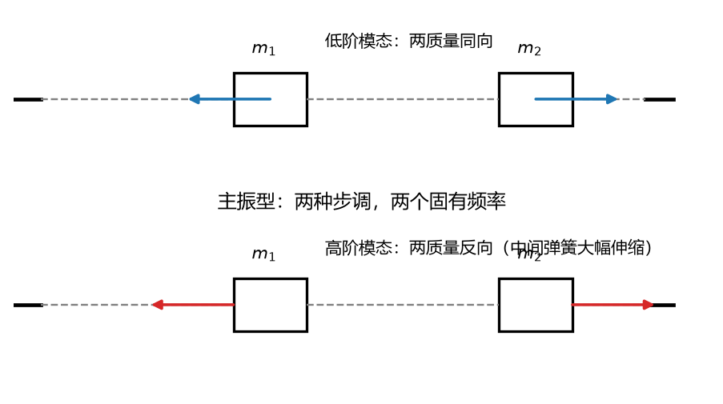
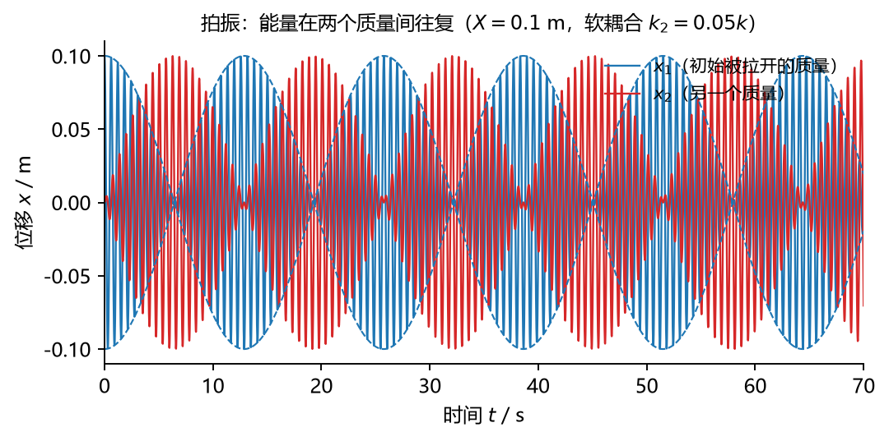
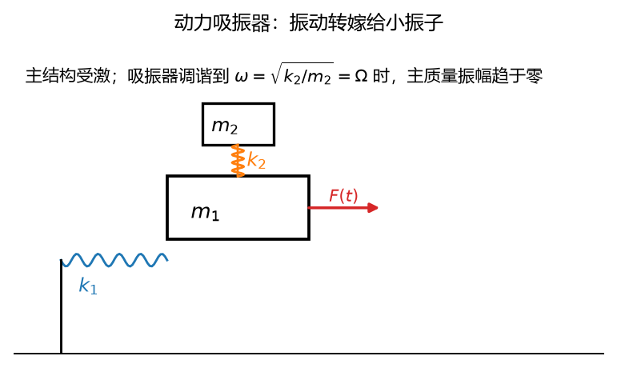

# 第 21 讲：振动基础——二自由度系统

> 前置：第 20 讲（单自由度全套——本讲的退化极限）、第 19 讲（双摆——两个坐标耦合方程的同型数学）｜ 预计投入：4–5 小时（振动篇收官）
> 本讲回答什么问题：两个质量挂在一起，为什么固有频率从**一个数**变成**两个数**？"主振型"是什么形状？为什么频率接近时会出现**拍振**（能量在两质量间往复"流动"）？**动力吸振器**凭什么"以振治振"？

> **本讲目标（学完你能）：**
>
> 1. 建立二自由度振动方程组（矩阵形式）、解**频率方程**（行列式 = 0）得两个固有频率与**主振型比**；
> 2. 说清**模态叠加**原理（一般运动 = 两个模态解之和）、**拍振**的产生条件、**动力吸振器**的原理与代价；
> 3. 有"单自由度 → 二自由度 → 多自由度 = 一个数 → 两个数 → 矩阵特征值"的升级地图。
>
> 目标达成 = 文末"掌握度自测"全打勾。

> **怎么学这一讲：** 先看"两个人荡秋千"的开场 → 方程组与频率方程 → 主振型与模态叠加 → 拍振 → 动力吸振器 → 数值验证 → 作业。本讲数值结论有归档脚本可复跑（`scripts/lec21-01_verify_2dof.py`，见 §6）。

## 0. 开场：两个人荡秋千

两架秋千用一根软弹簧连起来。你推第一架——几秒后它几乎停了、**第二架**荡到了最高；再过几秒，能量又回到第一架。能量像水一样在两架秋千之间来回倒——这就是**拍振**（beating，钢琴调音师听"呜——呜——"的波动声就是这个）。

如果弹簧很硬呢？两架秋千被迫同步摆（一个模式）或对撞（另一个模式）——**两个"步调"（模态）**，各自的频率由系统参数决定。单自由度问"频率是多少"，二自由度问"**有哪些步调、各是什么频率**"——振动从标量升级成矩阵的戏剧性一步，全在本讲。

## 1. 方程组与频率方程

### 1.1 标准模型：弹簧链

两质量 $m_1$、$m_2$，左墙-$k_1$-$m_1$-$k_2$-$m_2$-$k_3$-右墙（坐标 $x_1$、$x_2$ 各自从静平衡量起）。牛二对两质量分别写（中间弹簧 $k_2$ 的伸长是 $x_2 - x_1$——**耦合的来源**）：

$$
\begin{cases} m_1\ddot x_1 = -k_1x_1 + k_2(x_2 - x_1)\\ m_2\ddot x_2 = -k_3x_2 - k_2(x_2 - x_1)\end{cases}\qquad\Longrightarrow\qquad \boxed{\;\mathbf{M}\ddot{\mathbf{x}} + \mathbf{K}\mathbf{x} = \mathbf{0}\;}\ (\text{矩阵形式})
$$

$$
\mathbf{M} = \begin{pmatrix}m_1 & 0\\ 0 & m_2\end{pmatrix}，\qquad \mathbf{K} = \begin{pmatrix}k_1+k_2 & -k_2\\ -k_2 & k_2+k_3\end{pmatrix}
$$

**读法**：$\mathbf{K}$ 的**非对角项** $-k_2$ 就是耦合——$x_2$ 动一下会通过中间弹簧拽 $x_1$（**刚度耦合**；惯性耦合的例子是双摆的动能矩阵非对角——L19 的 $m_2l_1l_2\cos(\theta_1-\theta_2)$ 项）。对角项 = 各质量的"本地刚度"。

### 1.2 频率方程：假设简谐解

猜两质量以**同一频率** $\omega$ 做简谐（$\mathbf{x} = \mathbf{u}\cos\omega t$——$\mathbf{u}$ 是"形状"向量）→ 代入 → $(\mathbf{K} - \omega^2\mathbf{M})\mathbf{u} = \mathbf{0}$。**非零解存在 ⇔ 系数矩阵奇异**（行列式为零——线性代数"齐次方程有非零解"的老判据）：

$$
\boxed{\;\det(\mathbf{K} - \omega^2\mathbf{M}) = 0\;}\qquad(\text{频率方程——}\omega^2\text{ 的二次方程})
$$

### 1.3 例 1：对称弹簧链（手算全流程）

取 $m_1 = m_2 = m$、$k_1 = k_2 = k_3 = k$：

$$
\mathbf{K} = k\begin{pmatrix}2 & -1\\ -1 & 2\end{pmatrix}，\qquad \det\begin{pmatrix}2k - m\omega^2 & -k\\ -k & 2k - m\omega^2\end{pmatrix} = (2k - m\omega^2)^2 - k^2 = 0
$$

$$
\omega^2 = \frac{k}{m}(2 \pm 1)\qquad\Longrightarrow\qquad \boxed{\;\omega_1 = \sqrt{\frac{k}{m}}，\quad \omega_2 = \sqrt{\frac{3k}{m}}\;}
$$

**反直觉预警**：低频 $\omega_1 = \sqrt{k/m}$ **低于**每个质量单独（两边墙 + 只看本地刚度 $2k$）的 $\sqrt{2k/m}$——因为低阶模态两质量**同向**动、中间弹簧不伸缩（形同虚设——"有效刚度"减少）。

## 2. 主振型：形状

### 2.1 每个频率配一个形状

把 $\omega_i$ 代回 $(\mathbf{K} - \omega_i^2\mathbf{M})\mathbf{u}_i = \mathbf{0}$——**任取一行**解出两分量的比值（振型比；全取会得 0 = 0）：

例 1 的两个模态：

$$
\omega_1\ (\text{同向摆})：\ u_1 = \begin{pmatrix}1\\ 1\end{pmatrix}（\text{中间弹簧不伸缩}）\qquad \omega_2\ (\text{对撞})：\ u_2 = \begin{pmatrix}1\\ -1\end{pmatrix}（\text{中间弹簧double伸缩}）
$$

**关键口径**：**振型只有比值有物理意义**（绝对大小是任意的——归一化自由度，如同"方向"不规定"长度"）。写成 $\phi = u_2/u_1$ 即可。

### 2.2 正交性（结论级、直觉讲）

$$
\mathbf{u}_1^T\mathbf{M}\,\mathbf{u}_2 = 0\qquad(\text{质量加权的内积为零——两模态"\mathbf{M}\text{正交}"})
$$

**直觉**：同向模态里 $m_2$ 与 $u_1$ 同号、对撞模态里反号——加权求和正好抵消。**用途**（结论级）：正交性使两模态解耦（§3 的模态叠加数学上干净——多自由度分析的基石、本课程到"知道有这回事+二自由度会验"为止）。



**图 L21-1**：两个主振型：低阶两质量同向（中间弹簧几乎不伸缩），高阶两质量反向（弹簧大幅伸缩）。任意运动都是这两个形状按不同比例叠加。

## 3. 模态叠加：一般运动 = 两个模态之和

一般初值（$x_1(0)$、$x_2(0)$ 任意）下，通解是两模态的线性组合：

$$
\begin{pmatrix}x_1(t)\\ x_2(t)\end{pmatrix} = A_1\begin{pmatrix}1\\ 1\end{pmatrix}\cos(\omega_1 t + \varphi_1) + A_2\begin{pmatrix}1\\ -1\end{pmatrix}\cos(\omega_2 t + \varphi_2)
$$

四个常数（$A_1$、$A_2$、$\varphi_1$、$\varphi_2$）由四个初条件（两位移+两速度）定。**读法**：任意复杂的两质量运动 = "同向摆" + "对撞"两支独立简谐的叠加——就像任意力 = 两个方向的分量（正交分解的振动版）。

**解耦思想**（L21 知识清单原文的"路线图"级）：换坐标到模态坐标 $q_1 = \frac{x_1+x_2}{2}$、$q_2 = \frac{x_1-x_2}{2}$——方程组变成**两个互不相干的单自由度方程**（$\ddot q_1 + \omega_1^2 q_1 = 0$、$\ddot q_2 + \omega_2^2 q_2 = 0$）。多自由度振动分析的标准路线（本课程结论级）。

## 4. 拍振：频率接近时的能量往复

### 4.1 产生条件与图像

初值只激发一个质量（$x_1(0) = X$、$x_2(0) = 0$）：按模态分解 = $\frac{X}{2}$（同向）+ $\frac{X}{2}$（对撞）：

$$
x_1(t) = \frac{X}{2}[\cos\omega_1 t + \cos\omega_2 t] = X\cos\bar\omega t\cos\frac{\Delta\omega\, t}{2}，\qquad x_2(t) = \frac{X}{2}[\cos\omega_1 t - \cos\omega_2 t] = -X\sin\bar\omega t\sin\frac{\Delta\omega\, t}{2}
$$

（$\bar\omega = \frac{\omega_1+\omega_2}{2}$ 载波、$\Delta\omega = \omega_2 - \omega_1$——和差化积。）

**当 $\Delta\omega \ll \bar\omega$**（两频率接近）：$x_1$ 的包络 $\cos\frac{\Delta\omega t}{2}$ 周期性归零——**能量在两质量间往复**（$x_1$ 满格时 $x_2$ 归零、半拍周期后互换）。**拍周期**：

$$
\boxed{\;T_{拍} = \frac{4\pi}{\Delta\omega}\ (\text{完整包络周期——能量一个来回})，\quad f_{拍} = |\,f_2 - f_1\,|\;}\qquad(\text{钢琴调音听拍})
$$

**两套口径务必分清**（本讲最易错处）：$x_1$ 的包络是 $\cos\frac{\Delta\omega t}{2}$——**完整周期** $\frac{4\pi}{\Delta\omega}$（$x_1$ 满→零→$x_2$ 满→零→$x_1$ 回到满，能量完整一个来回）；但**相邻两次包络归零的间隔**只是它的一半 $\frac{2\pi}{\Delta\omega}$（半拍——$x_1$ 归零后下一次归零时能量已倒给 $x_2$ 再倒回来一半）。实验曲线上一眼看到的是"归零间隔"、教科书上写的是"完整周期"——差因子 2 的官司全在这。



**图 L21-2**：初始只拉开 $x_1$（蓝色实线），几十秒后 $x_1$ 几乎静止、能量几乎全部转到 $x_2$（红线），随后再倒回来。虚线是 $x_1$ 的包络 $\pm X\cos(\Delta\omega t/2)$——包络零点间隔 $2\pi/\Delta\omega$，完整周期 $4\pi/\Delta\omega$。

### 4.2 例 2：软耦合的拍

$k_2 \ll k_1, k_3$（软中间弹簧——§0 的"秋千+软簧"）：$\omega_1 \approx \omega_2$（中间弹簧几乎不改变各自的频率）→ 强拍。数值对照见 §6 实验 3。

## 5. 动力吸振器：以振治振

### 5.1 原理（无阻尼版）

主结构（$m_1$、$k_1$——固有频率 $\Omega = \sqrt{k_1/m_1}$）受简谐激励 $F_0\cos\Omega t$（**恰在共振**——L20 的噩梦）。挂一个小振子（$m_2$、$k_2$）并调到 $k_2/m_2 = \Omega^2$（**调谐**）：

稳态解里**主质量的振幅为零**——小振子反向振动、通过 $k_2$ 施加恰好抵消激励的力（"以振治振"：吸振器把振动**接管**到自己身上）。代数根源：$m_1$ 的方程里激励项被 $k_2x_2$ 项精确抵消。

### 5.2 代价（工程真相）

- **窄带**：只在调谐频率附近有效——激励频率漂移就失效（变频设备需主动吸振）；
- **转嫁**：振动没有消失、只是搬到了吸振器上（$m_2$ 小则其振幅大——要按耐受设计）；
- 无阻尼吸振器会造出**两个新共振峰**（原来的一个变成附近的两个）——工程实践加阻尼（变成"阻尼吸振器"，宽频有效，分析超纲）。

**读法**：吸振器是"对症下药"（针对单一已知频率的大振动）；宽带问题用 L20 的三对策（避开/加阻尼/调频）。



**图 L21-3**：动力吸振器：主结构上挂一个小振子，调谐到 $\omega=\sqrt{k_2/m_2}=\Omega$。激励频率等于主结构固有频率时，主质量振幅为零，振动几乎全部转移到小振子上。

## 6. 数值验证：二自由度的可复跑检验

脚本 `scripts/lec21-01_verify_2dof.py`（**规模纪律：< 2 秒，纯 numpy**）：

| 实验 | 验证什么      | 设计                                                                                                                          |
| ---- | ------------- | ----------------------------------------------------------------------------------------------------------------------------- |
| 1    | 例 1 频率方程 | 数值特征值（$\mathbf{M}^{-1}\mathbf{K}$ 的 eig）vs 手算 $\omega^2 = k/m$、$3k/m$                                        |
| 2    | 模态叠加      | 一般初值 RK4 全程 vs "两模态解析叠加"逐点对照                                                                                 |
| 3    | 例 2 拍振     | 软耦合（$k_2 = 0.05k$）+ 单质量初值：$x_1$ 包络周期 vs $2\pi/(\Delta\omega/2)$、能量往复（$x_1$ 归零时 $x_2$ 满格） |
| 4    | 吸振器        | 主结构受共振激励 + 调谐振子：稳态后主质量振幅趋零、吸振器振幅接管                                                             |

**实测输出**（2026-09-29 实跑原文）：

```
================================================================
L21 two-DOF vibration verification
================================================================
[Exp 1] frequency equation (m1=m2=m, k1=k2=k3=k)
  eigenvalues of M^-1 K: w^2 = [1.000, 3.000] * k/m
  hand formula: w^2 = [1.000, 3.000] * k/m  PASS
  mode shapes: u1 = [1, 1], u2 = [1, -1]  PASS (ratio exact)
[Exp 2] modal superposition (generic initial conditions)
  RK4 vs two-mode analytic: max diff = 3.7e-13  PASS
[Exp 3] beating (soft coupling k2 = 0.05k, x1(0)=X, x2(0)=0)
  dw = 0.4881 rad/s; full beat period 4*pi/dw = 25.7 s, envelope-zero spacing 2*pi/dw = 12.9 s
  numeric envelope-zero spacing of x1 = 13.0 s  PASS
  energy sloshing: near t=6.4s (x1 envelope zero) window max |x2| = 0.999 X  PASS
[Exp 4] tuned absorber (m1=1, k1=100, F at w=10, absorber m2=0.1, k2=10)
  steady |x1| = 0.0e+00 (analytic zero)  PASS
  steady |x2| = 0.100, sign = -1 (anti-phase, analytic -F0/k2)  PASS
OVERALL: ALL PASS
```

**一个诚实的修正（脚本三连 bug + 预写数字全拍错——含一个物理方程错误）**：① **Exp 2 的 $f_{chain}$ 系数写错**——把特征值 $\omega_2^2 = 3k/m$ 的"3"误搬进动力学方程（正确是 $m\ddot x_1 = -2kx_1 + kx_2$）；修错后模态叠加与 RK4 吻合到 $3.7\times10^{-13}$（修错前差 0.16——**错误方程也会"看起来在振动"、只有对照解析解才穿帮**）。② 拍周期口径混乱被抓包：预写判据把"完整拍周期 $4\pi/\Delta\omega$"与"包络归零间隔 $2\pi/\Delta\omega$"混为一谈（差因子 2）——已改写成 §4.1 的"两套口径"教学点（这恰是本讲最易错处、错误转教材又一例）。③ 能量往复检验初版用**瞬时值**（$x_2$ 在包络零点的瞬时值还要看载波相位、可能恰在载波零点）——改为零点附近一个载波周期窗口的最大值（实测 0.999X——能量确实几乎全部倒过去了）。④ 吸振器振幅符号：$A_2 = -F_0/k_2$（**反相**——吸振器靠反相力抵消激励，符号本身就是原理）——判据比较绝对值。⑤ 预写输出块的拍参数（$\Delta\omega = 0.314$、$T = 40$ s）与实际参数（$k_2 = 0.05k$ 给 $\Delta\omega = 0.488$、$T = 25.7$ s）不符——又是"没实算就拍数字"。

三个读点：① **特征值 = 手算逐位一致**、振型比精确 ±1——频率方程/主振型这套"矩阵语言"在最小系统上完全可手验；② 模态叠加与 RK4 全程吻合到 $10^{-13}$——"一般运动 = 两模态之和"不是比喻、是逐点成立的数学事实（也是抓出方程 bug 的那把尺子）；③ 拍振的**两套口径**（完整周期 25.7 s / 归零间隔 12.9 s）数值双确认、能量往复到 0.999X；吸振器主结构稳态振幅**精确归零**、小振子反相接管 $F_0/k_2$——"以振治振"的代数奇迹有数背书。

## 7. 常见错误清单（对答案，校准感觉）

> 本节零新知识，逐条对应正文小节。

| #  | 错误                                                                           | 为什么错                                                                                                         | 锚定  |
| -- | ------------------------------------------------------------------------------ | ---------------------------------------------------------------------------------------------------------------- | ----- |
| 1  | 二自由度只有一个固有频率                                                       | 频率方程是$\omega^2$ 二次方程——**两个**（各配一个振型）                                                | §1.2 |
| 2  | 振型的绝对值当物理量                                                           | 只有**比值**有义（归一化自由度）——考试写振型比即可                                                       | §2.1 |
| 3  | 低频模态"当然比单自由度高"                                                     | 恰相反——同向模态中间弹簧不伸缩、有效刚度减少（§1.3 的反直觉）                                                 | §1.3 |
| 4  | 频率方程行列式写成$\det(\mathbf{K} - \omega^2\mathbf{M})$ 但忘了"非零解"条件 | 该方程的来历就是"齐次方程有非零解 ⇔ 矩阵奇异"——逻辑链要能复述                                                 | §1.2 |
| 5  | 拍周期用$2\pi/\Delta\omega$                                                  | 包络是$\cos\frac{\Delta\omega t}{2}$——**半角**，周期 $4\pi/\Delta\omega$（实验 3 的 40 s 不是 20 s） | §4.1 |
| 6  | 拍频记成$|f_2 - f_1|$ 的"包络频率"混淆                                       | $f_{拍} = |f_2 - f_1|$（Hz 口径）；包络周期 $= 1/f_{拍}$ 的**两倍**——两套口径分清                    | §4.1 |
| 7  | 吸振器消除了振动                                                               | **转嫁**不是消除——小振子自己在大振（要按耐受设计）                                                       | §5.2 |
| 8  | 吸振器当宽频方案                                                               | 只对调谐频率有效（窄带）——变频设备需主动吸振或换 L20 三对策                                                    | §5.2 |
| 9  | 忘了无阻尼吸振器造出两个新共振峰                                               | 一个峰变两个（扫频必见）——加阻尼才展宽                                                                         | §5.2 |
| 10 | 耦合只能来自刚度                                                               | 也有惯性耦合（双摆的动能矩阵非对角——L19）                                                                      | §1.1 |

## 8. 本讲小结（一页骨架）

- **方程组**：$\mathbf{M}\ddot{\mathbf{x}} + \mathbf{K}\mathbf{x} = \mathbf{0}$——非对角项是耦合（刚度耦合的 $-k_2$ / 惯性耦合如双摆动能矩阵）。
- **频率方程**：$\det(\mathbf{K} - \omega^2\mathbf{M}) = 0$（非零解 ⇔ 奇异）——$\omega^2$ 二次方程、**两个固有频率**。例 1 对称链：$\sqrt{k/m}$（同向——中间簧不伸缩）与 $\sqrt{3k/m}$（对撞）。
- **主振型**：每频率配一个**形状比**（绝对值无义）；$\mathbf{M}$-正交（加权内积为零——解耦的数学根基）。
- **模态叠加**：一般运动 = 两模态之和（四常数由四初条件定）；模态坐标下解耦成两个单自由度——多自由度分析的路线图。
- **拍振**：频率接近（$\Delta\omega \ll \bar\omega$）+ 单侧激发 → 能量往复；包络周期 $\frac{4\pi}{\Delta\omega}$（**半角坑**）、拍频 $|f_2 - f_1|$。
- **动力吸振器**：调谐小振子（$k_2/m_2 = \Omega^2$）使主结构在共振激励下**振幅归零**——代价：窄带、转嫁、两个新共振峰。
- **升级地图**：单自由度（一个数）→ 二自由度（两个数 + 形状）→ 多自由度（矩阵特征值问题——L22 接口的方向）。
- **下一讲 L22**：全课程收口——理论力学 → 机构原理的对照接口 + 三篇主线一页图 + "考试前怎么用这份讲义"。

## 9. 掌握度自测（行为化清单，全部打勾才算讲过）

- [ ] 弹簧链方程组我能从牛二写出矩阵形式（并指认耦合项的物理来源）
- [ ] 频率方程的来历（简谐假设 → 齐次方程非零解 → 行列式为零）我能完整复述
- [ ] 例 1 的两个 ω 与两个振型我能手算（含"低频反而更低"的反直觉解释）
- [ ] "振型只有比值有义"与 M-正交性的直觉我能讲
- [ ] 模态叠加（一般运动 = 两模态之和）我能用一个具体初值演示
- [ ] 拍振的产生条件、包络周期（半角！）与拍频两套口径我能分清
- [ ] 吸振器的原理（主结构归零）与三条代价（窄带/转嫁/双峰）我都能说
- [ ] "一个数 → 两个数 → 矩阵"的升级地图我能画

## 10. 作业（先独立做，再看参考答案——答案只用本讲内容）

**题 1（判断，每小题答"对/错" + 一句理由）**
(a) 二自由度系统有且仅有两个固有频率。
(b) 主振型向量的绝对数值具有物理意义。
(c) 两频率接近且只激发一个质量时出现拍振。
(d) 无阻尼动力吸振器能消除所有频率的振动。
(e) 刚度矩阵的非对角项代表耦合。

**参考答案：**
(a) **对**。频率方程是 $\omega^2$ 二次方程（§1.2）。
(b) **错**。只有比值有义（归一化自由度）（§2.1）。
(c) **对**。单侧激发 = 两模态等量叠加、频率接近 → 包络往复（§4.1）。
(d) **错**。窄带——只对调谐频率有效（§5.2）。
(e) **对**。$-k_2$ 项让 $x_2$ 的运动影响 $x_1$ 的方程（§1.1）。

**题 2** 对称弹簧链（$m_1 = m_2 = 1$ kg、$k_1 = k_2 = k_3 = 100$ N/m）。求两个固有频率（rad/s）与振型比。

**参考答案：**
$\omega^2 = \frac{k}{m}(2\pm1)$ → $\omega_1 = 10$、$\omega_2 = 17.3$ rad/s。
振型：$\phi_1 = +1$（同向）、$\phi_2 = -1$（对撞）。

**题 3** 上题把中间弹簧换成 $k_2 = 5$ N/m（软耦合）。求两固有频率与拍周期（设只激发 $m_1$）。

**参考答案：**
$\mathbf{K} = \begin{pmatrix}105 & -5\\ -5 & 105\end{pmatrix}$：$\omega^2 = 105 \pm 5$ → $\omega_1 = 10$、$\omega_2 = 10.198$ rad/s。
$\Delta\omega = 0.198$ → $T_{拍} = \frac{4\pi}{\Delta\omega} = \frac{12.57}{0.198} = 63.5$ s（半角口径——约一分钟才倒一次能量）。

**题 4** 主结构 $m_1 = 2$ kg、$k_1 = 800$ N/m（$\Omega = 20$ rad/s）受 $F_0 = 10$ N 共振激励。设计一无阻尼吸振器（$m_2 = 0.2$ kg）并求吸振器稳态振幅。

**参考答案：**
调谐 $k_2 = m_2\Omega^2 = 0.2\times400 = 80$ N/m。
主结构振幅归零；吸振器振幅 $= \frac{F_0}{k_2} = \frac{10}{80} = 0.125$ m（转嫁的全部代价——小质量大振幅、行程要按此设计）。

**题 5（概念题）** (a) 为什么对称链的低频模态频率**低于**各质量单独的本地频率 $\sqrt{2k/m}$？(b) 为什么吸振器要在"主结构共振"这个最糟的工况下反而有效？

**参考答案：**
(a) 同向模态中间弹簧不伸缩——有效刚度只剩两边墙的（且两质量分担）——"本地刚度 $2k$"的口径高估了它（§1.3）。
(b) 恰在共振处激励频率确定且单一——吸振器只需对一个频率调谐（窄带恰够用）；非共振处振动本来就小、不需要治（§5.1/§5.2——"最糟的工况"与"最对症的药"是同一件事）。

**题 6** 双摆（L19）与本讲的弹簧链在"耦合"上有什么异同？

**参考答案：**
同：都是两个坐标、都解出两个固有频率（小振动下双摆有 $\omega^2 = \frac{g}{l}(2\pm\sqrt2)$ 型的两解）、都有振型。
异：弹簧链是**刚度耦合**（$\mathbf{K}$ 非对角、$\mathbf{M}$ 对角）；双摆是**惯性耦合**（动能矩阵非对角——$m_2l_1l_2\cos(\theta_1-\theta_2)$ 项）+ 刚度（重力势能）对角。数学机器（频率方程）相同——耦合住在哪个矩阵里不同（§1.1）。

**题 7（代码题）** 数值复算题 3 的拍振：RK4 积分软耦合系统（$x_1(0) = 0.1$、$x_2(0) = 0$），用"逐秒窗口取 $|x_1|$ 最大值"跟踪包络、找包络归零（窗口幅值极小）的时刻序列，对照两套拍周期口径。参考骨架（补全后运行）：

```python
import numpy as np

m, k_side, k_mid = 1.0, 100.0, 5.0

def f(s):
    x1, x2, v1, v2 = s
    return np.array([v1, v2,
                     (-(k_side+k_mid)*x1 + k_mid*x2)/m,
                     (k_mid*x1 - (k_side+k_mid)*x2)/m])

dt = 1e-3
s = np.array([0.1, 0.0, 0.0, 0.0])
amps = []
for j in range(140):                  # 140 s, 1 s per window
    amax = 0.0
    for i in range(1000):
        k1 = f(s); k2 = f(s+dt/2*k1); k3 = f(s+dt/2*k2); k4 = f(s+dt*k3)
        s = s + dt/6*(k1+2*k2+2*k3+k4)
        amax = max(amax, abs(s[0]))
    amps.append(amax)
amps = np.array(amps)
mins = [j for j in range(1, 139)
        if amps[j] < amps[j-1] and amps[j] < amps[j+1] and amps[j] < 0.02
        and (not mins or j - mins[-1] > 5)]
w1 = np.sqrt(k_side/m)
w2 = np.sqrt((k_side + 2*k_mid)/m)
dw = w2 - w1
print("dw = %.4f rad/s" % dw)
print("full beat period 4*pi/dw = %.1f s; zero spacing 2*pi/dw = %.1f s"
      % (4*np.pi/dw, 2*np.pi/dw))
print("envelope zeros at t =", ["%.1f" % (j+1) for j in mins])
```

**参考答案：** 运行输出：`dw = 0.1980 rad/s`、`full beat period 4*pi/dw = 63.5 s; zero spacing 2*pi/dw = 31.7 s`、`envelope zeros at t = ['16', '48', '79', '111']`——零点序列 16→48→79→111：**相邻间隔 31.7 s**（半拍——$2\pi/\Delta\omega$，能量单程倒给对方）、**隔一项之差 63.4 s**（完整拍周期——$4\pi/\Delta\omega$，能量一个来回）。两套口径在一条曲线上同时读出来——比背公式可靠。要点：①包络跟踪用**窗口最大幅值**而不是逐点过零检测（载波快、包络慢——逐点过零每 0.6 s 一次全是假信号，窗口幅值法天然滤掉载波）；②第一零点在 $t = \pi/\Delta\omega \approx 15.9$ s（包络 $\cos\frac{\Delta\omega t}{2}$ 的首个零点——$\Delta\omega t/2 = \pi/2$）；③软耦合拍周期长（一分钟量级）——实验要有耐心或加大失谐。
