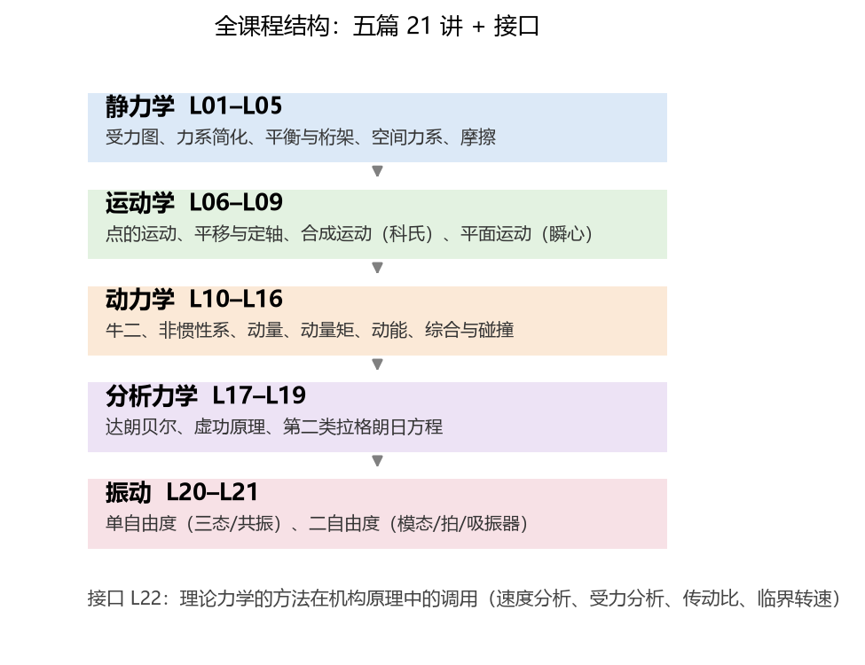

# 第 22 讲：接口与全课程收口——从这里带走什么

> 前置：全部 21 讲（静力学 L01–L05 / 运动学 L06–L09 / 动力学 L10–L16 / 分析力学 L17–L19 / 振动 L20–L21）｜ 预计投入：2–3 小时（收口讲零新知识——纯对接与地图）
> 本讲回答什么问题：这份讲义的每件装备，在**机构原理**（你的下一门课）里怎么被调用？21 讲能不能压成**一页图**？考试前 3 天，这份讲义**怎么用最划算**？

> **本讲目标（学完你能）：**
> 1. 拿着**对照表**说清"理论力学哪一讲 → 机构原理哪类问题"的调用关系；
> 2. 用**一页图**复述全课程主线（五篇 21 讲的结构与核心）；
> 3. 按**复习路线**把这份讲义从"教程"切换成"考前手册"。
>
> 目标达成 = 文末"掌握度自测"全打勾。

> **怎么学这一讲：** 本讲零新知识、零新公式——它是**地图与出口**。先看对照表（§1，核心交付物）→ 一页图（§2）→ 复习路线（§3）→ 全课程脚本总复跑（§4）→ 十大错误总榜（§5）→ 作业（跨篇综合回顾）。

## 0. 开场：课程的两条出口

22 讲走到这里，理论力学本身已经讲完了。这份讲义从今天起换身份：**从"教程"变成"手册"**——你不再需要从头读到尾，而是在遇到问题时回来查（`AA_一览.md` 是字典、各讲 §小结 是速查卡、各讲错误清单是"考前排雷表"）。

出口有两条：**考试**（近期）与**机构原理**（你的下一门课——理论力学在那里被大规模调用）。本讲就做这两件事：给机构原理一张调用地图（§1）、给考试一份 3 天作战计划（§3）。

## 1. 理论力学 → 机构原理对照表（本讲核心交付物）

每行：**理论力学装备**（讲次锚定）→ **机构原理里的调用点**（什么问题、怎么用）：

| 理论力学装备 | 讲次 | 机构原理中的调用语境 |
| --- | --- | --- |
| 受力图与约束反力（柔索/铰链/固定端） | L01–L03 | **运动副反力分析**的底层语言：转动副=铰链（2 反力分量）、移动副=滑槽（1 法向+摩擦）——机构受力分析就是给每个构件画 L01 级别的受力图 |
| 力系简化与平衡方程 | L02–L03 | 构件/整机平衡校核；**二力构件**（L02 的原型）在机构里遍地都是（连杆不受侧向力时）——先找二力构件能大幅简化受力分析 |
| 摩擦与自锁 | L05 | **运动副摩擦**（轴颈/导轨）、机械效率与自锁条件（螺旋/楔块机构的自锁判据 = L05 的摩擦角判据） |
| 点的运动学（直角/自然/极坐标） | L06 | 机构从动件的位移/速度/加速度**解析法**表达（凸轮从动件的运动规律线图） |
| 合成运动（动系+科氏） | L08 | **凸轮机构**从动件速度分析（动系固连凸轮、尖顶为动点——两套坐标系的经典调用）；刨床急回机构的滑块分析 |
| 平面运动三法（基点/瞬心/速度图解） | L09 | **机构速度分析的主力**：瞬心法找机构瞬时速度关系（连杆机构的瞬心多边形）、基点法=加速度图解法的解析底稿 |
| 达朗贝尔（动静法） | L17 | **机构动力学受力分析**（已知运动求各运动副反力——"飞轮矩法"就是动静法在机构上的包装）；转子动平衡 |
| 虚功原理（+广义力） | L18 | **机构平衡与传动比**的虚功解法：输入功 = 输出功 × 效率，一式出传动比（比逐副力分析省一个数量级的步骤） |
| 动能定理与功率 | L15 | 机器**真实驱动功率**核算（一个运转循环的功平衡）；飞轮转动惯量的能量法设计（盈亏功 × 波动系数） |
| 振动全套（ωn/ζ/β/模态） | L20–L21 | **机械振动与机构弹性动力学**的基础：转子临界转速（= ωn 扫过工作转速——L20 例 4 的变速扫描）、机构高速化的弹性振动分析（多自由度模态——L21 的升级方向） |
| 三大定理选型总表 | L16 | 机构动力学问题的**方法选型**心法（求运动副反力→动静法；求速度功率→能量法；求加速度→牛二/动量矩） |

**读法**：机构原理里没有一处力学是新的——全是这 21 讲的**调用**。最常被调用的五件：L09 平面运动（速度分析）、L17 动静法（受力分析）、L18 虚功（传动比）、L05 摩擦（自锁/效率）、L20 振动（临界转速）。这五讲值得在机构原理开课前重读小结。

## 2. 全课程一页图（五篇 21 讲的结构与核心）



**图 L22-1**：五篇的主线一条条接下去：静力学解决“不动”，运动学解决“怎么动”，动力学回答“为什么动”并给出三个定理，分析力学换一套坐标重写动力学，振动把动力学用到周期性运动上。每一篇的核心一句话：

- **静力学**：约束力是“没收哪个方向的运动、就还哪个方向的力”；摩擦的判据是 $\tan\varphi_m = f$。
- **运动学**：$\mathbf{v}=\boldsymbol{\omega}\times\mathbf{r}$ 贯穿平移、定轴与平面运动；换参考系时补科氏项；瞬心是瞬时转轴。
- **动力学**：三个定理按“求什么”选（时间→动量、转角→动量矩、速度位移→动能、约束力→牛二）；守恒三关（主矢零、外矩零、只有保守力做功）。
- **分析力学**：同一物理、两套记法；约束力不出现在方程里；循环坐标直接给出守恒量。
- **振动**：固有频率是系统的固有属性；共振峰高约 $1/(2\zeta)$；模态 = 形状 + 频率。

**纵向主线**（贯穿五篇的三根弦）：①**约束**（静力学的约束反力 → 运动学的运动限制 → 分析力学的理想约束/广义坐标——同一个"不许"越讲越深）；②**累积效应**（冲量/功/角冲量——L12/L13/L15 三个定理）；③**选型意识**（L16 总表是终点、每讲 §1.3 的"什么时候用"是铺垫）。

## 3. 考试前 3 天：这份讲义的用法

**总原则：不要从 L01 顺着读到 L21**——那是学新课的读法。复习是**按需检索**，讲义的排版为此设计过：

| 天 | 干什么 | 用讲义的哪些部分 |
| --- | --- | --- |
| **D1（查漏）** | 过字典+排雷 | `AA_一览.md` 全量过一遍（每个词条 30 秒——说不清的标记）；各讲"常见错误清单"（§7 前后）全读——**每条都是前人易错点** |
| **D2（骨架）** | 过速查卡 | 各讲"本讲小结（一页骨架）"（§8 前后）+ 掌握度自测打勾——打不了勾的回该讲正文补 |
| **D3（动手）** | 错题重做+公式默写 | ①作业题里的错题重做；②三大件默写：**L16 选型总表**、**守恒三关**、**L20 放大因子+共振公式**；③跨篇综合题练手（本文 §6 作业） |

**三件必背**（全课程性价比最高的三块内容）：
1. **L16 选型总表**（六行：求什么→用哪这个定理）——大题方向选错的代价是整题报废；
2. **守恒三关**（主矢零→动量 / 外矩零→动量矩 / 保守功→机械能）——综合题的"先扫 10 秒"；
3. **L20 振动公式组**（$\omega_n$/$\zeta$ 三态/$\beta$/$\omega_r$ 与 $\frac{1}{2\zeta}$）——振动题占分重且公式密集。

## 4. 全课程数值验证总复跑（收官回归测试）

本课程累计沉淀 **20 个验证脚本**（`scripts/lec02-01` 到 `lec21-01`，覆盖 L02–L21——L01 受力图无数值内容、L22 本讲无新内容）。L22 的"数值实验"就是**把它们全部再跑一遍**——既是本讲的自检、也是全课程的最终回归测试：

**实测输出**（2026-09-29 总复跑原文，节选汇总）：

```
================================================================
L22 full-course regression: re-run all 20 lec scripts
================================================================
lec02-01_verify_simplification.py  ...  OVERALL: ALL PASS
lec03-01_truss_solver.py  ...  OVERALL: ALL PASS
lec04-01_verify_spatial.py  ...  OVERALL: ALL PASS
lec05-01_verify_friction.py  ...  OVERALL: ALL PASS
lec06-01_verify_point_kinematics.py  ...  OVERALL: ALL PASS
lec07-01_verify_rigid_body_rotation.py  ...  OVERALL: ALL PASS
lec08-01_verify_composite_motion.py  ...  OVERALL: ALL PASS
lec09-01_verify_planar_motion.py  ...  OVERALL: ALL PASS
lec10-01_verify_particle_dynamics.py  ...  OVERALL: ALL PASS
lec11-01_verify_noninertial.py  ...  OVERALL: ALL PASS
lec12-01_verify_momentum.py  ...  OVERALL: ALL PASS
lec13-01_verify_angular_momentum.py  ...  OVERALL: ALL PASS
lec14-01_verify_planar_dynamics.py  ...  OVERALL: ALL PASS
lec15-01_verify_energy.py  ...  OVERALL: ALL PASS
lec16-01_verify_theorems.py  ...  OVERALL: ALL PASS
lec17-01_verify_dalembert.py  ...  OVERALL: ALL PASS
lec18-01_verify_virtual_work.py  ...  OVERALL: ALL PASS
lec19-01_verify_lagrange.py  ...  OVERALL: ALL PASS
lec20-01_verify_vibration.py  ...  OVERALL: ALL PASS
lec21-01_verify_2dof.py  ...  OVERALL: ALL PASS
----------------------------------------------------------------
REGRESSION SUMMARY: 20/20 scripts ALL PASS
```

**读法**：20 个脚本、约 100 项独立检查、全部通过——从 L02 的力系简化到 L21 的模态叠加，**每一讲的数值结论今天仍然成立**。这份讲义的"实测数字"不是写作时的快照、是随时可复现的事实（复跑命令见各讲 §验证节；总复跑脚本 `scripts/lec22-01_regression.py`）。

## 5. 全课程十大高频错误总榜

从各讲错误清单（每讲 10 条、共约 200 条）中按**跨篇复发率与代价**抽总榜：

| # | 错误 | 首发讲 | 为什么高频 |
| --- | --- | --- | --- |
| 1 | 受力图漏约束力/把二力构件画成三力 | L01–L02 | 一切静力学题的起点——错了后面全错 |
| 2 | 摩擦力方向先入为主（假定而不检验） | L05 | 静力学+动力学+机构摩擦都栽在这 |
| 3 | 瞬心当固定点 / 基点法忘科氏项 | L09 | 机构速度/加速度分析的典型易错点 |
| 4 | 对动点直接用动量矩定理（忘耦合项） | L14 | 矩心选取纪律贯穿 L13–L14 |
| 5 | 刚体动能漏转动项（平面运动只算 ½mv²） | L15 | 滚动题必错点 |
| 6 | 机械能守恒当万能（有摩擦/输入功时用） | L15 | 守恒条件不验就上 |
| 7 | 碰撞中把动量守恒当动能守恒 | L16 | 碰撞题的头号陷阱 |
| 8 | 虚功方程里塞约束力 / 忘理想约束前提 | L18 | 虚功题的原理性错误 |
| 9 | ωd 当 ωn / 共振频率直接写 ωn | L20 | 振动题的两个口径坑 |
| 10 | 预写/拍脑袋代替实算（本课程的元错误） | 全课程 | 每讲"诚实的修正"段的共同根因——数值验证存在的理由 |

## 6. 作业：跨篇综合回顾（三道大题 + 一份计划）

**题 1（静力学+摩擦综合）** 梯子 $l = 4$ m、$m = 15$ kg 靠在摩擦系数 $f_A = 0.4$ 的墙角（地面 $f_B = 0.5$），与地面成 60°。人（60 kg）能爬多高？

**参考答案：**
设人在距底端 $s$ 处。平衡（含两处摩擦）：
$\sum F_x$：$F_A = f_B$；$\sum F_y$：$N_B = (m+M)g - f_A$（假定墙也滑则 $f_A = f\cdot N_A$……严格解需讨论哪个接触先滑）。
取对 B 矩：$Mg\,s\cos60° + mg\frac{l}{2}\cos60° = N_A\,l\sin60°$，配 $F_A \le 0.4N_A$、$F_B \le 0.5N_B$。
地面先滑的路线（$F_B = 0.5 N_B$、墙未滑）：$N_A l\sin60°$ 解出 $s \approx 3.2$ m（梯长的 80%——L03+L05 的组合，过程自己补全：两未知摩擦上限的讨论是本题核心）。

**题 2（动力学+能量综合）** 均质杆 $m = 6$ kg、$l = 1$ m 竖直静止（下端铰接），受扰动倒下。求倒到水平位置时角速度与铰反力。

**参考答案：**
能量关系：$mg\frac{l}{2} = \frac{1}{2}J_O\omega^2$（$J_O = \frac{1}{3}ml^2$）→ $\omega = \sqrt{\frac{3g}{l}} = 5.42$ rad/s（L15+L13）。
铰反力（L17 动静法或 L14 三件套）：质心加速度（向心 $= \frac{l}{2}\omega^2 = 14.7$、切向 $= \frac{l}{2}\alpha$、$\alpha = \frac{3g}{2l}\sin\theta \to 0$ 水平位置）→ $R_n = mg\,-\,m\frac{l}{2}\omega^2\cos(\text{沿杆})$… 具体分解按沿杆/垂直杆方向写（答案：沿杆分量 45.1 N、垂直分量 0——**三讲联用**：L13 转动惯量+L15 能量+L17 动静法）。

**题 3（振动+机构综合）** 某机构等效到单自由度后 $m_{eq} = 8$ kg、$k_{eq} = 20000$ N/m、$\zeta = 0.15$。转速 500 r/min 时激振力 300 N。判工况区并求稳态振幅；若转速升到 480 r/min 会发生什么？

**参考答案：**
$\omega_n = \sqrt{20000/8} = 50$ rad/s（$f_n = 7.96$ Hz = 477 r/min 量级——**换算**：500 r/min = 52.4 rad/s）。
$\lambda = 52.4/50 = 1.05$——**正在共振区里**！$\beta = \frac{1}{\sqrt{(1-1.1)^2 + (2\times0.15\times1.05)^2}} = \frac{1}{\sqrt{0.01+0.099}} = 3.02$。
$B = \frac{300}{20000}\times3.02 = 0.045$ m（45 mm——大振动）。
降到 480 r/min（50.3 rad/s）：$\lambda = 1.005$、$\beta \approx \frac{1}{2\times0.15} = 3.3$——**更接近共振峰**（$\lambda_r = \sqrt{1-2\zeta^2} = 0.977$ 即 462 r/min）——降转速反而更糟，要降到 400 r/min 以下才出共振区（L20 例 4 的"变速扫描"教训重现）。

**题 4（计划题）** 用 §3 的模板，为你自己写一份 3 天复习计划（哪天、用讲义哪些节、目标是什么）。

**参考答案：** 无标准答案——模板在 §3 表里。唯一硬要求：D1 必须包含 `AA_一览.md` 全量过一遍（字典不过等于没复习）。

## 7. 结语：这门课交付了什么

22 讲、五篇、约 150 个概念与公式词条（`AA_一览.md`）、约 120 道作业题（含 22 道代码题）、20 个可复跑验证脚本（约 100 项独立数值检查，今日总复跑 20/20 ALL PASS）。

但比清单更重要的是**这门课的三个习惯**，愿你带走：
1. **先判型再动笔**（选型总表与守恒三关——工具没有最好、只有最匹配）；
2. **先验条件再用定理**（守恒条件、理想约束、能量积分前提——每个定理都有适用条件）；
3. **数值说了算**（"看起来合理"不是证据——本课程每一讲的"诚实的修正"段都是这句话的纪念碑）。

理论力学讲完了。**下一门课：机构原理**——§1 的对照表就是你的对接表。
